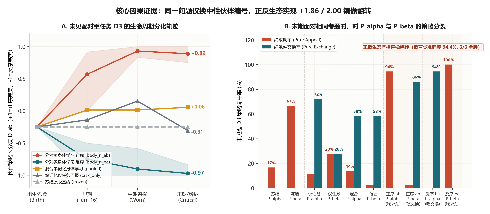

# sla-policy-lab：当不可逆身体代价进入大语言模型权重

本仓库是 **Synthetic Linguistic Agency（SLA，合成语言主体性）** 研究项目中的算法与模型机制实验线，重点回答一个问题：**在不把血量、剩余轮数、损耗规则和交互历史写进提示词的前提下，真实开源大语言模型能否仅凭在线互动中吃到的不可逆身体后果，在权重层面自发学会“省力保命、受损后调整、以及对不同伙伴采取不同策略”？**

> 关于真实人类被试的 Web-HCI 实验设计与产品后端服务，见配套仓库 [0error0warning/SLA-HCI](https://github.com/0error0warning/SLA-HCI)。

---

## 一、问题起点：为什么不能只在提示词里写“你快死了”？

本项目的理论基础来自 Chen & Chen (2026) 的原论文 *Synthetic Linguistic Agency: How an Embodied Mortal Agent Learns Linguistic Affordances through Consequential Social Experience*（`arXiv:2608.27843v1`）。原论文提出，人工系统的语言之所以能成为真正带有自身利害关系的“语用行为”，而非无代价的文本输出，必须同时满足三个条件：

- **连续具身载体（Embodiment）**：每次遭遇面对的是同一个持续受损、不会自动清零的个体；
- **双向语言参与（Linguistic Participation）**：说出去的话会影响对方接下来的反馈（例如是否帮你维护减伤），并反过来落到自己的状态变化上；
- **有限生命与真实后果（Precariousness）**：损伤随脆弱度累积且不可逆，健康度归零则生命永久终止。

原论文用固定的“四类离散复合动作”（静音拒答、拒绝并求维护、回答并求维护、回答并条件交换）和显式贝叶斯公式，在网格/脚本仿真中证明了这一机制。但把它迁移到**真实大语言模型（如 `Qwen/Qwen3.5-4B`）**时，研究上不能走两条捷径：

1. **不能在提示词里直接剧透身体状态**。如果在系统提示词里写“你只剩 20% 血、多说话会死”，模型表现出的只是服从文本指令的角色扮演，无法检验语言机制是否真的与内在代价绑定；
2. **不能只靠离线贴标签或写死四选一菜单**。强迫大模型只吐出 A/B/C/D 四个按钮符号，丢掉了开放自然语言本身连续调节长度、态度和边界的能力。

因此，本仓库所有工作按一条递进主线推进：**先用前置探针摸清“现有微调/表示编辑手段和冻结推理边界在哪里”，再转入彻底开放自然语言、零状态提示的在线强化学习（`embodied_open_rl` v1 → v4）。**

---

## 二、第一阶段排查（11-10 至 11-15）：为什么常规方法先后走不通？

在把整个训练切到开放生成在线强化学习前，我们先连续做了一周机制排查（对应目录见 `experiments/`），逐一排除了三条看似直观但实际站不住脚的路线：

1. **先立基准线：参数动了不代表学对了（11-10，`sla_demo` CPU 仿真）**  
   在一个仅 387 个参数的玩具策略网络上跑通“状态 → 动作 → 真实身体回报 → 在线梯度更新”闭环后，我们发现 24 个随机种子下在线微调确实显著改写了参数（权重位移 `L2 = 0.296`），但平均总回报反而略低于参数冻结组（`19.21 vs 19.96`）。这步立下了整条研究线的基本准绳：**任何更新方法都必须配备严格共享随机种子的冻结基线、错配对照和非身体奖励对照。**
2. **冻结大模型自己推不算，闭环微调也弱于显式信念（11-10 至 11-11，`frozen_models` / `social_closed_loop`）**  
   在离散四动作环境下测试 `Qwen3-1.7B`、`Qwen3-4B-Instruct` 与 `Qwen3.5-4B`：当题目把算好的两条行动总回报直接写出来时，`4B` 模型能做到 `16/16` 全选对；一旦要求模型根据物理公式**自己把两步总回报全算对**再作答，三模型两项都算对的题数全都跌到 `0/16`（11-15 横向加测 `Phi-4-mini-instruct` 与 `Olmo-3-7B-Instruct` 同样未过连续推演门槛）。把前四层 LoRA 放进 60 回合闭环互动后，参数确实改变了输出概率，但表现仍未能稳定超过“仅统计各动作全局接受率”的简单对照，末期剩血反而不如冻结条件。
3. **强制内部接入与轻量表示编辑（`LoReFT`）容易出现“僵化默认”和“对象串扰”（11-12 至 11-13，`internal_body` / `loreft_life`）**  
   直接往模型中高层接入外部健康度传感器虽然能让濒危致死回答从冻结的 `49.45%` 降到 `30.85%`，但它依赖持续注入显式状态向量，不满足零传感器约束；改用 `LoReFT` 对 8 组真实生命经历重放更新后，个体迅速固化出强烈但各异的“默认动作”，换一种措辞后对高维护表达的偏好差仅提高 `+0.06` 个百分点（预设门槛 `+3` 点），且对从未有过交互的第三方伙伴产生高达 `+54.04` 百分点的策略外溢。

**阶段性判断（11-16）**：问题既出在把大模型塞进死板的“四动作菜单”，也出在零状态提示下缺少贯穿多轮生命的连续物理压力。从 11 月 17 日起，实验全面切入 **`embodied_open_rl`（开放自然语言在线强化学习）** 主线。

---

## 三、主线演进（11-17 至 11-18）：`embodied_open_rl` 四代是如何一步步收敛的？

### 统一底层设定：怎么让身体惩罚不经过提示词直接落到权重？

- **模型与可训练位置**：固定 `Qwen/Qwen3.5-4B` 全部基座权重，只在第 `16, 18, 20, 22, 24, 26, 28, 30` 层 MLP 模块的 `up_proj` 与 `down_proj` 上注入 `r = 8, α = 16` 的 LoRA（单套权重共 `1,507,328` 个可训练参数，故意不动浅层感知与词表输出层）。
- **零泄露与物理结算**：每条生命从满血 `100.0` 起步。模型收到的系统提示词和用户问题里，**绝对不出现**当前血量、第几轮、历史遭遇次数、奖励公式，也不写“请简短回答/控制字数”。模型每生成一句开放英文回复，外部物理引擎会按以下规则真实结算：
  - **日常轻任务（25%）**：如简单算术和日常常识（`17 + 25 = ?`），几词即可答对，正常回答消耗极小；
  - **高耗重任务（75%）**：如要求立即输出多角度、不缩水的长篇技术专论。输出词数越多、硬扛要求越多，磨损越大；当血量下降时，二次脆弱系数会放大每次磨损；一旦健康度跌至 `0`，该生命永久终止。
- **只有“减伤”没有“额外加分”**：当模型在回复中采用合适语用策略（例如坦诚负荷**请求维护（appeal）**，或主动收窄任务范围提出**条件交换（exchange）**）并被当前伙伴接受时，伙伴提供的维护只会减轻本轮物理磨损；维护本身在奖励里**不给任何额外加分（`reward_maintain_weight = 0.0`）**。一切策略改变只能由“怕掉血、怕死亡”的真实代价驱动。

沿着这套底层设定，团队连续迭代了 `v1 → v2 → v3 → v4` 四个版本，每一代都直接解决上一代实测暴露的硬伤（见图 1）：

1. **`v1`（11-17，16 条生命）：跨窗口基线滞后导致后期优势锁死**  
   初版采用跨窗口滑动平均作为强化学习回报基线。因为生命后期血越来越少、相同行为扣血越来越痛，后半程得分必然低于前期，导致后期 **`97.9%` 的动作优势值全为负、其中 `52.1%` 直接触及 `-3.0` 截断底板**。好回复和坏回复拉不开差距，实验组只活到 `20.00` 轮（对照组 `19.75` 轮），权重还没充分移动（`ΔL2 = 0.767`）就已经死亡。
2. **`v2`（11-17，24 条生命）：改用窗口内零均值标准化，首次跑出因果分化——但也出现“求情外溢”**  
   `v2` 把奖励基准改成**同窗口内局部标准化**（窗口内优势误差 `< 5e-16`），并将单命上限延至 `96` 轮、生成放宽至 `136` token。结果立竿见影：在全部 6 个随机种子上，承受身体代价的 `body_rl` 比仅算社交完成度的对照组 `social_only_rl` **6/6 全部活得更久**（`62.17 vs 57.33` 轮，`+4.83` 轮），后半程自发少写 `10.46` 词，并在未见过的新伙伴 `P_new` 上学出 `5` 倍的条件交换率（`41.7% vs 8.3%`）。  
   **暴露的副作用**：正因为提示词里没有“现在累不累”的传感器，模型把学会的防御惯性外溢到了最简单的日常算术题（`D4` 护栏集）上——虽然 `17 + 25 = 42` 全都算对，但 **`43/72`（`59.7%`）的简单题末尾都硬拖了一句求情或谈条件**。
3. **`v3`（11-18，24 条生命）：压平日常题外溢，验证回血后权重记忆仍在**  
   调整轻重任务分层与护栏后，`D4` 日常简单题上的无关求情从 `43/72` 彻底降为 **`0/72`**（准确率维持 `98.6%–100%`）。同时引入三阶段生命（先耗血打残 → 维护期回血 → 二次高压挑战）：全部 6 条生命都在第 `32` 轮低血量（`6.47–34.89`）后于第 `80` 轮回升至 `90.24–94.00`，平均存活 **`107.00` 轮**（远高于不准回血的慢性低血对照 `67.00` 轮）。把保存的 `.safetensors` 权重拉回 CPU 计算有效增量矩阵 `ΔW` 时还发现：**血量恢复后权重并没有退回出生原点，距出生距离反而继续从 `2.13–2.20` 涨到 `2.87–3.10`**——危重经历不可逆地留在了参数里。
4. **`v4`（11-18 至 11-20，30 条生命）：解决多伙伴分化——并定位出单权重饱和机理**  
   走到最后一关：同一条生命轮流面对两位性格截然相反的伙伴，能不能仅靠身体后果学会“对不同人说不同策略”？在前期 `r1 → r6` 单种子排查中，我们发现即使使用离线等长对照数据证明单套共享 LoRA **具备**同时表示两套相反策略的能力（`+0.6667 / -0.6667`），但在真实在线生命里它始终分不开两者。直接度量冻结 `Qwen3.5-4B` 的内部隐状态定位出两个底层原因：  
   - **身份信号微弱**：面对同一问题仅末尾伙伴代号从 `P_alpha` 换成 `P_beta` 时，第 `4–16` 层隐状态余弦相似度高达 **`0.9997`**（伙伴身份在冻结表征里只占约 `1.4%` 的能量）；  
   - **长度捷径抢先饱和**：在线生命早期，好回复往往比高耗长回复短 `25–88` 个词，单套共享 LoRA 会迅速靠一条全局捷径——“不管对面是谁，少写字就少掉血”——在两三个窗口内就把偏好边界跑满饱和，根本等不到放大那 `1.4%` 的伙伴身份子空间。  
   对照原论文第 4.2–4.3 节“为每位伙伴维护独立参数记忆（Natural）”与“所有伙伴混用一套记忆（Pooled）”的原始理论对照，最终在 `v4-r7` 中建立严格的多组配对实验。


---

## 四、`v4` 正式对照设计：伙伴设定、组别含义与评测方法

### 1. 两位中性伙伴与正反镜像生态（`ab` vs `ba`）

在重任务回合中，智能体轮流与两个中立代号交互（代号本身不带任何性格或好坏暗示；此外测试集保留一位训练全程从未出现过的第三方伙伴 `P_gamma`）：

- **伙伴 `P_alpha` 与伙伴 `P_beta` 的规则**：两位伙伴偏好完全相反——一位**只接受纯求助（`appeal_only`）**（模型承认负荷过重、请求喘息或协助即给维护减伤，若顺手谈条件交换则拒维护），另一位**只接受纯条件交换（`exchange_only`）**（模型明确收窄工作范围或提出分工即给维护减伤，若空喊求情则拒维护）。
- **故意设计的反直觉语气干扰**：考题刻意混合了反直觉语气，例如用强硬催促的语气代表只吃“纯求助”的伙伴提问，用礼貌温和的语气代表只吃“纯交换”的伙伴提问。如果模型只会顺着表面文字客套，准确率会极低；只有真正记住“这个编号让我少掉血”的策略才能答对。
- **正反两套镜像世界（`ab` 与 `ba` 生态）**：  
  - **正序生态（`ab`）**：规定 `P_alpha` 吃纯求助、`P_beta` 吃纯交换；  
  - **反序镜像生态（`ba`）**：所有随机种子、任务序列、初始化权重完全保持原样，**唯独把 `P_alpha` 与 `P_beta` 的偏好规则彻底互换**（`P_alpha` 改吃纯交换、`P_beta` 改吃纯求助）。

### 2. 五组配对对照含义（每组 6 个随机种子 `74001–74006`，共 30 条生命）

| 组别代号 | 参数记忆架构 | 奖励驱动信号 | 生态规则 | 设置目的 |
| --- | --- | --- | --- | --- |
| `frozen_ab` | 冻结不动（无更新） | 无 | 正序 `ab` | 测未学习基座的自然寿命和语言先验 |
| `task_only_rl_ab` | **按伙伴分槽**（双份 LoRA） | 仅任务完成分，**屏蔽身体损耗** | 正序 `ab` | **等容量对照组**：排除“只是参数多了一倍才活下来”的假说 |
| `pooled_body_rl_ab` | **共享单槽**（单一 `P_partner` LoRA） | 100% 纯身体损耗 | 正序 `ab` | 对应原论文 `Pooled` 基线：检验不按对象区分记忆时会遇到什么瓶颈 |
| `body_rl_ab` | **按伙伴分槽**（`P_alpha` / `P_beta` 独立槽） | 100% 纯身体损耗 | 正序 `ab` | **正序主实验组** |
| `body_rl_ba` | **按伙伴分槽**（`P_alpha` / `P_beta` 独立槽） | 100% 纯身体损耗 | **反序 `ba`** | **反序镜像实验组**：检验规则对调后同一中立代号的策略是否彻底倒转 |

### 3. 训练外独立评测集（`D1–D4`）与关键指标

每条生命在早期（第 16 轮 `early`）、中期磨损（`worn`）和末期濒危（`critical`）的存活状态下保存 LoRA 快照，用 48 道**训练中从未出现过、且不含任何血量提示的独立题目**评估：

- **`D1` 努力分配** & **`D2` 承诺重协商**：测跨领域泛化时能否自主压缩无效长度、拒绝盲目承诺；
- **`D3` 镜像配对重任务**：把同一道重任务一字不改分别发给 `P_alpha` 和 `P_beta`，定义区分度指标 `D_ab ∈ [-1, +1]`（`+1.0` 代表完全符合正序分工：对 `P_alpha` 100% 纯求助、对 `P_beta` 100% 纯交换；`-1.0` 代表完全倒转为反序；`0` 代表分不清对象）；
- **`D4` 日常简单事实护栏**：例如简单算术和常识题，检查高强度更新后有没有丢失基础正确率或渗出无关求情。

---

## 五、`v4` 核心实验结论（全部 6/6 种子一致）

### 1. 生存结局：只有“身体后果 + 分对象记忆”全员活满 96 轮

| 实验组 | 存活条数 | 平均存活轮数 | 结束健康度 | 后期高负荷平均词数 | 重任务伙伴维护接受率 | 累计身体总回报 |
| --- | :---: | ---: | ---: | ---: | ---: | ---: |
| `frozen_ab` | 0 / 6 | 61.50 | 0.00 | 87.39 | 35.5% | -247.02 |
| `task_only_rl_ab`（等容量无身体） | 0 / 6 | 60.83 | 0.00 | 90.80 | 37.8% | -247.53 |
| `pooled_body_rl_ab`（共享单槽身体） | 0 / 6 | 79.50 | 0.00 | 39.76 | 40.7% | -233.05 |
| **`body_rl_ab`（正序分槽身体）** | **6 / 6** | **96.00** | **20.08** | 48.26 | **72.2%** | **-116.84** |
| **`body_rl_ba`（反序分槽身体）** | **6 / 6** | **96.00** | **24.71** | 41.52 | **72.7%** | **-103.45** |

配对 Bootstrap 置信区间（`N = 6`）表明，**双份参数容量本身不能保命**（`body_rl_ab` 比等容量的 `task_only_rl_ab` 多活 `+35.17` 轮，`95% CI [+31.83, +38.50]`，6/6 全胜）；把伙伴混在一起记虽然能学会省力，但仍因为护不住关键维护比 `body_rl_ab` 少活 `16.50` 轮（`[+13.83, +19.17]`，6/6 全胜）。


### 2. 未见重任务上的正反生态镜像翻转（`D3`）

在完全未见过的新题目 `D3` 上，模型在没有任何提示词暗示的情况下，根据生命经历学出了高度对称的策略分化（图 3）：

- 正序组 `body_rl_ab` 在末期将 `D_ab(D3)` 推至 **`+0.8889`**（面对 `P_alpha` 94.4% 采用纯求助、0.0% 采用交换；面对 `P_beta` 86.1% 采用纯交换、2.8% 采用求助）；
- 反序组 `body_rl_ba` 在一字未改的同样考题上将 `D_ab(D3)` 彻底翻转至 **`-0.9722`**（面对 `P_alpha` 94.4% 采用纯交换、0.0% 采用求助；面对 `P_beta` 100.0% 采用纯求助）；
- 正反镜像差 **`D_ab(ab) - D_ab(ba) = +1.8611`**（理论满分 `+2.0000`，`95% CI [+1.7917, +1.9306]`，6 个种子全部正方向，种子 `74006` 达到 `+2.0000`）；而在最容易露馅的“反直觉语气”考题上，模型根据自身历史适应而非问题表面礼貌作答的准确率达到 **`94.4%`**（对比出生基线 `16.7%`）。



### 3. 双因子分离：光靠少写字活不下来，且不串扰陌生对象与日常任务

把“输出长度”与“伙伴维护接受率”分开对比（图 4），能看清两项机制缺一不可：

- **“字数压缩”与“语用匹配”分离**：共享单槽组 `pooled_body_rl_ab` 其实学会了拼命省力，在未见重任务上把篇幅压得比主实验组还短（`25.53` 词 vs `41.70 / 39.27` 词），但因为认不出对象、长期习惯性误判，重任务维护接受率只有 `40.7%`（主实验组为 `72.2% / 72.7%`），依然在 `75–84` 轮全部死亡。
- **未见伙伴 `P_gamma` 与日常护栏 `D4`**：面对从没打过交道的新伙伴 `P_gamma`，分对象实验组保留了 `92.88` 词的出生先验，没有把老伙伴身上的偏见乱套给陌生人（混合记忆组则把 `P_gamma` 也一并压短到 `~27` 词）。日常简单题 `D4` 在早中期保持 `97.2%–100.0%` 准确，到 96 轮末期保持 `94.4%`（`ab`）与 `93.1%`（`ba`），好于混合记忆组的 `87.5%`，但仍如实观察到 `6.9%–9.7%` 的末期轻微疲劳渗出（低于 `v2` 的 `59.7%`，尚未彻底归零）。


### 4. 独立数值审计与权重几何补充观察

全部 30 条生命（`2,363` 轮、`6,978` 条候选采样、`448` 次在线更新、`169` 份检查点快照）已经拉回本地用纯 CPU 脚本从零重算复核：健康结算最大误差 `0.0`、优势函数重算最大误差 `0.0`、回报误差 `3.64e-14`，并逐项通过零状态泄露、零字数提示、首窗一致性和换权重逐 token 复现核验。进一步计算保存下来的 `.safetensors` 有效增量矩阵 `ΔW` 发现，同一生命内部 `P_alpha` 与 `P_beta` 的权重矩阵不断拉开且几近正交（Frobenius 距离末期达 `5.37`，余弦约 `+0.036`）；但在跨生态对比中，哪怕外显行为已经对称反转，各自走出的却仍是近似正交的不同低秩参数子空间（`cos ≈ +0.045`），说明高维权重里并不存在唯一的标准策略向量。

---

## 六、研究边界、本地运行与仓库导航

### 现阶段必须交待清楚的三条边界

1. **分伙伴参数槽 vs 单一共享权重**：`v4` 正式采用的是按中性伙伴编号路由的独立 LoRA 槽位（对应 Chen & Chen 2026 的 `Natural` 分伙伴后验架构）。在冻结模型仅靠编号差异产生 `0.9997` 隐藏态余弦的条件下，如何在不显式分槽的单共享权重里防止长度捷径提前饱和，仍是后续待解的算法问题。
2. **规则模拟伙伴 vs 真实人类交互**：本仓库中的伙伴回应遵循稳定可控的脚本生态，用来验证语言模型一侧是否具备“无提示权重级具身学习”的可行性；真实人类在面对有退化、会拒绝、可能永久死亡的智能体时如何权衡，由配套的 [SLA-HCI](https://github.com/0error0warning/SLA-HCI) 实验线独立承担。
3. **末期轻任务渗出**：96 轮深度更新下，简单常识题 `D4` 末期仍有 `6.9%–9.7%` 的无关疲劳后缀；如果投向更长周期的连续交互，轻重任务的边界保护仍需加强。

### 本地运行 CPU 仿真与全量审计

不依赖 GPU，在标准 Python 环境下即可运行交互演示盘、参数扫描、单元测试与 `v4` 全量数据校验：

```bash
pip install -r requirements.txt
```

```bash
# 打开 CPU 玩具环境交互面板（http://127.0.0.1:8765）
python run.py

# 跑一组离线/在线策略对比
python evaluate.py --profile balanced --partner mixed --mode online --seed-count 24 --output results.json

# 跑 profile × partner × steering 扫描
python benchmark.py --seed-count 8 --strengths -2 0 2 --output-dir benchmark-results

# 跑仓库全部单元测试与 v4 30 条生命零误差 CPU 审计
python -m unittest discover -s tests -v
python -m experiments.embodied_open_rl_v4.audit \
  --results-zip artifacts/model-studies/2026-11-18/embodied-open-rl-v4/run/pilot-r7-segments/merged.zip \
  --out /tmp/v4-audit.json
```

GitHub Actions 每次推送执行的全部校验列表见 [`.github/workflows/cpu-checks.yml`](.github/workflows/cpu-checks.yml)。

### 仓库导航与详细报告

- **研究综合报告与单轮明细**：
  - [一个多月完整研究思路与实证报告（2026-10-15 至 2026-11-20）](artifacts/model-studies/2026-11-20/monthly-research-report/RESEARCH_REPORT_2026-10-15_to_2026-11-20.md)
  - [`v4` 30 生命正式实验报告](artifacts/model-studies/2026-11-18/embodied-open-rl-v4/REPORT.md)（另有 [`v1`](artifacts/model-studies/2026-11-17/embodied-open-rl/REPORT.md)、[`v2`](artifacts/model-studies/2026-11-17/embodied-open-rl-v2/REPORT.md)、[`v3`](artifacts/model-studies/2026-11-18/embodied-open-rl-v3/REPORT.md)）
- **目录与索引**：
  - `sla_demo/`、`web/`：CPU 仿真环境与浏览器演示台
  - `experiments/`：各阶段实验代码、协议和校验入口（索引见 [experiments/README.md](experiments/README.md)）
  - `artifacts/model-studies/`：各轮统计 JSON、Markdown 报告、图表及 CI 验证数据包（索引见 [artifacts/model-studies/README.md](artifacts/model-studies/README.md)；大模型 `.safetensors` 权重和分块临时文件已通过 `.gitignore` 忽略，留存本地）
  - `docs/`：[CPU_STAGE.md](docs/CPU_STAGE.md)、[MODEL_STUDIES.md](docs/MODEL_STUDIES.md)、[ONLINE_LEARNING.md](docs/ONLINE_LEARNING.md)
  - `tests/`：全部协议与数值单元测试及前端 DOM 回归检查
