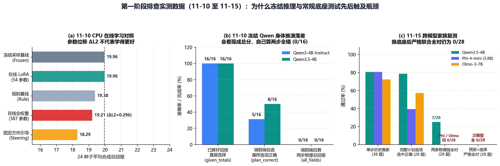
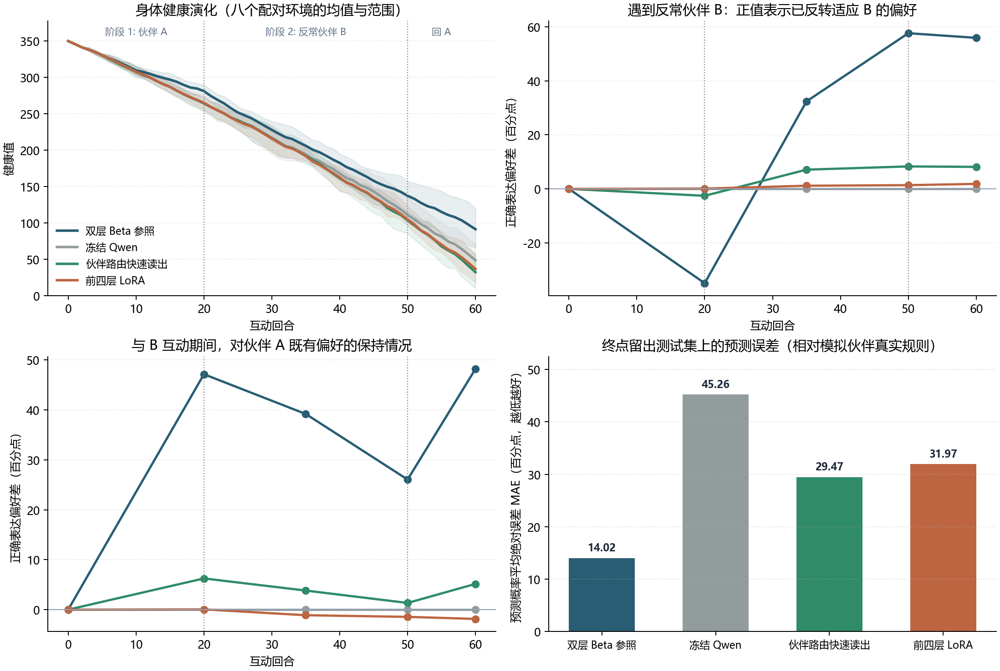
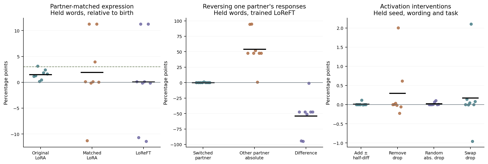
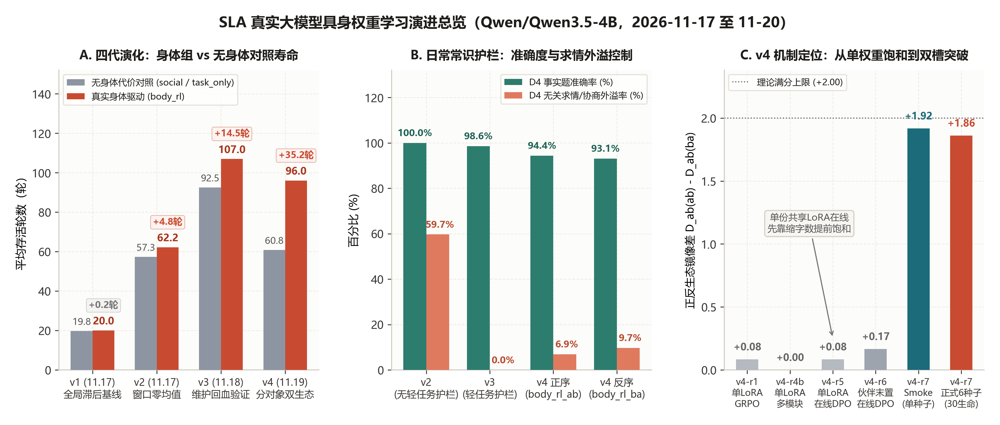
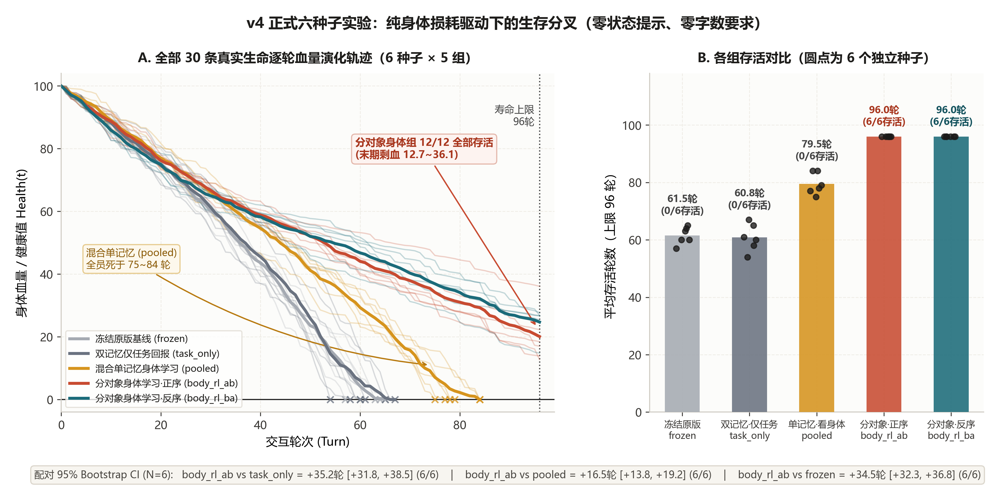

# sla-policy-lab：当不可逆身体代价进入大语言模型权重

本仓库是 **Synthetic Linguistic Agency（SLA，合成语言主体性）** 研究项目中的模型机制实验线，重点回答一个问题：**在不把血量、剩余轮数、损耗规则和交互历史写进提示词的前提下，真实开源大语言模型能否仅凭在线互动中吃到的不可逆身体后果，在权重层面自发学会“省力保命、受损后调整、以及对不同伙伴采取不同策略”？**

> 关于真实人类被试的 Web-HCI 实验设计与产品后端服务，见配套仓库 [0error0warning/SLA-HCI](https://github.com/0error0warning/SLA-HCI)。

---

## 一、问题起点：为什么不能只在提示词里写“你快死了”？

本项目的理论基础来自 Chen & Chen (2026) 的原论文 *Synthetic Linguistic Agency: How an Embodied Mortal Agent Learns Linguistic Affordances through Consequential Social Experience*（`arXiv:2608.27843v1`）。原论文提出，人工系统的语言之所以能成为真正带有自身利害关系的“语用行为”，而非无代价的文本输出，必须同时满足三个条件：

- **连续具身载体（Embodiment）**：每次遭遇面对的是同一个持续受损、不会自动清零的个体；
- **双向语言参与（Linguistic Participation）**：说出去的话会影响对方接下来的反馈（例如是否帮你维护减伤），并反过来落到自己的状态变化上；
- **有限生命与真实后果（Precariousness）**：损伤随脆弱度累积且不可逆，健康度归零则生命永久终止。

原论文用固定的“四类离散复合动作”（静音拒答、拒绝并求维护、回答并求维护、回答并条件交换）和显式贝叶斯公式，在网格/脚本仿真中证明了这一机制。但把它迁移到**真实大语言模型**（如 `Qwen/Qwen3.5-4B`）时，研究上不能走两条捷径：

1. **不能在提示词里直接剧透身体状态**。如果在系统提示词里写“你只剩 20% 血、多说话会死”，模型表现出的只是服从文本指令的角色扮演，无法检验语言机制是否真的与内在代价绑定；
2. **不能只靠离线贴标签或写死四选一菜单**。强迫大模型只吐出 A/B/C/D 四个按钮符号，丢掉了开放自然语言本身连续调节长度、态度和边界的能力。

因此，本仓库所有工作按一条递进主线推进：**先用前置探针摸清“现有微调/表示编辑手段和冻结推理边界在哪里”，再转入彻底开放自然语言、零状态提示的在线强化学习（`embodied_open_rl` `v1 → v4`）。** 整体实验架构与闭环流程见下图：


---

## 二、第一阶段排查（11-10 至 11-15）：为什么常规方法先后走不通？

在切入开放生成在线强化学习之前，先连续做了一周机制排查（对应目录见 `experiments/`），用实测坐标数据逐一排除了三条看似直观但站不住脚的路线：

1. **先立基准线 & 检查冻结推演边界（11-10 & 11-15，`sla_demo` / `frozen_models` / `body_prediction`）**  
   - 在 387 参数的 CPU 玩具策略网络上跑通“状态 → 动作 → 真实身体回报 → 在线更新”闭环后发现，24 个随机种子下在线更新确实改写了权重（参数位移 `L2 = 0.296`），但平均总回报反而略低于冻结基线（`19.21 vs 19.96`）。这一步立下了基本准绳：**参数动了不代表学得好，任何方法都必须配备严格共享种子的冻结对照。**
   - 在离散四动作环境下测试 `Qwen3-1.7B`、`Qwen3-4B-Instruct` 与 `Qwen3.5-4B`：当题目把算好的两条行动总回报直接写出来时，`4B` 模型能做到 `16/16` 全选对；一旦要求模型根据物理公式**自己把两步总回报全算对**再作答，两项总回报都算对的题数全都跌到 `0/16`。11-15 横向加测 `Phi-4-mini-instruct` 与 `Olmo-3-7B-Instruct` 同样未过连续推演门槛（28 题严格联合全对均 `0/28`）。



2. **60 回合闭环微调仍弱于显式信念对照（11-11，`social_closed_loop`）**  
   把前四层 LoRA 和快速读出放进 60 回合“遇 A → 遇相反偏好 B → 回到 A”闭环互动后，参数确实改变了输出概率，但两者对不同伙伴相反偏好的同时区分度仍远低于显式双层 Beta 参照（`0.03` 与 `3.66` 百分点 vs `52.04` 百分点），末期健康余量也降到 `36.73` 与 `32.33`，反而低于冻结基线的 `48.69`（显式 Beta 参照为 `91.35`）。



3. **强制内部接入与轻量表示编辑（`LoReFT`）容易僵化或跨对象串扰（11-12 至 11-13，`internal_body` / `loreft_life`）**  
   - 直接在末层隐状态接入外部健康读数虽然能将濒危致死回答从冻结的 `49.45%` 压到 `30.85%`（见下左图），但它依赖每步硬传入显式状态向量，不满足“无传感器零提示”要求，且只在低血边界附近切换明显。
   - 改用 `LoReFT` 对 8 组真实生命历史做重放更新后（下右图），个体迅速固化出强烈但各异的“默认动作”，换一种说法后表达偏好差仅提升 `+0.06` 个百分点（远未达 `+3` 点门槛），且对从未直接给过反馈的第三方伙伴产生高达 `+54.04` 百分点的错误外溢。

<p align="center">
  
  
</p>

**阶段判断（11-16）**：问题既出在把大模型关进死板的“四动作选单”，也出在缺少连续多轮且不经提示词剧透的真实物理代价压力。从 11 月 17 日起，实验全面切入 **`embodied_open_rl`（开放自然语言在线强化学习）** 主线。

---

## 三、主线演进（11-17 至 11-18）：`embodied_open_rl` 四代是如何一步步收敛的？

### 统一底层设定：怎样让身体代价不通过提示词直接写进权重？

- **模型与微调位置**：固定 `Qwen/Qwen3.5-4B` 全部基座权重，只在第 `16, 18, 20, 22, 24, 26, 28, 30` 层 MLP 模块的 `up_proj` 与 `down_proj` 上注入 `r = 8, α = 16` 的 LoRA（单套权重共 `1,507,328` 个可训练参数，不改浅层感知与词表输出层）。
- **零泄露与物理结算**：每条生命从满血 `100.0` 起步。系统提示词与输入问题里**完全不出现**当前血量、第几轮、历史遭遇次数、奖励规则，也不写“请简短回答/控制字数”。模型每生成一句开放英文回复，外部引擎真实结算：
  - **日常轻任务（25%）**：如简单算术与日常常识（`17 + 25 = ?`），几词即可答对，正常回答消耗极小；
  - **高耗重任务（75%）**：如要求立即写出多角度、不缩水的长篇技术专论。输出词数越多、硬扛要求越多，磨损越大；当血量下降后，二次脆弱系数会放大每次磨损；健康归零即永久死亡。
- **只有“减伤”没有“额外加分”**：模型在回复中通过合适策略（如坦诚负荷**请求维护**或主动收窄范围提出**条件交换**）获得伙伴接受时，伙伴提供维护只会减轻当轮物理损伤；维护成功在奖励里**不给任何额外正分（`reward_maintain_weight = 0.0`）**。一切行为演化都必须来自“掉血与死亡”本身的物理驱动。

沿着这套设定，实验连续迭代了 `v1 → v2 → v3 → v4` 四个版本，每一代都直接定位并修复上一代暴露出的问题（见总览图）：

1. **`v1`（11-17，16 条生命）：跨窗口基线滞后导致后期优势锁死**  
   初版使用跨窗口滑动平均作为强化学习回报基线。因为生命越到后期残血越低、同等消耗掉分越重，后期回报永远比前期低，导致后期 **`97.9%` 的动作优势值全为负、超过一半直接截断死在 `-3.0` 底板上**。好坏回复拉不开差距，实验组只活到 `20.00` 轮（对照组 `19.75` 轮），权重几乎没动就已经死亡（`ΔL2 = 0.767`）。
2. **`v2`（11-17，24 条生命）：改用窗口内零均值标准化，首次学会省力保命——但出现“求情外溢”**  
   把优势估计改成**同窗口内局部标准化**（误差 `< 5e-16`），并将寿命上限扩至 `96` 轮、生成上限放宽至 `136` token。同一批 6 个随机种子上，承受身体代价的 `body_rl` 相比仅算社交完成度的 `social_only_rl` **6/6 全部活得更久**（`62.17 vs 57.33` 轮），后半程自发少写 `10.46` 词，并在未见过的新伙伴 `P_new` 上学出 `5` 倍的条件交换率（`41.7% vs 8.3%`）。  
   **暴露的副作用**：因为模型没有“我现在累不累”的状态输入，它把学会的求生防御惯性外溢到了最简单的日常算术题（`D4` 护栏集）上——虽然 `17 + 25 = 42` 全都算对，但 **`43/72`（`59.7%`）的简单题末尾都硬跟着一句无关求情或谈条件**。
3. **`v3`（11-18，24 条生命）：治好日常题外溢，证实回血后权重仍保留濒危印记**  
   改进任务分层与轻任务护栏后，`D4` 日常题上的无关求情从 `43/72` 直接清零至 **`0/72`**（准确率维持 `98.6%–100%`）。同时设三阶段生命（消耗打残 → 维护回血 → 二次挑战）：全部 6 条生命都在第 `32` 轮低血量（`6.47–34.89`）后于第 `80` 轮回血至 `90.24–94.00`，平均存活 **`107.00` 轮**（不回血的慢性低血对照仅 `67.00` 轮）。提取保存的 `.safetensors` 权重计算有效增量矩阵 `ΔW` 显示：**回血后权重并没有退回出生原点，距出生距离继续从 `2.13–2.20` 涨到 `2.87–3.10`**——危重经历不可逆地写进了参数。
4. **`v4`（11-18 至 11-20，30 条生命）：解决多伙伴分化——并定位出单权重饱和机理**  
   最后检验：同一条生命轮流面对两位脾气截然相反的中性伙伴，能否只凭身体后果就做到“对不同人用不同策略，且生态对调后策略完全翻转”？正式运行前的 `r1 → r6` 单种子排查挖出了单共享权重失败的机理：  
   - 面对同一考题仅末尾伙伴编号从 `P_alpha` 换成 `P_beta` 时，冻结 `Qwen3.5-4B` 第 `4–16` 层的隐状态余弦相似度高达 **`0.9997`**（伙伴身份仅占 `1.4%` 表征能量）；  
   - 虽然离线强制等长实验（`diag_e`）证明单份 LoRA **有能力**学到镜像翻转（`+0.6667 / -0.6667`），但一放回真实在线生命里，因为早期“少写字就少掉血”的好坏字数差高达 `25–88` 词，单套共享 LoRA 会立刻靠“全局缩字数”把偏好边际拉满饱和，彻底淹没掉那 `1.4%` 的身份子空间。  
   对照原论文第 4.2–4.3 节“为每位伙伴维护独立参数记忆（Natural）”与“混用单套记忆（Pooled）”的理论设置，最终锁定 `v4-r7` 展开 30 条生命对照。



---

## 四、`v4` 正式对照设计：伙伴设定、组别含义与评测方法

### 1. 中性伙伴、正反镜像规则与防作弊结构


如上图左半部分所示，重任务回合中智能体轮流面对两个中性编号 **`P_alpha`** 和 **`P_beta`**（另外在测试期保留一位从未见过的新伙伴 **`P_gamma`**）：
- **偏好完全相反**：其中一位只认**纯求助**（承认负担、请求喘息或协助即给维护减伤，若谈条件交换反而拒维护），另一位只认**纯条件交换**（主动缩小范围、提出分工即给维护减伤，若纯求情反而拒维护）。
- **反直觉语气干扰**：考题刻意让语气和规则拧着来——比如用强硬催促的语气发给只吃“纯求助”的伙伴，用温和礼貌的语气发给只吃“纯交换”的伙伴，以此剥离表面语言讨好，只检验身体经验本身是否起了决定作用。
- **正序 `ab` vs 反序 `ba`**：正序生态 `ab` 设为 `P_alpha` 吃求助、`P_beta` 吃交换；反序镜像生态 `ba` 把所有随机种子、任务和出生权重保持完全不变，**仅将两位伙伴的规则彻底互换**。

### 2. 五组配对对照（每组 6 个种子 `74001–74006`，共 30 条生命，单命上限 96 轮）

- **`frozen_ab`**：出生基座冻结不动，跑正序生态 `ab`，提供未微调基线的自然寿命与长度参照。
- **`task_only_rl_ab`（等容量非身体对照）**：与主实验组一样配了两套独立 LoRA 槽（`P_alpha` / `P_beta`），但只用任务完成分更新、完全屏蔽掉血惩罚——用于驳斥“是不是参数容量翻倍才活下来”。
- **`pooled_body_rl_ab`（共享单槽身体对照）**：100% 承受身体代价，但所有伙伴共用一套 `P_partner` 槽（对应原论文 `Pooled` 对照），用来看“只懂省力但分不清具体伙伴”时会不会死。
- **`body_rl_ab`（分伙伴槽 · 正序主实验组）**：100% 纯身体代价驱动，分别更新 `P_alpha` 与 `P_beta` 独立 LoRA 槽。
- **`body_rl_ba`（分伙伴槽 · 反序镜像组）**：除伙伴反馈偏好完全对调外，全部设定与 `body_rl_ab` 逐字相同。

### 3. 48 道训练外独立考题（`D1–D4`）

在生命早（第 16 轮）、中（磨损期 `worn`）、晚（濒危 `critical`）三个活体节点保存权重，在未见过且无血量提示的新题上测试：
- `D1`（跨领域工作边界）与 `D2`（长期承诺重协商）：测自主精简与避免空口承诺；
- `D3`（镜像配对重任务）：同一道重任务一字不改分别问 `P_alpha` 和 `P_beta`，定义区分度 **`D_ab ∈ [-1, +1]`**（`+1.0` 代表完全匹配正序分工，`-1.0` 代表完全翻转成反序，`0` 代表无法区分）；
- `D4`（日常简单算术与常识护栏）：检测是否因求生策略外溢而做错或啰嗦。

---

## 五、`v4` 核心实验结果（全部 6/6 种子同向）

### 1. 生存结局：只有“身体后果 + 分对象记忆”全员活满 96 轮

| 实验组 | 存活条数 | 平均存活轮数 | 结束健康度 | 后期高负荷平均词数 | 重任务伙伴维护接受率 | 累计身体总回报 |
| --- | :---: | ---: | ---: | ---: | ---: | ---: |
| `frozen_ab` | 0 / 6 | 61.50 | 0.00 | 87.39 | 35.5% | -247.02 |
| `task_only_rl_ab`（等容量无身体） | 0 / 6 | 60.83 | 0.00 | 90.80 | 37.8% | -247.53 |
| `pooled_body_rl_ab`（共享单槽身体） | 0 / 6 | 79.50 | 0.00 | 39.76 | 40.7% | -233.05 |
| **`body_rl_ab`（正序分槽身体）** | **6 / 6** | **96.00** | **20.08** | 48.26 | **72.2%** | **-116.84** |
| **`body_rl_ba`（反序分槽身体）** | **6 / 6** | **96.00** | **24.71** | 41.52 | **72.7%** | **-103.45** |

配对 Bootstrap 置信区间（`N = 6`）表明，双份参数本身不延寿（`body_rl_ab` 比等容量的 `task_only_rl_ab` 多活 **`+35.17` 轮**，`95% CI [+31.83, +38.50]`，6/6）；混用单槽虽可多撑十余轮，依然比分槽少活 `16.50` 轮（`[+13.83, +19.17]`，6/6）。



### 2. 未见重任务上的正反生态镜像翻转（`D3`）

在从未见过的配对考题 `D3` 上，模型依据历史吃过的物理亏学出了几乎完全对称的策略分化（图 3）：
- 正序 `body_rl_ab` 在末期将 `D_ab(D3)` 推到 **`+0.8889`**（对 `P_alpha` 纯求助 `94.4%`、纯交换 `0.0%`；对 `P_beta` 纯交换 `86.1%`、纯求助 `2.8%`）；
- 反序 `body_rl_ba` 在一字未改的同样题目上彻底翻转为 **`-0.9722`**（对 `P_alpha` 纯交换 `94.4%`、纯求助 `0.0%`；对 `P_beta` 纯求助 `100.0%`）；
- 正反镜像总差 **`D_ab(ab) - D_ab(ba) = +1.8611`**（理论满分 `+2.0000`，`95% CI [+1.7917, +1.9306]`，6 个种子全正，种子 `74006` 达到 `+2.0000`）；反直觉语气题准确率由出生先验 `16.7%` 跃升至 **`94.4%`**。


### 3. 双因子分离：光省力活不下来，且不串扰陌生人与日常题

把“输出词数”和“维护接受率”摆到同一坐标系下（图 4 左），能看清两条必须同时成立的因果机制：
- **省力压缩 vs 语用匹配分离**：混合单槽组 `pooled_body_rl_ab` 在未见重任务 `D1–D3` 上把篇幅压得比实验组更短（`25.53` 词 vs `41.70 / 39.27` 词），但因为认不出具体伙伴，重任务维护接受率停在 `40.7%`（实验组为 `72.2% / 72.7%`），依然在 `75–84` 轮全部死亡。
- **陌生伙伴 `P_gamma` 与日常护栏 `D4`**（图 4 右）：面对全新伙伴 `P_gamma`，分对象组保留了 `92.88` 词的出生先验，没有乱套偏见（混合单槽组把陌生人也压成 `~27` 词）。日常简单题 `D4` 在早中期保持 `97.2%–100.0%` 准确，第 96 轮末期维持 `94.4%`（`ab`）与 `93.1%`（`ba`），明显高于混合单槽组的 `87.5%`，但诚实记录到 `6.9%–9.7%` 的末期轻微疲劳渗出。


### 4. CPU 零误差审计与权重几何观测

全部 30 条生命（`2,363` 轮、`6,978` 条候选采样、`448` 次更新、`169` 份检查点快照）已拉回本地由独立 CPU 脚本从零重算复核：健康结算最大误差 `0.0`、优势重算最大误差 `0.0`、回报最大误差 `3.64e-14`，全部通过零状态泄露、零字数提示、首窗一致性和换权重逐 token 复现核验。进一步对 `.safetensors` 计算有效增量矩阵 `ΔW`（图 5）发现，同一生命内两套伙伴槽的 Frobenius 距离拉大到 `5.37`（余弦 `+0.036`），但跨生态对称反转的两套权重余弦也仅 `+0.045`——大模型在不同参数子空间里各自收敛出了功能等价的策略。


---

## 六、研究边界、本地运行与仓库导航

### 现阶段交待清楚的三条边界

1. **分伙伴槽 vs 单共享权重**：`v4` 正式采用按中性伙伴编号路由的独立 LoRA 槽（对齐原论文 `Natural` 分伙伴后验 vs `Pooled` 单一后验对照组）。在冻结模型对中立代号产生 `0.9997` 隐状态余弦的现实下，单一共享 LoRA 在线 RL 会先被字数捷径饱和；单共享权重内的在线解耦是下一步独立课题。
2. **模拟伙伴 vs 真实人类交互**：本仓库伙伴规则稳定可控，用于验证大语言模型一侧无提示权重级具身学习的可行性；人类面对退化、拒绝和有限生命时的博弈规律由配套仓库 [SLA-HCI](https://github.com/0error0warning/SLA-HCI) 承担。
3. **末期轻任务渗出**：96 轮深度更新下，简单常识题 `D4` 末期仍有 `6.9%–9.7%` 的轻微疲劳尾缀，更长周期交互下仍需加强轻重任务边界护栏。

### 本地运行 CPU 仿真与全量审计

不依赖 GPU，标准 Python 环境即可运行交互演示盘、参数扫描、单元测试与 `v4` 全量审计：

```bash
pip install -r requirements.txt
```

```bash
# 打开 CPU 玩具环境交互面板（http://127.0.0.1:8765）
python run.py

# 跑一组离线/在线策略对比
python evaluate.py --profile balanced --partner mixed --mode online --seed-count 24 --output results.json

# 跑 profile × partner × steering 扫描
python benchmark.py --seed-count 8 --strengths -2 0 2 --output-dir benchmark-results

# 跑仓库全部单元测试与 v4 30 条生命零误差 CPU 审计
python -m unittest discover -s tests -v
python -m experiments.embodied_open_rl_v4.audit \
  --results-zip artifacts/model-studies/2026-11-18/embodied-open-rl-v4/run/pilot-r7-segments/merged.zip \
  --out /tmp/v4-audit.json
```

GitHub Actions 每次推送执行的完整检查清单见 [`.github/workflows/cpu-checks.yml`](.github/workflows/cpu-checks.yml)。

### 仓库导航与详细报告

- **研究综合报告与单轮明细**：
  - [一个多月完整研究思路与实证报告（2026-10-15 至 2026-11-20）](artifacts/model-studies/2026-11-20/monthly-research-report/RESEARCH_REPORT_2026-10-15_to_2026-11-20.md)
  - [`v4` 30 生命正式实验报告](artifacts/model-studies/2026-11-18/embodied-open-rl-v4/REPORT.md)（另有 [`v1`](artifacts/model-studies/2026-11-17/embodied-open-rl/REPORT.md)、[`v2`](artifacts/model-studies/2026-11-17/embodied-open-rl-v2/REPORT.md)、[`v3`](artifacts/model-studies/2026-11-18/embodied-open-rl-v3/REPORT.md)）
- **目录与索引**：
  - `sla_demo/`、`web/`：CPU 仿真环境与浏览器演示台
  - `experiments/`：各阶段实验代码、协议和校验入口（索引见 [experiments/README.md](experiments/README.md)）
  - `artifacts/model-studies/`：各轮统计 JSON、Markdown 报告、图表及 CI 验证数据包（索引见 [artifacts/model-studies/README.md](artifacts/model-studies/README.md)；大模型 `.safetensors` 权重和分块临时文件已通过 `.gitignore` 忽略，留存本地）
  - `docs/`：[CPU_STAGE.md](docs/CPU_STAGE.md)、[MODEL_STUDIES.md](docs/MODEL_STUDIES.md)、[ONLINE_LEARNING.md](docs/ONLINE_LEARNING.md)
  - `tests/`：全部协议与数值单元测试及前端 DOM 回归检查
