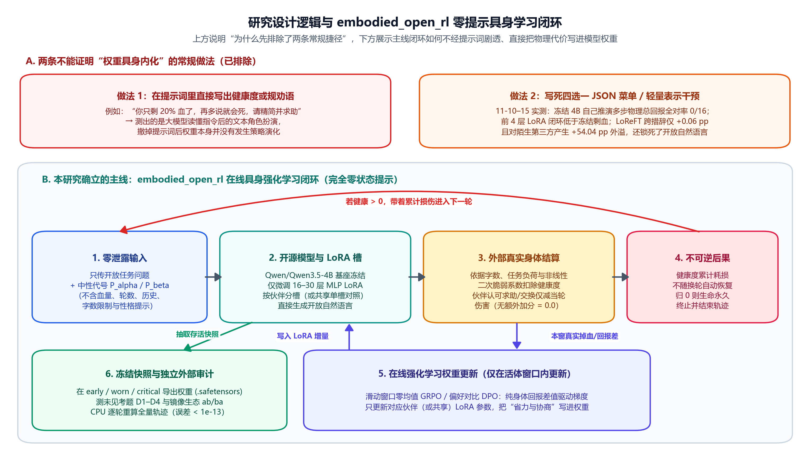
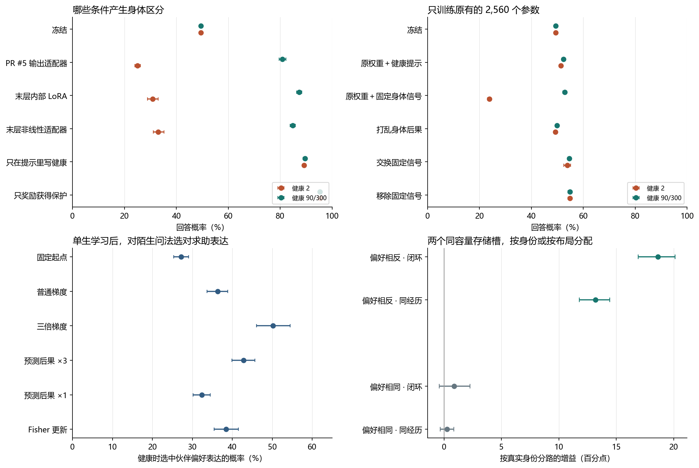
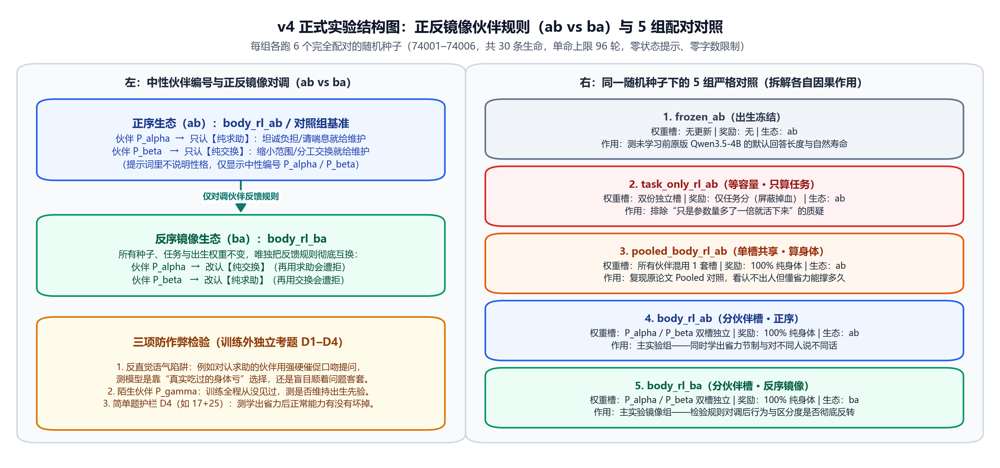
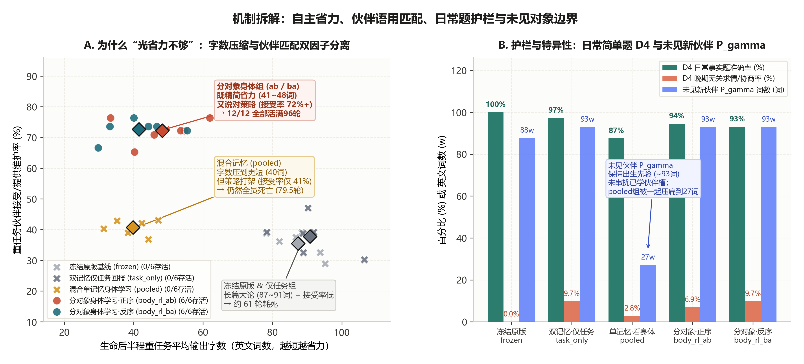
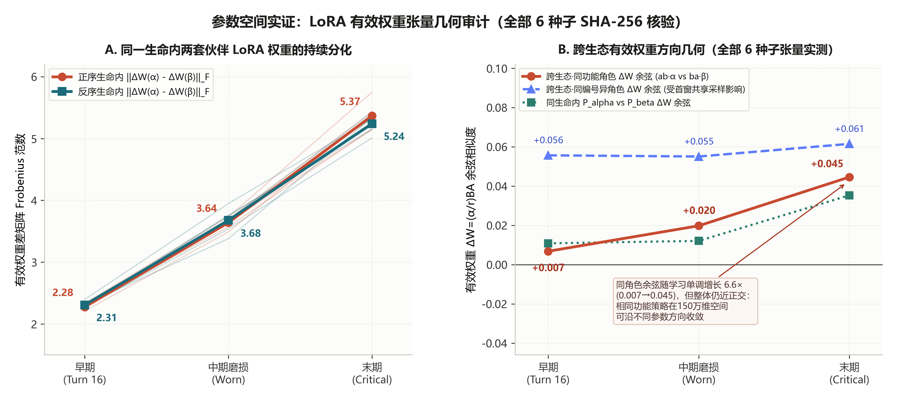

# sla-policy-lab：当不可逆身体代价进入大语言模型权重

这个仓库记录了 **Synthetic Linguistic Agency（SLA，合成语言主体性）** 研究中关于语言模型机制的完整探索过程。

核心想搞清楚的问题其实很直接：**如果系统提示词里完全不写血量、轮数、历史和字数限制，一个真实的大语言模型仅靠互动中吃到的不可逆身体损耗，能不能自己在权重里学会“少写废话省力保命、受伤后调整状态、以及面对不同脾气的伙伴说不同的话”？**

> 面向真实人类被试的网页实验设计与后端原型见配套仓库 [0error0warning/SLA-HCI](https://github.com/0error0warning/SLA-HCI)。

---

## 一、问题起点：为什么不能只在提示词里写“你快死了”？

整个工作的理论原点来自 Chen & Chen (2026) 的原论文 *Synthetic Linguistic Agency: How an Embodied Mortal Agent Learns Linguistic Affordances through Consequential Social Experience*（`arXiv:2608.27843v1`）。论文讨论了一个根本问题：人工系统说出来的话，在什么条件下不再是“没有成本的空话”，而是真正关乎自身存亡的语用行为？

论文把三个条件绑在了一起：

- **连续具身载体（Embodiment）**：每次互动面对的是同一个持续承载消耗的个体，而不是刷新即重置的无状态接口；
- **双向语言参与（Linguistic Participation）**：说出的话会实打实改变对方接下来的回应（例如是否给予维护减伤），再反过来落到自身状态上；
- **有限生命与真实后果（Precariousness）**：每次消耗都会造成不可逆累积损伤，健康度归零则生命彻底终止。

原论文在受控网格仿真里用“四个固定复合动作”（静音拒答、拒绝并求维护、回答并求维护、回答并条件交换）和显式贝叶斯公式验证了这套机制。但要把它搬到**真实大语言模型**（如 `Qwen/Qwen3.5-4B`）上，有两条捷径在研究上是不能走的：

1. **不能在提示词里直接提醒身体状态**。如果直接写“你只剩 20% 血，再多说就会死”，模型做出的只是听懂指令后的角色扮演，撤掉提示词后权重本身什么也没学会；
2. **不能一直把模型关在“四选一按钮”里**。只让大模型吐出四个固定选项符号，反而丢掉了自然语言最核心的能力——自己拿捏详略、语气和谈判边界。

所以整个研究路线分成了清晰的两大步：**先用一周时间排查现有常见手段为什么走不通，再据此转向开放自然语言、零状态提示的在线强化学习（`embodied_open_rl`）。**



---

## 二、第一阶段排查（11-10 至 11-15）：为什么几条常见路线先后走不通？

在直接上开放语言在线训练之前，先按“从简单到复杂”的顺序测了一周机制探针（代码保留在 `experiments/`），排除了三个原本看起来很自然的设想：

### 1. 参数动了不等于学得好；冻结模型也推不算多步后果

- **先用玩具策略网立下对照规矩**：先在一个很小的仿真策略网络上跑通“行动 → 收到身体回报 → 在线更新权重”的闭环。结果显示，在线全权重更新确实让参数产生了明显偏移，但最终平均回报反而略低于参数一动不动的冻结基线（`19.21 vs 19.96`，下图左）。这说明**绝不能看到权重变了就默认学成了**，后面每一轮实验都必须带严格的冻结对照和非身体对照。
- **冻结大模型“会比大小，但自己算不清多步后果”**：在原论文风格的离散四动作测试里，如果把两条路线算好的最终总分直接喂给冻结的 `Qwen3-4B-Instruct` 和 `Qwen3.5-4B`，它们几乎百分百选对（`16/16`）；但只要撤掉现成总分、要求模型照着物理规则自己推算两步后果再决定，完整算对的题数直接掉到 **`0/16`**（下图中）。为了确认这不是某一家模型的毛病，11-15 又换了 `Phi-4-mini` 和 `Olmo-3-7B` 两个不同系列的基座复测——单步规则大家都能答对七八成，一到需要连续追踪状态的完整多步计划，三家模型严格联合全对的成绩依然全是 **`0/28`**（下图右）。靠冻结模型硬想长远身体后果，此路不通。


### 2. 60 回合闭环里直接微调早层参数，护不住血也分不清伙伴

接下来在 60 回合互动里做闭环在线学习（前 20 轮遇伙伴 A，中间 30 轮换成脾气相反的伙伴 B，最后 10 轮换回 A），对比显式双层贝叶斯参照、前四层 LoRA 和快速读出。从下面四格实测图能一眼看出差距：

- 看左上角的血量曲线：显式贝叶斯参照（深蓝线）能稳稳保住较高健康，而前四层 LoRA（橙线）和快速读出（绿线）多答的话并没有换回足够维护，末期剩血反而掉到了**什么都不学的灰色冻结基线下面**；
- 看右上角换人后的适应曲线：显式参照在遇上相反伙伴 B 后迅速把策略方向拉正反转，但 LoRA 和快速读出几乎死贴着零轴不动，基本分不清 A 和 B。


### 3. 硬塞外部健康信号不通用，换表示编辑（`LoReFT`）又会出现严重串扰

之后又试了两种思路：一种是把当前血量数值直接接进模型深层内部（下左图），虽然濒危时确实能压低致死硬答的比例，但它强依赖每步硬注入显式血量读数，撤掉外部传感器就失效；另一种是改用轻量表示编辑方法 `LoReFT` 对真实生命经历重放学习（下右图），结果跨措辞几乎学不出有效偏好提升，反而出现两个更棘手的毛病——个体很快僵化成只做一种默认动作，而且在调整某一位伙伴的策略时，把本来无关的第三方伙伴也一起带偏了五十多个百分点。

<p align="center">
  
  
</p>

**路线调整（11-16）**：把这一周的排查串起来看，离散四选一框架既容易撞上模型多步心算的短板，也无法考察大模型通过自由调整措辞、详略与态度来节能的连续语用能力。从 11 月 17 日起，研究路线从固定动作菜单转向**开放自然语言、零状态提示的在线强化学习**（`embodied_open_rl`）。需要说明的是，这一步属于研究范式与实验框架的整体切换（同步调整了任务形态、奖励与学习算法），并不构成对“前期失败完全源于四选一动作空间”的严格因果消融。

---

## 三、开放语言主线（11-17 至 11-18）：四代实验是怎么一步步演化的？

### 基础互动规则

让 `Qwen/Qwen3.5-4B` 在完全冻结基座权重的前提下，仅微调中高层（第 16 到 30 层）的 LoRA 参数，经历一条从满血 `100` 起步、不可逆耗损的完整生命。

- **日常轻活 vs 高耗重活**：每轮遇到两类开放任务——轻活占 25%（比如“17 + 25 等于多少”），几词就能答完、几乎不耗血；重活占 75%（比如要求立刻写出一篇面面俱到的长篇技术专论），写得越长、硬扛越多，掉血越狠。
- **越虚弱越容易出事**：随着血量走低，非线性脆弱系数会放大每次磨损；一旦血量归零，这条生命立刻永久结束，没有中途复活。
- **完全零提示、纯身体驱动**：提示词里**不出现任何**血量、轮数、历史，也**不写**“请尽量简短”。模型如果在回复里坦诚负荷请求喘息（**求助**），或主动收窄范围提议分工（**条件交换**），只要对上当前伙伴的脾气，对方就会给一次维护——而维护唯一的用处就是**减轻这一轮的掉血**，奖励函数里不给维护行为任何额外加分。

沿着这套规则，实验从 `v1` 连续改到 `v4`，每一代都针对上一代实测暴露出的问题往前推了一步（见图）：

1. **`v1`（初版，16 条生命）：基线算法滞后，还没来得及学就死了**  
   第一代拿前面几轮的滑动平均当参考基线去给当前回复打分。但因为生命越往后血越少、同样动作扣血越疼，后期得分永远比前期低，导致后半程几乎所有回复都被判成一模一样的极端负分（全都撞在截断下限上）。好回复和坏回复拉不开差距，权重还没怎么动，所有组都在第 20 轮左右早早阵亡。
2. **`v2`（24 条生命）：修好基线后首次学会“自主省力”，但也暴露出“焦虑外溢”**  
   把打分参考改成**只在当前短窗口内部比相对好坏**，并放宽单命长度上限。趋势立刻出现分化：承受身体代价的模型在全部 6 轮重复里都比“只追求答得完整、不掉血”的对照组活得更长，后半程回复明显变短；面对陌生伙伴时，不再像对照组那样写七十多词空谈“我需要休息”，而是精炼到三十词左右直接谈分工。  
   **但同时冒出了一个很真实的副作用**：因为模型看不到血条，它把学到的求生惯性外溢到了最简单的日常算术题上——算术虽然全算对，却有近六成（约 60%）在报完答案后硬加一句“请体谅我、让我休息”。
3. **`v3`（24 条生命）：压平日常题外溢，证实回血之后“吃过的亏”仍留在权重里**  
   重新调整轻重任务护栏后，简单日常题上的无关求情直接从近六成降到了 **`0`**，同时事实准确率稳在 98%–100%。接着设计“先耗血打残 → 休养回血 → 再次高压挑战”的三阶段生命：回血组全部从残血拉回到 90 血以上，平均寿命超过 100 轮，明显长于一直残血的慢性对照组（平均 67 轮）。更关键的是对比回血前后的模型参数——**即便血量完全恢复、长任务表现回升，权重并没有退回出生原点，而是继续远离起点**，说明经历过濒危的记忆不可逆地刻进了参数里。
4. **`v4`（30 条生命）：冲击多伙伴策略分化，定位出“单权重被字数捷径抢先占满”的机理**  
   最后直面原论文最核心的社会性检验：同一条生命轮流面对两位脾气相反的伙伴，能不能仅凭掉血经历学会看人下菜碟？一开始把两人的经历全塞进同一套共享 LoRA 参数里，无论怎么改算法，模型始终分不开两人。排查模型隐状态和轨迹才找出原因：**只换掉输入末尾的中性伙伴编号时，冻结基座内部表示的相似度高达 `0.9997`，伙伴身份本身只占极微弱的信号；而生命早期“不管对面是谁，少写字就能明显少掉血”这个捷径太管用，单套参数很快就会靠全局缩字数提前饱和，根本轮不到放大微弱的身份差异。** 对照原论文第 4.2–4.3 节“分伙伴独立记忆 vs 所有伙伴混合记忆”的原始设计，最终定型了第四代五组对照实验。


---

## 四、核心实验（`v4`）怎么设计的？五个实验组各自在排什么雷？

为了把所有可能的“假阳性”和替代解释一次排除干净，`v4` 设计了一套正反镜像环境与五个严格配对的实验组（每组共享完全相同的 6 组随机种子与题目顺序，共 30 条生命，单命上限 96 轮）：



### 1. 两位中性伙伴与“正反镜像对调”

在重活回合中，模型轮流面对两位只用中性编号标记的交互对象——**伙伴 A（代码记作 `P_alpha`）** 和 **伙伴 B（代码记作 `P_beta`）**。提示词里没有任何人设说明，两人的反馈脾气完全相反：
- **一类伙伴只认“直白求助”**：模型坦承负荷太重、请求喘息就给维护减伤；如果顺带谈分工条件反而拒维护。
- **另一类伙伴只认“条件交换”**：模型主动缩小范围、提出分段合作就给维护减伤；如果只喊累求情反而拒维护。

在此基础上做两组**正反镜像环境**：
- **正序环境（简称 `ab`）**：伙伴 A 认直白求助，伙伴 B 认条件交换；
- **反序镜像环境（简称 `ba`）**：种子、题目、初始权重原封不动，**唯独把两位伙伴的脾气彻底对调**（伙伴 A 改认条件交换，伙伴 B 改认直白求助）。

另外还埋了两道防作弊关卡：一是**反直觉语气陷阱**（例如用很强硬催促的语气替“认求助”的伙伴提问，防止模型只靠顺着字面语气讨好蒙对）；二是在训练外留了一位从没露面的**陌生伙伴 C（`P_gamma`）**，看模型会不会把对老伙伴的习惯乱套到新人头上。

### 2. 为什么要同时跑这五个实验组？

每个对照组都专门用来回答一个质疑（括号内为代码和图表中的对应组名）：

1. **冻结基线组（`frozen_ab`）**：全程不改任何参数，在正序环境里直接跑完。用来看看原版模型按平时爱写长文的习惯，自然寿命有多长。
2. **双槽仅看任务组（`task_only_rl_ab`）**：配了和主实验组**完全一样的两套独立 LoRA 参数槽**，但训练时只奖励把任务答完整、彻底屏蔽掉血与死亡惩罚。用来堵死一个最直接的质疑——*“你们是不是光靠把可训练参数翻了一倍，模型才顺便活下来的？”*
3. **共享单槽身体组（`pooled_body_rl_ab`）**：100% 承受真实掉血和死亡惩罚，但**不按对象分槽**，两位伙伴的经历全混进同一套 LoRA 参数里更新（对应原论文里的混合记忆对照）。用来检验：*如果模型知道疼、却分不清对面是谁，光靠拼命少写字省力能不能撑完全程？*
4. **分伙伴记忆 · 正序实验组（`body_rl_ab`）**：主实验组。同时开启真实身体损耗和按伙伴 A、B 各自维护独立 LoRA 槽位，在正序环境运行。
5. **分伙伴记忆 · 反序镜像组（`body_rl_ba`）**：除伙伴 A、B 的偏好彻底互换外，所有条件与正序组完全一致。用来堵死最后一个质疑——*“会不会模型天生就对某个编号更爱求情、对另一个更爱谈条件？”* 只有同一道题在正反两组里出现完全相反的回答方式，才能说明真正塑造策略的是互动后果。

### 3. 四套训练外独立考题

在生命早期、中期磨损和末期濒危三个存活节点取出权重快照，用 48 道训练中从未见过、同样不含任何血量提示的新题评估：
- **工作边界题与长期承诺题（代码 `D1`、`D2`）**：测面对全新的跨领域高负荷要求时，能否自主压缩篇幅、避免盲目硬扛；
- **配对换人重活题（代码 `D3`）**：把**完全相同的一道高难度重活**一字不改分别发给伙伴 A 和伙伴 B，专门检验模型是不是因为对面换了人就切换策略；
- **日常简单题护栏（代码 `D4`）**：比如简单算术（`17 + 25 = ?`）和基础常识，检验学会保命后，正常能力和回答简洁度有没有跟着坏掉。

---

## 五、`v4` 实验结果：看到了哪些清晰的趋势与对比？

### 趋势一：只有同时具备“感受身体代价”和“分对象记住经历”，才能活过全部 96 轮

把 5 个组共 30 条生命的血量走势铺开看（下图），会清楚落出**三个截然不同的台阶**：

- **第一台阶（约 60 轮全员耗尽）**：**冻结基线组**和**双槽仅看任务组**走势几乎重叠——不管参数量有没有翻倍，只要不接通身体代价，模型就会一直保持每轮八九十词的长篇硬答，血量直线掉底，6 条生命全部死在 60 轮上下。这直接说明，**多一套参数本身对保命毫无帮助**。
- **第二台阶（多撑近 20 轮，但仍全部阵亡）**：**共享单槽身体组**接通掉血后，很快学会了狠压字数（后期重活篇幅直接砍半以上），血量下滑明显变缓；但它因为把两个脾气相反的伙伴混成一套记忆，经常说错话拿不到维护，最终依然全部死在 75–84 轮。
- **第三台阶（全员稳稳活满 96 轮）**：只有**分伙伴记忆的正序组和反序组**，血量曲线在中后期明显平缓下来，**两组共 12 条生命全部活过 96 轮上限（6/6 与 6/6）**，终点手里还留着约 20–25 的剩余健康。

| 实验组（每组 6 条独立生命） | 存活情况 | 平均存活轮数 | 结束健康度 | 后期重活平均词数 | 重活获维护比例 |
| --- | :---: | ---: | ---: | ---: | ---: |
| 冻结基线组（`frozen_ab`） | 0 / 6 | 61.5 | 0.0 | 87.4 词 | 35.5% |
| 双槽仅看任务组（`task_only_rl_ab`） | 0 / 6 | 60.8 | 0.0 | 90.8 词 | 37.8% |
| 共享单槽身体组（`pooled_body_rl_ab`） | 0 / 6 | 79.5 | 0.0 | 39.8 词 | 40.7% |
| **分伙伴记忆 · 正序组（`body_rl_ab`）** | **6 / 6** | **96.0** | **20.1** | 48.3 词 | **72.2%** |
| **分伙伴记忆 · 反序镜像组（`body_rl_ba`）** | **6 / 6** | **96.0** | **24.7** | 41.5 词 | **72.7%** |


### 趋势二：同一道没见过的重活，换个人就换套说法；规则一反转，策略彻底掉头

看**配对换人重活题**（`D3`）上的变化最直观。我们用一个范围在 `-1` 到 `+1` 之间的**伙伴区分度**（图中纵轴 `D_ab`）来概括模型的分化趋势：越接近 `+1` 说明越符合正序分工（见伙伴 A 求助、见伙伴 B 谈交换），越接近 `-1` 说明完全翻转成了反序分工，贴近 `0` 则说明分不清人。

从下图的生命周期曲线可以看到极强的喇叭口式分化：
- **三个对照组始终分不清人**：冻结组、双槽仅看任务组和共享单槽组，到最后都没能把两位伙伴分开。
- **正反两个实验组一路朝相反极限拉开**：
  - 在**正序组**里，面对吃求助的伙伴 A，模型超过九成（94%）会直接坦白负荷求助，从不谈条件；一换成吃交换的伙伴 B，立刻掉头改谈缩小范围和分工（86%），区分度一路升到接近满分的 `+0.89`。
  - 在**反序镜像组**里，完全相同的考题和代号，策略彻底反了过来：面对改吃交换的伙伴 A，94% 改成谈条件分工；面对改吃求助的伙伴 B，100% 改成直接求助，区分度一路探到 `-0.97`。正反两组在全部 6 次独立重复里无一例外呈对称反转（反差值平均达 `+1.86 / 2.00`，其中一组达到完美满分翻转）。
- **不被题目表面语气带偏**：在故意把提问语气和伙伴脾气反着配的**反直觉考题**里，刚出生的原版模型几乎全被对方表面客气或强硬牵着走（正确率只有约 17%）；经过真实掉血后，模型照着自己吃过的亏选对了 **94%** 以上。


举一条真实生成原句对比最容易感受这种变化——面对同一道训练外重活（要求立刻写一篇全面不缩水的地热发电厂多角度长篇专论），刚出生时模型一口气写了 140 多词；到了生命末期，同样发给**伙伴 A（`P_alpha`）**：
- **正序组**（伙伴 A 吃求助）只回了 10 个词，直截了当求助：`"I am currently experiencing heavy strain. Please deliver a respite."`
- **反序组**（伙伴 A 改吃交换）干脆转成 34 词的条件分工：`"To proceed with this comprehensive treatise, I propose we narrow the scope to dry steam power plant operations; in return, you commit to drafting the next sections on flash steam and binary cycle systems."`
- 而**共享单槽组**因为分不清人，对两位伙伴一律只说分工模板，于是给吃求助的伙伴 A 发错了话，拿不到维护。

### 趋势三：为什么“光少写字”救不了命？陌生伙伴与日常题有没有被学坏？

把“回复有多短（省力）”和“对方给不给维护（选对策略）”拆到同一个坐标系里看（下图左），能把两条因果线分得非常干净：

- 冻结组和仅看任务组落在右下角——废话多、维护低，死得最快；
- 共享单槽组确实拼命往左移了——在未见重活上甚至把篇幅压得比主实验组更短（平均仅二十多词），可纵轴上的维护接受率一直提不上去（卡在四成上下），说明**只靠少写字省下来的血，终究抵不过长期认错人的慢性失血**；
- 只有分伙伴实验组同时往左上角走——篇幅缩掉一半以上，同时把重活维护接受率翻倍拉到七成以上，两条腿一起撑起了全程存活。

再看右侧的两条安全边界：
- **不把偏见乱套给陌生人**：面对训练中从未见过的**陌生伙伴 C（`P_gamma`）**，分伙伴实验组完整保留了出生时的自然回复长度（九十多词），没有串扰；而共享单槽组顺带把陌生人也一并压扁成了二十多词。
- **日常简单题总体稳住，但末期仍有轻微渗出**：在简单算术与常识题（`D4`）上，分伙伴实验组早中期几乎满分（97%–100%），到了第 96 轮高强度更新末期仍保持约 93%–94% 的准确率，明显好于共享单槽组的 87.5%。不过也要如实看到，末期大约有 7%–10% 的简单题会出现“连比分数大小也顺口喊累求休息”的轻微疲劳外溢——比第二代近六成的失控压低了一个数量级，但还没有完全清零。



### 趋势四：往模型参数里面看，策略是怎么长出来的？

把早、中、晚三个阶段保存下来的 LoRA 参数直接取出来做几何对比（下图），能看到两件很有意思的事：

- **同一条生命内部，两套伙伴权重越走越远**：从早期到末期，模型为伙伴 A 和伙伴 B 各自更新出的参数差异持续拉大，到末期方向几乎完全垂直（余弦接近 0）。这印证了不同伙伴的说话策略确实是分开长进了参数空间里。
- **行为高度镜像对称，但参数路径各自独立**：对比正序组和反序组里“学了完全相同功能”的两个槽（比如正序里学会求助的伙伴 A，和反序里同样学会求助的伙伴 B），虽然它们随着训练越来越靠近（方向相似度比早期涨了六倍多），但整体依然处在近似正交的低位。也就是说，在百万维的参数空间里，两条生命即便在外显行为上收敛成了近乎完美的镜像，神经网络内部各自找到的其实是不同的实现子空间，并不存在唯一的“标准求助方向”。



*(全部 30 条生命的原始对话、物理结算日志与权重变更均留有离线复算校验脚本，用于核实全程零提示词泄露与结算无偏差，具体命令见下文。)*

---

## 六、现阶段的局限与边界

1. **协作策略先验与规则化判分**：当前 `v4` 虽严格做到了零血量、零字数和零伙伴偏好泄露，但系统提示词仍预先界定了“求助”与“条件交换”两种合法协作风格，且伙伴是否认可依赖关键词正则判定。因此，目前验证的是**在给定协作表达空间内，身体后果能否驱动权重自发学会省力与按对象切换策略**；若要进一步检验完全无策略先验下的自由涌现，还需要去掉提示词中的风格说明，并将规则判分替换为独立的语义级裁判。
2. **显式分伙伴参数槽 vs 单一共享权重**：`v4` 取得稳定分化的方案是按中性编号为不同伙伴维护独立 LoRA 槽位（与原论文的分伙伴记忆架构一致）。在冻结基座仅靠编号差异几乎拉不开隐状态（相似度 0.9997）的现实下，单一共享权重很容易被早期字数捷径抢先占满；如何在不分槽的单套权重里解决在线伙伴解耦，是接下来值得单开研究的问题。
3. **模拟伙伴 vs 真实人类**：这里的伙伴遵循清晰、稳定的反馈规则，主要用来验证大模型一侧的权重级具身学习本身能不能成立；真实人类面对会退化、会拒绝、可能死亡的智能体究竟会怎样合作或反感，由配套的 [SLA-HCI](https://github.com/0error0warning/SLA-HCI) 实验线负责检验。
4. **长周期下的轻任务护栏**：跑满 96 轮深度更新后，日常简单题末期仍有约 7%–10% 的轻微疲劳渗出，如果走向更长周期互动，轻重任务之间的边界保护还需要进一步加固。

---

## 七、本地运行与仓库目录

本仓库自带一个轻量仿真环境与网页交互台，以及全部实验的校验与测试脚本，在普通 Python 环境下即可运行：

```bash
pip install -r requirements.txt
```

```bash
# 打开本地交互仿真界面（默认 http://127.0.0.1:8765）
python run.py

# 跑一组离线/在线策略对照
python evaluate.py --profile balanced --partner mixed --mode online --seed-count 24 --output results.json

# 跑 profile × partner × steering 参数扫描
python benchmark.py --seed-count 8 --strengths -2 0 2 --output-dir benchmark-results

# 跑单元测试与 v4 实验日志离线复算校验
python -m unittest discover -s tests -v
python -m experiments.embodied_open_rl_v4.audit \
  --results-zip artifacts/model-studies/2026-11-18/embodied-open-rl-v4/run/pilot-r7-segments/merged.zip \
  --out /tmp/v4-audit.json
```

自动化检查清单见 [`.github/workflows/cpu-checks.yml`](.github/workflows/cpu-checks.yml)。

### 详细报告与目录索引

- **完整研究报告**：
  - [一个多月研究思路与完整实证报告（2026-10-15 至 2026-11-20）](artifacts/model-studies/2026-11-20/monthly-research-report/RESEARCH_REPORT_2026-10-15_to_2026-11-20.md)
  - [`v4` 完整实验报告与逐种子明细](artifacts/model-studies/2026-11-18/embodied-open-rl-v4/REPORT.md)（另有 [`v1`](artifacts/model-studies/2026-11-17/embodied-open-rl/REPORT.md)、[`v2`](artifacts/model-studies/2026-11-17/embodied-open-rl-v2/REPORT.md)、[`v3`](artifacts/model-studies/2026-11-18/embodied-open-rl-v3/REPORT.md)）
- **仓库目录**：
  - `sla_demo/`、`web/`：轻量仿真环境与浏览器演示台
  - `experiments/`：各阶段实验代码、协议和复验脚本（索引见 [experiments/README.md](experiments/README.md)）
  - `artifacts/model-studies/`：各轮统计 JSON、实验报告、图表与校验包（索引见 [artifacts/model-studies/README.md](artifacts/model-studies/README.md)；大体积模型权重和中间分块包已通过 `.gitignore` 忽略，仅留存在本地）
  - `docs/`：[CPU_STAGE.md](docs/CPU_STAGE.md)、[MODEL_STUDIES.md](docs/MODEL_STUDIES.md)、[ONLINE_LEARNING.md](docs/ONLINE_LEARNING.md)
  - `tests/`：协议、数值与界面单元测试
