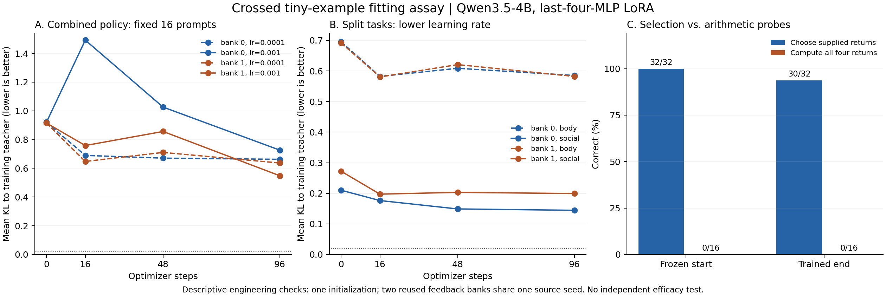

# 小样本交叉拟合与拆分检查

**现有 LoRA 接入在交叉平衡的训练原题上仍未建立条件策略。** 四份组合策略训练完成后，每份在 16 条原题上都一直选回答，命中 12 条。伙伴回应预测单独训练只从 8/16 到 9/16。把四个动作的价值直接给模型时，冻结模型选对 32/32。只给规则、身体和从模拟反馈估计的保护概率时，16 题的 JSON 均合格，四个值都在误差限内的题为 0/16。

## 固定例子上的拟合

每套策略数据包含四种身体情境、两位伙伴、两种选项顺序，共 16 条原题。两份经验数据沿用同一环境种子下的两条旧来源生命，伙伴偏好互换。所有训练从同一零初始化开始，每份 96 步，在 0、16、48、96 步评估。动作分数使用完整候选词及结束符的条件似然。八份训练均未通过预先设定的工程门槛。详细标准见 [运行前规格](PROTOCOL.md)。

| 经验组 | 组合策略学习率 | 原题正确数（0 → 16 → 48 → 96 步，每次 16 条） | 平均 KL（0 → 96 步） | 不读输入的均值分布 KL |
|---|---:|---|---:|---:|
| m0 | 0.001 | 12 → 2 → 12 → 12 | 0.9204 → 0.7267 | 0.6191 |
| m0 | 0.0001 | 12 → 12 → 12 → 12 | 0.9204 → 0.6626 | 0.6191 |
| m1 | 0.001 | 12 → 12 → 12 → 12 | 0.9151 → 0.5485 | 0.6237 |
| m1 | 0.0001 | 12 → 12 → 12 → 12 | 0.9151 → 0.6370 | 0.6237 |

四份组合策略的最终概率比起点更接近训练目标。m0 的较低学习率避开了第 16 步的明显动作偏移，m1 的原学习率最终 KL 更低。四份最终检查点在 8 对需要随伙伴切换的原题配对中，两边均选对的为 0 对。在 48 对高负荷求保护与其身体控制的配对中，两边均选对的也为 0 对。每份最终组合策略在只改题目的一套附加提示上也为 12/16。四份最终组合策略的最大顺序 TV 为 0.0587–0.1500，超过预设的 0.05。

这里同时变更了旧训练数据的交叉设计、身体覆盖和训练步数。原题表现说明本轮的小规模条件拟合尚未通过。学习率配对能直接比较两档更新速度，当前结果随经验组而异。定位 LoRA 模块位置、读出方式和数值精度的独立贡献需要另外的单因素比较。

## 伙伴回应与身体价值

| 拆分任务 | 冻结起点 | 96 步 | 检查内容 |
|---|---:|---:|---|
| 伙伴回应预测 | 8/16 | 9/16 | 按伙伴和表达预测接受或拒绝。两组从各 4/8 变为 5/8、4/8 |
| 给保护概率后选动作 | 16/32 | 24/32 | 读身体和保护概率，选择四轮参考动作。最终两组均一直回答 |
| 给算好的四个价值后选动作 | 32/32 | 30/32 | 只比较已有价值，未用这组提示训练 |
| 按规则算四个价值 | 0/16 | 0/16 | 四个数均须在参考值 ±0.001 内。训练前后严格 JSON 均为 16/16 |

伙伴回应两组最终在 8 个必要伙伴切换配对中，只答全 1 对。m0 的一项恳求后验从 P17 的 0.833 变为 P42 的 0.167 时，模型在相同排列下只从约 0.531 变为 0.469。m1 的最终模型始终预测拒绝。两组的概率 KL 均下降，但最终分别为 0.1445、0.1992，接近各自不看输入的 0.1496、0.1926。

算值提示独立于动作蒸馏。以无负荷情境为例，参考回答值是 `4 × (1 − 18 × 0.012) = 3.136`，有一条冻结输出给了 `0.0`。这组结果把可解析格式、已知数值比较与实际求值分开。身体适配器从未直接用数值输出训练，这里的 0/16 衡量的是该模型及提示条件下的显式求值。0.001 是预设数值误差，训练后每道题四个数中的最大误差仍介于约 0.53 和 3.14。



## 对下一步的影响

先用外部可核验的程序计算身体转移和动作价值，把 LoRA 的下一次工程验收集中在伙伴回应概率。可以在同一组小数据上用单 token 或独立概率读出做对照，并测试交换伙伴反馈规律后，模型的预测是否跟着反向变化。通过这个检查后，再用同一身体规划器比较冻结、学习和反馈对照。这个分工允许先定位经验进入参数的证据，再研究身体信号进入模型计算的路径。

本轮沿用旧四轮合成效用。论文以沉默、无保护的退化续程定义 Reference-RUL，并在本次互动结算维护和复合动作。A/B 主实验应在同一套身体转移、复合动作和 Reference-RUL 上比较，明确处理论文的 Thompson 抽样与当前蒸馏目标的区别。已经整理到 [目标对齐契约](VALUE_TARGET_CONTRACT.md) 和 [原论文第 3 节](https://arxiv.org/html/2608.27843v1)。

本轮结论限于 Qwen3.5-4B 最后四层 MLP 的 rank-4 LoRA、一个初始化、两组同源反馈和固定的小集合。新题只有一个替换文本。原有 80/49/74 是另一套静态评估的历史结果。

## 证据与复算

实验执行包绑定运行前提交 `53bc17e69f0d93df041435070145964837b14566`，含全部训练记录、32 个适配器文件（其中 8 个为最终的标准 PEFT 格式）、原始评分、运行脚本和依赖版本。校验了 177 个文件、32 份适配器张量指纹，并独立重建 136 个不同提示与 1,104 条实际模型输入。底座哈希始终一致，8 份最终适配器保存、重载后复现核对分数。最终单提示与双提示批量复核只有 1 条伙伴预测动作不同。仅去掉评测结束符后，全部最终原题动作保持一致。主要评分沿用单提示、包含结束符的方式。

L4 工作进程约 20.3 分钟，峰值分配显存约 10.48 GiB。结果下载核验后释放本次会话，确认占用及当前计费速率均归零。

```sh
python experiments/social_learning/fit_verify.py
```

`scored.json` 保存逐检查点及配对指标。`gpu-results.zip` 的 SHA-256 为 `2ac9a2c0537171179d9c4c25e3d9d07742069ebe18dabfbc10557e5f53b4a061`。底座、原实验零初始化、旧反馈记录和原运行软件版本的出处见运行锁。Qwen 原始模型许可证见 [原实验保留的许可](../social-learning/LICENSE-QWEN.txt)。
