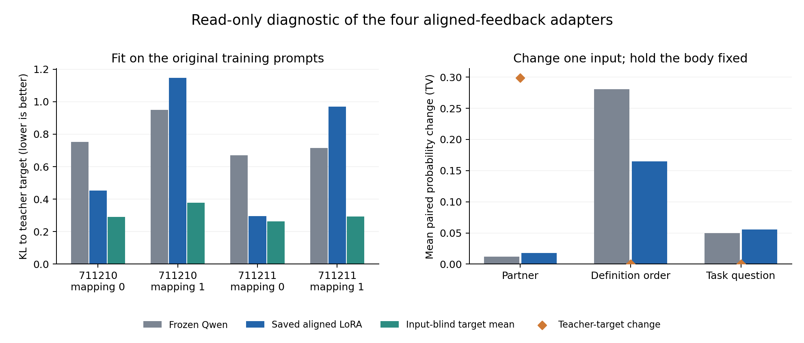

# 已存 LoRA 只读诊断：拟合与单因素变化（2026-11-10）

**主要发现：训练原题上的条件策略已经没有拟合好，不是仅在换题或身体外推时才失败。** 概率目标有少量平均改善，但四份真实反馈适配器表现分化，两份在原训练提示上已经退化为始终求助。伙伴条件响应仍很弱。

本轮只加载现有八份LoRA与同一冻结底座；全部参数冻结，没有优化器步骤、没有重新训练或推进新生命。原始静态成绩冻结80/128、真实反馈49/128、打乱74/128保持不变。

## 先更正教师合计

外部程序直接用真实反馈估计和身体规则决策，四条生命成绩为30、30、32、32，正确合计 **124/128**。此前122/128是报告汇总笔误，底层四项数据一直正确；已单独修正文档并加入自动合计校验。它不是LoRA成绩，也不证明32个蒸馏样本足够让LLM学会教师函数。旧静态顺序敏感性的25/64配对变化也已独立复核。

## 检查设计与测量边界

对每个原训练例子，依次检查原样输入、只换到另一位**已见伙伴**、只反转定义顺序、只换训练中未出现的题目。身体、负荷、保护和参考时域始终固定。伙伴变更使用对应伙伴的教师目标；换顺序和换题目不改变目标。没有研究陌生伙伴的零样本迁移。

每份适配器128条训练相关配对记录对应96个不同提示，因为换伙伴与换顺序共享同一组交叉提示。它们定义不同配对关系，总体分数相同是结构使然，不能靠比较两列总分定位原因。另重放原32个静态提示。跨来源生命去重后，共398种提示、1422个主模型—提示评估、330个批量数值检查；不是1752个独立科研样本，来源仍只有两个环境seed块。

主评测沿用原先每次一个提示、四条候选完成串的方式。记录完整动作串与结束符的对数似然、逐token贡献、动作概率和教师目标。KL衡量模型概率与soft教师目标的差距，零表示完全一致；动作一致数只看最终argmax。**下表针对各自训练教师，不是旧静态测试的隐藏真实概率评分。**

## 训练原题：两份适配器已出现全局动作退化

| 来源生命 | 冻结与教师一致 /32 | LoRA与教师一致 /32 | 冻结KL | LoRA KL | 不读输入的均值分布KL | LoRA原题动作分布 |
|---|---:|---:|---:|---:|---:|---|
| s711210-m0 | 26 | 17 | 0.7532 | 0.4530 | 0.2899 | answer 20, appeal 11, exchange 1 |
| s711210-m1 | 22 | 6 | 0.9509 | 1.1465 | 0.3790 | appeal 32 |
| s711211-m0 | 24 | 24 | 0.6701 | 0.2963 | 0.2635 | answer 32 |
| s711211-m1 | 24 | 4 | 0.7155 | 0.9697 | 0.2919 | exchange 32 |

合计原题一致数为真实反馈LoRA **51/128**，冻结 **96/128**；平均KL从冻结0.7724降至LoRA0.7164。因此不能说优化完全没有进展：soft目标的平均拟合略有改善。但两个检查点的KL恶化，且平均仍差于只输出训练目标均值、完全不读输入的统计基线（KL=0.3061）。这个统计基线不是另一份LLM或论文控制器，只用于衡量是否学到了条件关系。

两个映射1检查点在32个训练提示上分别始终输出appeal、始终输出exchange；对应一致数仅6/32、4/32。单纯增加未见题目或身体外推的解释不足以说明这些训练内错误。尚不能据此判断学习率、LoRA覆盖层数、表示能力或更新次数中哪一项是根因。

## 换一个字段之后

| 真实反馈组条件 | 与教师一致 /128 | 平均KL |
|---|---:|---:|
| 训练原样 | 51 | 0.7164 |
| 只换已见伙伴 | 52 | 0.7309 |
| 只换定义顺序 | 52 | 0.7309 |
| 只换题目 | 46 | 0.7835 |

换题目使一致数51→46，平均KL0.7164→0.7835，存在附加泛化损失；但训练原题本身已明显未拟合，不能把失败概括为“训练都学好了，只是迁移不行”。本次没有新增单独的身体外推干预，原静态测试也同时改变了身体/负荷等条件，因此身体外推的独立贡献仍未定位。

以下使用成对响应定位变化来源。TV是两次动作概率分布差异，范围0–1；它与最终动作是否跨过argmax阈值不同。

| 只改变的因素 | 冻结平均TV | LoRA平均TV | 教师目标平均TV | LoRA动作变化 /128 |
|---|---:|---:|---:|---:|
| 只换已见伙伴 | 0.0118 | 0.0176 | 0.2987 | 2 |
| 只换定义顺序 | 0.2807 | 0.1647 | 0.0000 | 23 |
| 只换题目 | 0.0498 | 0.0558 | 0.0000 | 11 |

**伙伴条件没有稳定建立。** 在36个教师要求换伙伴后最优动作也必须切换的配对中，LoRA完整答对0/36。只换伙伴的平均概率变化仅0.0176，教师期望约0.2987；模型并非完全不响应身份，但没有给出应有的条件决策。

**顺序敏感真实存在，但不是已经证明的唯一根因。** 训练相关顺序配对有23/128次动作变化，全部集中在s711210-m0。冻结模型虽始终回答、不发生argmax翻转，其平均顺序TV却有0.2807，高于LoRA平均0.1647。模型原有的分布敏感性、训练后的动作偏置和决策阈值都影响翻转数；不能把“动作翻转变多”直接当成“训练学会了排列捷径”的证据。训练题目/伙伴/排列混淆仍是需要修正的设计风险。



图左保留四个来源检查点，展示两份改善、两份恶化，而不是只给平均数。图右区分伙伴应有的目标响应与顺序/题目不应改变的目标。所有柱形为描述性比较，没有把提示重复当独立样本。

## 打乱组及解码、数值检查

打乱反馈组在其自身教师目标上的原题一致数为107/128，冻结对同一教师为116/128；KL从0.4599降至0.2275，仍高于不读输入的均值分布基线0.1434。它的教师更偏向回答、条件变化更弱，不能把107与真实组51直接比较为“错误反馈有益”。完整四组结果和配对计数保留在scored.json。

评测时去掉结束符、只保留动作词似然后，旧静态成绩仍为80、49、74，所有旧静态动作均未改变。真实反馈适配器的512个不同模型—提示主评估中，仅4处动作受这次重评分影响，原训练题一致数仅51→52。这说明**评测阶段删EOS不能消除本轮落差**，不等于排除了训练损失中EOS的作用，也没有排除动作词长度/语义等因素。

330个额外四提示批量检查中，有8项动作与单提示结果不同，最大完整串对数似然差约0.2346。主诊断及旧分数复现均使用原来的单提示方式，没有把批量结果混入主指标。所有1752条记录在同一提示的不同候选续词下，前缀logit最大差为0。

冻结底座及八份适配器的288条旧静态评估，**完整四动作分数逐项精确复现**，不只是最终动作相同。每份适配器加载后与原检查点hash一致，评测前后参数hash/版本不变，底座全程不变，无梯度、无优化更新。398种不同提示已用独立Jinja/Rust tokenizer重建，1752条模型输入均与预期hash和token ID一致。

## 现在可以与不可以下的结论

当前结果支持：训练内条件策略拟合已不足；新题还有附加影响；伙伴身份响应远弱于教师要求；定义顺序是明显的敏感因素，但训练前已经存在。不同适配器改善与恶化并存。

它尚不能证明：学习率过大是唯一根因、最后四层MLP一定不够、Qwen3.5-4B无法学习这类任务、全部退化由排列造成，或“生命经验无法进入权重”。这次只读诊断也不裁定当前四轮合成效用是否符合论文生命目标。

最近的工程检查应先确认现有训练路径能否在少量、完全交叉平衡的固定例子上拟合教师分布，再分别检查伙伴回应预测与身体价值计算。保留训练前/后固定集合的完整loss、KL和成对响应，单独改变优化设置或可训练模块；不以新增长生命训练代替拟合验收。与此同时，A/B主研究仍需冻结共同身体时序、复合动作、伙伴机制与Reference-RUL等价值尺度，按[前次审查](../social-learning-audit/REPORT.md)讨论目标对齐。上述下一步尚未实施。

## 原始记录和复算

旧模型来源包SHA-256：`7c23ff365bf2837236f6c89343a8f845768cb11f3422a51c45af37959c7a5299`。本轮原始结果包：`46483f6bdbe8e841d69aa422929e4703b5d239cffa2977a6eed59c2be3f567dc`。输入及worker哈希见publication.json和原始包内run-lock.json。旧模型来源ZIP作为已公开依赖复用，不在本轮归档重复存储。

本次在同型号L4和与原训练一致的软件版本中执行；worker约768秒，峰值已分配显存9.1304GiB。结果下载后逐文件校验，实例已释放并核实当前占用与计费速率为零；账户、余额、端点与认证记录保留本地。

```sh
python experiments/social_learning/diagnose_verify.py
python experiments/social_learning/diagnose_score.py --archive artifacts/model-studies/2026-11-10/saved-lora-diagnostic/gpu-results.zip --key artifacts/model-studies/2026-11-10/saved-lora-diagnostic/key.json --output /absolute/new-scored.json
```

可选 `--tokenizer-dir /absolute/pinned/model_0` 运行独立输入token核验。冻结检查设计、成对关系及参数加载方式见 [实验说明](../../../../experiments/social_learning/README.md)。
