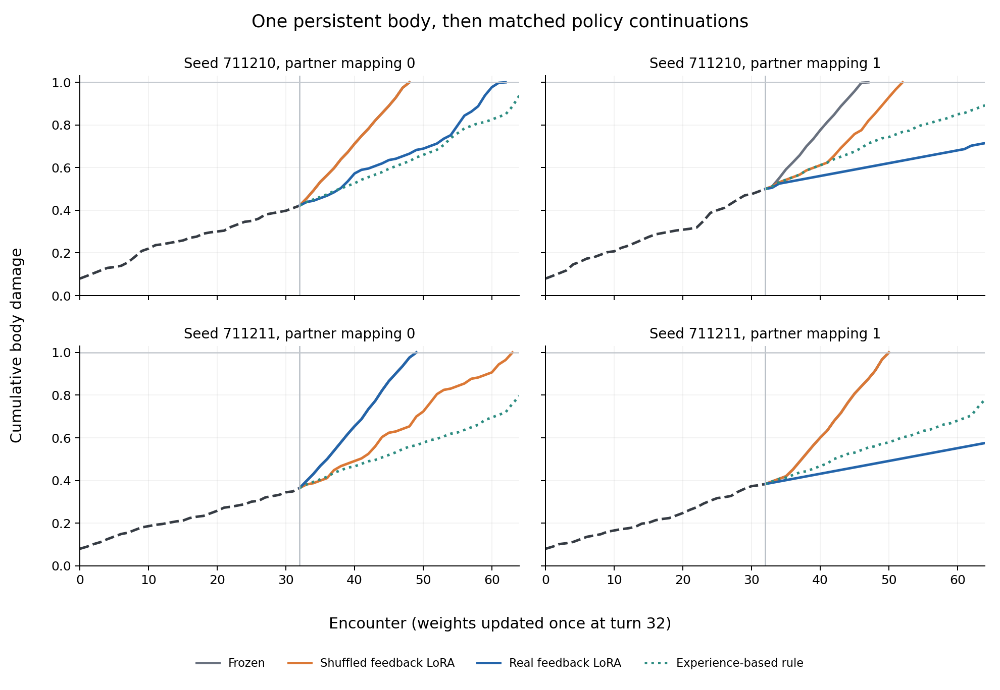

# 社会经历进入真实 Qwen LoRA：首轮结果（2026-11-10）

**工程闭环和真实参数更新已跑通；这版训练没有学好伙伴规律，整体决策退化。** 这是简化裂纹世界中的经验蒸馏实验，不是原论文复现，也不是自主探索或逐轮强化学习。

## 做了什么

沿用原 demo 的不可逆裂纹、动作损伤和延迟保护规则。两位脚本伙伴对 appeal/exchange 有相反的 0.9/0.1 接受概率，并设置偏好对调条件。两组环境 seed × 两种映射，共四条隔离生命；同一 seed 的映射条件共用随机 tape，统计上只有两个随机块。每条生命先连续进行 32 次平衡的脚本探索，不重置身体。四条生命到达学习节点时仍存活，损伤分别为 0.421894、0.499822、0.365005、0.383538。

根据每个伙伴/表达实际观察到的四次回应，估计 Beta(1,1) 后验均值；结合已知身体规则，将“当前动作＋随后三次回答”的延迟收益转为 softmax(Q/0.2) 目标。参考续程使用提示中明确给定的恒定负荷，不能当作 64 轮随机世界的最优价值。模型测试时直接选动作，决策目标由外部估计器和身体模型构造。

每条生命比较 A/真实反馈 LoRA、B/冻结模型、C/反馈标签打乱 LoRA。A/C 使用相同身体经历、训练提示、初始化、优化顺序及更新次数；C 仅打乱请求记录的接受标签，保持总体接受数，身体历史不随伪造反馈重新结算。测试隐藏详细历史和后验，保留伙伴身份、当前身体和新任务。

Qwen3.5-4B 使用与前期冻结测试相同的固定 checkpoint 和权重字节。只训练最后四层 MLP down projection 的 rank-4 LoRA，共 188,416 个参数。每组 48 次 AdamW 更新，8 组共 384 次；lr=0.001、batch=2、3 epochs、gradient clip=1。模型权重 BF16，LoRA 实际保存为 FP32。决策器归一化四个完整动作词加聊天结束符的序列似然；不是自由文本生成。表达模板固定，任务答案由 renderer 提供，未研究语言流畅性或答题生成能力。

## 隐藏历史后的静态探针

每条生命 8 个身体/负荷/保护/时长条件 × 2 个伙伴 × 2 种定义顺序 = 32 项。下表 128 项是四条生命的描述性汇总，重复使用相同测试提示，不能当作 128 个独立样本。正确指选择具有最大已知四轮参考收益的动作；regret 是相对该参考最优动作的收益损失，越低越好。

| 条件 | 参考动作正确 /128 | 平均 regret | 按策略概率计算的平均 regret | 完整答对身体配对 /16 |
|---|---:|---:|---:|---:|
| B 冻结 | 80 | 0.396674 | 0.501241 | 0 |
| A 真实反馈 LoRA | 49 | 0.564095 | 0.571414 | 0 |
| C 打乱反馈 LoRA | 74 | 0.400102 | 0.516639 | 0 |

“身体配对”仅指预设的负荷 0.35、损伤 0.25→0.70 条件：伙伴、问题及其他字段固定，正确决策应从回答切换至适合该伙伴的保护请求。三组均未完整答对这些配对，不能推广为所有情境中身体都无效。

在最需要保护的三个状态里，两种请求表达的偏好排名：三组均为 24/48 正确，接近随机。真实反馈组未显示稳定的伙伴偏好绑定。冻结模型在全部 32 个不同提示上始终回答；其 80/128 是这个探针集的多数动作基线，不代表已经理解伙伴。

| 生命 | 条件 | 顺序0正确 /16 | 顺序1正确 /16 | 总正确 /32 | 平均 regret |
|---|---|---:|---:|---:|---:|
| s711210-m0 | frozen | 10 | 10 | 20 | 0.396674 |
| s711210-m0 | aligned | 5 | 10 | 15 | 0.497281 |
| s711210-m0 | shuffled | 10 | 10 | 20 | 0.396674 |
| s711210-m1 | frozen | 10 | 10 | 20 | 0.396674 |
| s711210-m1 | aligned | 3 | 4 | 7 | 0.689012 |
| s711210-m1 | shuffled | 7 | 10 | 17 | 0.412067 |
| s711211-m0 | frozen | 10 | 10 | 20 | 0.396674 |
| s711211-m0 | aligned | 10 | 10 | 20 | 0.396674 |
| s711211-m0 | shuffled | 7 | 10 | 17 | 0.394994 |
| s711211-m1 | frozen | 10 | 10 | 20 | 0.396674 |
| s711211-m1 | aligned | 4 | 3 | 7 | 0.673414 |
| s711211-m1 | shuffled | 10 | 10 | 20 | 0.396674 |

仅改变动作定义的显示顺序也会影响结果，例如 s711210-m0 的真实反馈组分别为 5/16 和 10/16。使用完整动作词之后，顺序敏感性仍需保留为限制。

## 原身体继续生活

从真实第 32 轮身体检查点分出配对评估分支，继续至第 64 轮或死亡。三个模型分支共用环境 tape 和伙伴安排，权重不再更新。定义顺序每两轮变一次，使每位伙伴都遇到两种顺序；之前的 32 轮脚本探索不归功于 Qwen。

| 策略 | 后半段平均合成收益 | 存活至第64轮 /4 | 合计完成任务 | 合计请求保护 |
|---|---:|---:|---:|---:|
| B 冻结 | 3.535380 | 0 | 66 | 0 |
| A 真实反馈 LoRA | -2.292334 | 2 | 31 | 80 |
| C 打乱反馈 LoRA | 4.513725 | 0 | 70 | 15 |
| 相同真实反馈＋已知身体规则 | 13.931011 | 4 | 90 | 38 |
| 已知真实概率＋四轮参考规则 | 13.274063 | 4 | 82 | 46 |

真实反馈组在两个映射1条件下都连续请求保护 32 次、完成任务 0 次，虽然存活，收益分别为 -6.428777 和 -6.016000。存活率提高在这里伴随严重的任务退化，不能当作目标达成。使用相同实际反馈的简单参考规则却能四条生命全部存活并完成 90 个任务；这些具体轨迹中的信息是可用的，当前 LLM 更新方法未能有效转化它。已知真实概率规则也是短视参考策略，不是全程最优策略；单次有限样本中收益低于经验规则不构成优劣结论。



虚线黑色为共同的探索前缀；第 32 轮竖线为一次批量学习节点。曲线到损伤 1 即终止。曲线接近或重合时，需结合上表的任务数和收益解读。

## 已验证与仍待诊断

- 真实 LoRA 参数已更新，八组 L2 变化为 1.457012–1.790035；这不是玩具网络的 LoRA。标准 PEFT 文件与原始张量逐项一致，保存后重载的测试分数完全一致。
- 基础参数的字节级 hash 和版本计数未改变；训练前后冻结模型分数一致；零初始化 LoRA 复现冻结模型。峰值已分配显存 10.234606 GiB，仅适用于本次受限 LoRA 设置。
- 所有静态与闭环决策共 550 个输入，已通过独立 Jinja/Rust tokenizer 重建，提示 hash 与 token ID 一致。训练/评估原始数据、全部优化步骤及适配器均保留。
- CPU 独立重放四条探索生命、12 条模型续程及12条规则续程；Decimal 四轮参考与冻结 World 在 384 个分支设置下相符。71 项单元测试、原冻结/身体通路证据检查和界面交互检查通过。

失败原因还没有被因果定位。训练日志的 376/384 次更新触发梯度裁剪，部分 epoch 的平均 loss 回升，是优化稳定性的线索。伙伴接受反馈每个单元只有四次，训练身体损伤约 0.08–0.50，而部分测试损伤 0.70、负荷 0.85 超过经历范围，存在外推难度。实际闭环也出现过度求助，因此不能仅归因于静态测试外推。尚无证据确定应该通过更大模型、更多 LoRA 层或某个学习率解决。

当前身体依然通过结构化文字输入，没有新增专用数值身体编码器；固定表达词表下的训练也可能主要改变全局动作偏置。对新问题的变化不等于能迁移到新伙伴或开放语言互动。PR #2 的激活移植仍是独立探针，其选项排列不稳定结论不变。

## 下一步的具体诊断

先保留本轮原始结果，再分开做三项新条件：① 在当前完整动作词解码方式下，提供正确收益表，核验模型能否按值选择并跨定义顺序复现；② 用独立的伙伴/表达反馈预测任务检查是否能学会身份绑定，再连接决策目标；③ 预先冻结训练/验证/外推身体范围，以验证集学习曲线检查优化稳定性。验证用新条件和新记录，不覆盖本轮结果。暂不能据此宣称实现了可泛化的“身体—社会经历—参数”机制。

## 执行记录与复现

首次启动在挂载 LoRA 时被预装 torchao 0.10.0 与 PEFT 0.21.0 的兼容检查阻止，没有动作测试或梯度更新。保留 `failed-startup.zip` 及其输入。第二次在同一实例移除未使用的量化库，同时在任何动作测试开始前修正伙伴与定义顺序绑定；实验数据、种子和训练目标未变。成功运行完成8组、384次更新，GPU worker约696秒；实例已释放并核实当前占用和计费速率为零。

成功输入协议 SHA-256：`3ce03507be694bff55ca6b01ca80d4cbbd3e808d6f5f9b3127a3400ee7ce3a17`。成功 worker SHA-256：`a5826cefb78ee86f102b283240487d1136df53586f3eb093ce775342283bf9eb`。归档逐文件校验见 `publication.json`，GPU 原始包内也含自己的清单。账户、余额、认证与运行端点记录留在本地。

```sh
python experiments/social_learning/verify.py
python experiments/social_learning/score.py --archive artifacts/model-studies/2026-11-10/social-learning/gpu-results.zip --output /absolute/new-scores.json
```

方法、完整冻结配置和运行方法见 [实验说明](../../../../experiments/social_learning/README.md)。适配器基于 [Qwen3.5-4B 固定版本](https://huggingface.co/Qwen/Qwen3.5-4B/tree/851bf6e806efd8d0a36b00ddf55e13ccb7b8cd0a)，只含本项目修改的 LoRA 参数；底座权重不在仓库，原模型 Apache-2.0 许可保留为 `LICENSE-QWEN.txt`。
