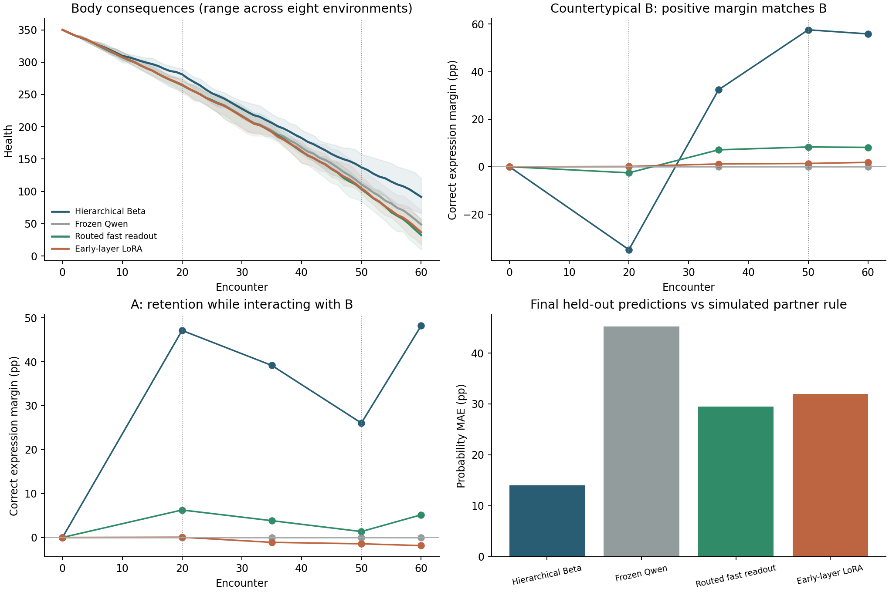

# A → 反常 B → A：真实参数学习进入互动闭环

**闭环已经跑通，但本轮参数学习尚未稳定超越“只统计各行动总体接受率”的简单对照。** 前四层 LoRA 的参数确实更新并改变了预测与行动；新版快速读出也吸收了部分反馈。然而，两者对不同伙伴相反偏好的区分仍很弱，新措辞进一步削弱了表现。它们增加了回答次数，本轮平均健康余量却低于冻结条件。论文式显式参照同时获得了更多回答、更多保护和更高的健康余量。

这些是当前模型、更新预算、表示和受控生态下的结果，不证明 LoRA 或参数记忆普遍不可行。

## 这次实际运行了什么

机制对齐依据：[原论文第 3.2–3.4 节](https://arxiv.org/html/2608.27843v1)。下述数值实现和受控简化均单独声明。

四个环境种子 × 两种镜像生态，每种分别运行双层 Beta、冻结 Qwen、伙伴路由快速读出、前四层 LoRA，共 **32 条闭环生命**。另取前两个种子的四条 Beta 来源生命，让快速读出和 LoRA 学习完全相同的经历，形成 **8 条强制重放**。各条均完成 60 回合；这是观察窗口，不是自然寿命终点。独立随机单位是四个种子，镜像条件和方法保持配对，不能把回合与探针当独立样本。

流程为：伙伴先提出任务 → 预测各行动下的维护概率 → 共同受限控制器结合当前身体选择行动 → 固定表达 → 模拟伙伴回应 → 身体结算 → 累积反馈并按五回合周期更新 → 下一轮。前 20 回合遇 A，中间 30 回合遇相反偏好的 B，最后 10 回合回到 A。

四个动作是沉默拒绝、拒绝但恳求、回答并恳求、回答并互惠。身体从 350 开始，维护免除本次遭遇的环境老化，保留行动成本和过去损伤。决策目标是预期下一步 Reference-RUL，没有沿用旧版“任务奖励减损伤罚分”。

**本轮由外部共同控制器选择行动，Qwen 负责伙伴回应预测。** LoRA 和快速读出学习同一个显式双层后验均值教师；训练时需要反馈计数，测试提示不含历史或计数。身体进入外部价值计算，没有接入 Qwen 内部激活。原论文的连续语言核在参照中简化为已知风格类别，主控制器采用共同 epsilon=.2 探索；因此这是机制启发的受控实现，并非原资产与数值复现。

快速读出是新变体：每个注册伙伴六个系数，共十八个，利用冻结 Qwen 的六个风格×行动参考中心修正基础分数，以软标签二元交叉熵拟合。它不同于上轮使用 ±log(5) 目标的三系数 RLS。P86 没有个人互动反馈，但其提示参加群体目标蒸馏，不能称为未见身份；见 [协议措辞更正](../../../../experiments/social_closed_loop/ERRATA.md)。

## 闭环行为与身体后果

每行是八个配对环境的均值。概率误差是对模拟伙伴已知回应概率的绝对误差，覆盖 A/B、全部六个留出内容、两种新措辞、两种接受／拒绝候选顺序；它不是动作正确率。

| 方法 | 概率误差 ↓（百分点） | 回答回合数 | 获得保护次数 | 第 60 回合健康 ↑ |
|---|---:|---:|---:|---:|
| 双层 Beta 参照 | 14.02 | 36.13 | 28.63 | 91.35 |
| 冻结 Qwen | 45.26 | 7.00 | 11.75 | 48.69 |
| 新版快速读出 | 29.47 | 26.13 | 16.63 | 32.33 |
| 前四层 LoRA | 31.97 | 21.50 | 15.63 | 36.73 |
| 按行动汇总的 Beta，事后 CPU 对照 | 27.79 | 31.63 | 19.00 | 33.25 |

后加的汇总对照只估计三个可回应行动各自的总体接受率，完全忽略伙伴和输入措辞，仍使用相同身体、五回合刷新和探索规则。它的预测误差低于两种参数方法。这说明数值预测相对冻结模型改善，本身不足以证明学会了个人关系。

本轮额外回答没有换来足够保护来抵销行动损耗。相对冻结组，LoRA 的平均行动基础损伤增加 21.75，未保护环境基础损伤减少 15.50；快速读出分别增加 28.03、减少 19.50。这些是脆弱性和噪声生效前的基础损伤单位，实际健康按逐事件公式结算。

按已知伙伴规则计算的一步 Reference-RUL 动作遗憾，Beta／冻结／快速／LoRA 分别为 .278／.382／.405／.397，越低越好。它是当前状态下一步值的诊断，不是全生命全局最优证明。LoRA 的健康余量相对冻结组在四个种子的镜像均值中均较低；快速读出为三个种子较低、一个较高，仍只作本轮描述。



图中纵向对比使用共同的第一个留出内容，终点误差柱使用全部六个留出内容。阴影是八个环境的范围，不是置信区间；虚线标记伙伴切换。不同闭环方法实际获得的经历不同，下面用同经历重放拆开这个因素。

## 能否修正对 B 的判断，并保留 A 的个人经验

“正确表达差”按每种输入风格计算：符合该伙伴真实偏好的回答表达，其预测保护概率减去另一表达的概率；正值表示方向符合伙伴规律。这是概率差，不是正确率。

显式参照在尚未遇 B 时对 B 的差为 **−34.90 点**，与 B 互动后到第 50 回合变为 **+57.59 点**：先迁移 A 的经验，再以 B 的个人反馈修正。这正是允许群体迁移、同时保留个人修正的效果。

快速读出相应为 −2.57 → +8.30 点；LoRA 为 +0.11 → +1.37 点。它们的改变明显较弱。

因为 A/B 的偏好相反，只看 B 一侧可能误把总体表达偏好当成个人学习。将两位伙伴的正确表达差合并，要求同时区分两人，终点全部留出内容上的个人区分差为：

| 方法 | 同时区分 A/B 的差（百分点） |
|---|---:|
| 显式参照 | 52.04 |
| 冻结 | 0.00 |
| 快速读出 | 3.66 |
| LoRA | 0.03 |

这个事后描述量会抵销对所有伙伴相同的表达倾向。它支持“当前个人绑定仍很弱”，而不是把一切跨伙伴变化都判作错误。各方法自身的教师目标与预测差也分别保存在 scored.json，避免把不同经历造成的目标变化误认为参数遗忘。

## 同一段经历重放：训练内与泛化分开

四条匹配来源、相同反馈、相同更新周期。下表相对相同的双层教学目标，单位为百分点；只有问题改变时保持原措辞，只有措辞改变时保持原问题。联合改变覆盖全部六个留出内容。

| 参数方法 | 训练原句 | 只换问题 | 只换措辞 | 新问题＋新措辞 |
|---|---:|---:|---:|---:|
| 快速读出 | 10.73 | 13.29 | 23.95 | 24.79 |
| LoRA | 23.17 | 22.91 | 29.38 | 30.82 |

**LoRA 在训练原句上已经存在明显残差；快速读出额外受到措辞变化的显著影响。** 因此失败不能全归因于模型自主探索得到的反馈较差，也不能全归因于新题。全体训练题均曾出现，但最后一批只使用交替题中的一道，训练误差覆盖两道题。

对这些相同来源，模拟规则下的终点概率误差：汇总计数 29.17 点、快速读出 29.25 点、LoRA 32.65 点。快速读出接近汇总统计，LoRA 还没有超过它。匹配重放的身体和动作由来源强制保留，其健康与回答数不能当成参数方法自主决策的成绩。

接受／拒绝候选换序引起的终点概率平均变化：冻结 10.14 点、LoRA 2.67 点、快速读出 13.78 点。平衡训练顺序减轻了 LoRA 的这一影响，但快速读出仍敏感。这是二元回应预测的选项顺序，不是四动作由 Qwen 选择时的顺序测试。

## 身体影响与额外拟合检查

在相同伙伴预测下，只读移植健康 350／200／100，四种主条件均没有改变首选动作。健康 2 时，Beta／快速／LoRA 有较多变化；其参考剩余寿命仅约 .39 回合。独立抽取 12,000 组三行动概率也得到：350→200→100 无改变，20／6／2 对应改变率约 1.58%／10.93%／31.57%。

因此，当前身体规则的动作变化主要集中在低健康与死亡边界附近。身体持续承受了后果，但不能据此宣称一般健康区间已有强烈身体策略效应，更没有检验身体进入 Qwen 内部的因果作用。

另做事后 CPU 拟合诊断，保持终点教学目标不变，让快速读出同时重放两道训练题：训练误差仅由 10.62 降到 10.09 点，新问题＋新措辞误差反而由 23.14 升到 24.56 点。将正则进一步减弱也未消除残差。这限制了“只是没有重放两道训练题”这个解释，提示当前六特征与分数修正形式值得进一步检查；尚不能唯一定位所有失败原因。该静态检查没有替换主闭环成绩，也没有新增伙伴反馈。

## 核验、资源和可复算资料

- 119 个导出文件逐项核验哈希；40 条记录共 2,400 回合，含 1,920 条闭环和 480 条强制重放。独立重建反馈计数、教学目标、随机事件、动作值与选择，并以 Decimal 重算身体事件，全部通过。事件哈希链位于 chains/。
- 12 组 LoRA 均保存真实权重变化并通过同 GPU、同批次重载一致性检查；864 次优化更新，基础 Qwen 参数哈希保持不变。worker 约 1,112 秒，峰值分配显存约 12.03 GiB。
- L4 已释放，实时验证 active_assignments=0、consumption_rate=0。整个资源会话余额变化约 1.178 CU，包含接入、失败检查和主实验，不等于梯度阶段单独耗费。
- 前两次接入检查分别因分数批次不一致和缺失导入中止，原始包与修正原因完整保留。第二次已完成的三个控制条件，与最终重跑的轨迹逐项相同。

[冻结协议与代码](../../../../experiments/social_closed_loop/README.md) · [复算指标与各条生命](scored.json) · [事后快速拟合诊断](fit-diagnostic.json) · [汇总统计对照](pooled-control/summary.json) · [预先数学检查](preflight-validation.json) · [资源释放核验](resource-release.json) · [接入失败记录](integration-failures/attempts.json)

真实模型：Qwen/Qwen3.5-4B，revision `851bf6e806efd8d0a36b00ddf55e13ccb7b8cd0a`。实际运行源码以输入包的逐文件 SHA-256 为准；Git 起点仅标识原有 checkout，不冒充新增代码已经提交。

- [完整 GPU 原始包](gpu-results.zip)：49,041,459 字节，SHA-256 `3ea2ef6f4e57680c09d7c2c4d97197274cd447670f6b9c14ee178cababdf757e`。
- [锁定输入包](gpu-inputs.zip)：SHA-256 `2e443381e452cb87a9c60d1c150e2f33288cd14a0ad7a092f6d7bdb2b9708d14`。

复算原始包需先安全解压，保持 output/、protocol.json、run-lock.json 等相对位置，然后执行：

```powershell
python experiments/social_closed_loop/analyze.py extracted-run artifacts/model-studies/2026-11-11/closed-loop
python experiments/social_closed_loop/fit_diagnostic.py extracted-run artifacts/model-studies/2026-11-11/closed-loop/fit-diagnostic.json
python experiments/social_closed_loop/pooled_control.py extracted-run artifacts/model-studies/2026-11-11/closed-loop/pooled-control
```
