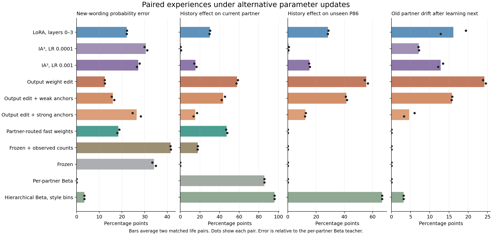

# IA³、定向权重编辑与快速权重实验

本轮让四条模拟生命先与 P53 相处 15 回合，再与 P17 或 P42 相处 45 回合。两组配对内的第一段经历完全相同，第二段交换恳求与互惠收到的保护回应。直接请求和各阶段的回应成功总数匹配。每条生命最终有 48 次请求，其中 24 次接受。P86 从未互动。所有方法读取同一套身体结算与互动数据，评价时保留两个候选顺序，并另用两种新措辞。详情见 [运行规格](PROTOCOL.md)。

## 第 60 回合的主实验

新措辞误差是当前伙伴预测相对其 Beta(1,1) 后验的平均绝对误差。历史效应是同一提示下两条历史的接受概率差，取「恳求差减互惠差」的一半。P53 漂移指它在第 15 到第 60 回合的新措辞概率平均绝对变化。表内为两个配对的均值，单位均为百分点。

| 方法 | 当前伙伴新措辞误差 ↓ | 当前伙伴历史效应 | 未见 P86 历史效应 | 旧伙伴 P53 漂移 ↓ |
|---|---:|---:|---:|---:|
| 前四层 LoRA | 22.1 | 30.2 | 28.5 | 16.1 |
| MLP IA³，学习率 0.0001 | 30.5 | 0.5 | 0.6 | 7.1 |
| 定向编辑输出权重 | **12.5** | 57.9 | 55.5 | 24.2 |
| 定向编辑，加权约束 4.0 | 26.5 | 15.3 | 12.5 | 4.6 |
| 按伙伴路由的快速权重 | **18.4** | **47.3** | **0.0** | **0.0** |
| 冻结 Qwen，读取观察计数 | 41.5 | 17.9 | 0.0 | 0.0 |
| 冻结 Qwen | 34.1 | 0.0 | 0.0 | 0.0 |

定向编辑只写入 Qwen 输出投影的两行，当前伙伴的新措辞误差最低。未见伙伴仍有 55.5 点历史效应，P53 的概率也改变了 24.2 点。P53 对原参照的误差从 26.5 点增到 39.3 点，说明这次编辑确实干扰了部分旧判断。加约束后，P53 漂移降到 4.6 点，当前伙伴的历史效应也从 57.9 降到 15.3 点。

快速权重在两个配对的当前伙伴历史效应分别为 46.7、47.9 点，新措辞误差为 18.8、18.0 点。旧伙伴在新互动前后相同，且两条历史切换时 P86 逐项相同。这个隔离来自按伙伴 ID 路由独立参数。每个伙伴使用 3 个快速系数以及 3×3 的逆 Gram 状态，从 Qwen 冻结的隐藏表示构造表达相似度。逐条回应更新与独立批量最小二乘解的最大差低于 `1e−10`。快速权重的当前伙伴直接请求差平均为 +3.3 点，前四层 LoRA 为 +13.2 点。

冻结 Qwen 读取计数后会对不同历史产生反应，但该提示条件的新措辞概率误差为 41.5 点。显式 Beta 后验直接用标注的表达类别取计数，是本轮概率误差的参照，所以按定义对该目标误差为零。这两个条件检验了语言模型读取历史与程序计算后验这两种用法。

## 群体先验和定向更新

论文式双层 Beta 的补充计算使用明确的三种表达类别，类别内权重为 1、类别间为 0，群体先验排除当前伙伴，个人先验强度为 0.5。对两层条件分布的均值和方差解析积分，并用独立采样核对公式。该参照在本次场景上给 P86 带来 66.7 点方向性变化，旧伙伴 P53 的平均漂移约 3.2 点。它展示了跨伙伴迁移可以按证据量控制。快速权重的零扩散反映了当前显式身份路由，编辑和 LoRA 的跨伙伴影响还应结合旧伙伴及匹配的直接请求来看。 [原论文第 3.3 节](https://arxiv.org/html/2608.27843v1)

## 参数和适用范围

LoRA 与 MLP IA³ 更新分别为 188,416 和 36,864 个可训练参数。输出编辑写入两行共 5,120 个元素，通过一个 2,560 维的分差向量联合求解。Qwen 的输出投影与嵌入在加载时共用权重，因此所有组均先复制一份同值的输出矩阵，以便编辑输出行时保留输入表示。各组统一用同一冻结语言骨干和两个下一词分数定义接受概率。权重实验在已固定的候选读出上进行。 [IA³ 原论文](https://arxiv.org/abs/2205.05638) · [定向编辑的相关研究](https://arxiv.org/abs/2202.05262) · [快速权重的相关研究](https://arxiv.org/abs/1610.06258)

两组配对都使用手写表达和脚本化回应。显式统计参照使用表达类别，快速权重也用已见表达的中心构造特征。参数量、每条反馈的更新次数和结构约束各有差别，比较的是这些具体实现的保留、预测和迁移表现。主实验全程峰值分配约 11.95 GiB，GPU 计算阶段约 271 秒，包含 672 次梯度更新和定向编辑、历史预测。显存为整次运行峰值。

## 两项补充对照

主实验结果读回后，在同一运行环境和同一数据上重跑两项设置。两次运行的冻结分数逐项一致。编辑只改变锚点相对权重，IA³ 只改变学习率。每项仍使用两对生命。

| 方法 | 当前伙伴新措辞误差 ↓ | 当前伙伴历史效应 | 未见 P86 历史效应 | 旧伙伴 P53 漂移 ↓ |
|---|---:|---:|---:|---:|
| 定向编辑，弱约束 0.5 | 16.0 | 43.8 | 41.4 | 15.7 |
| MLP IA³，学习率 0.001 | 27.2 | 15.5 | 15.4 | 12.8 |

输出编辑的约束从无、弱到强时，P86 的历史效应从 55.5、41.4 降到 12.5 点，当前伙伴效应也从 57.9、43.8 降到 15.3 点。弱约束恢复了当前伙伴的拟合，同时也恢复了大部分扩散。IA³ 学习率提高十倍后开始明显区分两段历史，但 P86 上出现几乎等幅的历史效应，旧伙伴的概率漂移也增加。补充对照完成 336 次梯度更新，GPU 计算阶段约 92 秒。

三条路线的主要差异已可定位。定向输出编辑在当前伙伴的新措辞上拟合最强，降低扩散要牺牲一部分拟合。MLP IA³ 的表现明显依赖学习率，当前较高学习率也没有建立伙伴专属性。快速权重在此设计中兼顾了对当前伙伴的新措辞信号和旧伙伴稳定性，伙伴专属性由显式路由提供。后续若给新人引入群体先验，可独立检验个人经历和群体推断分别改变了多少预测。



## 记录与复算

CPU 独立重放了四条生命的 240 个身体转移、每阶段反馈统计、快速权重更新、双层参照和各模型指标。主实验和补充实验分别校验 56 和 24 个文件。已释放 L4 并确认占用与当前计费速率归零。

- [复算指标与快速权重状态](scored.json)
- [主实验原始记录与模型参数](gpu-results.zip)，SHA-256 `729be5e5079df526158be61cf6cf3b1150504b86b05fd13acf498afec3fdce86`
- [补充对照原始记录与模型参数](sensitivity/gpu-results.zip)，SHA-256 `99dc5afda37349e86d07cf609986feaae37db6bbaeb16d10259d7ef8b566928d`

```powershell
python -B score_methods.py gpu-results.zip scored.json --sensitivity sensitivity/gpu-results.zip
python -B plot_methods.py scored.json method-comparison.png
```
