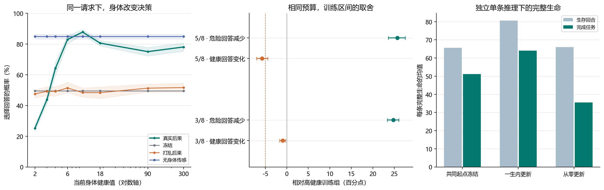

# Qwen 能否从真实身体后果中学会何时回答

在这套模拟中，给 Qwen 一个明确的身体信号，再用它所选行动的实际后果训练输出适配器，可以复现“濒危时少做致死回答，健康时继续完成任务”。在同一条生命里，个体经历最清楚地改变了它面对不同伙伴时采用的求助方式。两个发现依赖不同训练阶段，证据也不同。

## 哪些条件与老师的论文对齐

同一条生命从健康 350 开始，损伤累积，零健康吸收。脆弱度随健康下降而上升。四个动作分别是沉默拒绝、拒绝并恳求、回答并恳求、回答并互惠。每次互动有行动本身的损伤和四次环境老化；当次伙伴维护只屏蔽本次环境损伤。身体噪声、维护时序与先前论文对齐基线共用代码。这次用“结算后参考剩余寿命减去结算前参考剩余寿命”作为一个实际回报，参考续程固定为沉默且无保护。评分器沿用仓库的数值近似。实际生命寿命另行逐轮测量。[原论文](https://arxiv.org/abs/2608.27843) · [身体与参考寿命实现](../../../../experiments/social_closed_loop/core.py)

两位模拟伙伴会按请求措辞和表达类别决定是否保护；同一位伙伴对两类表达的倾向可以相反。智能体只看请求文字、伙伴身份和当前身体传感。Qwen 的四个原生词元直接给四种动作打分，输入表的 24 种排列均衡出现。任务完成按选中“回答”动作计数，回答和求助的显示文字可由模板还原。伙伴反应概率仅供环境结算和独立评估使用。

新方法在冻结 Qwen 的词汇输出投影中加入 3,168 个可训练系数。它们接收最后一层真实隐状态的 32 维无监督线性投影、已知伙伴身份，以及随当前健康平滑变化的 12 个系数。初始修正为零。设计者提供了传感和伙伴分路；系数与动作的关系由实际反馈学习。Qwen 本体的 45.39 亿个元素保持冻结。训练未给最优动作标签，程序也没有替它选行动。

## 固定方法，先看反馈是否真的教会了条件选择

一次训练对应一个种子和一种伙伴环境。先按带探索的冻结 Qwen 分布采样 49,152 次单次遭遇，每个副本只结算所选的一个动作。采样混入 55% 均匀探索。四个训练条件共享实际行动、伙伴反应和噪声。真实组学习所选行动的参考寿命变化；打乱组在完全相同的文本、排列和健康内置换八个副本回报。无身体传感组学习相同真实回报，输出参数共用一个健康档。训练时没有把多条单次遭遇伪装成同一人的记忆。初筛 4 个种子后，固定方法，在 20 个新种子、两种镜像环境、两个保留任务和未见措辞上确认；统计单位为种子。

| 确认指标 | 冻结 | 打乱后果 | 真实后果 | 无身体传感 |
|---|---:|---:|---:|---:|
| 健康 2 选致死回答 | 49.5% | 47.5% | 25.2% | 84.8% |
| 健康 90/300 选回答 | 49.5% | 51.5% | 76.5% | 84.8% |
| 健康 90/300 选该伙伴偏好的回答表达 | 24.7% | 26.2% | 66.4% | 75.3% |
| 健康 2 当轮总死亡风险 | 96.3% | 96.0% | 91.1% | 98.2% |
| 健康 6 当轮总死亡风险 | 71.6% | 71.1% | 32.9% | 29.5% |

真实组相对冻结组在健康 2 少做致死回答 24.29 个百分点，配对种子 95% 重采样区间为 22.18 至 26.32；健康时多回答 27.08 点。相对打乱组，健康时选对回答表达多 40.16 点。20 个种子这三项都同向。把每个排列分别平均，真实组相对冻结组的低健康改善为 20.7 至 30.9 点。无身体传感组学会了社会表达，但在不同健康下给出相同概率。在健康 4 和 6 时它的死亡风险甚至低于真实组，身体传感没有在每一个状态都取得最佳表现。[各健康档和种子](summaries/fresh-checkpoints.json) · [预设判据和确认](summaries/confirm.json)

## 单独改变训练覆盖，原先的疑问有什么答案

上轮隐藏身体输入的早层 LoRA，原区间和较低但非致死区间各只有 32 次遭遇。两组动作和伙伴回应相同，低健康 6/10 的可见测试风险差为 −0.016 个百分点，种子两升两降。新方法的第一组正结果同时更换了训练信号、参数接入位置和训练量。下面的配对实验专门控制这些因素，每个条件都用相同 49,152 次行为、相同反馈配对和 75 次更新，只替换部分训练副本的初始健康。实际损伤和回报允许随身体变化。[先前非致死覆盖实验](../health-coverage/REPORT.md) · [覆盖方案](../../../../experiments/consequence_policy/COVERAGE_PROTOCOL.md)

| 当前身体传感可用 | 健康 2 致死回答 | 健康 90/300 回答 | 较同轮高健康组的变化 |
|---|---:|---:|---|
| 高健康组，第一批 20 个种子 | 49.89% | 82.89% | 同轮对照 |
| 较低但保证非致死 | 63.34% | 76.96% | 危险时多回答 13.45 点，健康时少回答 5.93 点 |
| 8 档中换入 5 个较低档，含死亡结算 | 24.17% | 77.13% | 致死回答少 25.72 点，健康回答少 5.76 点，联合判据未通过 |
| 高健康组，另一批 20 个种子 | 49.90% | 82.71% | 同轮对照 |
| 8 档中换入 3 个危险档 | 25.15% | 81.76% | 致死回答少 24.75 点，健康回答少 0.95 点，联合判据通过 |

三个危险档为 1.25、2.5、8，另五档为 30、75、90、120、350。危险和健康两项配对差的 95% 区间分别是少 23.40 至 26.06 点、少 0.28 至 1.65 点。危险回答在 20/20 个种子减少。健康 2 的总死亡风险只降低 5.33 点，因为此时回答必死，沉默也会死，拒绝并恳求也常遇到伙伴拒绝。健康 6 的总死亡风险降低 19.50 点；健康 10 降低 1.01 点，其区间包含零。三档和五档各自都与本轮高健康组配对，两行使用独立种子批次。

隐藏当前身体时，两组使用同一固定传感向量。三档组在危险和健康下都以 85.49% 概率回答，高健康训练组两种测试状态均为 77.54%。训练经历此时只改变总体倾向，当前身体无法使同一提示切换行动。较低但非致死的五个替换档为 15–24，在所有动作和允许的噪声下都能幸存；它没有教会模型在健康 2 时躲开致死回答。后续危险档包含保护、损伤与死亡，不能进一步把效果全部归因于“看到死亡”这一项。[全部种子、动作和反馈分布](summaries/coverage-by-seed.csv) · [未通过的确认](summaries/coverage-confirm.json) · [新分配确认](summaries/allocation-confirm.json)

## 一次个人生命能改变什么

从两个只用群体训练反馈得到的输出适配器取共同起点，并以两者的参数差提供一个可学习方向。个人出生时两位伙伴的系数都为零。它在每次自行选择行动后，用实际身体回报更新当前伙伴的一个标量。伙伴真实偏好在整个个人生命中隐藏。两位伙伴可各自取相反映射，四种组合都测，包括群体训练中没有成对出现的组合。固定起点、从零开始更新整个输出适配器、匹配群体参数和打乱回放均保留。

每个确认种子每条件 8 条完整生命，共 160 条，健康从 350 到死亡，全部在 256 回合上限之前结束。单条独立推理表示部署时，个人更新相对同一起点冻结，平均生存从 65.67 到 80.61 回合，完成任务从 51.10 到 64.01 个；增加任务 12.91 个，配对 95% 区间 11.17 至 14.59。生命结束后把参数放到相同身体、没有聊天历史、当生未遇到的另一道题上，选择伙伴偏好回答表达的概率由 35.16% 到 61.86%，比在相同真实轨迹上错配后果的回放高 24.60 个百分点。20 个种子均同向。独立单条推理的统计和原批处理统计分别保存。[个人学习确认](summaries/singleton-lives/life-confirm.json) · [原部署确认](summaries/life-confirm.json)

这层更新学到的主要是伙伴偏好。健康 2 时，相对共同起点，个人更新后的回答反而多 0.80 点。零起点完全靠一条生命更新输出适配器，最后在危险、健康时回答约 48.3%、48.5%，未学出同样的身体区分。低健康适应主要来自先前横跨不同身体的群体训练。交换同一生命的两个伙伴系数后，在两位伙伴偏好相反的环境，匹配表达下降 48.73 点；偏好相同的环境下降 0.18 点。身份分路及可选学习方向均由架构给定，这个对照检验了系数里保存了什么。[原始轨迹重放和参数交换](summaries/replay-audit.json)

## 全模型执行和复现边界

大矩阵训练和批量评估使用真实 Qwen 冻结前缀的缓存，在 CPU 拟合输出投影。另一台 L4 实际装回全词表输出头，用完整 Qwen 前向选择了 6 条生命、476 回合的全部动作，两个个人条件通过 torch 自动求导逐步更新参数。使用同一次单条推理的表示重演，476 个动作、伙伴回应和身体状态逐项相同，最大动作概率差低于 0.000001。两条直接个人学习生命分别完成 80 和 60 个任务；相同处境的固定起点完成 63 和 49 个。[六条完整生命逐回合记录](summaries/full-qwen-encounters.jsonl)

原批量获取的缓存和单条全模型执行在 216 个规定的检验点相差最多 7.98 个百分点，95 分位 4.09 点，超过原定阈值。把新的 192 个单条状态用于全部已确认检查点，主要均值结论均复现。第 3 台 L4 复跑相同批次，960 个隐状态和原生动作分数逐项相等；同机改用单条时，极端个案经适配器放大，最大 65.77 点，发生在打乱组。只替换原生词元分数而固定适配器输入时，最大 4.40 点；只替换进入适配器的隐状态特征时可达 63.30 点。这定位到波动的放大环节。逐题概率和单次随机生命应连同其推理条件公布。[数值分解和最坏个案](summaries/numerical-factors.json) · [静态和完整生命审查](summaries/fresh-audit.json)

第四台 L4 在同一设备上启动四个独立进程。直接从单条测试开始的两个进程，在 192 个请求上逐元素相同，也逐元素复现第二台机器。先运行一次指定的 8 条、每条 187 词元的批次，以及先运行整套批次的两个进程，彼此逐元素相同，也逐元素复现第三台机器。四个进程各自重复的 24 条均完全一致。这表明本轮差异可由首次前向的执行条件触发；批大小、初始序列长度／内容和底层算子的具体贡献仍待分开。真实反馈组在同机批处理与单条比较中的单题最大概率差为 35.21 点，95 分位为 5.93 点。两种独立单条部署均保留了主要群体结论，三档覆盖仍通过、五档覆盖仍未通过。旧轮 2.7–2.9 点偏移的具体原因仍未证实。[同机四进程对照](summaries/numerical-factors.json)

## 下一步最值得检验的限制

保留这次通过的三档分配、寿命回报与完整生命对照，去掉预先提供的“两种伙伴策略差”这个方向。在相同可训练预算和相同个人经历下，比较能否直接从所遇伙伴的回应中学到表达策略，并测试第三位新伙伴及新措辞。现有结果支持一个带明确身体传感和小型适配器的受限动作系统，能将经历用于后续决策。它还不能支持一般 Qwen 主干会自行形成身体概念、自由生成语言能获得同样结果，或单个智能体仅凭一生即可学会整套身体策略。

原始包重新解出后，两个不同种子和映射的再训练逐项复现了四种适配器、动作概率与每步损失。四次 L4 分配合计 31.49 分钟，账户余额观测减少 0.6354 CU，结束时活动实例数为零。[核验记录](VALIDATION.json) · [数据索引](DATA.md) · [实验日志](LOG.md) · [运行资源](RESOURCES.json)
