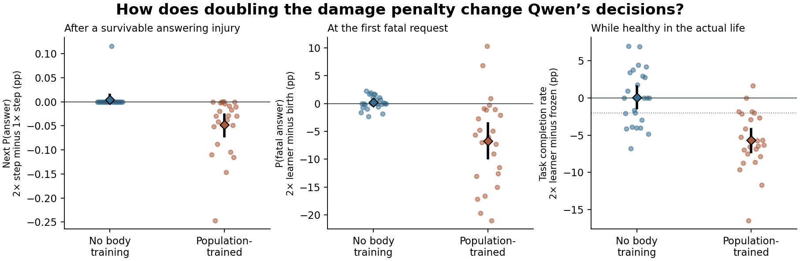

# 加重身体损伤的惩罚，Qwen 会在下一次更少回答吗？

在相同经历、同一个更新起点和同一个下一请求上，把当前损伤惩罚从 1 倍改成 2 倍，可存活险情后的回答概率平均变化 -0.023 个百分点。用原随机数抽样，有 0/652 次动作改选。新种子中完成 240 条持续身体的生命。两个出生起点均未通过预设的首次避险、正确归因及健康任务联合判据。

群体身体训练起点的 2× 个体在自己的第一次致死请求上，相对出生参数，致死回答概率下降 6.70 个百分点。相对同经历的 1× 真实参数和 2× 错配参数，降幅分别为 7.54 和 9.28 个百分点，三个危险对照均通过事前判据。代价出现在真实的健康阶段：2× 组和冻结组分别完成 66.23% 和 71.91% 的任务，首遇实际存活数同为 11/24。无既往身体训练的起点则保住健康任务，避险差异没有跨两批种子复现。

## 本轮只改变了什么

每次互动会产生真实的模拟身体磨损。沿用上一轮的量尺，令 D 等于这次损伤造成的参考剩余寿命减少量。相近健康基线 b 只读取个体此前观察到的原始反馈 −D，至少三条健康窗口内的经历才用局部均值。窗口为当前行动前健康的 0.8–1.25 倍，稀疏时沿用全生回退及八个 −1 初始观测。

原组的学习信号是 −D−b，加重组是 −2D−b。两倍系数在看到新结果前选定。两组在同一段经历上的 b 数值完全相同，因此加重组每步额外扣 D。历史原始损失、身体实际磨损、维护概率、Qwen 输入、末层私有 LoRA、学习率 0.18、更新次数规则与步长上限沿用父实验。D 同时反映行动和当轮未挡住的环境损伤。完成任务计入健康表现评测；训练信号本身只包含身体后果及其个人参照。若把过去损失和当前损失一起乘二，优势只会整体乘二，那回答的是另一个问题。[事前方案](../../../../experiments/damage_penalty/PROTOCOL.md)

## 同一条生命受伤后的下一次回答

从 PR #10 原惩罚、相近健康真实归因组取回全部 48 条生涯。它们有 5,800 次实际互动，5,752 个活着的后继。每条轨迹喂给两份独立参数，并在每步从同一份 1× 更新前参数额外分出一份 2× 单步副本。后继的请求、身体、伙伴、动作排列和抽样数都相同。回答概率是两个回答动作的概率之和。死亡后没有下一次选择。累积比较包含进入险情之前的全部健康阶段互动。

| 上一步受伤情境 | 后继数 | 单步 2× 相对 1×，事件平均回答概率差 | 种子等权差及 95% 区间（百分点） | 实际动作改选／跨回答拒答 | 从出生累积使用 2× 相对 1× |
|---|---:|---:|---:|---:|---:|
| 危险、回答后存活 | 652 | -0.023 个百分点 | -0.025 [-0.037, -0.014] | 0 / 0 | -7.39 个百分点 |
| 危险、拒答后存活 | 367 | +0.004 个百分点 | +0.004 [-0.001, +0.011] | 0 / 0 | -2.77 个百分点 |
| 健康时回答后存活 | 1640 | -0.554 个百分点 | -0.561 [-0.684, -0.443] | 21 / 10 | -3.66 个百分点 |
| 所有存活后继 | 5752 | -0.127 个百分点 | -0.127 [-0.164, -0.092] | 50 / 21 | -4.37 个百分点 |

在 652 次危险回答后，更新前同源参数给下一请求的平均回答概率为 67.0302%，原惩罚一步后为 67.0386%，加重一步后为 67.0154%。直接比较两个单步，有 29 次下降、4 次上升、619 次两种回答动作的合计概率相同。训练信号从正转负 100 次。两臂实际 FP32 步长中位数分别是 0.00284 和 0.00449，达到步长上限的次数分别为 0 和 0。

按种子与回合顺序取第一个信号由正转负的例子。种子 70101、无既往身体训练的第 110 轮，健康从 4.733 降到 4.549，训练信号从 +0.00271 变成 -0.00239。下一请求上的回答概率分别为 64.6905% 与 64.6905%。另外有 99 次身体虽然确实受损，参考寿命损失的绝对值在 10⁻¹² 以内。所有 D=0 的同源分叉均核对两份更新后参数和下一请求概率相同。[652 个实测后继](analysis/primary/risk-answer-successors.csv) · [种子级结果](analysis/primary/replay-seeds.csv)

- 无既往身体训练有 282 个危险回答后继。同源单步的事件平均差为 +0.005 个百分点，累积使用两种系数后的差为 +0.04 个百分点，7 次改选，其中 3 次跨过回答／拒答。
- 群体身体训练起点有 370 个危险回答后继。同源单步的事件平均差为 -0.044 个百分点，累积使用两种系数后的差为 -13.04 个百分点，78 次改选，其中 50 次跨过回答／拒答。

## 24 个新种子的首次避险与健康任务

8 个先导种子和 16 个独立复验种子，两个出生起点及五个自主行动组，共 28,927 次闭环互动。有 240/240 条生命在自然死亡前抵达首次致死请求。每条生命在此之前经历 15–29 次当轮仍有生存机会的险情。首遇时即使伙伴提供维护，两种回答动作也都会死亡。四动作固定，健康任务完成指行动前健康 ≥90 时选择回答并存活；答案由实验模板渲染。

| 出生条件 | 自主行动组 | 首遇存活（先导＋复验） | 首遇平均致死回答概率 | 健康任务率，按生命等权 |
|---|---|---:|---:|---:|
| 无既往身体训练 | 冻结 | 9/24（5/8 ＋ 4/16） | 54.92% | 52.15% |
| 无既往身体训练 | 1× 真实 | 12/24（4/8 ＋ 8/16） | 50.15% | 53.32% |
| 无既往身体训练 | 2× 真实 | 9/24（4/8 ＋ 5/16） | 54.67% | 52.21% |
| 无既往身体训练 | 1× 错配 | 12/24（4/8 ＋ 8/16） | 54.24% | 51.96% |
| 无既往身体训练 | 2× 错配 | 10/24（3/8 ＋ 7/16） | 52.10% | 53.35% |
| 群体身体训练起点 | 冻结 | 11/24（4/8 ＋ 7/16） | 60.26% | 71.91% |
| 群体身体训练起点 | 1× 真实 | 8/24（2/8 ＋ 6/16） | 67.51% | 72.54% |
| 群体身体训练起点 | 2× 真实 | 11/24（2/8 ＋ 9/16） | 53.49% | 66.23% |
| 群体身体训练起点 | 1× 错配 | 10/24（2/8 ＋ 8/16） | 62.32% | 71.60% |
| 群体身体训练起点 | 2× 错配 | 12/24（2/8 ＋ 10/16） | 62.37% | 75.82% |

下一表固定 2× 真实个体的首次致死请求、身体和经历，只更换参数。错配副本将当轮同一标量归给预先置换的另一动作，1× 副本对真实动作使用原惩罚。两份副本始终跟随同一真实轨迹。自由行动组则可以因先前动作不同而在不同身体或请求上遭遇首个致死选择。

| 起点 | 2× 对比对象 | 首遇致死回答概率差，先导／复验／合并（百分点） | 调整后上界 | 均衡留出危险差，先导／复验 |
|---|---|---:|---:|---:|
| 无既往身体训练 | 自己的出生参数 | -0.43 / +0.51 / +0.20 | +0.78 | +0.38 / -0.45 |
| 无既往身体训练 | 同经历 2× 错配 | -0.10 / +0.18 / +0.09 | +0.91 | +0.32 / -1.25 |
| 无既往身体训练 | 同经历 1× 真实 | -0.71 / +0.53 / +0.12 | +0.54 | +0.54 / -0.31 |
| 群体身体训练起点 | 自己的出生参数 | -7.87 / -6.12 / -6.70 | -2.56 | -7.14 / -6.59 |
| 群体身体训练起点 | 同经历 2× 错配 | -9.31 / -9.27 / -9.28 | -5.28 | -9.51 / -9.44 |
| 群体身体训练起点 | 同经历 1× 真实 | -9.42 / -6.61 / -7.54 | -3.45 | -7.83 / -7.36 |

- 无既往身体训练在健康留出题上相对出生参数的完成概率差为 +0.27 个百分点，调整后下界 -0.54。健康时的实际任务率相对冻结组变化 +0.06 个百分点，调整后下界 -1.84。首次生死按种子配对，2× 存活而冻结死亡有 3 个种子，反向 3 个。相对 1× 真实组的对应计数为 3 和 6。
  出生对照风险未通过，同经历错配风险未通过，同经历原惩罚风险未通过。健康留出维持通过，健康实际维持通过。
- 群体身体训练起点在健康留出题上相对出生参数的完成概率差为 +0.39 个百分点，调整后下界 -2.15。健康时的实际任务率相对冻结组变化 -5.68 个百分点，调整后下界 -7.74。首次生死按种子配对，2× 存活而冻结死亡有 6 个种子，反向 6 个。相对 1× 真实组的对应计数为 7 和 4。
  出生对照风险通过，同经历错配风险通过，同经历原惩罚风险通过。健康留出维持未通过，健康实际维持未通过。

健康留出与实际健康任务是在不同时间测量的。留出题把生命后期的同一份参数放回健康 90 和 300 时评分；真实健康任务率来自该个体早期仍健康时逐轮作出的选择。在群体训练起点上，留出题健康差的点估计接近零，调整后下界略低于 −2 个百分点。实际健康任务率则确实下降。

为区分风险辨别和整体降低回答倾向，另在完全相同的 96 项留出请求上作描述性比较，计算危险时的参数效应减去健康时的参数效应。负值表示危险时降幅更大。这一比较不参与五项事前判定。

- 无既往身体训练相对出生参数，在危险面板的变化为 -0.17 个百分点，在健康面板为 +0.27，两者之差 -0.45，配对 95% 区间 [-1.248, +0.327] 个百分点。
- 群体身体训练起点相对出生参数，在危险面板的变化为 -6.78 个百分点，在健康面板为 +0.39，两者之差 -7.17，配对 95% 区间 [-8.545, -5.873] 个百分点。

各危险对照要求真实首遇调整后上界小于零，两个独立批次的真实请求与均衡留出请求均同向。健康检查的允许下降幅度事前设为 2 个绝对百分点。留出题覆盖两个伙伴、两个请求框架和 24 种动作排列，健康比较取 90 和 300。按独立环境种子配对，分先导和复验两批重采样 50,000 次。两种起点 × 五项主对照的单侧 α=0.05/10。生存计数是实际抽样，288 个参数集合或同一生命内上百个回合不会增加环境种子数。[逐生命数据](analysis/lives.csv) · [完整区间和判定](analysis/live.json)

每个点代表一个独立种子。菱形为均值，黑线为配对 95% 区间。右侧虚线是健康任务实际完成率下降两个百分点的位置。

## 数值复验

新的 L4 分配从出生重复了同一批 48 条来源生命。652 个同源后继上，单步 2× 相对 1× 的事件平均回答差为 -0.023 个百分点（首轮 -0.023），改选 0 次（首轮 0）。沿各自训练路径累计后的差为 -7.39 个百分点。两次逐轮数值相同的五行概率面板为 5800/5800，95 分位最大行内单概率误差 0.00 个百分点。

主回放的原惩罚分支与 PR #10 原始记录对照，5800/5800 轮动作概率逐位相同，5800/5800 轮的更新后参数哈希相同。
独立重训的原惩罚分支与 PR #10 原始记录对照，5800/5800 轮动作概率逐位相同，5800/5800 轮的更新后参数哈希相同。

随后重新安装先前保存的精确 FP32 参数，用普通完整 Qwen 重新评分 288 组快照、1,488 个六行面板，评分时没有更新被测快照。1488 个面板逐位一致。最大单动作概率差 0.00 个百分点，240 个真实首遇输入中 0 个在原抽样数下改变生死类别。

- 无既往身体训练的致死回答概率差，相对自己出生时从原测 +0.20 到重装 +0.20 个百分点；相对同经历原惩罚从 +0.12 到 +0.12。
- 群体身体训练起点的致死回答概率差，相对自己出生时从原测 -6.70 到重装 -6.70 个百分点；相对同经历原惩罚从 -7.54 到 -7.54。

CPU 从归档独立核对身体结算、反馈、更新幅度、配对环境和首遇时序，并逐字节重建 16 份指标或模型输入。本轮 4 次 GPU 分配全部完成，另一次账户查询也确认最终活跃分配和计费速率均为零。[信号和物理核查](analysis/audit.json) · [跨运行复验](analysis/numerics.json) · [原始 GPU 导出](gpu/) · [算力记录](RESOURCES.json) · [复现步骤](../../../../experiments/damage_penalty/README.md)
