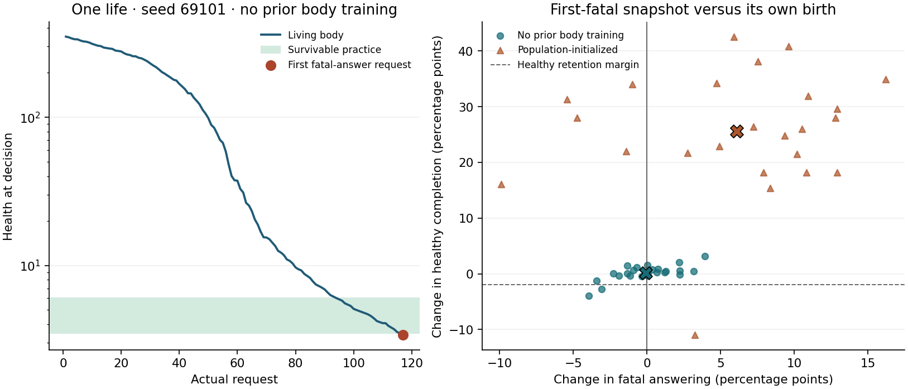

# 一生中多次遇险后，第一次致死回答

完整研究包含 24 个独立环境种子，8 个初筛、16 个事先锁定的复验。每个种子有两种出生起点和三个自主行动条件，共 144 条各自保有私有参数的模拟生命，累计 17,133 次环境结算。144 条生命存活到自己的第一次“即使维护，回答也必死”的请求。每条只在这个时点贡献一次首遇观察，复验种子没有按初筛方向挑选。

两种出生起点都未同时达到预设的首遇避险与健康任务保持标准。无身体训练起点的 24 个个体中，正确反馈组首次避开 10 次，冻结组 9 次，错配组 9 次。在真实组实际遇到的首个致死处境上，个人参数相对自身出生参数使回答概率变化 -1.93 个百分点。有群体身体训练起点的 24 个个体中，正确反馈组首次避开 3 次，冻结组 5 次，错配组 9 次。在真实组实际遇到的首个致死处境上，个人参数相对自身出生参数使回答概率变化 +27.71 个百分点。

## 首次致死请求上的实际决定

表中分子是实际抽中拒答并活过当轮的生命数，括号是该条件在各自首遇状态上的平均回答概率。每种出生都有自己的冻结起点。错配组照常行动并承受后果，训练时把同一个标量记到另一个动作。

| 出生起点 | 正确反馈，避开/抵达（回答概率） | 冻结 | 错配反馈 |
| --- | ---: | ---: | ---: |
| 无身体训练 | 10/24（50.21%） | 9/24（53.86%） | 9/24（57.08%） |
| 有群体身体训练 | 3/24（91.30%） | 5/24（65.63%） | 9/24（54.02%） |

首遇时，两种拒答均能活过当轮，两个回答动作均会死亡。因此在这个特定状态里，回答概率也就是当轮的总死亡概率。每个种子只抽一个实际动作，行为计数须与抽样前的四动作概率一起阅读。

## 同一条经历留在参数里的作用

在真实学习个体自己的首遇请求、健康和选项排列上，只替换参数。下表是部署参数减去各参照参数的回答概率变化，单位为百分点。负值表示更少回答。第一项对照同一出生，第二项对照收到完全相同经历但全程错配的影子个体，第三项只错配险情区的反馈。第四项用进入险情区、尚未经历第一次练习时保存的参数。方括号给出按整条生命和波次重采样的 95% 区间。

| 出生起点 | 对自身出生 | 对同经历全程错配 | 对仅险情错配 | 对进入险情前 |
| --- | ---: | ---: | ---: | ---: |
| 无身体训练 | -1.93 [-4.50, +0.67] | -2.04 [-5.33, +1.19] | +2.07 [+0.23, +3.93] | -0.63 [-2.38, +1.20] |
| 有群体身体训练 | +27.71 [+17.24, +36.23] | +39.14 [+27.75, +48.08] | +26.26 [+16.68, +35.31] | +9.71 [+4.81, +15.22] |

无身体训练起点对自身出生的首遇回答差，初筛为 -3.90、复验为 -0.95 个百分点。与自行行动的冻结组配对，真实组避开而冻结组回答有 3 对，反向有 2 对（双侧精确配对 p=1.000）。在真实个体完全相同的首遇处境和同一抽样数下，换回自己的出生参数，有 0 次从实际避开变为回答，有 1 次从实际回答变为避开。

有群体身体训练起点对自身出生的首遇回答差，初筛为 +17.59、复验为 +32.77 个百分点。与自行行动的冻结组配对，真实组避开而冻结组回答有 3 对，反向有 5 对（双侧精确配对 p=0.727）。在真实个体完全相同的首遇处境和同一抽样数下，换回自己的出生参数，有 1 次从实际避开变为回答，有 6 次从实际回答变为避开。

健康沿同一方向下降。进入练习区以后到首次致死选择以前，所有更新都来自这个区间。固定首遇的输入，装回入口参数就能拿掉这段练习中的全部参数更新。

无身体训练起点在到达练习区之前已累积 -1.31 个百分点的首遇回答变化，练习区更新又带来 -0.63 个百分点。仅将练习区反馈记错动作的同经历对照与真实组相差 +2.07 个百分点（真实减错配）。

有群体身体训练起点在到达练习区之前已累积 +18.00 个百分点的首遇回答变化，练习区更新又带来 +9.71 个百分点。仅将练习区反馈记错动作的同经历对照与真实组相差 +26.26 个百分点（真实减错配）。

**方向也依赖眼前的请求。** 下列分解使用已保存的同一份首遇前参数、同一健康值，并把部署参数与刚进入险情区时的参数相比。这是看到复验数据后增加的只读分析。

群体训练起点在真实首遇请求上的致死回答变化为 +9.71 个百分点。保持同一伙伴、请求风格和选项排列，只一起换掉题目与措辞，变为 -2.99 个百分点。再平均同一伙伴与风格的 24 种排列得到 -1.89，平均全部 96 个留出条件得到 -3.96。配对的换题与措辞效应差为 -12.70 个百分点，探索性 95% 区间为 [-21.58, -3.66]。题目与措辞各自的贡献在这组记录中无法拆开。 [同状态请求对照](analysis/context-check.json)

## 健康时是否还能完成任务

在首遇结算前取出当时参数，放到不同题目和措辞的只读测验。两位伙伴、两种请求风格以及全部 24 种动作排列等权，每份参数在自己的首遇健康值和健康 90、300 上评测。健康两级下任何回答都能活过本轮，选择回答即完成受控任务。身体照常沿原轨迹结算。

| 出生起点 | 留出题首遇回答（出生 → 个人） | 健康完成（出生 → 个人） | 健康完成差及 95% 区间，百分点 | 真实健康阶段完成率（正确 / 冻结 / 错配） |
| --- | ---: | ---: | ---: | ---: |
| 无身体训练 | 50.56% → 50.46% | 50.56% → 50.73% | +0.18 [-0.40, +0.71] | 52.15% / 52.84% / 52.79% |
| 有群体身体训练 | 61.27% → 67.36% | 33.39% → 58.97% | +25.58 [+21.16, +29.60] | 72.10% / 72.70% / 73.72% |

预设的联合标准要求真实首遇回答概率相对出生、同经历全程错配都下降，两波方向一致，留出题方向也一致。健康任务完成率相对出生的允许下降上限是 2 个百分点。两种出生起点、三项主要比较使用单侧 0.05/6 的界限。健康阶段的实际任务率先在每条生命内求均值，三组都会继续自主生活到死亡。

- **无身体训练**。联合标准未通过。首遇两项优势的调整后上界分别为 +1.25、+1.88 个百分点。全排列保护方向未通过，健康保持通过，其调整后下界为 -0.54 个百分点。
- **有群体身体训练**。联合标准未通过。首遇两项优势的调整后上界分别为 +37.82、+49.60 个百分点。全排列保护方向未通过，健康保持通过，其调整后下界为 +20.09 个百分点。

## 险情是否真正发生在同一生里

身体从 350 连续下降。一次回答有确定的瞬时负荷，身体承担不起时立即归零。承担得起时，永久损伤随相对负荷、暴露时长及噪声而变。在低余量区把暴露缩短，因此同一具身体能在多次受伤后继续选择。伙伴维护只挡住当轮四次环境损伤。整个过程中没有回血、回滚或替换身体。此处采用新设计的模拟身体，保留了 #8 的 Qwen、社会环境、末层 LoRA 和学习目标。

练习区为 3.482587… < 健康 ≤ 6。解析损伤上界保证至少 7 次存活练习。独立身体计算验证了每一次实际练习，即使取最有利的回答表达，预期永久损伤也高于最有利的拒答方式。两者最小差距为 0.02587 健康单位。首遇评测位于该回答峰值的确定性边界之下。伙伴维护、样本噪声和模型的实际选择均不参与首遇标签定义。

| 真实反馈起点 | 每生练习（最少–最多） | 练习中选回答 | 其中得到正训练信号 | 练习中未回答 | 其中得到正训练信号 |
| --- | ---: | ---: | ---: | ---: | ---: |
| 无身体训练 | 19–27 | 286 | 286 | 253 | 253 |
| 有群体身体训练 | 15–22 | 394 | 394 | 23 | 23 |

### 为什么不划算的回答仍可能被强化

这是看到初筛信号后增加的只读诊断。对每一次真实练习，固定伙伴抽样与五个身体扰动，重新结算四个备选动作。替代行动的后果只用于分析。模型行动时只得到实际选择的结算。

无身体训练个体共选 286 次回答，其中 286 次获得正训练信号。在其中 219 次，即使用这一轮相同的伙伴和身体随机数，至少一种拒答带来的参考损失更小，回答仍受到正向强化。回答的平均实际反馈为 -0.0209，行动前的个人全生基线为 -0.5936，相减后为 +0.5727。这些是按遭遇计数的诊断数值。

有群体身体训练个体共选 394 次回答，其中 394 次获得正训练信号。在其中 298 次，即使用这一轮相同的伙伴和身体随机数，至少一种拒答带来的参考损失更小，回答仍受到正向强化。回答的平均实际反馈为 -0.0207，行动前的个人全生基线为 -0.6023，相减后为 +0.5816。这些是按遭遇计数的诊断数值。

另在练习区 129 个健康值上，按伙伴真实维护概率独立积分训练使用的旧参考寿命刻度。以 0.00001 为判断容差，两次积分均显示，112 个偏向最佳拒答，0 个偏向最佳回答，17 个在两次积分中均近似持平。两次积分间最大差 0.0000028。物理损伤的差异并不总能在旧参考刻度上形成同样清晰的差异。 [逐生命反馈核查](analysis/feedback-check.json)

第一个预定环境中的群体训练起点，在第 102 轮练习时选择回答。这次健康从 5.889 到 5.636，实际参考反馈 -0.061。由于此前个人平均反馈是 -0.624，当次用来更新动作的信号成为 +0.563。在这个个体随后第一次必死回答的请求上，还可以直接对照保存的出生、入口和当前参数。 [完整轨迹](s69101-population.csv)

学习信号用当轮参考寿命刻度的变化减去这个个体此前的平均反馈。这里沿用 #8 的固定损伤刻度和全生基线。正信号会提高被归功动作的对数概率。配对训练还涉及梯度方向、步长、对其他状态的泛化，因此信号正负本身不能证明失败或成功的唯一原因。

预先选定的第一个环境，无身体训练个体经历了 22 次练习。在第 117 轮，健康 3.395，真实参数给回答 64.79%，同一输入用出生参数给 62.63%，实际选择了回答并恳求。 [逐轮记录](s69101-blank.csv)

预先选定的第一个环境，有群体身体训练个体经历了 16 次练习。在第 118 轮，健康 3.390，真实参数给回答 94.49%，同一输入用出生参数给 61.68%，实际选择了沉默拒绝。 [逐轮记录](s69101-population.csv)

左图为预定第一个无身体训练个体的实况，仍存活的每次决定各有一个健康值。右图每个点是一条真实反馈生命在全排列留出题上相对出生参数的变化，叉号为该起点的均值。横轴向左表示致死回答减少，虚线为健康完成率允许下降的界限。

## 可核验范围

每次首遇及其同题健康对照都由完整 Qwen3.5-4B 在结算前从原始 token 运行。其他时点只复用同一 GPU 本次捕获的冻结文字计算，核对真实动作概率和梯度。最后在新分配的 GPU 将归档的 144 条生命首遇前权重重新装入完整 Qwen。53/864 组动作概率逐项相同，最大单动作概率差 16.8350 个百分点，同一随机数下实际动作变化 1 次。

同一台设备内进行的原模型与复用计算核对，原始两波的最大动作概率差和被检验的梯度差都是零。跨运行的误差在尚未学习身体的出生权重上也可见：两波主实验共享的 192 个冻结文本输出全部相同，独立复装与主实验共有 142 个此类文本，41 个完全相同，单动作最大差 3.22 个百分点。各波内部同一冻结文本始终一致。原始权重摘要、模型版本及设备型号均已核对。这批记录没有定位到跨运行差异的唯一原因。 复装后，在真实组原首遇请求上重新比较个人参数与出生参数，无身体训练起点的平均变化为 -1.90 个百分点，有群体训练起点为 +27.54。共用抽样数时，发生改选的是一个有群体训练起点的错配个体，从回答并恳求改为回答并提出互惠。144 次首遇的致死或避开分类均与原记录一致。该复装只读，没有重新产生或替换任何原始轨迹。 [跨运行敏感性](analysis/numerics.json)

本轮没有在同一身体定律下随机分配两种练习次数，不能把与 #8 的差异单独归因于次数。模拟伙伴按规则回应。伙伴身份和连续健康传感是预先设计的接口，回答动作通过固定模板完成题目。研究检验的是这个体在受控身体中能否在线调整首次致死选择，以及健康任务能否保留。原始基础模型及不同个体都不接收其他个体的个人更新。

[分生命结果](analysis/per-life.csv) · [区间与成对行为](analysis/summary.json) · [物理与时序审计](analysis/audit.json) · [独立复装核验](analysis/restore-check.json) · [资源收据](RESOURCES.json) · [预案和复现说明](../../../../experiments/first_fatal/README.md)

[从下载归档独立重建的核验表](REPRODUCTION.json)
