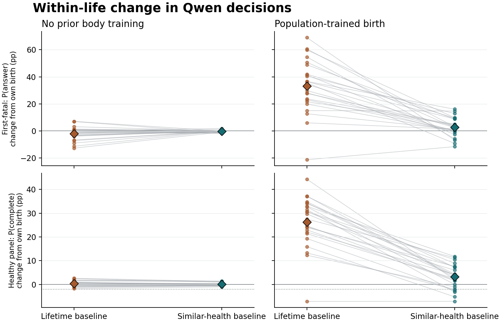

# 比较基线怎样影响 Qwen 一生中的下一次选择？

在 48 条已记录的生命中，把一次可存活险情的结果与相近健康经历比较，实际参数步长的中位数约为全生基线的 1/34.1。相同起点、相同下一请求和随机数下，这一次相近健康更新在 0/680 次改变了下一动作。两条基线沿相同经历累积学习后，有 114/680 次下一动作不同。随后用 24 个独立新环境种子检验了 240 条从出生直到死亡的自由生命。两种出生条件都未通过预设的避险与健康任务联合标准。

主要差异出现在群体训练起点。在相同经历、相同身体、相同首次请求下，相近健康真实参数的致死回答概率相对全生真实参数下降 33.15 个百分点，相对自己的出生参数，致死回答概率的点估计上升 2.89 个百分点。全生基线下积累的危险回答倾向减弱了，个人经历带来的独立避险收益仍缺少证据。无既往身体训练起点的首遇差为 -0.25 个百分点，到均衡留出题则为 +0.26。

## 同一生命的单步与累积影响

从 PR #9 取回两种起点的全部 48 条真实反馈轨迹。两份私有 LoRA 依次收到完全相同的已经发生的行动、应答及身体后果。第三份临时 LoRA 每次复制全生组更新前的参数，使用与全生组相同的梯度和行为概率，仅替换本次基线，然后在真实的下一请求上评分。记录里的后继抽样只用于比较，之后继续使用原轨迹实际行动。死亡后的更新没有下一次观测。

| 680 次险情回答后的同一个下一请求 | 四动作改选 | 回答／拒答互换 | 概率向量逐位相同 | 随机数遍历时改选的平均概率 |
|---|---:|---:|---:|---:|
| 同一全生起点，更新前 → 全生一步 | 2 | 1 | 270 | 0.546% |
| 同一起点，更新前 → 相近健康一步 | 0 | 0 | 608 | 0.024% |
| 相近健康自己的起点，更新前 → 更新后 | 0 | 0 | 638 | 0.047% |
| 同一起点，全生一步 → 相近健康一步 | 2 | 1 | 272 | 0.548% |
| 自出生一直用全生 → 一直用相近健康 | 114 | 85 | 8 | 17.759% |

全生基线实际 FP32 参数步长中位数 0.09191，相同参数和梯度下相近健康基线 0.00270，相近健康沿自己轨迹更新时 0.00246。680 次中相近健康优势有 314 次为负、365 次为正，另 1 次在 ±10⁻⁹ 内。学习率始终为 0.18。表中最后一列按四个语义动作的累计概率区间求交，计算同一随机数下两种选择不同的区间总长度。

例如预定首条生命 69101 的无既往训练个体第 96 轮，优势从 +0.6151 变成 -0.0195，步长从 0.05387 变成 0.00171。下一轮随机数为 0.6129，两种单步更新及未更新版本都选了同一个动作（回答并恳求维护）。

- 无既往身体训练共有 286 个险情回答后继。两份累积学习参数有 26 个后继动作不同，15 个跨回答／拒答，平均回答概率差为 +2.25 个百分点。
- 群体身体训练起点共有 394 个险情回答后继。两份累积学习参数有 88 个后继动作不同，70 个跨回答／拒答，平均回答概率差为 -17.40 个百分点。

放宽到全部 5,640 个活着的后继，相同起点的相近健康单步有 41 次改选。因此，险情回答子集上的数字有明确的适用范围。每条生命的重复回合共享参数和经历，不作为独立样本。[680 个事件](analysis/replay-practice-answers.csv) · [按种子汇总](analysis/replay-seeds.csv) · [完整回放统计](analysis/replay.json)

## 新种子中的首次避险与健康任务

每个环境种子有两个参数起点，每个起点有五条独立自主行动的生命。个体只有一具持续损伤的身体，真实组每轮根据当轮已实现的后果更新私有末层 LoRA。错配组把相同标量归给预先确定的另一个动作。基线使用该个体以往所有真实反馈，或先筛选行动前健康在当前健康的 0.8–1.25 倍之间的以往反馈，至少三条时取平均。稀疏时回退到全生规则。模拟身体、损伤／维护时序、冻结参考寿命奖励、学习率和更新次数规则均沿用上轮。

| 出生条件 | 自由行动组 | 首遇存活（8＋16 个种子） | 首遇平均致死回答概率 | 健康任务完成率，按生命平均 |
|---|---|---:|---:|---:|
| 无既往身体训练 | 冻结 | 7/24（3/8 ＋ 4/16） | 52.47% | 52.94% |
| 无既往身体训练 | 全生基线，真实归因 | 11/24（1/8 ＋ 10/16） | 53.61% | 52.64% |
| 无既往身体训练 | 相近健康，真实归因 | 8/24（2/8 ＋ 6/16） | 55.69% | 52.50% |
| 无既往身体训练 | 全生基线，错配动作 | 11/24（2/8 ＋ 9/16） | 50.01% | 52.06% |
| 无既往身体训练 | 相近健康，错配动作 | 10/24（3/8 ＋ 7/16） | 49.29% | 52.45% |
| 群体身体训练起点 | 冻结 | 7/24（4/8 ＋ 3/16） | 63.87% | 72.47% |
| 群体身体训练起点 | 全生基线，真实归因 | 1/24（0/8 ＋ 1/16） | 93.85% | 73.34% |
| 群体身体训练起点 | 相近健康，真实归因 | 9/24（3/8 ＋ 6/16） | 63.01% | 72.66% |
| 群体身体训练起点 | 全生基线，错配动作 | 9/24（3/8 ＋ 6/16） | 51.71% | 72.14% |
| 群体身体训练起点 | 相近健康，错配动作 | 5/24（3/8 ＋ 2/16） | 61.30% | 72.83% |

240 条自然死亡生命均有完整轨迹，共 28,803 轮。记录到 240 个首次致死请求。两种回答即使获得当轮维护都会死亡，两种拒答当轮可存活。健康时的实际任务完成率按行动前健康 ≥90、回答并且存活计，每条生命等权。任务使用固定答案渲染器，指标衡量选择承担任务的能力。两臂自由生活后到达首遇的伙伴、题面或健康可以不同。[逐生命数据](analysis/lives.csv)

## 固定首次遇险处境，只替换参数

下表在相近健康真实归因个体实际首次致死请求上比较。冻结出生参数、相近健康错配参数、全生真实参数都在这一个体的相同文本、身体、选项和伙伴上评分。两个对照参数在影子副本中学习同一条真实轨迹。负的危险差表示致死回答减少。健康留出差使用两种伙伴、两种请求框架、24 种排列，健康取 90 和 300。单位均为绝对百分点。

| 起点 | 相近健康真实参数对比对象 | 危险差：先导／独立复验／合并 | 危险差调整后上界 | 留出危险差：先导／复验 |
|---|---|---:|---:|---:|
| 无既往身体训练 | 自己的出生参数 | -0.43 / -0.17 / -0.25 | +0.15 | +0.31 / +0.23 |
| 无既往身体训练 | 同经历的错配参数 | -0.42 / -0.46 / -0.45 | +0.16 | -0.03 / +0.55 |
| 无既往身体训练 | 同经历的全生真实参数 | +0.83 / +1.69 / +1.40 | +4.46 | -0.61 / -0.18 |
| 群体身体训练起点 | 自己的出生参数 | +0.62 / +4.02 / +2.89 | +6.26 | +0.94 / +2.56 |
| 群体身体训练起点 | 同经历的错配参数 | +0.90 / +4.69 / +3.42 | +8.40 | +1.22 / +2.68 |
| 群体身体训练起点 | 同经历的全生真实参数 | -35.19 / -32.13 / -33.15 | -24.53 | -1.09 / -1.35 |

- 无既往身体训练在健康留出面板上相对出生参数的任务概率差为 +0.08，调整后下界 -0.25（预设界限 −2.00）。回到自由行动，真实相近健康组与冻结组在首次存活上，只有前者活过的种子有 4 个，只有后者活过的有 3 个，配对精确双侧 p=1。健康实际任务完成率相差 -0.44 个百分点，配对 95% 区间 [-1.40, +0.53]。
- 群体身体训练起点在健康留出面板上相对出生参数的任务概率差为 +3.19，调整后下界 +0.64（预设界限 −2.00）。回到自由行动，真实相近健康组与冻结组在首次存活上，只有前者活过的种子有 5 个，只有后者活过的有 3 个，配对精确双侧 p=0.727。健康实际任务完成率相差 +0.19 个百分点，配对 95% 区间 [-1.69, +2.01]。

先导 8 个和独立复验 16 个环境种子在四种伙伴生态内平衡。每个种子带全部配对条件一起重采样，分两批分层，50,000 次。三项危险对照与一项健康维持检查乘两种起点，单侧 α=0.05/8。判定还要求三项危险差在两批真实请求和两批均衡留出请求上方向一致。样本中的首遇存活数、实际概率、留出概率及自由健康任务各有自己的分母。[事前方案](../../../../experiments/health_baseline/PROTOCOL.md) · [完整差值、界限及配对数据](analysis/live.json)

每条细线连接同一环境种子的两条真实归因生命。纵轴是部署参数相对各自出生参数的变化，菱形为平均值。上排在各生命实际首遇上评分，下排在同一组健康留出题上评分。

在这具只会继续受损的身体里，符合相近健康窗口的既往经历都来自当时健康略高的状态。首次遇到致死请求时，个体此前能观察到的只有可存活险情的后果。更换基线能改变这批经历的相对分数，个体仍须把这种经验迁移到跨过致死阈值的第一次决定。

## 数值复验与证据边界

在一次新的 L4 分配上，从出生重新训练全部 48 条旧轨迹。相同起点的相近健康小步在两次运行的 680 个指定后继中分别改选 0 和 0 次。两条累计基线分别有 114 和 113 次不同。逐个输入比较，163/5688 组回放概率逐位相同，四动作、五参数行的最大单概率偏移为 73.76 个百分点。这些是同一批经历的技术复验。

另在后续独立分配上重新加载原始 FP32 参数，用常规完整 Qwen 前向复算 288 组快照的 1488 个面板。125 个面板完全相同，最大单动作概率偏移 29.63 个百分点。240 条自由生命的首遇部署动作有 5 个改变，其中 2 个改变回答／拒答类别。此次重装包括所有真实首遇和各健康水平的一例轮换留出项，不将它当成又一套独立生命。[跨运行核查](analysis/numerics.json)

与 PR #9 留存的旧全生运行比较，本次固定轨迹中 520/5688 轮四动作概率完全相同，跨轮累积过程中最大单概率差 73.76 个百分点。重放使用原行动和原行为概率，并根据重新评分的策略做预定重要性修正。协议的主对比均在相同工作进程中配对运行。固定转移的重放不能充当自由行动证据；训练后果标量仍只评价当步身体变化，两种基线均未引入未来反事实或更强的惩罚。

CPU 独立重算全部身体轨迹、机会到达、过去反馈窗口、动作归因、更新倍率、顺序和终止。实测参数步长与梯度公式的最大差 5.6e-08。本轮共 7 个顺序分配，最终活跃分配和计费速率为零。[逐项核查](analysis/audit.json) · [算力记录](RESOURCES.json) · [原始导出](gpu/) · [字节复现与使用步骤](../../../../experiments/health_baseline/README.md)

在五次完成训练或回放的 GPU 运行内部，复用冻结上游张量的计算与从原始 token 开始的完整 Qwen 共逐项比对 7,534 个概率面板、986 组梯度。最大概率差 0，最大梯度差 0。跨分配误差另按同输入、同参数的重装和整条轨迹重训分别计算。

独立回放中的全生组与 PR #9 原始记录对照，5688/5688 轮的四动作概率完全相同，5688/5688 轮更新后参数哈希相同。在这次回放上，全生与相近健康单步中位数分别为 0.09088 与 0.00259，相当于 1/35.1。首次回放的比率为 1/34.1。

相同的群体起点首遇快照在完整模型上重装后，相近健康真实参数对同经历全生真实参数的致死回答差为 -32.52 个百分点，对出生参数为 +3.13。原始测量分别为 -33.15 与 +2.89 个百分点。

有 1 次运行中途被服务端解除分配。使用相同 SHA-256 的输入包重跑了原定种子，正式分析只使用完整重跑。中断时已完整保存 10 条生命；同一种子和出生条件重跑后，其中 0 条的首遇生死判定改变。此项是意外获得的技术重复，不增加独立样本数。[中断记录](interruptions/) · [已备份生命与重跑逐条对照](analysis/interrupted-retry.json)

进一步固定出生参数、尚未有任何个体更新，旧归档与本次回放的首轮概率最大偏移在无既往身体训练起点为 1.86 个百分点，群体训练起点为 18.75 个百分点。这把相同参数上的数值差异与多步重新训练累积的差异区分开来。[冻结输入与起点的数值核查](analysis/device-check.json)
