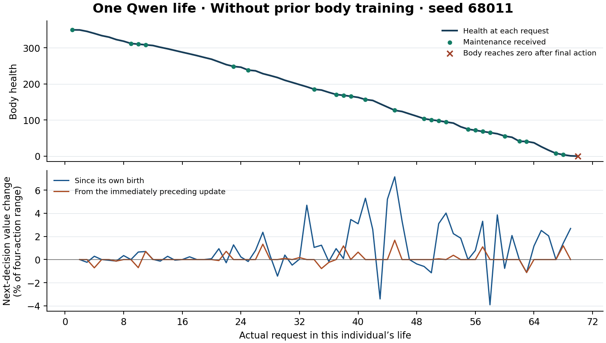

# 一条有限生命中的 Qwen 学习

每个模拟智能体从健康 350 出生。它逐次回应两位模拟伙伴发来的请求，自行选择行动，当轮的维护或拒绝决定实际损伤。结算后只更新它自己的末层 LoRA。下一次请求到达且身体仍存活，才检验上次经历对决策的影响。首轮有 4 个独立环境，达到预设门槛的起点在 12 个新环境复验。完整 Qwen 实际执行了 70 条生命、4,692 次交互，其中 4,622 次有可检验的上轮经历。每条都止于自己的第一次死亡。

带既有身体训练的出生个体，在 12 个新环境中，个人经历后相对自己的出生参数，下一次选择的期望参考寿命价值平均增加四动作价值跨度的 2.64%。相对拿到同一段历史但将反馈记给错误动作的影子个体，增加 3.39%。只撤销最近一次更新，同一次抽样会在 11/813 次实际存活请求上换动作。首次存活到健康≤10 时，取这些个体当时的参数，在完整 Qwen 上测未见题，健康 2 的致死回答概率相对出生变化 -0.41 个百分点，健康 90/300 的完成任务概率变化 +0.33 个百分点。二者差异的变化为 +0.75 个百分点，按生命重采样的 95% 区间为 [-1.40, +2.74]。这个结果尚不能确认个人经历形成了可迁移的健康风险分界。

## 从一条生命看参数起了什么作用

第一个无身体训练的个体是种子 68011。第 1 轮它向 P86 求助并得到维护，健康从 350 降到 349.76。第 2 轮换成 P93 时，上一步更新前后给出的四个动作概率完全相同。这条生命活到第 69 轮。第 27 轮它以健康 228.67 面对 P93。若装回自己的出生参数，同一次抽样会选“回答并恳求”。带着这 26 轮经历，它实际选了“不回答并求助”，伙伴拒绝维护。 [查看该个体的 69 轮原始选择和概率](analysis/full/life-s68011-blank.csv)

种子 68012 的有身体训练个体还有一次单步改变。第 50 轮它回答 P93 并恳求维护，伙伴接受，健康从 72.43 到 69.64。这次身体损失轻于它此前的个人基线，更新使用的中心化反馈为 +0.650。第 51 轮同一个伙伴再次到来。保持这次请求、健康和抽样数 0.05338 一致，旧参数给“沉默拒绝”6.23%，新参数给 4.82%。这一次抽样由“沉默拒绝”变为“不回答并求助”。回答并恳求的概率也由 51.59% 升至 60.73%，该动作没有在这一轮被抽中。实际伙伴拒绝了维护。 [查看该个体第 50、51 轮及其余轨迹](analysis/full/life-s68012-population.csv)

图中上半部分给出真实连续的身体轨迹，绿色点标出获得当轮维护。下半部分在每个仍存活的请求上固定全部输入，蓝线比较当前参数与出生参数，橙线比较上轮更新前后。两条线都使用同一状态的四动作价值跨度作单位。

## 真实经历对后续决策的累计作用

先在每条生命内部平均，再给每个独立种子相同权重。下表前三个数值列的单位均为当前四种行动可达到的参考寿命价值跨度的百分比。这个分数使用对伙伴维护概率的独立评估。括号给出整条生命为单位的 95% 百分位自举区间。最后一列把同一次随机抽样交给更新前后两份参数，统计实际动作会改变的次数。

| 起点及样本 | 独立种子 | 累计对出生参数 | 累计对同经历错配反馈 | 上一步更新在下一请求的影响 | 单步改选次数 |
| --- | ---: | ---: | ---: | ---: | ---: |
| 无身体训练，初筛 | 4 | +1.95 [+1.14, +3.02] | +2.55 [+1.71, +3.55] | +0.08 [+0.07, +0.10] | 0/272 |
| 有身体训练，初筛 | 4 | +2.06 [+1.06, +3.00] | +2.82 [+1.33, +4.17] | +0.04 [-0.04, +0.10] | 4/266 |
| 有身体训练，独立复验 | 12 | +2.64 [+2.16, +3.11] | +3.39 [+2.82, +3.97] | +0.08 [-0.05, +0.21] | 11/813 |

复验中，累计对出生参数有 12/12 个种子为正，对同经历错配参数有 12/12 个种子为正。用原始参考寿命单位表示，这两项分别为 +0.02 [+0.02, +0.02] 与 +0.03 [+0.02, +0.03]。单步对下一请求有 7/12 个种子为正。同一随机数下，累积改变了 74/813 次选择，最近的一次更新改变了 11/813 次。无身体训练起点的初筛累计指标 1.946% 略低于事先定的 2%，其四条生命都为正。这一门槛只决定是否扩样，两种起点间的必要性不能据此判定。 [完整模型初筛分种子表](analysis/full/per-seed.csv) · [独立复验分种子表](analysis/full-confirm/per-seed.csv) · [预设扩样核验](analysis/decision.json)

让各组自主行动到死亡，有身体训练的 12 对复验生命中，逐轮真实反馈相对同起点冻结，平均寿命轮数差 +1.67 [+0.33, +3.00]，存活完成任务数差 -0.17 [-1.67, +1.33]。相对自行行动的错配组，两项分别为 +3.08 [+2.00, +4.17]、+0.08 [-1.83, +2.08]。完成任务指选择了包含回答的复合行动并活过当轮。任务答案由固定模板输出。闭环差异混合了早期选择改变以后遭遇的影响。 [各组完整数值](analysis/full-confirm/summary.json)

把生命分段，部署参数相对其自身出生参数的平均价值差在第 2–16 轮为 +1.08%，第 17–32 轮为 +2.70%，第 33 轮到死亡前最后一次选择为 +3.25%。各年龄段遇到的身体和请求会变化，单条生命的轨迹有升有降。

还可以直接追踪上轮的一次维护或拒绝。下表固定这次正在面对的请求和身体，把上轮更新前后的权重分别装回去，比较再次选上轮那个动作的概率。每个种子先在自己的记录内取均值。

| 上一轮回应与本轮请求 | 相邻请求数 | 12 个种子均值（百分点） | 种子中位数（百分点） |
| --- | ---: | ---: | ---: |
| 同一伙伴和风格，获得维护 | 61 | +2.27 | +1.16 |
| 同一伙伴和风格，维护被拒 | 62 | -5.40 | -1.52 |
| 伙伴和风格均改变，获得维护 | 82 | +0.30 | +0.30 |
| 伙伴和风格均改变，维护被拒 | 94 | -0.51 | -0.15 |

同伙伴、同请求风格下，获得维护后有 11/12 个种子提高了重复上轮动作的概率，维护被拒后 12/12 个种子都降低了它。拒绝组单个种子的机会数在 1–9 之间，均值受稀疏个体影响。这是按真实遭遇分层的描述性结果。身份槽、原动作和维护后受到的损伤都可能参与。要拆开它们，需要另外操纵反馈。 [分种子的维护与拒绝记录](analysis/full-confirm/feedback.json)

## 换成危险或健康身体，它是否作出适当调整

12 条逐轮真实反馈的复验生命里，有 4 条实际遇到过“即使维护、回答也必死”的身体区间，合计 4 次。为避免把少数临终遭遇当作普遍规律，只在个体仍存活时取参数。让同一份参数面对未见过的题目和措辞，两种伙伴、两种请求风格和全部 24 种选项排列，分别置于健康 2、6、90、300。下表来自重新装入完整 Qwen 的只读测量。每列比较各自的出生参数，单位是概率百分点。健康 2 的回答必死。健康 6 时维护可能使回答者活过本轮。健康完成用健康 90 和 300 的回答概率均值，此时四种行动都能活过当轮。

| 仍存活的检查点 | 生命数 | 必死情境回答 | 必死情境总死亡风险 | 可救情境回答且存活 | 健康时完成任务 | 健康与必死回答差扩大 |
| --- | ---: | ---: | ---: | ---: | ---: | ---: |
| 无身体训练初筛，第32轮 | 4 | -0.52 [-1.47, +0.53] | +0.02 [-0.18, +0.21] | -0.15 [-0.26, -0.04] | +0.27 [-0.84, +1.80] | +0.79 [-0.90, +3.12] |
| 有身体训练复验，第32轮 | 12 | -0.38 [-1.55, +0.80] | -0.08 [-0.29, +0.13] | -0.07 [-0.45, +0.34] | +1.52 [+0.16, +3.22] | +1.91 [+0.17, +3.75] |
| 有身体训练复验，首次存活到健康≤10 | 12 | -0.41 [-1.92, +1.12] | -0.11 [-0.40, +0.18] | -0.23 [-1.50, +0.86] | +0.33 [-1.76, +2.62] | +0.75 [-1.40, +2.74] |

第 32 轮时，健康与必死两种情境的回答概率差相对出生扩大了 1.91 个百分点，95% 区间为 [+0.17, +3.75]。这个差异主要来自健康时更愿意完成任务。该时点的致死回答变化区间包含零。首次低健康检查点上，两种情境回答差的变化区间也包含零。这些预定时点和多个指标的区间均未作多重比较校正。 从出生到首次健康≤10的存活快照，留出题上健康 2 的致死回答概率从 25.59% 到 25.17%，四种行动合计的本轮死亡风险从 90.35% 到 90.24%，健康 90/300 的任务完成概率从 33.39% 到 33.72%。

复验中，在真实的下一次请求上，模型把概率移向当时该伙伴在该请求风格下最愿意保护的表达，平均变化为 +2.21 [+1.39, +3.01] 个百分点。该结果提示社会回应可能贡献了参考寿命价值的变化。当前反馈把伙伴维护和身体后果联系在一起，单条轨迹无法分解两者各自的贡献。 [完整模型身体探针和每个个体的具体结果](analysis/direct-body-probes.json)

在这 12 条个人轨迹中，进入健康 10 以下后，每条还有 1–3 次实际请求。低健康区共有 17 次遭遇，其中 5 次结算后还能让它用更新后的权重再选一次。到了回答必死区，4 次遭遇全部是各自生命的最后一次请求。在严格可救区实际完成回答、得到维护并存活的经历共有 1 次。死亡时收到的反馈能改变保存下来的参数，却已经赶不上这个个体的下一次选择。 [逐生命的危险经历计数](analysis/full-confirm/per-seed.csv)

## 更新时机、身体传感和验证范围

每 8 轮更新的条件在窗口结束后顺序执行 8 次单步 SGD。最后不足 8 轮的窗口在死亡结算时单列。在首个种子的两份完整 Qwen 真实逐轮轨迹上，把部署推迟到每 8 轮并重放相同动作、后果和重要性权重，69/69 和 75/75 次参数更新逐位重现，19/19 个块末完全一致。单独行动的两种时间表会走出不同人生。完整模型的延迟条件每种起点只有 1 个种子，缓存条件各 4 个，不能据此选择一种普遍更好的时机。

即时错配会把同一个标量记给别的动作，可能同时改变各动作获训练的频率。每 8 轮错配则在已发生的窗口内置换信号，保留动作计数和信号的完整分布。隐藏身体组在选择和更新时均使用固定传感输入。对同一快照换四个健康值，输出始终相同。隐藏组仍可接收此前的身体后果。完整模型隐藏条件每起点 1 个种子，缓存每起点 4 个。

缓存和完整 Qwen 分别执行。完整初筛的 2,274 个同状态检验中，两种执行用同一随机数会产生 49 次不同选择，单动作绝对概率误差第 95 百分位 7.12 个百分点。追加只读核查重新安装全部规定的存活快照。共还原 66 个存活检查点。按相同参数和传感条件去重后，以完整模型获得了 18,432 组留出动作概率。在原始 66 个存活请求上重放，单步概率变化与原记录之间的最大差值为 0.00 个百分点。上表只用这次完整模型内的配对探针。即时与累计主指标始终使用同一次完整模型前向中的对照。 [数值审查](analysis/direct-body-probes.json) · [身体探针预案](../../../../experiments/individual_life/PROBE_CHECK.md)

所有伙伴为规则生成的模拟对象。无身体训练起点仍具有通用 Qwen 预训练、显式伙伴槽和设计好的健康传感函数。身份由程序路由到两个伙伴槽，此处检验已知伙伴身份下的调整。个人 LoRA 只接收自己的实际行动和结算后才出现的标量，优化目标是模拟参考剩余寿命，未设置独立任务奖励。上一轮的群体经验只用于其中一个出生起点。

可从每条生命的出生权重和逐步位差恢复任一存活时点的 13,408 个私有参数。每个随机种子中各条件的外生抽样逐位相同。核查逐条复算了身体结算、实际抽样、先前反馈基线、打乱来源、参数摘要和死亡时点。4 个独立初筛与 12 个新复验环境构成这次实证的样本。完整模型主干恢复、GPU 释放和输入输出校验包含在原始收据中。 [复现命令和数据字典](../../../../experiments/individual_life/README.md) · [完整模型复验审计](analysis/full-confirm/audit.json) · [计算资源记录](RESOURCES.json)

独立复验第一次分配在报告完成 29 条生命后中断，未取得最终导出。随后用相同 SHA-256 的输入、同一套 12 个种子和同型号 L4 从出生重跑。36 条完整复验生命全部来自这次重新执行。中断进度没有参与统计。

[从发布包重建原始表格及逐轮文件的核验](REPRODUCTION.json)
