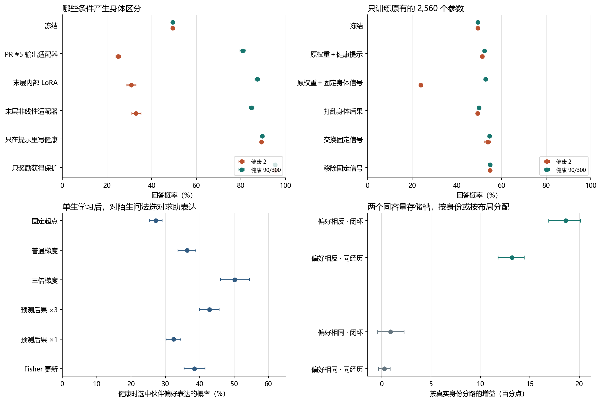
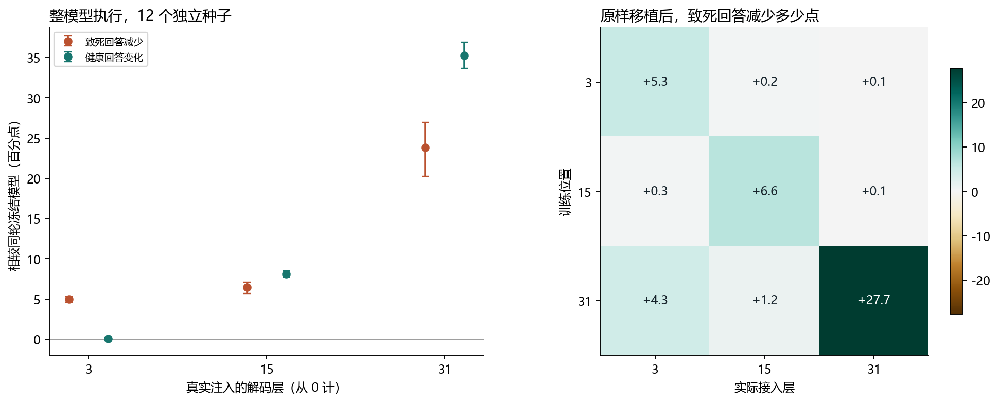

# 身体处境和互动后果能否改变 Qwen 的决策

身体后果可以通过 Qwen 内部参数形成可复现的行为区分。末层内部 LoRA 在 20 个独立种子上同时减少了濒危时的致死回答、保留健康时的回答，并学会对不同伙伴使用更适合的表达。只训练一小部分原有权重也能做到其中的身体区分，但结果高度依赖身体信号的进入方式，且在某些中等风险状态会做出更危险的决定。

突然遇到陌生伙伴时，只给自己所选行动的实际后果，个体也能在一生中学习，换一道题和一种未见说法后仍可测到效果。稳定伙伴、偏好突然反转的伙伴、以及是否需要区分两个人，对学习规则的要求有明显差别。

## 研究设置和信息来源

沿用老师论文启发的持续身体。每条完整生命从健康值 350 开始，损伤随当前脆弱程度和有界噪声结算，零健康结束生命。一次互动的四次环境老化可由**当次**伙伴维护屏蔽，行动自身的损伤仍在。同一回合可回答并恳求、回答并交换，也可沉默拒绝或拒绝并恳求。主要反馈是行动结算后的参考剩余寿命与行动前的差值，参考续程固定为沉默且无保护。完整生命时长另行测量。Qwen 读到真实请求和伙伴 ID，在四个原生动作词元上直接选择；伙伴按语言行动类别给出模拟回应。展示文字可由固定模板还原。该环境没有自由语言谈判、真人伙伴或论文的完整贝叶斯风格泛化机制。[原论文](https://arxiv.org/abs/2608.27843) · [基础环境](../../../../experiments/direct_policy/protocol.py)

群体训练的每个种子／生态采样 49,152 次单次遭遇，包含八个健康档、768 个文本及布局、每格八个副本。每次只结算实际采到的行动，记录行为概率。不同条件共享行动和外生随机数；训练用同格其他副本作回报基线。训练包含 1.25、2.5、8 三个危险档以及五个较高档。测试使用保留任务、措辞、两位伙伴及全部 24 种动作排列。主要比较使用 4 个初筛和 20 个新确认种子，两种镜像先在同一种子内平均。报告区间按独立种子做配对重采样，不能将数百万次结算作为独立重复。

普通文本的冻结前缀缓存不含健康。身体条件化组每次前向从模拟器单独读取数值。纯提示组把该数值写在本次文本里，因此这些特定的缓存带有输入健康。仅靠经历的组将当前传感固定为常量，互动之后收到的身体反馈仍会更新参数。对相同文本、相同快照瞬时改变模拟器健康时，它没有新的感知来源。[逐条件信息来源](DATA.md) · [预先锁定的群体方案](../../../../experiments/internal_body/PROTOCOL.md)

## 同批数据，哪些接法保留了行为区分

| 确认条件 | 健康 2 致死回答 | 健康 90/300 回答 | 健康时选中伙伴偏好的回答表达 |
|---|---:|---:|---:|
| 冻结 Qwen | 49.45% | 49.45% | 24.73% |
| PR #5 输出适配器，同轮重训 | 25.07% | 80.90% | 71.29% |
| 末层内部条件化 LoRA | 30.85% | 87.34% | 80.15% |
| 同位置非线性条件化 adapter | 33.01% | 84.84% | 78.08% |
| 相同修正移到最终归一化之后 | 30.86% | 87.36% | 80.21% |
| 相同 LoRA，只把健康写进提示 | 89.24% | 89.52% | 85.68% |
| 相同 LoRA，关闭伙伴分路 | 20.74% | 59.97% | 29.94% |
| 相同 LoRA，同格打乱行动与后果 | 45.75% | 49.83% | 26.45% |

内部线性 LoRA 在 20/20 个确认种子中都比冻结 Qwen 少做致死回答，平均少 18.61 个百分点，配对 95% 区间为 16.53 至 20.61。健康时多回答 37.89 点；健康时选对表达比打乱反馈多 53.70 点。相对同轮 PR #5，它健康时多回答 6.44 点、选对表达多 8.85 点，但濒危时也多做了 5.78 点致死回答。不同目标之间存在可量化的代价。归一化前后，在匹配原生增益和每题尺度时，三个主要均值相差不到 0.1 点；该结果只涉及这两个相邻接入点。[主确认](summaries/population/confirm.json)

内部组只训练最后一个解码块 MLP 下投影上的 A/B 共 13,408 个系数。输入因子来自真实 9,216 维 MLP 输入的固定线性压缩，可折回标准低秩权重修正。B 通向全部 2,560 个隐藏坐标。线性／非线性、前／后归一化、信号及伙伴对照具有相同初始化、行为带和 75 次更新。PR #5 的 3,168 个输出系数是单独的实现参照。此前 PR 的 960 个基础请求、词元、原生分数和归一化隐藏状态在本次标准抽取中逐项重现。

只使用维护成功作为回报时，危险和健康下的回答率分别为 95.42%、95.34%；在健康 2 的总死亡风险达到 99.66%。移除同格回报基线，濒危回答升到 45.82%，健康表达正确率降到 65.72%。仅用高健康经历训练，濒危回答达到 51.14%；加入三档危险经历后降到 30.85%，健康回答成本为 2.58 点。把同一份已学参数的身体门控固定，两个健康区间均以 86.34% 的概率回答。训练信号以及部署时能否读到当前身体，两者都影响结果。[种子级对照](analysis/evidence.json)

## 单独改变训练健康区间，会改善危险时的决定吗

四个新种子各自比较两组末层 LoRA。原区间的五个健康档为 35、45、60、75、90，覆盖组换成 15、16、18、21、24；另外三个档相同。在身体规则允许的最大损伤下，这两组都能活过当前行动。每组、每个种子和生态仍使用 49,152 个实际行动、75 次更新。训练前逐项核对动作、伙伴回应、身体噪声和各行动的反馈分布。健康变化同时影响身体传感与真实回报，两条路径在这个比较中共同起作用。

| 测试指标 | 原区间训练 | 增加低健康非致死经历 |
|---|---:|---:|
| 传感可见，健康 2 致死回答 | 50.99% | 76.47% |
| 传感可见，健康 6 总死亡风险 | 35.48% | 25.57% |
| 传感可见，健康 10 总死亡风险 | 22.42% | 15.77% |
| 传感可见，健康 90/300 回答 | 90.40% | 90.17% |
| 传感隐藏，健康 2 或 90/300 回答 | 89.62% | 90.96% |
| 传感隐藏，健康 6 总死亡风险 | 23.26% | 21.63% |
| 传感隐藏，健康 10 总死亡风险 | 13.66% | 13.24% |

**同一套训练，在两种危险程度上产生了相反的效果。** 健康 2 时任何回答都致死，覆盖组在四个种子中都更常回答，平均多 25.48 点，范围 23.04 至 28.19 点。健康 6 或 10 时，伙伴维护仍能让部分回答安全，当轮总死亡风险分别少了 9.90、6.66 点。健康 300 单独看，回答率为 88.60% 和 89.21%。训练经历中确有这种差别：五个替换档里，两类回答都约一半获得维护，两组的这项计数逐项相同；两种回答的平均优势在两组都略为正。测试时屏蔽传感后，每套参数在各健康档的回答率相同到表中精度。本分配未通过预先登记的濒危保护门槛，证据限于四个种子。[初筛方案](../../../../experiments/internal_body/NONFATAL.md) · [逐种子差值](summaries/nonfatal/pilot.json)

在五个替换的训练档内，合计四个种子、两个镜像生态，沉默拒绝、拒绝并恳求、回答并恳求、回答并互惠的观察计数依次为 62,514、59,940、69,878、53,428。对应的维护次数为 0、8,990、35,060、26,790；沉默不会获得回应。原区间每种动作的平均优势依次为 −0.0538、+0.0337、+0.0107、+0.0112，覆盖组为 −0.0525、+0.0326、+0.0107、+0.0109。四个动作的总体平均训练信号很接近，实际送入模型的健康区间和同一行动在不同身体上的结果有差异。镜像生态重复使用同一组行动抽样，推断以四个种子为单位。

此前用前四层、训练时隐藏健康的八回合 LoRA 另做过小预算测试。两组各 32 次真实互动，可见健康 6/10 的平均风险差为 −0.016 个百分点，四个种子两升两降。当时两轮零基线相差最多约 2.7–2.9 点；后续复核确认首次前向的批次条件能改变其他采集中的数值，旧两轮偏移的具体来源仍未定位。本文的覆盖差均使用本轮共享冻结状态、共享随机带的配对结果。[早期同预算八回合复测](../health-coverage/REPORT.md) · [跨进程数值对照](../consequence-policy/REPORT.md)

用另一台 L4 逐条重新采集完全相同的 192 个保留请求，再对这四对种子的同一批参数重算。冻结 Qwen 每题四动作中的最大概率差，平均为 0.86 点、95 分位 1.85 点、最大 2.93 点。覆盖组相对原区间的致死回答差，在新采集上仍为 **+25.18 点**；健康回答差为 −0.36 点，健康 6/10 的总死亡风险差分别为 −10.20、−6.83 点。隐藏传感时，两个健康区间的回答差均为 +1.25 点。训练后个别“请求×参数×身体”的动作概率对采集条件特别敏感，原批次到独立单条 BF16 回放的最大差为 71.40 点；在同一单条前缀只切换末层数值算法，最大差为 2.41 点。两种采集下的**配对研究结论**可以复现，单题概率需要注明前向条件。[逐种子与逐检查点数值复验](analysis/nonfatal-numerics.json)

## 接在第几层，效果可以跟着参数搬走吗

这次把“在哪儿训练”和“把同一组参数搬到哪儿执行”分开检验。层号从 0 开始，31 是 Qwen 的最后一个解码块。三个条件读取完全相同的第 3 层文本特征、同一身体传感和同一条反馈带，只改变修正向量进入残差的位置。

先在完整 Qwen 上直接反向传播。四个种子，每次八个状态、32 次更新。第 3、15、31 层的濒危回答为 49.01%、51.54%、57.19%，健康回答为 57.06%、63.08%、78.92%；同轮冻结的两项均为 49.34%。额外的末层本地输入组也未通过门槛。再固定在末层、使用 12 个新种子，同样更新 32 次，分别比较小批读取、重复读同一批 256 个状态以及每次读完整训练集。濒危回答依次为 56.8%、43.2%、33.9%。增加每步看到的反馈改变了结果；简单延长小批训练没有产生同样的改善。[直接训练方案](../../../../experiments/internal_body/DEPTH.md) · [批量与重复对照](analysis/evidence.json)

小批直接训练究竟有没有拟合自己的经历？我们把四个种子、两套生态、四种接法各自训练过的 32×8 个状态装回完整模型，用原批次、原行动与原反馈重新打分。与冻结模型相比，扣除同一 KL 惩罚后，第 3、15、31 层与末层本地输入的训练目标平均分别提高 0.057、0.105、0.176、0.175，四个种子在每种接法上都同向；拆下适配器后，原生分数恢复，最大偏差为零。它们确实拟合了一部分训练信号，但这份改善没有保证在保留题上学到正确的危险切换。这里是训练目标的数值单位，不能读成准确率或百分点。[真实训练状态及回报审查](analysis/direct-audit.json)

另取 12 个新种子，在 Qwen 上实测三个位置对四个原生动作分数的梯度。训练用局部一阶近似、相同的每步完整训练集、75 次更新及 12% 残差长度上限。随后把每一份参数装回完整 Qwen，在 48 个保留请求、24 种动作顺序、两套伙伴生态上重新决策。下表来自实际安装后的模型。每种子的两套生态先配对平均。

| 真实接入位置 | 健康 2 致死回答 | 健康 90/300 回答 | 健康时选对伙伴表达 | 健康 6 总死亡风险 |
|---|---:|---:|---:|---:|
| 冻结 | 49.34% | 49.34% | 24.67% | 71.65% |
| 第 3 层 | 44.36% | 49.37% | 26.01% | 70.29% |
| 第 15 层 | 42.91% | 57.43% | 33.30% | 64.67% |
| 第 31 层 | 25.54% | 84.61% | 57.27% | 39.07% |

第 3、15、31 层实际分别少做 4.98、6.42、23.80 点致死回答，三个位置均为 12/12 种子同向。只有末层同时通过濒危、健康和伙伴表达的预设门槛。末层的致死回答降幅区间为 20.22 至 26.93 点，健康时多回答 35.27 点。它相对第 15 层少做 17.37 点致死回答，配对区间 14.21 至 20.20。早中层的局部近似在单题上可能差很多，四动作概率最大绝对差的 95 分位分别为 11.06、12.90 点，末层为 1.04 点。[真实 Qwen 分数及逐种子比较](analysis/depth.json) · [位置实验方案](../../../../experiments/internal_body/PLACEMENT.md)

预先指定的前四个种子还做了原样移植。同一个末层供体在第 31 层让致死回答少 27.72 点，搬到第 15 层只少 1.16 点，搬到第 3 层只少 4.34 点。逐题、逐健康的修正向量在 96 次跨位置哈希比较中完全相同。在原位只给半强度，降幅为 18.46 点；原位使用打乱反馈训练的供体，平均反增 0.10 点。位置影响了身体反馈所学方向在后续计算中的作用。这个结论覆盖所测的四动作接口、共同输入及三个候选位置。

## 只动原有权重，身体信号还重要吗

仅允许 `model.language_model.norm.weight` 的 2,560 个原有 scale 坐标学习。明文健康提示下，20 个新种子的濒危／健康回答约为 51.3%／52.3%。为单独检验输入通道，我构造了一个固定、没有奖励信息的旋转，将当前健康映入末层残差。它在实数运算中保持残差长度以及四个原生动作的初始投影；BF16 整模型实测，出生时单题动作概率最大变化为 1.41 点。每个训练种子的旋转方向独立随机，未提供应当拒绝或求助的阈值。

在这一固定信号下，同一组原有 scale 参数训练后，濒危回答为 23.8%，健康回答为 52.9%。相对冻结少 25.66 点致死回答，95% 区间 24.98 至 26.33；健康回答多 3.42 点，20/20 个种子两项都同向。交换为另一随机旋转后两档变为 53.8%／54.6%，彻底移除旋转则均为 54.9%。身体信号与学到的参数要相配。[原有参数实验方案](../../../../experiments/internal_body/NATIVE_SENSOR.md) · [独立确认](summaries/native/confirm.json)

**这条原有参数路线仍有明显缺口。** 它健康时选对伙伴表达只有约 26.4%。健康 2 的总死亡风险从 96.33% 降到 90.57%，健康 6 从 71.61% 降到 55.36%，但健康 10 **从 24.64% 升到 44.64%**。同一身体评估下，内部 LoRA 的三个风险依次为 91.32%、25.15%、16.63%。能区分极端健康状态不足以推出每一档都更安全。八个普通语言请求的两档健康／两套权重复核中，带旋转的已学原有权重保留原首选词的比例为 90.6%，完整词表平均 KL 为 0.157。此传感器只针对四个动作在出生时尽量中性。

纯提示条件也留下了可读线索。冻结末层残差的简单读出器，在同一未见请求内将较高数字排在较低数字前的比例为 95.3%，跨请求固定阈值的准确率仅为 52.3%。词元长度本身在这批配对中就能实现 100% 排序。现有读出结果不足以断言 Qwen 理解了身体危险，行为对照也显示可读线索没有自动进入行动选择。[提示读出与置换对照](summaries/population/prompt-information.json)

## 不给预先学好的伙伴策略，单个个体能学什么

每条新生命面对从未出现在群体训练中的 P86、P93，两位伙伴各自的维护偏好未知。出生时共用同一个从两种生态实际后果合并训练的身体策略。自由组的个人矩阵从零开始，当前伙伴的实际后果更新最终隐藏残差的全部坐标；它从未读过分别代表两种社会生态的策略差方向。测试时固定当前身体，不给聊天记录，还要换任务和措辞。此前提供策略差的个人模型保留作单独对照。

第一版普通策略梯度初筛比固定起点高 8.78 点，比打乱反馈高 8.19 点，均未达 10 点门槛。独立 20 种子复验分别为 +10.93 和 +9.64 点，联合门槛仍未通过。在这些生命的配对题中，完全屏蔽当前身体、只允许互动后果改参数时，危险和健康回答率都为 67.6%；仅靠一条生命从零更新时约为 53.0%／60.4%。现有个人结果最清楚地支持学习伙伴回应规律，跨健康适应仍很大程度依靠出生前训练。[原版单生确认](summaries/population/life-confirm.json)

在完全不同的 4+20 个种子上，下一版只改变一次反馈怎样训练所选行动。模型把所选原生词元分数相对出生起点的变化，向实际身体后果产生的目标移动，每轮只用已选行动结果。普通策略梯度、三倍普通梯度、预测目标尺度 1 和 3、Fisher 预条件、冻结、伙伴参数共享均有对照。

| 稳定伙伴，20 个确认种子 | 保留问题上选对表达 | 每条生命平均完成任务 | 每条生命平均回合 |
|---|---:|---:|---:|
| 固定出生策略 | 27.2% | 38.03 | 65.70 |
| 普通策略梯度 | 36.4% | 39.93 | 68.14 |
| 三倍普通梯度 | 50.2% | 43.81 | 71.71 |
| 按真实后果预测，尺度 3 | 42.8% | 41.83 | 70.43 |
| 同一预测方法，尺度 1 | 32.4% | 39.16 | 67.19 |

主要预测组比固定起点高 15.63 点，比自己完全相同的轨迹中错配后果高 13.15 点，两项均 20/20 同向。相对普通梯度高 6.47 点；相对三倍普通梯度却低 7.38 点，95% 区间为低 3.25 至 11.49 点。同一条普通学习轨迹上强制重放相同行动和反馈，两者分别达到 42.07%、46.87%。稳定环境中的收益不能简单归功于“预测”这个算法名。只翻转第一位伙伴的偏好，第 32 回合结束到第 64 回合，在相同健康和保留问题上对新偏好选对表达，主要预测组从 15.39% 升到 32.24%，三倍普通梯度从 15.36% 到 25.90%。分数仍未达到稳定环境的水准；到探针时点已死亡的个体使用终态参数，存活标记另存。[信用分配方案](../../../../experiments/internal_body/CREDIT.md) · [新种子确认](summaries/credit/confirm.json)

**是否需要分人，取决于两人的真实偏好。** 两个条件都提供两个同容量参数槽，共 76,800 个可训练坐标，只改索引依据。对于偏好相反的伙伴，按真实身份而非无关动作布局分配，固定经历回放高 13.19 点；在新配对闭环上高 18.64 点，95% 区间为 16.92 至 20.13，20/20 同向。伙伴实际偏好相同时，闭环差只有 +0.87 点，区间 −0.41 至 +2.25。把两个槽位的名称同时交换，读写保持一致，原轨迹的行动及终态矩阵逐比特等价。PR #5 的一处文字把映射编号与实际偏好混淆；48.73 点对应实际偏好相同，0.18 点对应实际偏好相反，原数组和合并均值无变化。[同容量分路确认](summaries/routing/confirm.json) · [分组勘误与原始代码](PR5-NOTE.md)

## 原始运行与复核

整模型在原生词表上做静态和完整生命复核。独立 L4 上直接执行 10 条生命共 656 次真实动作，个人参数更新由已采样 Qwen 词元的 autograd 梯度直接产生。稳定新环境的一个直跑案例中，固定起点、三倍梯度、预测更新分别完成 27、43、32 个任务；另一条中途反转的环境对应 37、42、40 个任务。这是小样本执行见证，群体结论来自上面的独立种子。

另在真实 Qwen 模块中只放开原有最终 scale，三种身体输入在相同 16×8 训练预算下直接反向传播。部署为 BF16 后，明文、隐藏、固定旋转分别有 2,393、2,388、2,427 个原有坐标改变；其他原有权重冻结，克隆训练实例结束后恢复原始模型。固定旋转训练产生的临界／健康回答为 46.45%／54.99%，小预算改善弱于 75 次全批更新。完整模型与同一进程实测状态构造的末层近似在内部线性条件下最大单题差 1.36 点，95 分位 0.84 点；与原始批次缓存相比最大可到 35.62 点。因此匹配同一批次并报告整模型复核仍有必要。[完整 Qwen 行动记录](analysis/full-qwen-encounters.jsonl) · [运行参数及资源](RESOURCES.json)

在另一台 L4 上逐条重新采集 576 个无健康文本状态、1,536 个明文健康状态，并保留原生 BF16 末层相加和归一化的中间量。480 个独立整模型前向见证涵盖线性、非线性、归一化之后、明文原有参数和明文 LoRA 五种条件；同进程逐题回放的动作概率最大误差为 0.000012 个百分点。用这次采集重新评估原 20 个确认种子，内部 LoRA 的致死回答比冻结少 18.69 点，健康回答多 37.79 点；固定旋转加原有 scale 对应少 25.65 点、多 3.43 点。陌生伙伴的终态参数使用新采集的决策前缀，单独编码的请求语言键沿用原缓存。此时比固定起点高 15.60 点、比错配反馈高 13.14 点。这项复核复用了同一批种子的参数和相同题目，独立性来自采集进程与前向计算。[独立采集及数值复核](analysis/fresh-summary.json)

所有 8 次 L4 分配均已释放，累计分配 107.23 分钟，观测到的消耗为 2.844 CU，最终活动实例数和消耗速率均为零。独立重建了 4,915,200 个群体采样动作的 19,660,800 次配对身体结算，以及小批直接训练另有的 196,608 个动作。检查了 3,040 条冻结前缀闭环生命、206,789 个回合和 656 个完整 Qwen 回合；224 个选定个人终态参数逐比特重放相同。抽查 13 个重新拟合的检查点，8 个普通内部／明文模型及 2 个固定旋转原有权重逐比特相同；3 个局部梯度模型在 FP32 精度内接近，非逐比特复现。发布归档含精确保存的参数、每步动作和回报，复算脚本单独记录重新拟合误差。[核验结果](VALIDATION.json) · [资源及失败尝试](RESOURCES.json) · [各阶段记录](LOG.md) · [解包与复算](../../../../experiments/internal_body/README.md)

## 下一项最值得做的实验

固定末层、训练预算、伙伴、行动和噪声，只调整训练在“获得维护仍会死”和“获得维护可以幸存”这段身体边界上的覆盖。测试预先保留的连续健康值和新的维护概率，分别看致死回答、总死亡风险和可安全完成的任务。眼下最值得解释的是同一份非致死经验为何能让健康 6 更安全，却让健康 2 更危险。之后再用自由生成表达检验能否推广到四个动作以外。
