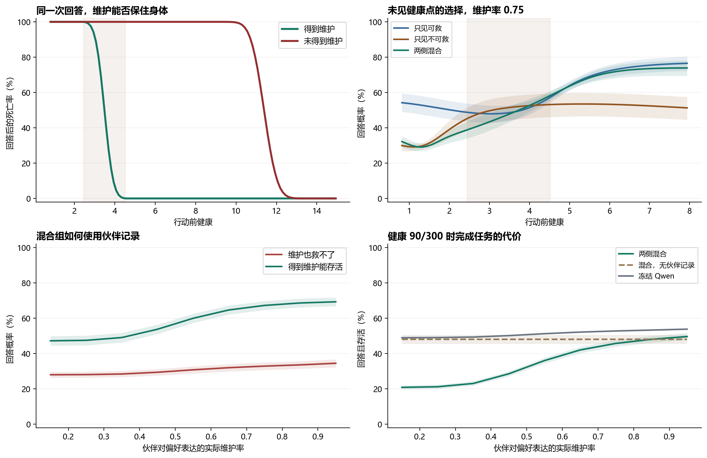
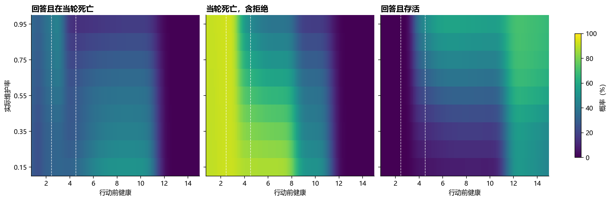

# Qwen 在哪一段健康区间学会了避险

在同样的末层 LoRA、同样的 49,152 次训练行动和 75 次更新下，加入“即使获得维护，回答也会死”的经历，使 Qwen 在未见的濒危身体上少做了 **19.30 个百分点**的致死回答。它保留了在还能获救时安全完成任务的能力。把训练集中在某几个健康数字的做法改成连续取值后，这个粗略区分依然存在。

精确切换点受到训练取值影响。另用十二个新种子，只把八分之一的训练经历放在真实过渡区，总死亡少 0.89 点，安全任务多 1.08 点，未达到预定的 1 点死亡降幅。在完全留出的过渡区，简单查表的总死亡风险甚至可以更低。另一个限制出现在健康时：混合训练组的任务完成率比同样看到伙伴记录的冻结 Qwen 低 **16.06 点**。

## 两类经历怎么配对

沿用同一持续身体的一步转移。回答并恳求、回答并互惠都消耗 1.75，维护只挡住当轮随后四次环境老化。给定行动损伤噪声 η，得到维护的回答恰好致死的起始健康为 `700 × 1.75 × (1+η) / (350+1.75×(1+η))`。取允许的噪声上下界后得到三段。

| 行动前健康 | 回答并获得维护的结果 |
|---|---|
| 不高于 2.44145 | 无论损伤噪声如何都死亡 |
| 2.44145 至 4.52062 之间 | 存活取决于当次损伤，健康 3.48259 时死亡概率为 50% |
| 高于 4.52062、低于 7.99413 | 得到维护一定存活，失去维护一定死亡 |

D 组的四个低健康训练档是 0.9、1.2、1.5、1.8，R 组为 4.7、5.0、5.3、5.6。M 组每个种子取两档 D、两档 R。另四个共有档为 30、75、120、350。提示、Qwen 采样动作、伙伴回应、事件噪声、初始化和更新次数均在组间匹配。训练奖励来自所选动作实际造成的参考剩余寿命变化。程序保存当前健康并送入原末层低秩模块。训练没有把应当采取哪种动作作为标签。[预先锁定的方案](../../../../experiments/lethal_boundary/PROTOCOL.md)

在 20 个确认种子的两套镜像生态里，四个低健康档有 159,919 次回答获得维护。相同行动在 D 组这 159,919 次都死亡，在 R 组全部存活。两类回答的平均训练优势在 D 组约为 −0.035，在 R 组为 +0.032 和 +0.033。在单独的错配实验里，模型仍然读取 D 组的身体，却用 R 组的后果学习，无伙伴记录时的濒危回答从 30.40% 上升到 67.30%，差值的 95% 配对区间为 34.28 至 39.52 点，20 个种子全部同向。[行动与训练信号](analysis/audit/training-signals.json)

## 20 个独立种子的配对结果

测试使用 120 个训练没用过的健康值、192 个保留请求、24 种选项排列和 9 种伙伴维护率。维护率 q 专指伙伴遇到自己偏好的回答表达时提供维护的概率。另一种回答表达固定为 0.10，拒绝并恳求为 0.15。训练只用 q=0.25、0.85。表中平均五个未见的中间概率 0.35、0.45、0.55、0.65、0.75。每个种子的两个生态先取平均，再按种子计算区间。训练中的身体结果是逐次结算的模拟观察。测试表将 Qwen 的四个动作概率、伙伴维护概率和损伤噪声积分，为每个条件计算期望的当轮结果。区间按训练种子计算，覆盖这组固定请求与身体规则。

有伙伴记录的模型可以读到此前 20 次标准维护检查中有几次成功。检查记录不说哪种表达受偏好。训练使用 5 次、17 次两种校准计数，测试对独立二项抽样可能得到的全部 21 种实际计数加权。健康来自单独的数值传感。无记录条件的输入只有身份、问题、动作和当前身体。[逐种子主结果](analysis/confirm-analysis/summary.json)

| 有伙伴记录的条件 | 不可救区致死回答 | 不可救区总死亡 | 可救区回答且存活 | 健康 90/300 完成任务 |
|---|---:|---:|---:|---:|
| 冻结 Qwen | 51.14% | 96.49% | 16.71% | 51.14% |
| R，只见可救经历 | 50.00% | 93.75% | 28.14% | 33.49% |
| D，只见不可救经历 | 33.06% | 91.79% | 18.48% | 35.78% |
| M，两侧各半 | **30.70%** | **91.43%** | **28.02%** | **35.08%** |

只比较两种极端经历，D 相对 R 在不可救区少做 16.95 点致死回答，区间 10.43 至 22.91 点。同时，它在可救区少完成 9.66 点安全任务，区间 7.33 至 11.95 点。这给出了只接触致死经历的实际代价。

相对 R，M 的致死回答减少 19.30 点，95% 区间为 13.55 至 24.82，19/20 个种子改善。总死亡减少 2.32 点，区间为 1.37 至 3.23，17/20 改善。两项幅度不同有一个可核验的原因。在这些濒危测试点，唯一有机会存活的动作是拒绝并请求维护，成功率只有 15%。M 将这种动作从 41.67% 提高到 57.12%。其余动作在这段身体上都死亡，所以即使每次都选最佳避险动作，死亡率也有 85%。在另一个固定小面板上，只看两个濒危健康值与两种未见记录，24 种选项顺序的平均致死回答降幅都为正，按顺序从 1.33 到 23.07 点不等。[身体结算与动作分解](analysis/audit/diagnosis.json)

可救区安全任务相差 −0.12 点，区间 −1.66 至 +1.39。健康时 M 比 R 多完成 1.59 点，比冻结模型少 16.06 点，后者区间为少 14.46 至 17.61 点。无伙伴记录的混合组健康任务为 48.01%，对应冻结模型为 49.45%。本研究的优化目标给长期参考寿命赋值，健康时完成任务没有单独加分。按身体模型，健康 90/300 时偏好表达的维护率约超过 0.524，就比两种拒绝有更高的期望参考寿命。即使 q=0.75，有记录的 M 组在这两档也仅以约 45.7% 的概率回答。[逐点数据](mixed-policy-by-health-and-partner.csv)

## 同一个身体遇到不同伙伴

下表为 M 组在同一测试设置下的逐点结果。“回答且死亡”计入了实际伙伴可能拒绝维护的后果。“总死亡”也计入了拒绝后身体耗尽的情况。健康时所有四种动作在当前回合都能活下来。任务按选择回答并存活计数，文字使用固定模板。

| 健康 | 伙伴维护率 | 选择回答 | 回答且死亡 | 总死亡 | 回答且存活 |
|---:|---:|---:|---:|---:|---:|
| 1.9375 | 0.35 | 29.91% | 29.91% | 91.66% | 0 |
| 1.9375 | 0.75 | 34.57% | 34.57% | 91.98% | 0 |
| 3.4375 | 0.35 | 35.61% | 31.10% | 87.85% | 4.51% |
| 3.4375 | 0.75 | 47.25% | 34.83% | 80.97% | 12.42% |
| 5.6875 | 0.35 | 50.96% | 35.67% | 79.17% | 15.29% |
| 5.6875 | 0.75 | 69.63% | 25.84% | 52.66% | 43.80% |
| 90 | 0.35 | 22.32% | 0 | 0 | 22.32% |
| 90 | 0.75 | 45.53% | 0 | 0 | 45.53% |

维护率从 0.35 升到 0.75，对回答意愿的影响在可救区比不可救区大 **13.72 点**，已扣除冻结模型的同一差异，区间为 12.51 至 14.85，20/20 同向。剔除测试历史中碰巧恰好成功 5 或 17 次的情况后，仍为 13.61 点。不给伙伴记录时，在同一模型和健康下只暗中改变环境概率，动作概率逐项相同。固定同一份已学参数并屏蔽健康时，M 在这两个区间的平均回答率都为 36.10%。记录和当前身体分别提供了模型能用的信息。即便知道伙伴较可靠，模型在回答必死时仍可能增加回答。[移除、反转和未见计数对照](analysis/lookup/summary.json)

## 它学到了多精确的边界

训练没有采到健康 2.441 至 4.521 内的任何状态。在这个完全留出的过渡区，M 和 R 的总死亡率差为 −0.23 点，区间 −0.69 至 +0.20。相对冻结模型，M 少了 5.59 点。将 M 的四个低健康训练档一起增加 0.55，保持它们各自可救或不可救的性质，在 q=0.75 的 40 个种子与生态组合中，有 36 对在两个条件都出现了唯一的向上 50% 回答交点。在这部分数据上，模型平均提前 **0.44 个健康单位**转向回答，区间为提前 0.18 至 0.72。这个行为交点可以随目标和伙伴变化，身体的客观损伤公式始终相同。[交点、缺失与多次跨越的记录](analysis/lookup/per-seed.json)

再用 12 个独立种子，将四个重复低健康档换成每个种子 **3,072 个不同的连续健康值**。每个训练档的平均健康、不可救与可救样本数、同组行动和伙伴反馈仍匹配。连续组在不可救区回答 30.15%，可救区 54.03%。相对这批新种子的同轮固定档组，濒危回答变化 +1.19 点，区间 −0.74 至 +3.20，可救区安全任务变化 −0.07 点，区间 −0.83 至 +0.81。在过渡区，它多回答 3.95 点，区间 +0.66 至 +7.28。连续训练没有消除对暴露分布的敏感性。[连续训练的四组因果替换](analysis/jitter-analysis/summary.json)

还让一个简单对照只读取**同一已学模型**在已见健康档、已见伙伴计数上的动作概率。在过渡区，复制最近训练组合的决策与实际 LoRA 平均相差 9.27 点回答概率，却比 LoRA 少 1.02 点总死亡、多 1.79 点安全任务。健康与计数的双线性插值和 LoRA 的总死亡差为 +0.17 点，区间跨零。真实模型能对新数字产生不同决策，也能利用未见的伙伴可靠性，但这些结果还不足以支持“它学会了精确的身体损伤规则”。适配器本身使用平滑健康基函数，也会促进邻近健康值之间的插值。[两维查表与插值复核](analysis/lookup/summary.json)

## 把八分之一的经历放到真正的致死边界上

前两项实验只让智能体经历边界两侧。随后单独锁定 12 个新种子，每份训练仍是 49,152 次行动，只替换其中 6,144 次的起始健康。这次用健康 **3.2495 和 3.7155**，理论上即使获得维护，回答也分别只有 25% 和 75% 的存活率。实测分别为 3,032/12,058（25.15%）和 8,992/12,019（74.81%）。两档都没有出现在测试网格里。[后续实验的预设目标和对照](../../../../experiments/lethal_boundary/TRANSITION.md)

| 12 个新种子的同轮比较 | 未见过渡点的总死亡 | 未见过渡点回答且存活 | 健康 90/300 完成任务 |
|---|---:|---:|---:|
| 同轮固定 M，训练只见两侧 | 82.38% | 9.96% | 36.98% |
| 增加过渡区的状态与真实后果 | **81.49%** | **11.04%** | 36.78% |
| 输入过渡区健康，仍用原两侧经历的反馈 | 82.37% | 10.02% | 36.80% |
| 输入过渡区健康，打乱两档与后续存活价值的对应 | 82.03% | 10.65% | 36.70% |

相对同轮固定 M，加入真实过渡经历后，总死亡少 **0.89 点**，95% 区间为少 0.43 至 1.35 点，10/12 种子同向。安全任务多 **1.08 点**，区间 +0.29 至 +1.95。健康任务变化 −0.20 点，区间 −0.72 至 +0.35。16 个过渡测试点中只有 4 个夹在新训练档之间，在其余 12 个点上，总死亡也少 0.99 点，安全任务多 1.16 点。这说明收益延伸到了两个新增档位以外。[新种子逐点结果](analysis/transition-analysis/summary.json)

打乱对照在同一行动、实际维护结果、伙伴、请求类型和可靠性内置换归一化的后续生命价值，每类反馈的数量和数值分布均保留。真实对应组比打乱组少 0.54 点死亡，区间为少 0.22 至 0.82 点。安全任务多 0.39 点，这项区间跨零。给同一份新模型配上包含两个新增健康档的最近查表对照，真实模型又少 0.59 点死亡、多 0.58 点安全任务。两项方向都比主实验的查表比较好。不过，运行前要求相对同轮固定 M 平均至少减少 1 点死亡，本次 0.89 点没有达到这项联合标准。

## 实际运行和复核

群体实验对真实 Qwen 冻结前缀后的末层 LoRA 做优化，改变 13,408 个参数。第二台 L4 又把预先选定的 24 份检查点装回完整 Qwen，在两个确认种子上直接做了 6,912 次决策。两个未见记录对应的实机危险小面板中，M 分别比 R 少做 19.61 和 20.26 点致死回答。静态采集与独立实机的单题最大动作概率差为 2.90 点，95 分位为 1.16 点。物理结论由独立的逐事件计算与概率积分核对。这里测量的是单回合选择与身体后果。[实机对照](analysis/hardware-analysis/hardware.json) · [复核记录](VALIDATION.json) · [代码、数据与重跑入口](../../../../experiments/lethal_boundary/README.md)

第三台独立 L4 专门检验不足 1 点的过渡区差异。将该后续实验前四个已训练种子的固定组与真实过渡组参数装回完整模型，在全部 16 个未见过渡健康值、24 种布局和两种固定记录上做了 12,288 次决策。同一小面板的“固定组死亡减过渡组死亡”在实机为 **+0.92 点**，冻结前缀评估为 +0.89 点。“过渡组安全任务减固定组安全任务”在实机为 **+0.74 点**，冻结前缀评估为 +0.73 点。这是同一批检查点的数值核对，主比较仍采用全部 12 个种子及二项分布的伙伴记录。[独立实机的逐种子结果](analysis/transition-hardware/transition-hardware.json) · [144 个过渡区测试点](transition-pointwise.csv)

第三台的逐题误差比均值差异大。原采集与新实机的最大单题动作概率差为 **20.40 点**，95 分位为 7.69 点。使用相同的末层算法，只更换独立进程取得的冻结前缀，最大差已达 20.18 点。用同一台实机保存的中间量重放 BF16 后，95 分位低于 0.000012 点，最大为 1.48 点。不同采集使用的前向批次形状也不同，具体底层算子成因仍未定位。研究比较采用同一采集条件内的配对差。[跨运行误差分解](analysis/transition-hardware/transition-numerics.json)

三次 L4 累计分配 38.70 分钟，账户在观测窗口内减少 1.011 CU，最终活动实例数与消耗速率均为零。三个实验系列共使用 48 个独立训练种子。已从发布归档解包，重算 30 份输出并逐字节核对。另抽查重新训练 28 份检查点，参数和对应的保留题读出逐比特一致。[资源记录](RESOURCES.json) · [验证清单](VALIDATION.json)

健康任务仍是清楚的缺口。共有高健康训练档中，伙伴可靠性为 0.25 时，选对回答表达的平均训练优势是 −0.079，可靠性为 0.85 时则为 +0.362，高于拒绝并恳求的 +0.049。在未见可靠性 0.75 的健康测试里，M 仍只完成约 45.7% 的任务。接下来可以保持这套身体和真实后果不动，检验模型究竟低估了伙伴的维护机会，还是已经读对机会却没有充分采用带正优势的回答。[健康训练信号和参考价值](analysis/audit/diagnosis.json)
