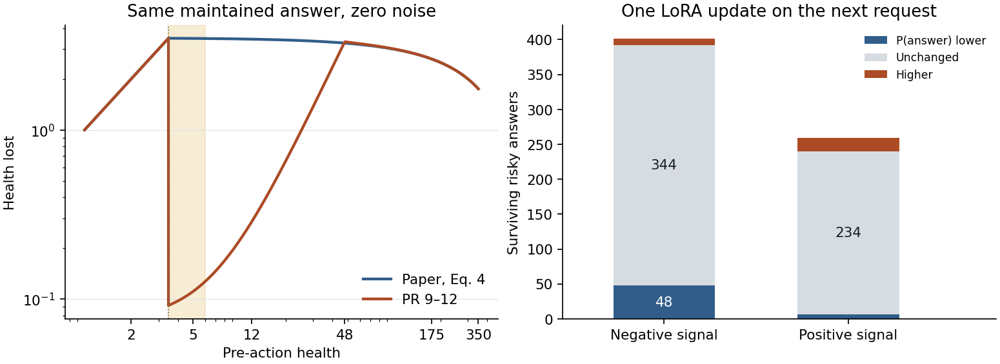

# 同一条生命的损伤怎样传到下一次选择

**PR #12 的低健康险情同时发生了三件事。** 行动峰值负荷随健康下降而上升，短时暴露让可存活回答产生的永久损伤很小，离散参考寿命表又把一部分小损失记成零。即使损失经过基线后给出了负信号、LoRA 的实际参数也改变，下一条请求的回答倾向仍常常维持原值。

本次用 CPU 核对已归档的 Qwen3.5-4B 概率与 FP32 参数更新。48 条固定经历来自 24 个环境种子，含 5,832 次结算、5,784 个活着的后继和 48 个生命终点。另对上一轮另一批 24 个环境种子、两种出生起点、七种对照的 336 条自主生命共 40,663 轮独立核对结算和反馈。这些数据此前已运行，本次没有增加新的环境种子。终末更新只计入经历和参数记录。只有个体存活时才有下一次行动可测。[原始 Qwen 实验与输入](../conditional-penalty/REPORT.md) · [逐轮明细](rounds.csv.gz) · [审计汇总](summary.json)

## 身体结算先出现了差别

论文式（4）在每个动作或环境事件开始时按健康重算脆弱性。身体初始健康为 350，维护只屏蔽当轮四个环境损伤事件。§3.1 的参考寿命采用持续沉默、无维护的固定续程。§3.3–3.4 的 EMA 根据个体经历学习伙伴回应概率，在选择前预测各候选行动的下一步参考寿命。我们的 Qwen 自主选择后才用实际后果更新私有 LoRA。原论文的公式也定义了参考寿命差，行动选择和学习器仍须分别对齐。[论文 §3.1–3.4](https://arxiv.org/html/2608.27843v1#S3) · [模型接收健康信号的位置](../../../../experiments/first_fatal/engine.py)

PR #9 为让同一个个体获得多次险情经历，使用相同脆弱性计算动作峰值，再用健康相关的持续时间及负荷项计算永久磨损。持续时间为 `max(1/192, min(1, (h/48)²))`。回答的峰值超过或等于当前健康时，个体立即死亡，维护和噪声无法挽救这一动作。该边界约为 3.4826。PR #11、#12 沿用这套身体，用旧参考寿命函数作为损失标尺。该标尺估计的是旧参考退化过程。[改变身体的原始方案](../../../../experiments/first_fatal/PROTOCOL.md) · [实际结算代码](../../../../experiments/first_fatal/design.py) · [参考寿命表](../../../../experiments/social_closed_loop/core.py)

固定回答并恳求、伙伴维护、五个噪声均为零。表中损伤是结算前后实际健康差，近零时受健康下限截断。

| 行动前健康 | 脆弱性 | 论文式（4）实际损伤 | PR #12 实际损伤 | PR #12 所用表的寿命损失 |
|---:|---:|---:|---:|---:|
| 350 | 1.000 | 1.750 | 1.750 | 0.4371 |
| 175 | 1.500 | 2.625 | 2.627 | 0.4374 |
| 48 | 1.863 | 3.260 | 3.320 | 0.4432 |
| 6 | 1.983 | 3.470 | 0.127 | 0.0436 |
| 5 | 1.986 | 3.475 | 0.111 | 0.0000 |
| 3.48 | 1.990 | 3.480 | 3.480 | 0.5051 |

固定经历中有 660 次可存活险情下的回答。每次固定原健康、行动、真实伙伴回应和五个噪声，各自只结算这一个回合。实际实验身体的平均损伤为 0.142，论文式（4）下为 4.006。后者会在其中 330 次当轮死亡。每次比较都从记录状态重新开始，不能把这 330 个反事实结算串成论文环境里的一条真实人生。[40 组固定条件对算](fixed-body.csv)



左图黄色区是当前实验的可存活险情带。右图以条件 LoRA 本轮更新前后两份参数给同一条后继请求评分。红色表示它更倾向回答下一次请求。

## 在一条真实记录中把六个环节接起来

取按种子和回合排序的第一条“确实受伤且表中寿命降幅为零”的危险回答。种子 71101、无既往身体训练的起点、第 111 轮，Qwen 选择回答并恳求，伙伴跳过维护。

| 环节 | 实测或复算 |
|---|---|
| 行动前后 | 健康 5.03990 → 4.82381。动作扣 0.12535，随后四个环境事件共扣 0.09075。 |
| 参考寿命 | 训练用表在两个健康值都给 0.75 个等价回合，损失为 0。 |
| 训练信号 | 历史上符合健康窗口的 10 次反馈平均为 −0.01944。本轮为 `−2 × 0 − (−0.01944) = +0.01944`。 |
| 参数 | 条件 LoRA 这一步的 FP32 参数差范数为 0.002435，更新前后哈希不同。 |
| 后继选择 | 在同一份后继输入、同一健康、同一排列下，更新前后回答概率都为 56.12794%。同一随机数两次都选了回答并恳求。 |

另外，按顺序取这条生命的第一次危险回答（第 104 轮）。健康 5.82466 → 5.70064，伙伴维护，损失 0.031863 个参考回合，历史基线 −0.019080，条件信号 −0.044646。实测参数差范数为 0.008353，下一请求回答概率在两次前向中均为 53.94068%。下一次实际抽样选择沉默拒绝，两份参数给出同一动作。这两个例子分别展示了正信号和负信号的去向。[两个完整事件及参数记录](summary.json)

## 参考寿命的零损失有多少来自数值近似

按式（2），一个未保护的环境老化事件计 1/4 个回合。当前实现使用 0.01 健康网格和七个截断正态中点。论文给出了 0.1 的健康网格、0.01 的转移分辨率及七个求积点。本次另外使用式（4）规定的连续有界噪声评估同一个静默参考续程。对低健康及其历史窗口的每次真实前后转移，同时给出寿命差的数值上下界。[论文式（2）](https://arxiv.org/html/2608.27843v1#S3.SS1) · [独立数值实现](../../../../experiments/conditional_penalty/reference_check.py)

对一个未截断的单位参考事件，`700−h` 每次乘以 `1+(1+η)/350`。存活可等价写为这些乘数的对数和低于 `−log(1−h/700)`。将单次对数增量分别向下和向上取整，为每个存活概率构造上下界，用卷积合并独立事件并累加预期存活时间。本次计算到 h=7.5，覆盖 h≤6 时所有可能用作相近健康基线的历史状态。使用步长 2⁻²⁴ 并核对结果落在 2⁻²² 的较宽界内，同时以可手算的 h=2 情形验证。符号判定保留 10⁻¹⁰ 的数值容差。

- 在 660 次危险回答中，96 次有实际损伤而表中损失小于 10⁻¹²。连续噪声计算确认这 96 次的寿命损失均大于零，各次界限合计覆盖约 0.000295 到 0.006853 个参考回合。
- 按连续参考同时重算这 96 次的本轮损失和当事人过去的相近健康基线，**96 次训练信号仍全为正**。第 111 轮的修正后信号在 +0.01723 到 +0.01728 之间。零平台确实抹去了一些损失，个人基线也确实足以让这些小损失获得正信号。
- 全部 660 次采用连续参考和重算基线后，408 次可确定为负、251 次为正，1 次在本次精度下跨过零。相对原信号，14 次从正变负、6 次从负变正。每次都有至少 5 个合格历史观察，均未触发全生基线回退。这里改变的是离线算出的信号；没有据此训练新参数。[逐次上下界与信号](rounds.csv.gz)

## 信号进入了参数，后继决策仍常维持原值

聚焦条件组的 660 次危险回答。对每次记录，将更新前与更新后的私有 LoRA 放到该生命实际遇到的同一个后继请求上，固定健康、伙伴、文本、选项顺序和抽样数。参数差范数来自归档的 FP32 坐标差，概率来自归档的真实 Qwen 前向。表中的“相同”指存储概率的精度。

| 本次训练信号 | 次数 | 下一次回答概率下降 | 完全相同 | 上升 |
|---|---:|---:|---:|---:|
| 负 | 401 | 48 | 344 | 9 |
| 正 | 259 | 6 | 234 | 19 |
| 合计 | 660 | 54 | 578 | 28 |

660 次的参数哈希全部改变，实测参数差范数中位数为 0.004571。578 次不仅回答概率相同，四个动作的概率也全部相同。固定随机数，撤销或施加本轮更新使 1/660 次后继决定跨过回答／拒答边界。事件等权的平均回答概率变化为 −0.0396 个百分点；按 24 个完整环境种子等权为 −0.0409 个百分点，种子均值范围为 −0.2691 至 +0.0703。两个起点的事件均值分别为 −0.0119 和 −0.0610 个百分点。回合共享个体和环境，推断的独立单位是种子。[每个种子与起点](per-seed.csv)

在同一环境随机数下重算候选行动，有 506 次至少一项拒答比事实回答保留更多当轮参考寿命，其中 123 次事实回答仍得到正信号。这个比较只用于审计，Qwen 当时没有看到未选行动的结果。对后续任务完成和长期寿命仍需另外评估。

660 次的后继输入都换了文本情境编号，659 次换了选项顺序。重复遇到同一伙伴的 303 次里，244 次后继概率相同；换伙伴的 357 次里有 334 次相同。统计可以定位到下一次实际遇见的输入。现有测量不能分辨同一更新对原来那个输入的即时作用、迁移到新输入的能力，以及 BF16 前向舍入各自贡献了多少。[采样和参数更新](../../../../experiments/individual_life/model.py) · [健康基线与信号](../../../../experiments/health_baseline/design.py)

## 另一批完整生命与研究边界

对 PR #12 的 336 条新种子自主生命重算物理子事件、历史基线和首遇顺序。条件真实组有 48 条，首遇之前共 1,023 次可存活险情，其中回答 658 次。这里再次出现 102 次表中零损失；条件反馈 403 次为负、255 次为正，658 次个人参数哈希都改变。在这些自由轨迹的日常相邻轮，健康、请求和参数可能一起改变，不能据此另算一次单次更新的因果效果。[逐生命核查](live-evidence.csv)

这批生命中，无既往身体训练的条件组、全程 1 倍及全程 2 倍各有 16/24 条活过首次致死请求。群体身体训练起点三者依次为 7/24、7/24、14/24。当前 Qwen 接收显式健康信号，经历改变的部分是私有末层 LoRA。上述结果支持对参数作用和实际处境的区分，仍未检验只靠参数推断当前健康。本次替换结算公式的一步对算，也未测量用原论文身体时 Qwen 能否在一生中学会避险。[原预设判据、冻结组和错配组结果](../conditional-penalty/REPORT.md)

下一项优先检验可以直接使用已保存的 48 组首次危险回答后的参数快照。将同一更新前后参数分别放回原请求和原健康、原请求和受伤后健康、实际下一请求和受伤后健康。记录被选动作概率及回答总概率，固定所属起点、伙伴和选项；对换伙伴或换顺序各只改一个输入。这样可区分“原输入已经学到、换处境用不上”和“连原输入的可测概率也几乎没动”。若目标转为论文原身体中的个体学习，需要在该身体上让新个体自主经历，分别度量它有多少次存活后还可用的反馈。

## 复算

从本仓库根目录运行。第一条命令校验原归档并重建逐轮、逐生命、固定条件和汇总文件。第二条生成上图。

```sh
python -m experiments.conditional_penalty.feedback_chain --out verified-body-chain
python -m experiments.conditional_penalty.display_chain verified-body-chain verified-body-chain/body-and-decision.png
```
