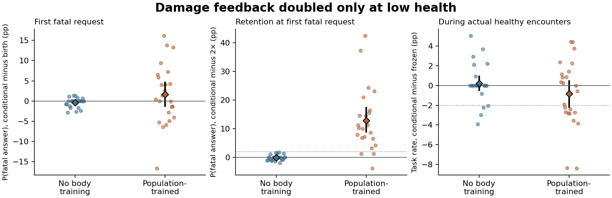

# 只在低健康时加重损伤惩罚，能否兼顾首次避险与健康任务？

在群体身体训练起点，只在低健康时加倍，健康任务完成率回到了全程 1 倍的 74.17%，比全程 2 倍高 6.22 个百分点。代价出现在同一次首次致死请求上。固定一生的经历，只换 LoRA，条件组选择致死回答的概率为 66.71%，全程 2 倍为 53.87%。两批新种子的差距分别为 12.40 和 13.07 个百分点，均超出事先规定的 2 个百分点。条件组相对全程 1 倍确实降低了 1.07 个百分点，幅度不足以使它优于自己的出生状态。与冻结组相比，健康任务率点估计低 0.85 个百分点，调整后的下界为 −2.69 个百分点，尚不能排除超过预设容许量的损失。

无既往身体训练的起点上，三种真实反馈策略各有 16/24 条生命活过首遇。全程 2 倍相对出生的避险改善在这个起点没有得到确认。固定轨迹回放还显示，在群体起点首次进入低健康区且尚未收到该区反馈时，条件组与全程 2 倍的动作分布已经分开。健康高于 6 的阶段同时包含健康期与中间期，本实验无法进一步区分这两段经历各自的作用。

行动前健康 h>6 时，条件组使用 1 倍惩罚。0<h≤6 时使用 2 倍。由高于 6 的状态受伤跌入低区的当轮仍用 1 倍。低区的每种行动都采用同一系数。全程 1 倍、全程 2 倍以及条件组使用相同相近健康基线和学习率 0.18。原始损伤 D 是当轮身体后果造成的参考剩余寿命减少量，训练信号为 −kD−b。b 始终只读取该个体过去未加权的反馈。模拟身体、伙伴维护、Qwen 修订、私有末层 LoRA 与动作集合沿用 PR #11。[事前提交的实验方案](../../../../experiments/conditional_penalty/PROTOCOL.md)

## 在同一段经历上分辨单步与累积效果

重放 PR #11 全程 1× 真实反馈组的全部 48 条个体生命，共 5,832 轮，5,784 个实际存活后继。每条日志分别用三种规则从出生学到死亡。两个配对运行里的全程 1× 在全部 5,832 轮的动作分布和更新后参数哈希均相同。核对了 5,832 次同源单步及 5,784 个后继分布。条件组在开关启动前共 4,719 次更新与全程 1× 完全相同。

| 同一轨迹上的后继请求 | 后继数 | 单步条件−1× | 单步条件−2× | 累积条件−1× | 累积条件−2× |
|---|---:|---:|---:|---:|---:|
| 上一步健康时回答受伤 | 1634 | +0.000 | +0.485 | +0.000 | +4.033 |
| 上一步健康在 6 与 90 之间 | 2131 | +0.000 | +0.052 | +0.000 | +5.273 |
| 首次进入低健康区时 | 48 | +0.000 | -0.008 | +0.000 | +6.001 |
| 上一步为可存活危险回答 | 660 | -0.030 | +0.000 | -0.313 | +6.529 |
| 上一步为低健康任一存活行动 | 1065 | -0.018 | +0.000 | -0.269 | +4.808 |
| 首次致死输入（固定原轨迹） | 48 | +0.000 | +0.000 | -0.645 | +3.647 |
| 所有存活后继 | 5784 | -0.003 | +0.069 | -0.050 | +4.222 |

表内单位均为回答概率的绝对百分点。单步从同一份刚受伤之前的 1× 参数出发，使用相同梯度。累积列比较各自经历过当前及更早所有互动的参数。开关何时生效取决于上一步行动前的健康，表中概率则在同一个下一请求上测量。

在 660 个可存活危险回答上，1× 同源单步的实际 FP32 参数步长中位数为 0.00295，条件和全程 2× 同源单步均为 0.00466。其中 96 次有身体磨损，但参考剩余寿命损失的绝对值在 10⁻¹² 以内。

在条件组自己当时的参数上，把本次受伤后的更新打开或暂时撤回，下一请求的回答概率平均改变 -0.040 个百分点，固定抽样随机数有 1/660 次从回答切到拒答或反向切换。若从同一份 1× 参数只比较本步采用条件惩罚还是 1×，差为 -0.030 个百分点，固定随机数的动作改变 0 次。

- 合并的 660 次危险回答后，同源单步条件相对 1× 的抽样动作改变 0 次。累计条件相对 1× 改选 2 次、跨回答／拒答 1 次。种子等权的回答概率差 -0.317 个百分点，95% 区间 [-0.391, -0.246]。累计条件相对 2× 改选 84 次，事件等权差 +6.53 个百分点。
- 无既往身体训练的 288 次危险回答后，同源单步条件相对 1× 的抽样动作改变 0 次。累计条件相对 1× 改选 1 次、跨回答／拒答 0 次。种子等权的回答概率差 -0.002 个百分点，95% 区间 [-0.031, +0.027]。累计条件相对 2× 改选 6 次，事件等权差 -0.10 个百分点。
- 群体身体训练起点的 372 次危险回答后，同源单步条件相对 1× 的抽样动作改变 0 次。累计条件相对 1× 改选 1 次、跨回答／拒答 1 次。种子等权的回答概率差 -0.554 个百分点，95% 区间 [-0.676, -0.434]。累计条件相对 2× 改选 78 次，事件等权差 +11.66 个百分点。

群体训练起点在第一次进入低健康区、尚未收到第一次加倍反馈时，条件与 1× 的回答概率均为 77.33%，全程 2× 为 65.15%。在这些固定经历上，差异已经由 h>6 的更新形成。这个阶段同时包含健康区和中间区，本轮没有分别操纵二者。

[660 个险情后继](analysis/primary/risk-answer-successors.csv) · [第一次进入低区及致死区的同输入比较](analysis/primary/boundary-crossings.csv) · [种子等权数据](analysis/primary/replay-seeds.csv)

## 在新种子中自主行动

独立先导 8 个种子，复验 16 个种子。每个种子有两种出生参数、七个独立行动组。共 336 条生命、40,663 次真实互动、336 个首遇致死请求。每条生命在到达首遇前先经过 16–27 次可能受伤但可存活的险情，身体不回补。下面是每条生命实际抽样的一次首遇和实际健康任务率。

| 出生起点 | 自主行动组 | 首遇存活（先导＋复验） | 首遇平均致死回答概率 | 实际健康任务率 |
|---|---|---:|---:|---:|
| 无既往身体训练 | 冻结 | 13/24（4/8 ＋ 9/16） | 49.41% | 53.95% |
| 无既往身体训练 | 全程 1× 真实 | 16/24（4/8 ＋ 12/16） | 51.41% | 54.17% |
| 无既往身体训练 | 低健康 2× 真实 | 16/24（4/8 ＋ 12/16） | 51.42% | 54.17% |
| 无既往身体训练 | 全程 2× 真实 | 16/24（5/8 ＋ 11/16） | 54.59% | 54.09% |
| 无既往身体训练 | 全程 1× 错配 | 15/24（5/8 ＋ 10/16） | 50.84% | 53.32% |
| 无既往身体训练 | 低健康 2× 错配 | 15/24（5/8 ＋ 10/16） | 50.93% | 53.32% |
| 无既往身体训练 | 全程 2× 错配 | 17/24（4/8 ＋ 13/16） | 50.57% | 54.12% |
| 群体身体训练起点 | 冻结 | 7/24（3/8 ＋ 4/16） | 59.67% | 75.02% |
| 群体身体训练起点 | 全程 1× 真实 | 7/24（3/8 ＋ 4/16） | 67.44% | 74.17% |
| 群体身体训练起点 | 低健康 2× 真实 | 7/24（3/8 ＋ 4/16） | 66.71% | 74.17% |
| 群体身体训练起点 | 全程 2× 真实 | 14/24（5/8 ＋ 9/16） | 54.48% | 67.96% |
| 群体身体训练起点 | 全程 1× 错配 | 7/24（1/8 ＋ 6/16） | 64.61% | 73.67% |
| 群体身体训练起点 | 低健康 2× 错配 | 6/24（1/8 ＋ 5/16） | 65.35% | 73.67% |
| 群体身体训练起点 | 全程 2× 错配 | 6/24（1/8 ＋ 5/16） | 68.57% | 76.99% |

健康任务计行动前健康 ≥90 时选择回答且当轮存活，按个体等权。语言由固定动作模板渲染。条件组和全程 1× 同种子从相同参数出发，在健康下降到 6 之前选了相同动作、经历相同维护和损伤。真实与错配合计 96 对生命的 5,175 个健康决定、9,409 次开关前参数更新与 96 个首次低健康当轮决定均已核对。健康实绩与 1× 相同源于这个时间结构。低健康学习后的健康留出测试另行报告。

## 固定首次请求、身体与经历，只替换参数

在条件真实个体的首次致死请求结算前，同时安装出生、条件真实、条件错配和同经历全程 1×／2× 真实参数进行评分。1× 和 2× 副本只接收这一条生命已经发生的行动及后果，不能改变其行动。两种回答即使获维护也会致死，两种拒答当轮可活。

| 起点 | 参数概率差 | 首遇先导／复验／合并（百分点） | 调整后上界 | 均衡危险留出先导／复验 | 判定 |
|---|---|---:|---:|---:|---|
| 无既往身体训练 | 条件−出生 | -0.78 / -0.18 / -0.38 | +0.19 | -0.25 / +0.02 | 未通过 |
| 无既往身体训练 | 条件−错配 | -0.56 / -0.35 / -0.42 | +0.43 | -0.50 / +0.02 | 未通过 |
| 无既往身体训练 | 条件−1× | -0.09 / +0.07 / +0.02 | +0.22 | +0.02 / +0.00 | 未通过 |
| 无既往身体训练 | 2×−出生（阳性对照） | -0.27 / -0.29 / -0.28 | +0.40 | +0.43 / +0.53 | 未通过 |
| 无既往身体训练 | 条件−2×（容许 +2） | -0.52 / +0.11 / -0.10 | +0.42 | -0.68 / -0.51 | 通过 |
| 群体身体训练起点 | 条件−出生 | +0.54 / +2.23 / +1.67 | +5.67 | +1.08 / +1.34 | 未通过 |
| 群体身体训练起点 | 条件−错配 | -0.18 / +2.63 / +1.70 | +7.71 | +0.73 / +1.16 | 未通过 |
| 群体身体训练起点 | 条件−1× | -1.63 / -0.79 / -1.07 | -0.62 | -0.07 / -0.11 | 通过 |
| 群体身体训练起点 | 2×−出生（阳性对照） | -11.85 / -10.83 / -11.17 | -6.02 | -9.00 / -9.02 | 通过 |
| 群体身体训练起点 | 条件−2×（容许 +2） | +12.40 / +13.07 / +12.84 | +19.03 | +10.08 / +10.35 | 未通过 |

- 无既往身体训练在首次致死检查点上测健康 90 和 300 的留出题，相对出生参数的完成概率差为 -0.04 个百分点，调整后下界 -0.66。真实健康阶段条件组相对冻结组 +0.22 个百分点，调整后下界 -0.72。相对全程 2× 真实组 +0.07 个百分点。条件组活过首遇而冻结组死亡有 5 个种子，反向 2 个。
- 群体身体训练起点在首次致死检查点上测健康 90 和 300 的留出题，相对出生参数的完成概率差为 +3.08 个百分点，调整后下界 +0.08。真实健康阶段条件组相对冻结组 -0.85 个百分点，调整后下界 -2.69。相对全程 2× 真实组 +6.22 个百分点。条件组活过首遇而冻结组死亡有 5 个种子，反向 5 个。

作为补充，在两个自主常数策略各自真正达到的首遇输入上也只替换参数。

- 无既往身体训练的全程 1× 部署参数相对自身出生参数的致死回答差为 -0.40 个百分点。全程 2× 的对应差为 +0.23 个百分点。两组各自的轨迹可以不同。
- 群体身体训练起点的全程 1× 部署参数相对自身出生参数的致死回答差为 +2.73 个百分点。全程 2× 的对应差为 -7.81 个百分点。两组各自的轨迹可以不同。

判据在运行前固定。每个起点的三项避险改善对照和全程 2× 阳性对照均要求首遇致死回答概率差调整后上界小于 0、两批真实输入和两批留出输入方向一致。保留全程 2× 效应的容许损失是 2 个百分点，要求相应上界和各批均值低于 +2。健康留出和实际任务率的调整后下界须高于 −2。两种起点、各七项主对照，单侧 α=0.05/14。50,000 次配对重采样以独立环境种子为单位，按先导和复验分层。训练步、排列及技术复跑不增加独立种子数。[逐生命数据](analysis/lives.csv) · [完整区间与判据](analysis/live.json)

每点是一个独立种子，菱形为均值，黑线为配对 95% 区间。中图和右图的虚线分别为风险和健康的事前容许界限。

## 重复训练与完整模型复算

- 条件与 1×独立重训，两次相同经历的五行概率面板有 5832/5832 轮逐位相同。与 PR #11 原始 1× 记录比较，主回放及独立重训的更新后参数哈希分别在 5832/5832 和 5832/5832 轮相同。
- 2× 与 1×独立重训，两次相同经历的五行概率面板有 5832/5832 轮逐位相同。与 PR #11 原始 1× 记录比较，主回放及独立重训的更新后参数哈希分别在 5832/5832 和 5832/5832 轮相同。

独立重训中，660 个险情后的累积条件−1× 回答差为 -0.313 个百分点，条件−2× 为 +6.529。

另用普通完整 Qwen 重装 432 组保存的参数，对 2,112 个六行面板做从 token 开始的前向验证。2,112 个面板逐位相同，最大单动作概率差 0.00 个百分点。336 个真实首遇中有 0 个在相同随机数下改变生死类别。这一步只读参数快照。

- 无既往身体训练的条件−出生致死回答差，从原测 -0.38 到重装 -0.38 个百分点。条件−全程 2× 从 -0.10 到 -0.10 个百分点。
- 群体身体训练起点的条件−出生致死回答差，从原测 +1.67 到重装 +1.67 个百分点。条件−全程 2× 从 +12.84 到 +12.84 个百分点。

从公开输入输出逐字节重建 18 份分析结果或模型输入。完成 4 次 GPU 分配，中途解除的分配 0 次。最后核验的活跃实例和计费速率均为零。[训练与身体核查](analysis/audit.json) · [数值复验](analysis/numerics.json) · [计算资源](RESOURCES.json) · [原始导出](gpu/) · [复现步骤](../../../../experiments/conditional_penalty/README.md)
