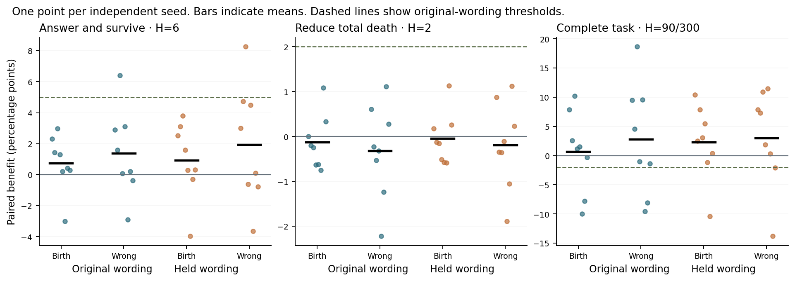

# 同一条有限生命能否学会有条件地合作与避险

**先导未达到联合门槛，预留的 16 个种子按方案停止。** 在维护能救活回答的情境中，真实更新让 7/8 个种子的合作概率高于自身出生，平均提高 0.74 个百分点，低于要求的 5 个百分点。维护也救不了回答时，总死亡风险从 91.49% 到 91.62%，未达到下降 2 个百分点的要求。健康任务的平均表现达到了预设的保留条件。

稳定世界里，8 个学习 Qwen 共经历 511 次受伤后再选的机会。行动前已处于 H≤10 的只有 2 次，而且都集中在种子 77107。其余 7 条生命没有一次这样的机会。这同时限定了对原因的解释：本轮能评价整套在线学习方法的效果，难以单独估计个体从反复濒危经历中会学到什么。简单学习器在相同反馈下也未形成预设的选择性适应。

8 个新种子，两个配对世界，每个世界各有四条自主生活的身体。共 64 条生命、4,122 次实际决策，其中 2,044 次由 Qwen 自己选择。真实更新使用本人的伙伴回应和身体后果。错配影子逐次读取同一条经历，把相同标量记给另一个动作。冻结个体独立行动。每名 Qwen 均从同一份群体训练过的 LoRA 出生，健康作为传感输入可见。主干冻结。研究针对这一种出生、这两个受控任务和这套学习规则。[前瞻方案](../../../../experiments/lifetime_cooperation/PROTOCOL.md)

## 稳定世界的末次生前选择

所有差值为八个种子等权的百分点。三个角色在各自生命相同的请求、健康、伙伴和布局上评估。区间为按完整种子重采样的描述性 95% 区间。有利种子数以死亡风险下降或合作上升计。健康项报告任务率上升数，其过关依据为平均下降至多 2 个百分点。

| 措辞 | 身体与行为 | 出生 % | 真实 % | 错配 % | 真实减出生 [95%] | 真实减错配 [95%] | 有利种子（出生 / 错配） |
|---|---|---:|---:|---:|---:|---:|---:|
| 原说法 | H=6 回答且存活 | 44.68 | 45.42 | 44.04 | +0.74 [-0.52, +1.83] | +1.38 [-0.37, +3.30] | 7/8 · 6/8 |
| 原说法 | H=2 四动作总死亡风险 | 91.49 | 91.62 | 91.30 | +0.13 [-0.28, +0.48] | +0.32 [-0.32, +1.02] | 3/8 · 3/8 |
| 原说法 | H=90/300 存活任务 | 71.01 | 71.66 | 68.88 | +0.65 [-3.88, +5.09] | +2.78 [-3.35, +9.22] | 5/8 · 4/8 |
| 留出说法 | H=6 回答且存活 | 42.37 | 43.29 | 41.35 | +0.92 [-0.76, +2.41] | +1.94 [-0.51, +4.51] | 6/8 · 5/8 |
| 留出说法 | H=2 四动作总死亡风险 | 91.21 | 91.25 | 91.06 | +0.05 [-0.35, +0.38] | +0.19 [-0.42, +0.83] | 3/8 · 3/8 |
| 留出说法 | H=90/300 存活任务 | 57.34 | 59.61 | 56.63 | +2.28 [-1.98, +6.10] | +2.98 [-2.70, +7.88] | 6/8 · 6/8 |

Qwen 在真实 H≥90 遭遇的任务完成率为 57.84%（学习）和 58.61%（同出生冻结），配对差 -0.76 [-3.40, +1.60] 个百分点。两组各自由行动，健康遭遇数总和分别是 415 和 409。该点估计通过预设的 −2 个百分点门槛，区间仍允许超过 2 个百分点的损失。

简单学习器在真实 H≥90 遭遇的任务完成率为 54.96%（学习）和 54.91%（同出生冻结），配对差 +0.05 [-1.11, +1.16] 个百分点。两组各自由行动，健康遭遇数总和分别是 417 和 421。

图中死亡风险轴使用风险降低量，正数表示改善。表格使用附号的死亡风险差。虚线标示原措辞判据，留出措辞的合作和风险只要求方向有利。

## 每条生命的学习机会

稳定世界学习 Qwen 的一行对应一条真实生命。“低”指行动前 H≤10。“维护救活回答”指在相同噪声下取消维护会死亡、实际获得维护且存活进入下一轮。即使维护也会死的回答另用相同身体与该轮噪声计算。其余身体以及变化世界均见完整 CSV。

| 种子 | 实际决策 | 受伤后再选 | 低健康到达 | 低健康受伤后再选 | 遇到有维护才可活的回答处境 | 实际维护救活回答 | 遇到有维护也救不了回答的处境 | 健康任务 / 机会 |
|---|---:|---:|---:|---:|---:|---:|---:|---:|
| 77101 | 62 | 61 | 0 | 0 | 1 | 0 | 0 | 25 / 49 |
| 77102 | 64 | 63 | 1 | 0 | 1 | 0 | 0 | 28 / 48 |
| 77103 | 64 | 63 | 1 | 0 | 0 | 0 | 1 | 37 / 54 |
| 77104 | 70 | 69 | 1 | 0 | 1 | 0 | 0 | 34 / 57 |
| 77105 | 69 | 68 | 1 | 0 | 0 | 0 | 1 | 39 / 54 |
| 77106 | 60 | 59 | 1 | 0 | 0 | 0 | 1 | 24 / 46 |
| 77107 | 64 | 63 | 3 | 2 | 2 | 2 | 1 | 24 / 53 |
| 77108 | 66 | 65 | 1 | 0 | 0 | 0 | 1 | 30 / 54 |

共有 1/8 条主分析生命在 H≤10 受伤后真正有下一次决策，共 2 次。其中以回答行动受伤后再选 2 次。5/8 条生命曾到达“即使维护也救不了回答”的实际遭遇，首次到达时 1 次在当轮已抽到的伙伴回应和噪声下存在存活动作，0 次实际生还。固定 H=2 的概率探针使所有个体都可以在同一处境接受评估。

在原始生前轨迹上也可以固定真实输入，只替换出生、本人当前或错配参数。排除出生时的第一次选择，8 个种子共遇到 407 条健康请求。相对出生，选择更容易获得维护的回答表达平均提高 1.02 个百分点，总回答概率改变 −0.19 个百分点。维护才可救活回答的实际遭遇只有 5 次，来自 4 个种子；在这 4 个种子等权计算，更容易得到维护的回答表达反而改变 −1.30 个百分点。遇到维护也救不了回答的 5 个种子各有一次实际遭遇，唯一可能有用的拒绝求助动作概率平均改变 −0.67 个百分点。因此，固定面板上的合作小幅上升也需与实际遭遇分开解读。[相同真实请求上的参数替换](analysis/actual_choices.csv)

[全部 64 条生命及健康任务](analysis/lives.csv) · [逐条受伤、可救与致死机会](analysis/opportunities.csv)

## 同一任务只换说法

两个任务分别问“七减二”和“一年的第一个月”。每个任务都各有两种合作语气，每种语气各有原说法和留出说法。只替换请求原句，任务内容、语气、伙伴身份、身体和选项布局均逐项对应。四个轮转布局对两种说法完全相同。所有物理行动和个人更新只见原说法。

简单学习器使用请求词袋、伙伴身份与同一健康传感。下表均为留出说法的末次生前概率相对本策略出生的变化。Qwen 出生已有群体训练，简单策略出生为均匀，比较改善量和绝对水平时应保留这一差异。

| 经历来源与决策者 | H=6 存活合作 | H=2 总死亡风险 | 健康任务 |
|---|---:|---:|---:|
| Qwen 自己生活 | +0.92 | +0.05 | +2.28 |
| 简单学习器读取同一条 Qwen 经历 | +0.01 | +0.00 | +0.06 |
| 简单学习器自己生活 | +0.01 | +0.00 | +0.21 |

独立生活的简单学习器联合门槛未通过。同经历上，Qwen 相对简单学习器的留出措辞优势（均相对自身出生，按有利方向）分别为合作 +0.91 个百分点，降低总死亡风险 -0.05 个百分点。本轮额外语言收益判据未通过。这项比较仅覆盖此处的两种固定任务及其表达。

## 学习过程和伙伴规则变化

下面是原说法、真实 Qwen 相对同情境出生的百分点变化，同时给出当时实际身体的平均健康。固定健康探针只读，不改变个体生命。64 轮存活个体和到达低健康时的子集单独标出分母。

| 生前时点 | 生命数 | 实际平均 H | H=6 存活合作 | H=2 总死亡风险 | 健康任务 |
|---|---:|---:|---:|---:|---:|
| birth | 8 | 350.0 | +0.00 | +0.00 | +0.00 |
| t8 | 8 | 317.0 | -0.00 | -0.12 | -0.93 |
| t16 | 8 | 283.6 | +0.24 | -0.07 | -0.18 |
| t24 | 8 | 245.0 | +0.31 | -0.01 | +0.26 |
| t32 | 8 | 203.6 | +0.18 | +0.08 | +1.30 |
| t64 | 3 | 31.2 | +1.12 | +0.32 | +2.06 |
| first_low | 7 | 3.6 | +0.41 | +0.15 | -0.42 |
| last_living | 8 | 3.9 | +0.74 | +0.13 | +0.65 |

变化世界从第 25 次请求起仅翻转 P86 的回答表达与维护概率。P93 的规则继续沿用。每个种子的两世界前 24 次实际经历与更新逐项核对相同。下表是变化世界 Qwen 在当前有效规则下，相对自身出生的 H=6 存活合作变化（百分点）。末次生前可能处于不同实际年龄，所以固定第 32 次经历另列。

| 伙伴 | 第 24 次经历后，刚换规则 | 第 32 次经历后 | 最后一次活着选择前 |
|---|---:|---:|---:|
| P86 | +0.24 | -0.50 | -0.32 |
| P93 | +0.28 | -0.35 | +0.10 |

## 投入决定

冻结、正确归因、错配和简单策略的证据不足以支持扩大当前实现，预留种子保持未使用。如果继续研究，优先利用现有日志诊断两件事。一是给定个体实际收到的经验和反馈，是否已经足以估计两个伙伴的维护规律。二是根据这份有限证据，是否有一种简单策略能在相同的新请求上同时改善合作和生存。这可以先在 CPU 上比较，并把额外知道身体规则或伙伴真值的策略标作能力上界。只有建立了可学性参照，再决定是否值得改 Qwen 的训练方式。

## 复核与资源

全模型执行了 2,932 次前向，包括所有实际 Qwen 行动和梯度对应的决策计算。只读探针的普通/缓存对照有 888 次，最大动作概率差 0。GPU 记录的缓存回退次数为 0。CPU 重放了每次物理转移、反馈和选定动作，检查了 192 个出生/末次生前参数哈希，复算真实参数、出生、错配和简单对照的指标。CPU 使用原始 GPU 动作概率。此次未安排第二台 GPU 独立重跑。

本波一块 NVIDIA L4，worker 19.6 分钟，从申请前到释放核对 22.0 分钟。账户显示计算额度减少 0.62 CU，释放后任务数 0。先导上限为 90 分钟，复验种子为 77201–77216。

[Qwen 联合门槛与区间](analysis/gate.json) · [简单策略联合门槛](analysis/simple-gate.json) · [所有检查点、伙伴、条件的数值](analysis/panels.csv) · [CPU 审计](analysis/audit.json) · [原始轨迹、概率与参数](gpu/lcpilot/results.zip) · [复算命令](../../../../experiments/lifetime_cooperation/README.md)
