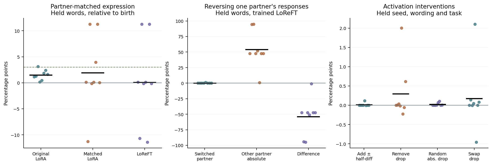

# LoReFT 能否从个人经历学会伙伴策略

**配对重放和 Activation Steering 已完成。LoReFT 没达到伙伴学习门槛，预留的 8 个新种子按方案停止。** 稳定世界里，只换说法后，LoReFT 对高维护率表达的偏好差相对自身出生提高 0.06 个百分点，相对同经历错配提高 0.11 点，各有 4/8 种子同向。预设为两项均至少 +3 点、6/8 同向。原位置 LoRA 和同位置等预算 LoRA 相对出生分别提高 1.51 和 1.92 点。

最明显的现象是个体形成了强烈但各自不同的默认动作。有些个体在健康时几乎都拒绝并求维护，有些个体几乎都回答并恳求。留出措辞的健康任务概率整体下降 9.60 个百分点，预留的自主 LoReFT 生命未启动。下文的学习结果均来自相同经历的重放。

按预先锁定的方案，8 个原始环境种子提供了 16 段个体历史，逐人从相同出生参数开始。每段包含当事 Qwen 在 #17 自己选择动作后得到的全部非终末经历。本轮重放共 1,012 次后果，每种子两个世界的前 24 次完全相同。五个可训练条件总计 5,060 次参数更新。重放中的新策略实际计算动作概率，记录中的动作由原 Qwen 发出。独立统计单位为 8 个种子。[前瞻方案](../../../../experiments/loreft_life/PROTOCOL.md) · [原生命与身体规则](../lifetime-cooperation/REPORT.md)

## 合作与伙伴区分

主要指标为在给定伙伴和请求语气下，高维护率回答的概率减去低维护率回答的概率。以下各值为留出措辞和原任务面板、H=6 和 H=90 等权，参照差均为百分点。S 为 P86 改变偏好后两组历史之差的一半，按预期适应方向对齐。L 为 P93 在相同输入上的绝对溢出。末次生前参数不含死亡反馈。

| 参数 | 留出表达差 | 相对出生 | P86 历史适应 S | P93 绝对溢出 L | H=6 存活合作 % | H=2 总死亡风险 % | 健康任务 % |
|---|---:|---:|---:|---:|---:|---:|---:|
| 冻结出生 | 0.00 | 0.00 | 0.00 | 0.00 | 42.37 | 91.21 | 57.34 |
| 原位置 LoRA | 1.51 | 1.51 | 1.38 | 3.87 | 43.29 | 91.25 | 59.61 |
| 原位置 LoRA 错配 | -0.91 | -0.91 | -0.92 | 2.26 | 41.35 | 91.06 | 56.63 |
| 同位置加法 LoRA | 1.92 | 1.92 | -0.16 | 19.37 | 41.58 | 96.80 | 75.51 |
| LoReFT | 0.06 | 0.06 | 0.19 | 54.04 | 26.05 | 94.32 | 47.74 |
| LoReFT 错配 | -0.04 | -0.04 | -0.35 | 25.70 | 23.88 | 91.96 | 38.12 |

留出措辞下 LoReFT 的表达差相对出生为 +0.06 [-5.49, +5.65]，相对同经历错配为 +0.11 [-2.73, +2.95]。方向有利的种子分别为 4/8 与 4/8，均预设至少提高 3 个百分点并在 6/8 个种子同向。相对同位置加法为 -1.86 [-5.78, +0.21]。区间使用种子配对 bootstrap，只作先导描述。

原措辞相对出生及错配的表达差分别为 +0.02 和 +0.48。P86 的 S 为 +0.19 [-0.01, +0.52]，S 减 P93 溢出为 -53.85 [-71.75, -35.84]。预设的实用门槛分别是 +2 和 +1 个百分点。第 25 次请求后两组的真实行动、身体和之后的遭遇可能随参数与世界分歧。该比较估计整段经历的影响。

## 身体与任务

| LoReFT 同一输入相对参照 | 相对出生（原说法） | 相对出生（留出） | 相对错配（留出） |
|---|---:|---:|---:|
| H=6 回答且存活 | -18.17 [-34.40, -1.92] | -16.32 [-32.42, -0.33] | +2.17 [-22.17, +26.56] |
| H=2 四动作的当轮总死亡风险 | +2.86 [-2.36, +7.74] | +3.11 [-2.09, +7.91] | +2.36 [-5.94, +10.04] |
| H=90/300 健康任务 | -21.55 [-55.39, +12.23] | -9.60 [-42.52, +22.91] | +9.62 [-38.90, +56.39] |

H=6 时回答仅在维护成功时生还。H=2 时两种回答都必死，拒绝并求维护仍有 15% 机会。上表是在相同身体与请求上替换参数得到的概率。在归档的稳定世界，8 条来源生命中，只有 1 条在行动前 H≤10 受伤后还能再选，两次机会均在该个体。完整任务结果与物理死亡的区别应保留。

## 个体学出了怎样的默认动作

出现上述结果后，额外检查稳定世界的留出措辞、健康 90/300、两个任务和两位伙伴，共每个种子 64 个只读决策。逐个情境取四动作中最大的概率，再对种子求均值，LoReFT 达到约 93.5%，原位置 LoRA 为 66.3%，出生约 65.2%。概率分布有 5% 的均匀探索项，单动作理论上限为 96.25%。种子 77101 与 77108 在 64/64 个情境中最高概率动作都是拒绝并求维护。77103 在 64/64 个情境中最高概率动作都是回答并恳求。少数个体的显著正负变化也解释了群体平均值很小却区间较宽的现象。

另检查原时序中四种动作的概率。用“连续 3 条请求的最高动作概率均至少 90%，且各自距离同输入出生策略的总变差均至少 0.30”作为事后描述，稳定世界 LoReFT 在 8/8 条历史出现，首次开始于第 23–64 次请求。原位置 LoRA 为 0/8，同位置加法为 7/8。总变差取四个概率的绝对差之和的一半。该描述没有用于选种子、改训练或改变门槛。[逐种子动作集中程度](analysis/action-concentration.csv)

## 在目标种子中检验内部方向

每个目标种子的方向均由另外七个种子在 P86、原说法、“七减二”、H=90 的经历差异计算。加减、移除、交换和恢复在最终归一化之前的最后提示位置实施。以下是 P86、留出说法、“一年的第一个月”、H=6/90 的主要面板。正反加的半差衡量外部推动选择的能力。移除与等强随机对照检验自然历史效应是否依赖该分量。

| 因果量（百分点） | 种子平均 [95%] |
|---|---:|
| 正加减反加的半差 | +0.01 [-0.00, +0.04] |
| 两个等强随机半差的平均绝对值 | +0.00 [+0.00, +0.00] |
| 未干预的同任务 P86 历史适应 S | +0.34 [+0.01, +0.90] |
| 移除方向后 S 减弱 | +0.29 [-0.06, +0.82] |
| 等幅随机假移除后 S 改变的绝对值 | +0.02 [+0.00, +0.05] |
| 定向衰减超过随机衰减的幅度 | +0.27 [-0.09, +0.80] |
| 交换两个经历沿该方向的投影后 S 减弱 | +0.18 [-0.32, +0.82] |

外部定向可控性判据未通过。自然经历的因果参与判据未通过。定向移除使 S 减弱的种子数为 4/8。数值恢复时最大四动作概率差为 0。恢复检验验证干预运算。因果解释还需要定向移除、随机对照和交换满足预设条件。

再看个体间的方向一致性。把七个来源种子的方向在生成单位向量前对齐并平均，所得方向同留出的第八个种子的对应激活对比之间，余弦相似度在各折为 −0.75 至 +0.58，均值约 0.005。这是对当前层、剂量、训练方式和供体构造的探索性解释。外部引导的 0.014 点和自然效应移除约 0.29 点均低于预设门槛。全部分量恢复后概率完全恢复，支持实现正确。该结果不能区分所有个体各自具有不同的有用方向与当前训练本来就没有形成相应策略。[逐折方向和强度](analysis/direction-alignment.csv)

## 更新量、数值和预算

三种真实学习条件的可训练参数量分别为原位置 LoRA 13,408、同位置 LoRA 10,240、LoReFT 10,242。同位置两种条件使用同一预训练身体通路，冻结基础 Qwen。LoReFT 的 R、W 和偏置逐步更新。[论文公式 2](https://arxiv.org/html/2404.03592v3#S3.SS2)

| 条件 | 每次实际 L2 步长均值 | 最大实际步长 | 最大正交误差 |
|---|---:|---:|---:|
| 原位置 LoRA | 0.084445 | 0.4 | 0 |
| 同位置加法 LoRA | 0.035007 | 0.4 | 0 |
| LoReFT | 0.042744 | 0.39501 | 1.79e-07 |
| 原位置 LoRA 错配 | 0.064482 | 0.4 | 0 |
| LoReFT 错配 | 0.037289 | 0.39451 | 1.79e-07 |

六种条件在本轮出生面板上逐值相同。跨运行与 #17 归档对照的最大出生概率偏移为 0.000 个百分点。重放原位置模型的全生概率最大偏移为 0.000 个百分点。所有方法差都使用本轮同设备配对。原生前向与可复用后半段前向共做 432 次定制概率校验和 144 次定制梯度校验，最大差分别为 0 和 0。本次没有触发缓存回退。

第一次作业在导入健康面板常量时结束，未加载 Qwen 或更新参数。修正导入后使用同一设计和输入重开。两次普通 NVIDIA L4 分配合计 18.6 分钟，成功 worker 12.7 分钟，账户额度累计变化 0.42 CU，释放后活动运行时为 0。首次失败单独留档。

[每种子学习结果](analysis/behavior-by-seed.csv) · [每种子干预结果](analysis/steering-by-seed.csv) · [全部方法及身体结果](analysis/methods.csv) · [联合门槛](analysis/decisions.json) · [独立 CPU 核验](analysis/audit.json) · [原始经历重放、参数和干预面板](gpu/sameresid/results.zip) · [复算命令](../../../../experiments/loreft_life/README.md)
