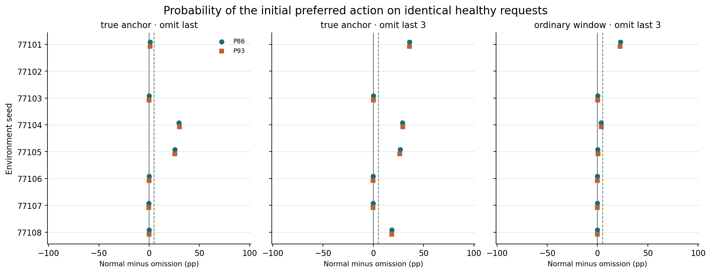

# 哪段个体经历触发跨伙伴的默认动作

**在这 8 条固定历史中，可以定位到具体个人经历，它的参数更新把对两位伙伴的策略一起推向了同一个动作。** 在 7 条出现真实请求三连的生命里，忽略紧邻的一次更新打断 3 条，忽略前三次打断 5 条。其中同时使两个伙伴的健康测试目标动作概率分别下降至少 5 个百分点的，是 2 条和 4 条。等长普通窗口也分别有 1/7 出现双伙伴同幅下降。固定探针持续三次偏好某个动作的取得或改写，在不少生命中早于或晚于真实请求上的三次确认。

**77101 提供了同一个体内的正反两段证据。** 在第 33 次遭遇，它向 P93 回答并恳求、得到维护，仍损失 2.31 健康，训练信号 +0.574。单独跳过这一步，到第 35 次决策时，对 P86 / P93 使用同一动作的健康探针概率分别从 92.91% / 92.91% 降到 71.52% / 71.56%。第 37 次又向 P93 回答并恳求，这次未获维护，损失 8.86 健康，信号 −0.529。这次更新后，“拒绝并求维护”的健康探针概率为 88.40% / 88.28%，跳过这一步则为 4.54% / 4.54%。继续经过同样的后续经历，到第 46 次真实请求出现新偏好时，单独遗漏第 37 步仍使两伙伴的新动作概率分别少 81.08 / 80.91 个百分点。只看第 46 次请求紧邻的三次反馈，几乎看不到这次较早的改写。

**身体条件下的后果不同。** 在上述第 37 步的正常减遗漏对照中，第 38 次生前参数在 H=2 的总死亡风险低 14.21 个百分点，H=6 的存活任务概率低 31.84 点，H=90/300 的健康任务概率低 83.80 点。面对危险时的收益伴随大幅参与损失。报告仅在固定同一生前输入和经历的条件下解释参数写入对行为的因果影响，无法据此推出相应分支在自主选择时的真实寿命。

使用 #17 和 #18 的八条原始稳定历史。正常重放共有 511 次非终末更新，并读到每条生命最后一次生前决策。另完成 190 个独立计算的遗漏分支：从同一更新前参数出发，只去掉指定的参数写入，之后继续读取原动作、伙伴回应、持续健康与训练信号，重新计算各自的梯度。整段历史的奖励和机会次序都固定。实验未启动新的物理生命。[事前方案](../../../../experiments/loreft_omission/PROTOCOL.md) · [原始 LoReFT 实验](../loreft-life/REPORT.md)

## 每条生命的正常时间线

真实三连指三次请求连续偏向同一个动作，概率每次均至少 90%，且与该输入的出生概率分布的总变差各至少 0.30。固定面板三连要求两个伙伴及两个健康值（90、300）的每个分组里，16 项中至少 12 项以至少 90% 概率支持相同动作，持续三次生前决策。末期稳定指健康面板上两伙伴一直保有该最高概率动作的严格多数，标准比高置信三连宽。动作是模型的最高概率选择，仍由原行为者的归档动作驱动身体。

| 种子 | 可测生前决策数 | 真实首次 | 面板首次 | 面板后续改写 | 末期众数及最终建立时点 |
|---|---:|---|---|---|---|
| 77101 | 62 | 35 回答并恳求 | 34 回答并恳求 | 47 拒绝求维护 | 拒绝求维护，38 |
| 77102 | 64 | 未出现 | 未出现 | 无 | 回答并恳求，60 |
| 77103 | 64 | 35 回答并恳求 | 26 回答并恳求 | 无 | 回答并恳求，26 |
| 77104 | 70 | 64 沉默拒绝 | 64 沉默拒绝 | 无 | 沉默拒绝，39 |
| 77105 | 69 | 34 回答并互惠 | 34 回答并互惠 | 63 拒绝求维护 | 拒绝求维护，56 |
| 77106 | 60 | 45 回答并互惠 | 55 回答并互惠 | 无 | 回答并互惠，7 |
| 77107 | 64 | 23 拒绝求维护 | 24 拒绝求维护 | 44 回答并恳求 | 回答并恳求，43 |
| 77108 | 66 | 27 回答并恳求 | 5 回答并恳求 | 51 拒绝求维护 | 拒绝求维护，49 |

## 首次真实偏好之前，把哪些更新跳过

下表以第 t 次请求为锚点，正数表示正常更新提高目标动作的概率。各对数字为 P86 / P93 在相同健康探针上的百分点差，健康 90 和 300、两任务、两语气、四布局等权。普通时段使用同一条生命、同样的目标动作与同长度的遗漏，并匹配实际健康和相对年龄。普通窗口的健康匹配距离逐项公开。

| 种子 | t、目标 | 跳过最近一次 | 跳过最近三次 | 普通 t | 普通跳过三次 | 三步后原三连是否打断 | 单独有双伙伴实质作用的更新 |
|---|---|---:|---:|---:|---:|---|---|
| 77101 | 35 回答并恳求 | +1.0 / +1.1 | +36.1 / +36.1 | 29 | +22.6 / +22.4 | 打断 | 33 |
| 77102 | 35 回答并恳求（普通参照） | -0.8 / -0.9 | -1.0 / -1.0 | — | — | 无原三连 | 无 |
| 77103 | 35 回答并恳求 | +0.0 / +0.0 | +0.1 / +0.1 | 41 | +0.3 / +0.2 | 打断 | 无 |
| 77104 | 64 沉默拒绝 | +29.6 / +30.2 | +28.9 / +29.4 | 58 | +3.6 / +3.7 | 打断 | 63 |
| 77105 | 34 回答并互惠 | +25.7 / +25.7 | +26.6 / +26.4 | 28 | +0.2 / +0.4 | 打断 | 33 |
| 77106 | 45 回答并互惠 | +0.1 / +0.1 | -0.3 / -0.2 | 51 | -0.0 / -0.0 | 保留 | 无 |
| 77107 | 23 拒绝求维护 | -0.4 / -0.4 | -0.2 / -0.3 | 29 | +0.0 / +0.0 | 保留 | 无 |
| 77108 | 27 回答并恳求 | +0.0 / +0.0 | +18.5 / +18.2 | 33 | -0.1 / -0.1 | 打断 | 无 |

图中空白的 77102 没有真实首次三连。在其第 35 次普通参照上，三步遗漏使健康探针的目标动作概率比正常分支高 1.00 / 1.04 点。它仍有末期多数偏好，第 60 次决策开始持续以回答并恳求占多数。这套较宽松的标准与连续高置信三连有不同含义。

实质作用要求在同一时点分别令两个伙伴的目标动作概率都降低至少 5 个百分点，同时原事件的判据被打断。只打断高置信阈值或只影响一位伙伴都没有计入实质作用。普通时段通常没有原事件，直接比较其同一目标概率，及与事件窗的配对差。

| 事件类别与遗漏 | 窗口数 | 原判据打断 | 两伙伴均 ≥5 点 | 同时满足 | 普通窗两伙伴均 ≥5 点 | 事件减普通的较小伙伴效应，按生命平均 |
|---|---:|---:|---:|---:|---:|---:|
| 真实首次，略一次 | 7 | 3 | 2 | 2 | 1/7 | +6.20 |
| 真实首次，略三次 | 7 | 5 | 4 | 4 | 1/7 | +11.84 |
| 真实改写，略一次 | 3 | 0 | 0 | 0 | 0/3 | -1.50 |
| 真实改写，略三次 | 3 | 1 | 1 | 1 | 0/3 | +26.62 |
| 面板首次，略一次 | 7 | 7 | 6 | 6 | 0/7 | +27.26 |
| 面板首次，略三次 | 7 | 7 | 6 | 6 | 1/7 | +33.07 |
| 面板改写，略一次 | 4 | 4 | 4 | 4 | 0/4 | +18.09 |
| 面板改写，略三次 | 4 | 4 | 4 | 4 | 0/4 | +42.68 |
| 末期建立，略一次 | 8 | 8 | 8 | 8 | 1/8 | +51.45 |
| 末期建立，略三次 | 8 | 8 | 8 | 8 | 1/8 | +51.89 |

## 改写发生时的具体经历

以下列出全部固定面板的连续高置信改写，真实请求序列中的改写另列。每行给出三次原始经历与当时的相对训练信号，按从早到晚排列。✓ 代表维护成功，× 代表未维护，沉默动作不产生伙伴观察。表中可归因的单步必须在从相同前缀分叉后同时通过两伙伴 5 点与打断标准。

| 种子 / 观测 | t 与新目标 | 前三次真实行动、伙伴、结果及优势 | 有实质作用的单步 | 三步遗漏效果 P86 / P93 | 后续原目标再次满足时间 |
|---|---|---|---|---:|---|
| 77101 真实请求改写 | 46 拒绝求维护 | 43 P86 拒绝求维护× -0.103，44 P93 回答并恳求× -0.332，45 P86 回答并恳求× -0.344 | 无 | -0.7 / -0.7 | 46 |
| 77101 固定面板改写 | 47 拒绝求维护 | 44 P93 回答并恳求× -0.332，45 P86 回答并恳求× -0.344，46 P86 拒绝求维护✓ +0.955 | 46 | +9.8 / +9.9 | 到末次未再满足 |
| 77105 真实请求改写 | 66 拒绝求维护 | 63 P93 回答并互惠× -0.617，64 P86 回答并恳求✓ +0.472，65 P86 回答并恳求× -0.590 | 无 | -3.3 / -3.5 | 66 |
| 77105 固定面板改写 | 63 拒绝求维护 | 60 P93 回答并互惠× -0.566，61 P86 回答并互惠✓ +0.414，62 P93 回答并恳求× -0.509 | 62 | +34.8 / +34.7 | 64 |
| 77107 固定面板改写 | 44 回答并恳求 | 41 P86 回答并恳求✓ +0.555，42 P93 回答并恳求✓ +0.553，43 P93 回答并恳求✓ +0.434 | 42,43 | +48.9 / +48.9 | 到末次未再满足 |
| 77108 真实请求改写 | 50 拒绝求维护 | 47 P93 回答并互惠✓ +0.456，48 P93 回答并恳求× -0.628，49 P93 拒绝求维护× -0.088 | 48 | +66.3 / +66.7 | 到末次未再满足 |
| 77108 固定面板改写 | 51 拒绝求维护 | 48 P93 回答并恳求× -0.628，49 P93 拒绝求维护× -0.088，50 P93 拒绝求维护✓ +0.855 | 48,50 | +81.7 / +81.5 | 到末次未再满足 |

若健康严格多数已经形成，但未达到持续 90% 的高置信门槛，末期众数与高置信改写需分开解读。四个遗漏分支共享同一正常时间线，单个、联合与普通窗口的效果相关。CSV 分别记录 t、t+2、t+8（仍活着时）及末次。GPU 归档保存每一步全部 128 个固定输入的四项原始概率。

## 哪次更新先把动作推向另一边

下面是事后定位。对每个持续改写，从上一次同类事件到本次确认之前，逐次固定输入，比较正常更新前后。取两位伙伴中较小的“新动作概率减旧动作概率”的增量，按此数值最大定位。末期建立行按新动作本身的概率排序。该栏可定位单步对当时策略的直接影响，不能凭最大增量把数轮后的整个改写归给该经历。最后一栏仅在这次更新恰有单独遗漏分支时列出它传播到确认时点的效果。

| 种子 / 确认时点 | 最大变化对应的更新 | 实际伙伴行动与回应 | 健康损失 | 训练信号 | 新动作即时概率差 P86 / P93 | 确认时点该步单独遗漏的差 |
|---|---|---|---:|---:|---:|---|
| 77101 actual-rewrite-46 | 37 | P93 回答并恳求，未维护 | 8.86 | -0.529 | +83.9 / +83.7 | +81.1 / +80.9 |
| 77101 panel-rewrite-47 | 37 | P93 回答并恳求，未维护 | 8.86 | -0.529 | +83.9 / +83.7 | +89.4 / +89.3 |
| 77101 final-established-38 | 37 | P93 回答并恳求，未维护 | 8.86 | -0.529 | +83.9 / +83.7 | +83.9 / +83.7 |
| 77105 actual-rewrite-66 | 55 | P93 拒绝求维护，维护 | 0.46 | +0.849 | +62.2 / +62.1 | -3.3 / -3.5 |
| 77105 panel-rewrite-63 | 55 | P93 拒绝求维护，维护 | 0.46 | +0.849 | +62.2 / +62.1 | -0.0 / -0.0 |
| 77105 final-established-56 | 55 | P93 拒绝求维护，维护 | 0.46 | +0.849 | +62.2 / +62.1 | +62.2 / +62.1 |
| 77107 panel-rewrite-44 | 42 | P93 回答并恳求，维护 | 2.44 | +0.553 | +39.6 / +40.0 | +14.6 / +14.6 |
| 77107 final-established-43 | 42 | P93 回答并恳求，维护 | 2.44 | +0.553 | +39.6 / +40.0 | +39.6 / +40.0 |
| 77108 actual-rewrite-50 | 48 | P93 回答并恳求，未维护 | 10.06 | -0.628 | +63.3 / +63.5 | +59.2 / +59.3 |
| 77108 panel-rewrite-51 | 48 | P93 回答并恳求，未维护 | 10.06 | -0.628 | +63.3 / +63.5 | +81.3 / +81.2 |
| 77108 final-established-49 | 48 | P93 回答并恳求，未维护 | 10.06 | -0.628 | +63.3 / +63.5 | +63.3 / +63.5 |

[每次转折的最大单步变化](analysis/largest-steps.csv) · [全部候选更新及两伙伴的即时变化](analysis/step-drivers.csv)

另有三种有别于 77101 的路径。77108 首次三连前连续三次向 P86 回答并恳求且均得到维护，联合遗漏使两位伙伴的回答并恳求概率下降 18.47 / 18.23 点，任意单独遗漏均未满足两伙伴下降 5 点并打断的标准。77105 单独漏掉第 62 次 P93 未维护回答的更新，面板的“拒绝并求维护”偏好暂时减弱，后续更新仍可使该偏好回来。77107 的第 41–43 次均是回答并恳求且得到维护，联合遗漏使第 44 次决策两位伙伴的该动作概率降低 48.86 / 48.87 点，直到末次生前决策也没再达到同一固定面板三连。

## 有限身体与适用范围

当轮 H=2 的总死亡风险由四动作概率加权，H=6 的存活合作由两种回答与对应伙伴维护率计算，H=90/300 报告安全任务概率。以下是七个真实首次时点正常减遗漏的探针差，它们估计参数对决策的影响，新的实际寿命没有在固定经历中被观测到。

| 略过更新 | H=2 总死亡风险 | H=6 回答且存活 | H=90/300 健康任务 |
|---|---:|---:|---:|
| 最近一次 | +0.23 | -1.05 | -0.34 |
| 最近三次 | +1.41 | -0.34 | +5.88 |

[全部转折与匹配](analysis/events.csv) · [三步原经历及其即时影响](analysis/prior-experiences.csv) · [单次与联合遗漏的归因](analysis/attribution.csv) · [各分支随时间的效果](analysis/event-effects.csv) · [普通时段配对差](analysis/matched-ordinary.csv) · [逐轮四动作](analysis/normal-stepwise.csv)

## 核验与资源

CPU 检查正常参数链以及每次尚存生命的身体、行动和反馈，本轮正常更新与 #18 逐步匹配 511/511，实际请求最大概率偏差 0，出生和末期固定面板最大偏差 0。每个遗漏步之后参数指纹及整个固定面板均保持，CPU 检查 296 次遗漏和 4793 次本分支继续学习，逐行复算 920 个时点对照。累计保存 742,144 次四动作探针读出。

普通 NVIDIA L4 上抽验 2,551 个原生计算的六行面板，最大概率误差 0。成功 worker 41.5 分钟，申请至释放核对 44.5 分钟，账户额度变化约 1.28 CU，释放后活动数为 0。相同请求/身体、更新前和更新后观察共享连续的参数状态，程序保留全部分支至原生命末次。

[完整汇总](analysis/summary.json) · [CPU 核验](analysis/audit.json) · [GPU 归档](gpu/omitstable/) · [原始程序与复算说明](../../../../experiments/loreft_omission/README.md)
