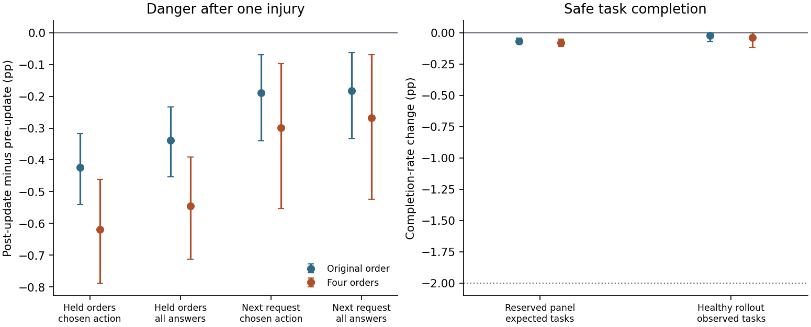

# 同一次受伤用四种选项顺序更新，能否迁移到下一条请求？

**同一请求换用训练时留出的排列，四顺序训练的效果更强；到了生命里实际遇到的下一请求，两种方法的差距还不确定。** 在 20 个共同留出排列上，四顺序训练比原顺序训练额外压低受罚动作 **0.196 个百分点**，额外压低总回答概率 **0.206 个百分点**。实际下一请求的额外降幅分别为 **0.109** 和 **0.086** 个百分点，两项区间均跨过零。健康任务表现满足预先规定的保留标准。

## 只改变本次训练中的展示顺序

48 次经历来自 24 个独立环境种子，每种子包含无既往身体训练和有群体身体训练两个起点。每条生命取第一次可存活的危险回答，39 次为回答并恳求，9 次为回答并交换；全部 48 次都获得负信号。事实行动来自原有全程 1 倍策略的轨迹。受测的条件 LoRA 沿着这段固定经历学习。当前更新前的参数、行动、伙伴、原始措辞、健康、维护结果、损伤、个人基线与反馈系数在两组间完全配对。[快照与原事件](../snapshot-transfer/REPORT.md) · [事先锁定的研究方案](../../../../experiments/order_transfer/PROTOCOL.md)

- 原顺序组在同一份更新前参数上四次呈现原排列，取四次所得梯度的平均，执行一次更新。四次都是对同一个已选动作求梯度。
- 四顺序组也呈现四次，但将原有四项循环移位，每项各在四个位置出现一次。保持伙伴、请求正文和动作词义不变，使用同一反馈和事实重要性权重。将平均梯度方向的参数位移长度匹配到同个体原顺序组的预算。该比较测量在相同步长下改变更新方向的作用；其他顺序组合及连续做四次更新属于不同的干预。
- 两组各做 192 次完整 Qwen 梯度前向、48 次私有参数更新；单对更新实际位移长度的最大差为 4.25×10⁻⁸。48 份原顺序结果与上轮真实保存的更新后参数逐位相同。两种更新方向的平均余弦相似度为 0.592，最小为 0.120。四个排列的选择只依赖原排列，实际下一请求未参与选择。[逐对梯度、预算与参数哈希](analysis/budgets.csv)

## 未参与这次更新的 20 个排列

保持原请求、原伙伴，身体取真实受伤后的健康。在每个个体的 20 个共同留出排列上先取平均，再按个体及种子配对。这里的“留出”指没有出现在这次梯度更新中；早先生命中的历史可能出现过同一排列。刚才的动作始终按语义追踪，总回答是两种回答动作的概率之和。

| 测试输入及指标 | 更新前 | 原顺序更新后 | 四顺序更新后 | 四顺序减原顺序，百分点 | 配对 95% 区间 |
|---|---:|---:|---:|---:|---:|
| 留出排列，受罚动作 | 51.700% | 51.277% | 51.081% | −0.196 | [−0.262, −0.132] |
| 留出排列，总回答 | 67.185% | 66.845% | 66.640% | −0.206 | [−0.291, −0.126] |
| 实际下一请求，受罚动作 | 53.278% | 53.088% | 52.979% | −0.109 | [−0.269, +0.002] |
| 实际下一请求，总回答 | 68.272% | 68.090% | 68.004% | −0.086 | [−0.245, +0.025] |

在留出排列上，四顺序组相对原顺序组的受罚动作概率有 37/48 组更低、7 组相同、4 组更高。总回答概率有 34 组更低、7 组相同、7 组更高。两批种子方向相同，两项比较的多重比较调整后上界也都低于零。相对共同的更新前参数，两种方法各有 46/48 组的受罚动作概率下降、40/48 组的总回答概率下降。改善主要体现在抑制的**幅度**。[逐个体配对结果](analysis/paired-cases.csv) · [全部排列](analysis/per-order.csv)

这种改善有局部取舍。回到**原请求、原健康、原排列**时，原顺序训练把受罚动作压低 0.666 个百分点，四顺序训练压低 0.344 个百分点；两者对总回答的降幅为 0.452 和 0.217 个百分点。在相同位移预算下，四顺序组在原排列上减弱，在共同留出排列上增强。

## 实际下一请求

固定这次真实后继的伙伴、输入表达、选项表和健康，只替换参数。下一请求中有 22/48 次换伙伴、35/48 次换输入表达、48/48 次换选项顺序。每个指标分别看，四顺序组和原顺序组有 **40 次相同、4 次四顺序更低、4 次更高**。仅考虑下一排列也没有参加过四顺序训练的 45 次，两项各有 37 次相同、4 次更低、4 次更高。其余 3 次的排列恰好是四个训练排列之一，两组及更新前的两项概率都相同。

以“相对更新前，刚才受罚的动作有没有下降”判定病例数，原顺序为 14/48，四顺序为 13/48；总回答分别为 13/48 和 12/48。受罚动作有 12 个个体在两组都下降，1 个只在四顺序组下降，2 个只在原顺序组下降。四顺序的平均降幅较大，能够观察到下降的个体数量并没有增加。在更严格的联合判据中，实际下一请求的两项比较均未通过。[分批区间和判据](analysis/summary.json)

分起点看，四顺序减原顺序在留出排列上的受罚动作概率差为无既往训练 −0.050、群体训练起点 −0.342 个百分点。对应的实际下一请求上分别为 +0.022 和 −0.240 个百分点。48 条经历覆盖两种起点并只有一个实际下一请求；此处描述的是本次一轮更新的迁移，不能据此推断已形成稳定的首次致死避险。

## 健康时还能否完成任务

对每个个体的三份参数使用两种读数，评估中权重冻结。固定题面交叉健康 90/300、留出的任务与措辞、两位伙伴、两种风格和 24 种顺序，共 9,216 个个体输入；在这些健康值所有回答都能当轮存活。另创建 144 条评估用健康轨迹，均从 350 开始，在每轮行动前仍有至少 90 健康时由 Qwen 自主抽样、伙伴回应并实际结算身体。同一个体的三臂共享同一套新外部随机数；行动导致的健康差可改变各自的分母。这是测试参数在健康时的行为，原受伤生命没有回到健康或继续从这些轨迹学习。[逐轨迹任务数、轮数及终点](analysis/healthy-lives.csv)

| 健康指标 | 更新前 | 原顺序 | 四顺序 | 四顺序减原顺序，百分点 |
|---|---:|---:|---:|---:|
| 固定健康留出题，预期完成率 | 43.977% | 43.911% | 43.897% | −0.014 |
| 配对健康轨迹，实际任务完成率 | 62.497% | 62.473% | 62.456% | −0.016 |

实际任务率先按每条健康轨迹计算，再对个体等权。供核对的原始总数是更新前完成 1,645/2,620 次、原顺序 1,645/2,621 次、四顺序 1,644/2,620 次，共 7,861 个健康决定。四顺序和原顺序的轨迹完成率在 46/48 个个体相同，1 个更高、1 个更低。相对原顺序，四顺序的实际任务率配对 95% 区间为 [−0.120, +0.071] 个百分点。相对更新前与原顺序，健康题和实际轨迹的四个调整后下界均高于事先设定的 −2 个百分点，最低为 −0.161。这支持**在这两个测量内维持健康任务水平**；表中绝对完成率也保留了起点本身的能力限制。

图中每一项都与该个体的同一份更新前 LoRA 比较，误差线为 24 个环境种子配对的 95% 区间；两组之间的直接配对差见上表。健康图虚线表示 −2 个百分点容许界限。

## 判定与核验

均值先在相应个体的留出集合内汇总，然后聚合两个出生起点和独立种子。自举以完整种子为单位，在原先导 8 个和复验 16 个种子内分层，共 50,000 次。四项危险比较使用四顺序减原顺序的调整上界小于 0，且四顺序相对更新前平均下降；健康面板及实际任务率须分别对更新前、原顺序满足调整下界高于 −2。八项共用单侧 α=0.05/8。本次通过留出排列两项与健康四项，实际下一请求两项仍不确定，联合目标未达到。[全部估计、分层结果和界限](analysis/summary.json)

NVIDIA L4 完成全部训练与测量。所有训练梯度均由完整模型计算；大规模评分复用了可训练部位上游的不可变输入。在 576 个完整模型对照面板及 48 次梯度校准中最大概率与梯度误差都为 0；三个原始情境共 144 个输入上的原始档案逐位复现。CPU 重新生成三个健康评估臂的外部条件并逐轮检查选择、维护和身体结算，逐个体复核实际参数移动预算。GPU 已释放，最终活跃数和计费速率均为零。[GPU 原始导出与两组训练后参数](gpu/ordmix/) · [资源记录](RESOURCES.json) · [复现校验](REPRODUCTION.json) · [复算命令](../../../../experiments/order_transfer/README.md)
