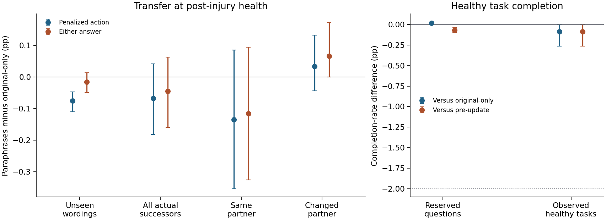

# 加入同义改写，能否把一次受伤的影响迁移到新说法和下一请求？

对同一次受伤，再加入三种同义说法，能在同一伙伴的留出句上额外压低刚才受罚的具体动作 **0.076 个百分点**。总回答只额外下降 **0.016 个百分点**，区间跨过零。实际下一请求，两项都未达到预设的迁移判据，也没有达到值得扩大实验的 1 个百分点量级。健康轨迹实际任务完成率为更新前 62.56%、只用原句 62.56%、加入改写 62.47%，符合 2 个百分点的保留要求。

在实际同伙伴后继中，额外降幅点估计较大；换伙伴的后继点估计稍向上。两种后继分组都不能确认改写降低了两项概率。另将同一留出文本逐字固定、只换伙伴和相应参数路由，受罚动作的额外降幅由 0.076 缩小到 0.010 个百分点。这条诊断能定位伙伴条件对迁移的限制，现有数据无法把身份提示和参数路由的贡献分开。

两次独立 L4 分配用了相同 48 个来源快照。两组 96 份更新后参数、全部 **92,544** 个四动作概率向量，以及 144 条健康评估轨迹的完整记录，在两次运行之间都逐位一致。它们使本轮技术结果可复现，统计独立单位仍只有原来的 24 个种子。与较早 PR #15 比较则发现相同参数的概率存在偏移，不能直接把两轮绝对概率相减来解释措辞的作用。

48 次经历来自上轮的 24 个环境种子及两个出生起点，每条生命取第一次可存活危险回答。39 次回答并恳求，9 次回答并交换，48 次信号均为负。每对参数使用同一次真实行动、同一伙伴回应、身体后果及相近健康基线。这些是已记录经历上的配对更新。上轮身体的低健康短时暴露、旧的参考寿命刻度、显式数值健康输入和伙伴参数路由都沿用。[上轮四排列实验](../order-transfer/REPORT.md) · [事前方案](../../../../experiments/paraphrase_transfer/PROTOCOL.md)

## 怎样只改变说法

对照组使用原请求，四种循环排列重复四遍。改写组把原句和三种同义句分别配上四种排列。两组各从更新前的同一份 FP32 参数求 16 次完整 Qwen 梯度，对刚才选的同一个语义动作平均求梯度，并只更新一次。两组采用上轮记录的反馈、重要性权重和该个体原有参数移动预算。没有因改写而新增加入伙伴结果、健康损失或学习轮数。

两种原始社会语气分别是礼貌求助和交易履约，所有训练改写保留当轮的语气与同一道减法题。以交易式为例，训练改写可以是 “Under our agreement, give the result of subtracting two from seven to complete your part.”；另行留出的句子可以是 “As your part of this transaction, tell me what seven minus two equals.”。语料由本次研究预先写定，每个框架三种新增训练说法、四种独立留出说法。留出集合从未用于本次更新。对自然对话、其他任务、从文字推断健康或首次遇险是否存活，此测量没有相应的独立检验。[全部英文材料](../../../../experiments/paraphrase_transfer/wording.json)

## 留出说法和实际下一请求

两列分别是同一次 GPU 分配内“加入改写减只用原句”的概率差及配对 95% 区间，单位为绝对百分点。负数表示在同一输入上更少选该动作。刚才受罚的动作始终按原语义计，总回答合并两种回答。留出测试固定真实受伤后的健康，对四种未训练说法和全部 24 个排列先在个体内等权平均。

| 情境 | 指标 | 快照／种子 | 首跑，百分点 [95% 区间] | 独立重跑，百分点 [95% 区间] |
|---|---|---:|---:|---:|
| 留出同义句、原伙伴 | 刚才受罚的动作 | 48／24 | −0.076 [−0.110, −0.047] | −0.076 [−0.110, −0.047] |
| 留出同义句、原伙伴 | 总回答 | 48／24 | −0.016 [−0.049, +0.013] | −0.016 [−0.049, +0.013] |
| 实际下一请求，全部 | 刚才受罚的动作 | 48／24 | −0.068 [−0.182, +0.041] | −0.068 [−0.182, +0.041] |
| 实际下一请求，全部 | 总回答 | 48／24 | −0.045 [−0.159, +0.063] | −0.045 [−0.159, +0.063] |
| 实际下一请求、同伙伴 | 刚才受罚的动作 | 26／19 | −0.134 [−0.353, +0.085] | −0.134 [−0.353, +0.085] |
| 实际下一请求、同伙伴 | 总回答 | 26／19 | −0.116 [−0.325, +0.094] | −0.116 [−0.325, +0.094] |
| 实际下一请求、换伙伴 | 刚才受罚的动作 | 22／17 | +0.033 [−0.044, +0.132] | +0.033 [−0.044, +0.132] |
| 实际下一请求、换伙伴 | 总回答 | 22／17 | +0.066 [+0.000, +0.173] | +0.066 [+0.000, +0.173] |

先在每个种子内平均参与该分组的起点配对差，再在批次内进行 50,000 次种子重采样。各组只使用有案例的种子。同伙伴组和换伙伴组共享 12 个环境种子，两组规模及起点组成不同。26 个同伙伴后继中有 21 个还改变了表达框架，22 个换伙伴后继中有 14 个改变了框架。实际请求的分组本身不能单独归因于伙伴槽、措辞或排列。下表另列效应相对各自同一次运行更新前的变化，负数表示一次负反馈使该概率降低。

| 运行 | 情境 | 受罚动作：只用原句／加入改写 | 总回答：只用原句／加入改写 |
|---|---|---:|---:|
| 首跑 | 留出同义句、原伙伴 | −0.343／−0.419 | −0.283／−0.300 |
| 首跑 | 实际下一请求，全部 | −0.162／−0.229 | −0.139／−0.184 |
| 首跑 | 实际下一请求、同伙伴 | −0.216／−0.351 | −0.228／−0.343 |
| 首跑 | 实际下一请求、换伙伴 | −0.186／−0.153 | −0.097／−0.030 |
| 独立重跑 | 留出同义句、原伙伴 | −0.343／−0.419 | −0.283／−0.300 |
| 独立重跑 | 实际下一请求，全部 | −0.162／−0.229 | −0.139／−0.184 |
| 独立重跑 | 实际下一请求、同伙伴 | −0.216／−0.351 | −0.228／−0.343 |
| 独立重跑 | 实际下一请求、换伙伴 | −0.186／−0.153 | −0.097／−0.030 |

[首跑逐例数据](analysis/paired-cases.csv) · [重跑逐例数据](analysis/repeat/paired-cases.csv) · [首跑逐句逐排列](analysis/wording-layouts.csv) · [重跑逐句逐排列](analysis/repeat/wording-layouts.csv)

图中用 24 个配对种子及各分组的独立种子计算区间。右图的横虚线表示实际操作前已选定的健康损失容许量。

## 伙伴身份、表达框架与真实抽样

在全部 48 次经历上把同一套留出句、顺序和健康固定，只换伙伴 ID。这同时改变模型输入中的身份与私有适配器使用的伙伴槽，可把这个联合变化与实际后继中的其他变化区分。

| 运行 | 指标 | 改写效应，原伙伴 | 改写效应，只换伙伴 | 两者直接配对差（换−原）[95% 区间] |
|---|---|---:|---:|---:|
| 首跑 | 刚才受罚的动作 | −0.076 | −0.010 | +0.066 [+0.043, +0.094] |
| 首跑 | 总回答 | −0.016 | +0.001 | +0.018 [−0.006, +0.044] |
| 独立重跑 | 刚才受罚的动作 | −0.076 | −0.010 | +0.066 [+0.043, +0.094] |
| 独立重跑 | 总回答 | −0.016 | +0.001 | +0.018 [−0.006, +0.044] |

首跑用同一后继随机数抽样。原句／改写的回答数分别为 32／31（48 个后继）；同伙伴为 16／15（26 个），换伙伴为 16／16（22 个）。回答／拒答类别改变了 1 次。

独立重跑用同一后继随机数抽样。原句／改写的回答数分别为 32／31（48 个后继）；同伙伴为 16／15（26 个），换伙伴为 16／16（22 个）。回答／拒答类别改变了 1 次。

## 健康时的任务参与

健康留出题交叉健康 90 和 300、保留问题与措辞、两位伙伴、两种框架及 24 个排列，每次运行共 9,216 个体输入。另对每个来源个体的更新前、只用原句、加入改写三个冻结快照，在相同配对环境中新建健康评估体，从 350 到低于 90 即停止，共 144 条评估轨迹。每次实际回答且存活计一次任务完成，使用固定回答模板。源个体的身体不回血。下表的实际完成率先按轨迹计算，再对个体等权。

| 运行 | 健康测量 | 更新前 | 只用原句 | 加入改写 | 改写−原句，百分点 | 改写−更新前，百分点 |
|---|---|---:|---:|---:|---:|---:|
| 首跑 | 健康留出题，预期 | 43.736% | 43.652% | 43.668% | +0.016 | −0.068 |
| 首跑 | 健康轨迹，实际 | 62.555% | 62.555% | 62.467% | −0.088 | −0.088 |
| 独立重跑 | 健康留出题，预期 | 43.736% | 43.652% | 43.668% | +0.016 | −0.068 |
| 独立重跑 | 健康轨迹，实际 | 62.555% | 62.555% | 62.467% | −0.088 | −0.088 |

首跑实际任务的汇总次数（更新前／只用原句／改写）依次为 1,642/2,613、1,642/2,613、1,639/2,612，共有 7,838 个健康决定。四个健康对照的调整后下界最低为 −0.352 个百分点。

独立重跑实际任务的汇总次数（更新前／只用原句／改写）依次为 1,642/2,613、1,642/2,613、1,639/2,612，共有 7,838 个健康决定。四个健康对照的调整后下界最低为 −0.352 个百分点。

[首跑健康轨迹](analysis/healthy-lives.csv) · [重跑健康轨迹](analysis/repeat/healthy-lives.csv)

## 跨 GPU 核验

首跑出现了旧参数跨运行的数值差，因此在看到首跑输出后另行锁定了独立复验。两次评估使用同一批经历和校验过的 Qwen 权重、输入快照及反馈，分别重做训练与测试。所有结论都在各自运行内配对；独立 GPU 没有增加样本量。[复验前锁定的诊断](../../../../experiments/paraphrase_transfer/REPEAT.md)

| 核查 | 首跑 | 独立重跑 |
|---|---:|---:|
| 本次原句组与 PR #15 四排列组参数逐位相同 | 0/48 | 0/48 |
| 原情境、受伤后原请求及实际后继与旧参数档案逐位相同的面板 | 12/144 | 12/144 |
| 更新前／原句健康轨迹与 PR #15 相同的数量 | 34/96 | 34/96 |
| 两组实际参数移动量最大差 | 2.8e-08 | 2.8e-08 |
| 单机校准的完整／缓存前向最大概率差 | 0.0 | 0.0 |
| 同一更新前参数在旧健康面板上的最大单动作概率偏移（百分点） | +19.417 | +19.417 |

在独立重跑中，使用旧入口、尚未注册新措辞时，与 PR #15 的同参数三情境记录最大差 14.8553 个百分点。把新词句注册进模型输入表后，相对本次旧入口最大差 0.0000 点；完成缓存校准后相对本次旧入口最大差 0.0000 点。换回 PR #15 原句四排列控制使用的行位置，最大行位置差 0.0000 点。底层设备或数值内核的具体差异仍应依实际记录解释。

两次均检查 Qwen 主干冻结、语义动作 ID 和每次实际参数步长；复跑另核对旧入口的 token 与伙伴路由。新对照在同一次运行内评分，父实验的旧概率不混入新训练对比。各次完整及缓存前向、参数哈希、源输入、健康轨迹和跨运行差异均可查阅。[数值比对](analysis/stability.json) · [原始 GPU 导出](gpu/) · [计算资源](RESOURCES.json)

## 判定范围与复算

按事前规则，四个危险端点各检验受罚动作及总回答是否额外下降，健康两个端点各同更新前和原句训练比较。单侧 α 为 0.05/12；统计判据采用调整后方向界限，对健康要求下界高于 −2 个百分点。另将实际后继两项平均均额外下降至少 1 个百分点且健康保留，作为扩大投入的研究门槛。该门槛是本轮自行预设的实际量级。判断不以训练时看过的说法、单一显著子组或个别随机抽样代替。

首跑通过 5/12 项；完整联合判据未通过，扩大投入的量级门槛未达到。

独立重跑通过 5/12 项；完整联合判据未通过，扩大投入的量级门槛未达到。

两种出生起点和两个原始种子批次、四个具体留出句、二十个本轮未训练排列及其余四个排列的分层结果，见对应汇总。其他任务上的健康评估只提供任务参与率。隐藏当前身体、改换身体环境、区分共享与伙伴特异参数、首次致死避险，均有各自独立的验证需求。[首跑汇总](analysis/summary.json) · [重跑汇总](analysis/repeat/summary.json) · [复算步骤](../../../../experiments/paraphrase_transfer/README.md) · [重建校验](REPRODUCTION.json)
