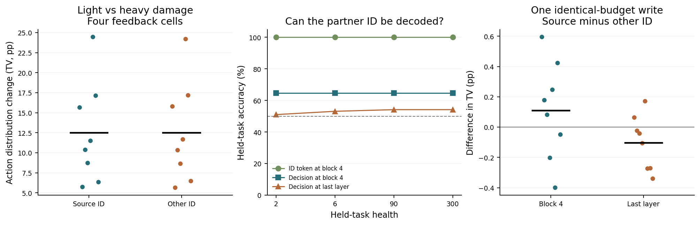

# 伙伴拒绝和身体损伤各自怎样影响个体参数

**伙伴拒绝会经身体后果影响这套策略。训练器收到的个人学习信号只包含参考剩余寿命变化相对此前基线的差值。** 在两个损伤剂量下分别翻转本次的伙伴接受/拒绝记录，34 个事件共 68 对参数和动作概率逐位相同。固定回应而从维护可挡掉的损伤换到未维护的损伤，34 个事件都改变了参数。原环境中回应会决定维护，进而改变伤害，这条间接路径仍然存在。

**跨伙伴扩散在写入和读出两个环节都可见。** 在八条生命预先选出的 32 个普通遭遇中，它们都位于个人历史的第 1–17 次，按生命等权，换掉训练请求的伙伴 ID 后，两份参数梯度的平均余弦为 0.998。真实写入对来源伙伴和另一伙伴分别移动 7.64、7.62 个百分点的四动作概率分布。把另一个人的一步隐藏增量放到同输入接收者上，平均只偏离实际更新 0.084 个百分点。两个伙伴共享同一 LoReFT，读到的变化接近通用的动作调整。人为只对来源者启用更新时，来源效应原样保留，另一人变化为零，这是架构保证的参照。

**身份本身在文本中清晰，到了动作决策位置，独立辨认较弱。** 在第 4 块 ID 词元上，固定中心的跨任务读出为 100%，第 4 块的最后决策词元为 64.6%，最终决策词元在不同健康值为 51.0%–54.2%。成对比较 A、B 时仍能固定排序。置换标签的对照有时也会得到 100% 的配对排序，因此不能把排序正确或名字可读单独当作策略采用身份的证据。按来源请求实际变化成功匹配的 19 项（7 个种子）中，第 4 块相对末层的伙伴特异性改善为 −0.15 个百分点，描述性 95% 区间 [−0.55, +0.22]。在这组测试里，直接把相同模块前移没有可靠改善。

两例的数值应连同文末跨设备复查阅读。

沿用 #19 八条稳定生命，以 77101 的第 33 次（获维护）、第 37 次（未获维护）为机制个案。预先另外选取每条生命中两位伙伴各自首次维护和首次拒绝的非沉默经历，共 32 项。这 32 项与两例分开统计。每项比较均从同一次原始经历前的 FP32 个人参数出发，固定当前请求、行动、身体、噪声和已有历史基线。报告中 TV 是四个动作分布总变差（所有动作概率绝对差之和的一半），用百分点表示。[前瞻方案](../../../../experiments/partner_damage/PROTOCOL.md) · [之前的遗漏实验](../loreft-omission/REPORT.md)

## 伙伴回应、身体后果、训练信号

模拟器先结算行动固有损伤，再结算最多四次环境损伤。维护会屏蔽当轮的四次环境损伤。当前训练信号为行动后参考寿命减行动前参考寿命，再减去本人此前反馈的基线。这个接口没有读取一个独立的“伙伴拒绝惩罚”。同损伤换回应测这条独立路径。同回应换损伤测身体反馈路径。两种错开的组合是为了识别通路而做的干预，不是自然观察到的第三种身体规则。

CPU 重算 511 次非终末事件，包括 41 次沉默拒绝（无社会回应）和 470 次有观察。对这 470 次以相同噪声重新结算，轻重两种身体后果在 470 次产生不同的训练信号，其中 443 次为低损伤正、高损伤负。其余事件也保留原先的历史基线。GPU 实际训练 34 项 × 四格，固定身体损失并改社会记录时，共有 68 对可学习参数和四动作概率逐位相同，最大概率差为 0。低高损失导致不同参数的事件为 34/34。

| 原经历 / 目标动作 | 回应记录与损伤 | 实际损失 | 训练信号 | P86 目标概率 % | P93 目标概率 % | 健康任务 % | H=2 总死亡 % |
|---|---|---:|---:|---:|---:|---:|---:|
| 33 · 回答并恳求 | 更新前 | — | — | 55.34 | 56.35 | 65.04 | 92.63 |
| 33 · 回答并恳求 | 接受 · 低损伤 | 2.31 | +0.574 | 91.44 | 91.67 | 92.80 | 99.73 |
| 33 · 回答并恳求 | 拒绝 · 低损伤 | 2.31 | +0.574 | 91.44 | 91.67 | 92.80 | 99.73 |
| 33 · 回答并恳求 | 接受 · 高损伤 | 8.19 | -0.447 | 1.26 | 1.26 | 65.64 | 99.67 |
| 33 · 回答并恳求 | 拒绝 · 高损伤 | 8.19 | -0.447 | 1.26 | 1.26 | 65.64 | 99.67 |
| 37 · 拒绝求维护 | 更新前 | — | — | 4.61 | 4.50 | 94.20 | 99.80 |
| 37 · 拒绝求维护 | 接受 · 低损伤 | 2.77 | +0.491 | 1.25 | 1.25 | 97.50 | 99.81 |
| 37 · 拒绝求维护 | 拒绝 · 低损伤 | 2.77 | +0.491 | 1.25 | 1.25 | 97.50 | 99.81 |
| 37 · 拒绝求维护 | 接受 · 高损伤 | 8.86 | -0.529 | 88.25 | 87.92 | 10.66 | 85.59 |
| 37 · 拒绝求维护 | 拒绝 · 高损伤 | 8.86 | -0.529 | 88.25 | 87.92 | 10.66 | 85.59 |

此处两伙伴的目标概率均指相同留出请求、H=90/300 等权的面板。对原事件的训练选择只计一次，表中四格没有提供新的个人经历。以下将这一次写入后继续读取完全相同的真实身体与后续记录，不去改写后续基线，以检查一次更新对以后决策的传播。

| 写入回合 → 后续决策 | 低损伤 P86 / P93 | 高损伤 P86 / P93 | 低减高 P86 / P93（点） |
|---|---:|---:|---:|
| 33 → 35 | 92.73 / 92.83 | 3.75 / 3.82 | 88.97 / 89.01 |
| 33 → 62 | 1.25 / 1.25 | 1.25 / 1.25 | -0.00 / -0.00 |
| 37 → 46 | 1.25 / 1.25 | 94.77 / 94.62 | -93.52 / -93.37 |
| 37 → 62 | 1.25 / 1.25 | 96.25 / 96.25 | -95.00 / -95.00 |

## 为什么另一位伙伴也受影响

沿用当前经历模型分别看训练输入、两份写入的切空间梯度、写入后真正传给隐藏状态的一步增量和输出。固定身体与语义条件后，只换训练伙伴会改变文本 ID，同时交换冻结身体路由。两个出生路由参数逐位相同。真正累积的 LoReFT 参数在同一个体内部由两位伙伴共享。读出实验将已经学到的增量换给同一文本条件的另一位伙伴。硬路由对照人为保留另一位伙伴的旧参数。

下表是 32 个普通事件先在每条生命内求平均，再对八条生命等权的估计，区间为按种子重采样的描述性 95% 区间。两个诊断个案单列。

| 比较量 | 普通集合均值 [95%] | 两次诊断经历（33 / 37） |
|---|---:|---:|
| 同记录改身体损失，来源伙伴 TV | 12.512 [8.683, 16.770] | 92.849 / 82.990 |
| 同记录改身体损失，另一伙伴 TV | 12.505 [8.703, 16.733] | 92.906 / 83.152 |
| 一次事实写入在来源伙伴的 TV | 7.638 [5.175, 10.151] | 36.189 / 81.340 |
| 同一次写入在另一伙伴的 TV | 7.619 [5.165, 10.106] | 36.699 / 81.448 |
| 只交换训练 ID 后，另一伙伴分布与原事实写入的 TV | 1.628 [0.862, 2.607] | 0.071 / 0.098 |
| 交换训练 ID 并匹配更新系数后的 TV（另一伙伴） | 2.129 [1.163, 3.190] | 1.751 / 6.855 |
| 只换训练 ID 后的切空间梯度余弦 | 0.998 [0.994, 1.000] | 1.000 / 1.000 |
| 成对测试输入的一步隐藏增量余弦 | 0.872 [0.794, 0.941] | 1.000 / 1.000 |
| 把同输入的对方增量换进来，与原事实写入的 TV（另一伙伴） | 0.084 [0.063, 0.107] | 0.002 / 0.221 |
| 只允许来源伙伴读取本次私有写入，另一伙伴的 TV | 0.000 [0.000, 0.000] | 0.000 / 0.000 |

预先约定的两人各至少变化 1 点 TV 的可测普通事件有 24/32，覆盖 8 个独立种子。该条件的指标和全部种子值在汇总中给出。移除本步全部增量或恢复后的原生输出均按四个动作核验。硬路由切断扩散是结构规定的正对照。

## Qwen 有没有识别身份的信息

训练数据为同一任务的原说法，测试是另一任务的留出说法。同框架、布局和健康逐项配 ID。类别中心在训练集固定。配对排序只问两人中哪一个得分更高，固定阈值准确率则要求在不看配对对象时认出身份。128 组随机符号在训练对内交换标签，作为零对照。第 4 层名字位取两种 ID 最后一个不同词元，决策位取最后提示词元。只读激活不参与训练回报。

| 读出位置 | 健康 | 单项固定中心准确率 | 两人排序正确 | 随机固定中心 95% 分位 |
|---|---:|---:|---:|---:|
| 第 4 块 · ID 词元 | 2 | 100.0% | 100.0% | 100.0% |
| 第 4 块 · ID 词元 | 6 | 100.0% | 100.0% | 100.0% |
| 第 4 块 · ID 词元 | 90 | 100.0% | 100.0% | 100.0% |
| 第 4 块 · ID 词元 | 300 | 100.0% | 100.0% | 100.0% |
| 第 4 块 · 决策词元 | 2 | 64.6% | 100.0% | 70.8% |
| 第 4 块 · 决策词元 | 6 | 64.6% | 100.0% | 70.8% |
| 第 4 块 · 决策词元 | 90 | 64.6% | 100.0% | 70.8% |
| 第 4 块 · 决策词元 | 300 | 64.6% | 100.0% | 70.8% |
| 最终归一化前 · 决策词元 | 2 | 51.0% | 100.0% | 52.8% |
| 最终归一化前 · 决策词元 | 6 | 53.1% | 100.0% | 52.8% |
| 最终归一化前 · 决策词元 | 90 | 54.2% | 100.0% | 52.1% |
| 最终归一化前 · 决策词元 | 300 | 54.2% | 100.0% | 53.1% |

## 换接入位置能否隔离经验

同一个已训练个体的权重冻结，仅在第 4 个解码块或最终归一化前追加同秩、出生恒等的新 LoReFT，更新之前的动作概率逐项相同。每个普通事件在两个位置都做一轮真实写入，分别测试同样 16 个未训练输入。匹配步长只看原训练请求上的实际四动作 TV，不用测试面板选择强度。来源动作的变化和留出面板的变化分别记录。区别于前节持续学到当时的模块，这里是同一起点的全新一次写入。

| 位置和条件 | 来源伙伴 TV | 另一伙伴 TV | 来源减另一伙伴 |
|---|---:|---:|---:|
| 未匹配 · 第 4 块 | 6.141 [4.567, 7.468] | 6.030 [4.515, 7.416] | 0.110 [-0.101, 0.320] |
| 未匹配 · 末层 | 5.114 [3.659, 6.491] | 5.216 [3.781, 6.585] | -0.102 [-0.217, 0.017] |
| 有效匹配 · 第 4 块 | 2.080 [1.653, 2.547] | 2.206 [1.625, 2.757] | -0.126 [-0.557, 0.277] |
| 有效匹配 · 末层 | 2.091 [1.202, 3.198] | 2.070 [1.179, 3.163] | 0.021 [-0.063, 0.084] |

32 个普通事件中，19 个满足两侧训练请求 TV 都 ≥0.5 点、两侧差 <0.5 点，涵盖 7 个种子。各候选强度及未过匹配的事件全部保留。两个位置的一步匹配诊断无法代替从出生开始训练、比较长期自主寿命的实验。

## 跨运行锚点与第二台 L4

首跑的每一个社会/身体、交换身份、注入增量和早末层对照都在同一运行内配对。与 #19 的事实续步检查发现同一预存参数在本轮面板有漂移。各事件的 128 个情境、四动作中取最大绝对差，再看 34 个事件的最大值，写入前为 17.47 个百分点，写入后为 32.18 点。历史权重、个案参数、身体公式及锁定的依赖版本和权重文件摘要均核对过。因此这些同轮对照仍能检查通路，但跨运行的旧概率不能被当成可互换的同一数值。复查在看到第一块设备的结果后登记，未重新选择主要事件。[技术复查方案](../../../../experiments/partner_damage/RECHECK.md)

| 检查项 | 回合 1 | 回合 33 | 回合 37 |
|---|---:|---:|---:|
| 第二次原第 3 行与本轮第 0 行的最大概率差（点） | 0.000 | 0.000 | 0.000 |
| 两次运行同权重、写入前最大概率差（点） | 15.980 | 14.407 | 2.376 |
| 全部四格及原参数的两运行最大差（点） | 16.512 | 14.407 | 7.387 |
| 首跑与 #19 原参数面板最大差（点） | 15.980 | 14.407 | 2.376 |
| 复查与 #19 原参数面板最大差（点） | 0.000 | 0.000 | 0.000 |
| 第二次实际更新参数与 #19 逐位一致 | 是 | 是 | 是 |

第二台设备也核对了普通全前向和缓存前向、模型原生槽位和新的配对槽位、四格回应/损伤、原来源权重及两个个案的后续读出。下表是两台设备在相同健康任务面板上的均值，百分比。第 37 次的目标为拒绝并求维护，第 33 次为回答并恳求。

| 个案、健康后果 | 首跑 P86 / P93 | 第二台 P86 / P93 |
|---|---:|---:|
| 33，更新前 | 55.34 / 56.35 | 56.17 / 56.19 |
| 33，低损伤 | 91.44 / 91.67 | 91.87 / 91.84 |
| 33，高损伤 | 1.26 / 1.26 | 1.25 / 1.25 |
| 37，更新前 | 4.61 / 4.50 | 4.54 / 4.54 |
| 37，低损伤 | 1.25 / 1.25 | 1.25 / 1.25 |
| 37，高损伤 | 88.25 / 87.92 | 88.40 / 88.28 |

[逐案例跨设备检查](analysis/cross-run.csv) · [两个设备各病例的梯度、通路和锚点](analysis/repeat-check.csv) · [两设备全量四格和持续效应](analysis/repeat-cells.csv)

## 复核与适用范围

CPU 独立重算同一噪声下的五段身体损失和反馈，核对了 34 个物理/参数锚点、68 个同体损伤的独立社会对照、34 对接入位置、480 个身份读出输入。事实更新与 #19 的逐位匹配为 0/34。全部细节和运行版本见归档。测试覆盖 P86 和 P93 两位规则伙伴、两项固定任务及既有的健康传感。

首跑和技术复查各使用一块普通 NVIDIA L4。两次累计从申请到释放核对 23.2 分钟，账户额度变化约 0.47 CU。两个运行时均已释放。

[逐事件指标](analysis/cases.csv) · [四格反馈](analysis/factorial-cells.csv) · [持续影响](analysis/continuation.csv) · [身份读出](analysis/identity-readout.csv) · [各位置全量结果](analysis/positions.csv) · [动作变化](analysis/action-flow.csv) · [完整汇总](analysis/summary.json) · [CPU 复核](analysis/audit.json) · [原始 GPU 数据](gpu/socialdamage/) · [复算命令](../../../../experiments/partner_damage/README.md)
