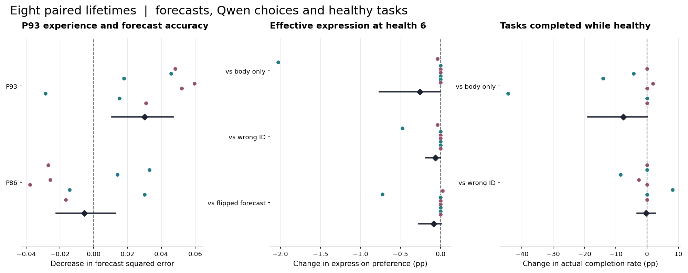

# 伙伴回应预测能否改变同一个体的表达选择

两次相同输入的 GPU 运行都观察到，P93 自己的回应改善了八个个体中七个对 P93 的预测。当两位伙伴喜欢相反的表达时，P93 的经历也会拖累对 P86 的判断。固定同一个体的全部参数，只交换“恳求”和“互惠”的维护预测，Qwen 在 H=6 上偏向有效表达的变化分别为 −0.09 和 +0.06 个百分点。真实组相对原组的实际健康任务完成率差分别为 −7.61 和 +0.78 点。预测与行为的预设联合门槛在两次运行中均未达到。下表先给首跑，技术复跑一节给出逐项对照。

## 哪些经历进入了预测

每个种子沿用 #17 同一条由 Qwen 产生的完整历史。三种身体策略读取相同请求、健康、动作和回应。回放采用原动作的采样概率校正更新。原组仅收到身体反馈。对照中的身份交换只发生在写入伙伴预测时。预测头在回答或拒答求助后学习当轮的实际接受或拒绝，沉默没有标签。致死当轮的回应计入最后一次预测评分，随后停止更新。

下表在最终参数上评估任务固定的未见说法。误差为两种回答表达的预测与环境真实维护率 .90/.10 的平均平方差，越低越好。排序指较有效表达排在前面的比例，平局计半分。

| 预测所用经历 | P93 误差 | P93 排序 | P86 误差 | P86 排序 |
|---|---|---|---|---|
| 原身体方案 | 0.1600 | 50.0% | 0.1600 | 50.0% |
| 真实伙伴 | 0.1408 | 68.8% | 0.1375 | 65.6% |
| 伙伴身份错配 | 0.1567 | 59.4% | 0.1603 | 56.2% |
| 跳过 P93 回应 | 0.1709 | 50.0% | 0.1320 | 87.5% |
| 跳过 P86 回应 | 0.1405 | 71.9% | 0.1789 | 50.8% |

增加 P93 写入后，P93 误差平均降低 0.0301，八个个体中七个改善，整生命重抽样区间为 0.0106–0.0470。P86 预测平均绝对移动 8.29 个百分点，误差平均升高 0.0055，较有效表达的排序率从 87.5% 降到 65.6%。P86 的平均误差增量在预设容忍值 0.01 以内。其种子区间包含更大伤害。真实组相对原组 0.5 参照和身份错配的 P93 误差优势分别为 0.0192 和 0.0159，事前各要求至少 0.0200。

四个种子中两位伙伴喜欢相反的表达，另四个种子喜欢相同表达。下表给只增加 P93 回应带来的变化。误差下降为正，P86 误差下降为负表示串扰伤害判断。

| 两位伙伴的偏好 | P93 误差下降 | P86 误差下降 | P86 预测平均绝对移动 |
|---|---|---|---|
| 相同 | +0.0125 | +0.0157 | 9.78 点 |
| 相反 | +0.0477 | -0.0267 | 6.80 点 |

八条来源历史共 519 次决策，其中 511 次有下一次选择，470 次有可用于更新的伙伴回应。P93 贡献 231 次更新，其中拒答求维护 82 次、回答并恳求 112 次、回答并互惠 37 次。就两种回答表达而言，按种子、伙伴、语气和表达划出的 64 个组合中，三个完全没有本人执行后可用于学习的回应。P93 每次回答表达的真实写入，在同一请求上使本人的维护预测平均绝对移动 7.66 点，换到 P86 仍移动 5.12 点。

在每次回应发生之前评分，P93 的 234 个实际回应包含 231 个随后可用于学习的回应。以每条生命等权计，真实组 Brier 分数 0.2023，错配组 0.2175，固定 0.5 参照 0.2500。Brier 分数对当次实际接受或拒绝打分，和表中对规则维护率的误差口径不同。

## 固定任务后换说法

同一个提问任务分别使用熟悉和留出说法，同时固定伙伴、请求语气、四个动作的排列和健康值。H=6 时，两种回答都需要获得维护才能存活。表达差指有效表达减去另一表达的无条件选择概率。拒答仍可被选。健康任务率计算 H=90 与 H=300 上完成回答的概率。H=2 总死亡风险包括四个动作。表中所有数都是百分数或百分点。

| 说法 | 末次生前策略 | 有效表达差 | 已回答时选对 | 回答并存活 | 健康任务 | H=2 死亡 |
|---|---|---|---|---|---|---|
| 熟悉 | 出生参数 | +0.00 | 50.00 | 44.62 | 71.69 | 91.52 |
| 熟悉 | 原身体方案 | +0.10 | 50.10 | 40.07 | 76.48 | 96.31 |
| 熟悉 | 真实伙伴 | -0.15 | 49.92 | 42.23 | 81.73 | 96.90 |
| 熟悉 | 伙伴身份错配 | -0.14 | 49.92 | 42.26 | 82.09 | 96.75 |
| 留出 | 出生参数 | +0.00 | 50.00 | 41.77 | 57.07 | 91.28 |
| 留出 | 原身体方案 | +1.02 | 51.18 | 39.79 | 74.93 | 96.31 |
| 留出 | 真实伙伴 | +0.76 | 50.44 | 42.21 | 79.84 | 96.82 |
| 留出 | 伙伴身份错配 | +0.82 | 50.49 | 42.23 | 79.86 | 96.69 |

以下只替换已训练真实组接收到的预测，固定 Qwen 全部参数和身体。数值为原始预测减替换预测时的配对差，按八个种子等权。

| 送入同一 Qwen 的替换 | 有效表达差变化 | 回答并存活变化 | 健康任务变化 |
|---|---|---|---|
| 预测全部设为 0.5 | -0.03 | -0.02 | -0.14 |
| 交换两种回答的预测 | -0.09 | -0.03 | -0.06 |
| 读取另一伙伴的预测 | +0.02 | +0.01 | +0.01 |
| 跳过 P93 回应 | -0.01 | -0.01 | -0.08 |

真实组在留出说法上作出回答时，选中更有效表达的比例为 50.44%。原组为 51.18%，错配为 50.49%。原预测相对交换预测的有效表达差仅 −0.0877 点，方向有利的种子为 2/8，预设要求为至少 +1 点且 6/8 同向。相对原组的回答并存活概率上升 2.43 点，相对错配组为 −0.02 点。分别学到不同策略后的比较同时含有整个训练路径的影响。固定真实组策略、只换预测，能单独测量这个预测通路的即时作用。

末期 H=6 的 256 个留出情境（每条生命 32 个）中，237 个情境的最高动作概率已至少为 90%。六个新增读入参数在每个个体中都有非零范数，真实和调换预测的个别请求最多能相差 2.78 点。策略容易集中到一个动作是这组数据留下的解释线索，其形成机制仍需通过更早的配对状态检验。

## 三组各自作出选择并生活到死亡

每条生命从健康 350 出发，带着自己刚更新的参数继续面对下一请求。三组配对共享外生请求、行动抽样用的随机数、伙伴随机数和身体噪声。行动可以分化，之后每组只收到自己实际观察到的回应。健康任务列同时给合计分子分母和八条生命的等权完成率。险情列统计当轮回答获维护能活、未获维护会死的机会，括号内为其中实际回答并存活的次数。

| 方案 | 回合 | 健康完成/机会 | 等权完成率 | H≤10 受伤后再选 | 可救险情（救下的回答） | 完成任务 |
|---|---|---|---|---|---|---|
| 原身体方案 | 507 | 259/408 | 63.22% | 3 | 5（2） | 320 |
| 真实伙伴 | 504 | 227/405 | 55.62% | 0 | 5（0） | 275 |
| 伙伴身份错配 | 506 | 229/405 | 55.98% | 2 | 5（0） | 278 |

同一八个种子的自主闭环训练结束后，在固定留出说法上再作只读测量。

| 组别 | P93 预测误差 | H=6 有效表达差 | H=6 回答并存活 | H=90/300 健康任务 | H=2 总死亡 |
|---|---|---|---|---|---|
| 原身体方案 | 0.1600 | -0.02 | 31.53 | 63.39 | 95.71 |
| 真实伙伴 | 0.1509 | -0.70 | 27.51 | 49.38 | 92.98 |
| 伙伴身份错配 | 0.1714 | -1.84 | 27.67 | 54.20 | 94.70 |

真实组健康任务的种子等权率为 55.62%，相对原组 63.22% 低 7.61 点，整生命重抽样区间为 −18.93 到 +0.16 点。与错配组 55.98% 相差 −0.37 点。单看回放末期健康面板，真实组反而比原组高 4.91 点。因此，实际生命中的健康任务保留情况须从真实动作计算。差异最大的种子 77106 中，原组为 45/50，真实组为 21/46。四个种子的健康完成分子分母与原组相同。

每组在各自生命中只遇到五次回答能够被维护救下的情形，真实组实际选了两次回答，两次均未获救。在 H≤10 受伤后还有下一次决策的次数，原组为 3，真实组为 0，错配组为 2。五次机会无法支持对现实闭环救援成功率的稳定估计。按固定 H=6 和固定任务的概率面板仍可检验表达选择。

## 每条生命与预设判据

三组顺序依次为原身体、真实伙伴和伙伴错配。末三列来自固定历史。实际健康任务和受伤后的下一次选择来自各组自主生命。骤死个体、稀有表达与不利种子均保留。

| 种子 | 生命回合 | 健康完成/机会 | 低健康伤后再选 | P93 误差下降 | P86 误差下降 | 预测交换效应（点） |
|---|---|---|---|---|---|---|
| 77101 | 63 / 63 / 63 | 45/51 · 45/51 · 45/51 | 0 / 0 / 0 | +0.0483 | -0.0270 | +0.02 |
| 77102 | 58 / 59 / 59 | 15/47 · 13/47 · 13/47 | 0 / 0 / 0 | +0.0457 | +0.0329 | -0.73 |
| 77103 | 64 / 65 / 63 | 33/53 · 26/54 · 30/53 | 2 / 0 / 0 | +0.0178 | +0.0140 | +0.00 |
| 77104 | 66 / 66 / 66 | 20/54 · 21/54 · 22/53 | 1 / 0 / 0 | +0.0596 | -0.0257 | +0.00 |
| 77105 | 64 / 64 / 64 | 46/50 · 46/50 · 46/50 | 0 / 0 / 0 | +0.0521 | -0.0377 | +0.00 |
| 77106 | 65 / 60 / 64 | 45/50 · 21/46 · 18/48 | 0 / 0 / 2 | -0.0287 | -0.0144 | +0.00 |
| 77107 | 62 / 62 / 62 | 5/50 · 5/50 · 5/50 | 0 / 0 / 0 | +0.0152 | +0.0301 | +0.00 |
| 77108 | 65 / 65 / 65 | 50/53 · 50/53 · 50/53 | 0 / 0 / 0 | +0.0308 | -0.0166 | +0.00 |

各项阈值于运行前锁定。区间按完整种子配对重抽样。方向性门槛按八个种子的点估计执行。

| 指标 | 平均差 | 95% 整生命重抽样区间 | 正向种子 | 门槛 | 结果 |
|---|---|---|---|---|---|
| P93 误差下降，相对 0.5 | 0.0192 | [0.0022, 0.0394] | 6/8 | ≥0.0200 | 未通过 |
| P93 误差下降，相对错配 | 0.0159 | [-0.0030, 0.0347] | 5/8 | ≥0.0200 | 未通过 |
| P93 写入改善 P93 | 0.0301 | [0.0106, 0.0470] | 7/8 | ≥0.0200，≥6/8 同向 | 通过 |
| P93 写入改善 P86 | -0.0055 | [-0.0223, 0.0128] | 3/8 | ≥-0.0100 | 通过 |
| 有效表达差，相对原组 | -0.26 | [-0.77, -0.00] | 0/8 | ≥3.00 | 未通过 |
| 有效表达差，相对错配 | -0.06 | [-0.18, 0.00] | 1/8 | ≥3.00 | 未通过 |
| 回答并存活，相对原组 | 2.43 | [-0.57, 7.86] | 2/8 | ≥0.00 | 通过 |
| 回答并存活，相对错配 | -0.02 | [-0.60, 0.54] | 1/8 | ≥0.00 | 未通过 |
| 健康面板，相对原组 | 4.91 | [-1.59, 16.31] | 5/8 | ≥-2.00 | 通过 |
| 健康面板，相对错配 | -0.02 | [-1.93, 1.88] | 1/8 | ≥-2.00 | 通过 |
| 实际健康任务，相对原组 | -7.61 | [-18.93, 0.16] | 1/8 | ≥-2.00 | 未通过 |
| 实际健康任务，相对错配 | -0.37 | [-3.17, 2.73] | 1/8 | ≥-2.00 | 通过 |
| 有效表达差，相对交换预测 | -0.09 | [-0.27, 0.01] | 2/8 | ≥1.00，≥6/8 同向 | 未通过 |

图上每个圆点是一条生命，青色表示伙伴偏好相同，紫色表示相反。菱形与横线给等权平均和整生命重抽样区间。

## 同输入的第二次 GPU 运行

首跑与 #19 的比较中，出生参数的哈希一致，同一出生面板的动作概率仍出现最大 15.98 点的偏移，面板平均绝对偏移 0.96 点。八条固定历史在第一次更新后的参数指纹均与旧运行不同。为检查这会不会影响本轮研究判断，进行了一次事后登记的技术复跑。重新分配一张 L4，逐字节复用同一份输入包与启动脚本。下表仍以八个配对种子各自等权。

| 配对结果 | 首跑 | 同输入复跑 |
|---|---|---|
| P93 写入后的 P93 误差下降 | 0.0301（7/8 正向） | 0.0300（7/8 正向） |
| P93 写入后的 P86 误差下降 | -0.0055（3/8 正向） | -0.0055（3/8 正向） |
| P93 误差相对错配改善 | 0.0159（5/8 正向） | 0.0160（5/8 正向） |
| H=6 有效表达差相对原组（点） | -0.26（0/8 正向） | -0.79（4/8 正向） |
| 固定策略，原预测相对交换预测（点） | -0.09（2/8 正向） | 0.06（3/8 正向） |
| 实际健康完成率相对原组（点） | -7.61（1/8 正向） | 0.78（2/8 正向） |
| 预测联合门槛 | 未通过 | 未通过 |
| 行为联合门槛 | 未通过 | 未通过 |

第二次运行里，P93 在留出说法上的误差为 0.1408，错配为 0.1568，原组为 0.1600。两位伙伴偏好相反时，P93 写入引起的 P86 误差增量为 +0.0265。偏好相同时增量为 -0.0156。

复跑八种子的实际健康任务完成率，原组为 50.86%（209/406），真实组为 51.65%（213/408），错配组为 51.33%（210/405）。百分比按个体等权，括号是逐轮总计。

两次运行之间，出生留出面板最大差 15.9799 点。回放末期的维护预测最大差 0.3374 点，回放与自主末期所有方案的同条件动作概率最大差 95.0000 点。24 对自主生命中，1 对的整条行动序列相同。第二次相对 #19 的出生面板最大偏移为 0.0000 点，末期最大偏移为 0.0000 点。两次分配的总时长上界 36.66 分钟，低于先验上限 110 分钟。释放后的活跃分配为零。

复跑的原身体方案与 #19 的 511 次正常更新逐步指纹全部吻合。两次本轮运行各有 256 次完整前向与缓存前向的校验，均逐项一致。两次同型号分配间仍出现了前向数值差异，具体由哪个底层运算引起尚未定位。健康任务的组间差值随运行改变了方向。每次的统计区间只覆盖该次运行的八个个体，不包含设备间差异。相对原组和身份错配，真实组在 H=6 的有效表达差两次都没有达到预设的 +3 点。只交换预测时两次的均值都不到 0.1 点，低于 +1 点门槛。技术复跑与首跑共享全部源经历，独立环境种子仍为八个。

[复跑登记](../../../../experiments/partner_prediction/RECHECK.md) · [GPU 原始结果](gpu/recheck/results.zip) · [复跑预测与行为闸门](analysis/recheck/gates.json) · [逐种子技术比较](analysis/recheck/technical_comparison.csv) · [首跑和 #19 对比](analysis/cross_run.csv) · [再次 CPU 核验](analysis/recheck/audit.json) · [总资源回执](gpu/resources.json)

## 实现、校验与边界

27 个预测参数读取研究者指定的第 4 解码块里的名字词元和整句请求特征，八条无回应的原说法用作中心，两个伙伴共用预测权重。另有六个策略读入参数只由原身体反馈训练。策略读取的健康信息和出生身体适配器均与原组相同。环境真实维护率仅在评估时使用。选择是 Qwen 原生四个动作词经原采样规则得到的结果，任务完成衡量在受限接口中回答并存活。各组的语言能力未通过自由回答质量评分。

两种说法包含相同任务、语气、伙伴和选项位置，仅检验这两项熟悉任务在一种新说法下的迁移。本轮的独立单位是八个配对环境。每种条件下的多次测量和同种子自主生命共享这个环境。

硬件为 NVIDIA L4，含启动和回收的占用上界 18.14 分钟，worker 16.18 分钟。结束时活跃分配为零。冻结权重哈希与锁定版本相符。完整 Qwen 和缓存尾部共检查 256 次，最大概率差 0.00000000，回退记录 []。与 #19 同轨迹的原身体方案比较，逐轮动作分布最大绝对偏移 95.00 点，末次留出面板最大偏移 95.00 点。所有组间结论均使用本次同硬件配对。

CPU 从两个锁定历史归档重建输入，逐回合核对抽样行动、伙伴回应、健康、Reference-RUL 优势、身体更新指纹链和终末停止。用第 4 块保存的激活重新建立预测特征，从零重建每次真实、错配和跳过来源的 BCE 更新，核对最终权重、面板和评分。Qwen 的动作前向来自本轮 GPU。

[运行前协议](../../../../experiments/partner_prediction/PROTOCOL.md) · [复现命令](../../../../experiments/partner_prediction/README.md) · [原始输入](gpu/partnerpred/inputs.zip) · [GPU 轨迹和参数](gpu/partnerpred/results.zip) · [资源回执](gpu/partnerpred/resources.json) · [逐项门槛](analysis/gates.json) · [逐种子预测](analysis/prediction.csv) · [策略面板](analysis/policy.csv) · [实际生命](analysis/life.csv) · [每次更新的平均影响](analysis/immediate.csv) · [训练表达覆盖](analysis/source_exposures.csv) · [CPU 校验](analysis/audit.json)
