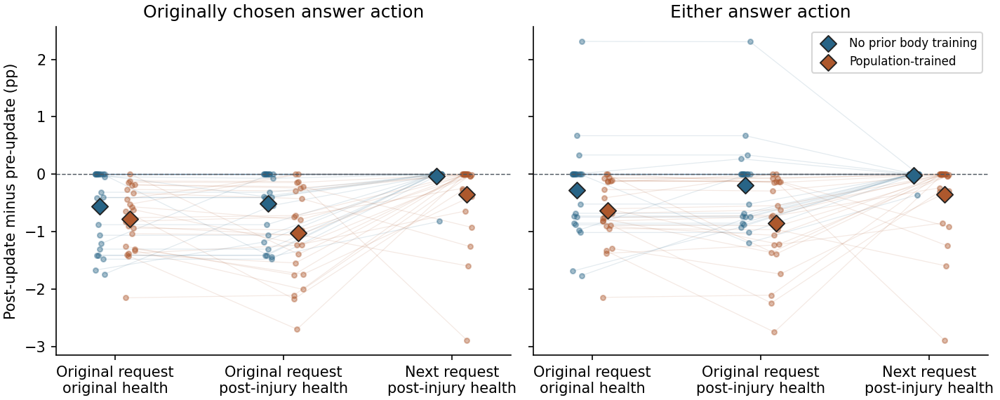

# 一次受伤更新之后，Qwen 在原请求和下一请求上怎样选择？

**多数更新在原请求上已经起效。** 48 次负反馈更新中，36 次降低了刚才所选动作的概率，11 次持平，1 次略微上升。只把健康换成受伤后的值，仍有 36 次降低。到了实际下一请求，只有 14 次降低。原来有可见抑制效果的 36 次里，13 次保留了效果，23 次降到原生输出精度下的完全持平。另有 1 次在原输入持平、在下一请求才出现下降。

## 两个概率随情境怎样变化

对每个输入分别装入同一次更新之前和之后的条件 LoRA。“刚才的动作”始终按原语义追踪，即使展示顺序、伙伴或下一轮实际所选动作已改变。“总回答”是回答并恳求与回答并交换两种动作的概率之和。Δ 为更新后减更新前的绝对百分点；各组计数顺序为下降／持平／上升。

| 完整模型输入 | 刚才动作的平均概率（前 → 后） | Δ | 下降／平／升 | 总回答的平均概率（前 → 后） | Δ | 下降／平／升 |
|---|---:|---:|---:|---:|---:|---:|
| 原请求、原健康 | 59.33% → 58.66% | −0.666 | 36／11／1 | 71.70% → 71.25% | −0.452 | 33／11／4 |
| 原请求、受伤后健康 | 59.38% → 58.61% | −0.769 | 36／12／0 | 71.79% → 71.27% | −0.525 | 32／12／4 |
| 实际下一请求、受伤后健康 | 53.28% → 53.09% | −0.190 | 14／34／0 | 68.27% → 68.09% | −0.182 | 13／34／1 |

读每一行的前后差，才能判断这次参数更新的作用。第一行到第三行的平均原始概率也受请求和身体输入本身影响。为补充概率结果，在同一行用同一个原抽样随机数比较更新前后，两份参数各有 1/48 次产生不同的回答／拒答决定。第一、二行使用原轮随机数，第三行使用下一轮随机数。[每个更新的配对结果](analysis/paired-updates.csv) · [所有语义动作的前后概率](analysis/contexts.csv)

图中每条线代表一组固定的更新前后参数，菱形为同一起点内的均值。各点使用实际 Qwen 的原生动作分布。

## 同一份更新在哪一步损失了效果

第一行的 36 个下降案例中，33 个在只换健康后仍然下降，3 个持平；另有 3 个原先未下降的案例在改健康后出现下降。总体而言，单独换健康导致的平均抑制幅度差为 +0.103 个百分点，按种子配对的 95% 描述区间为 [−0.025, +0.241]。这批数据没有显示这次小幅受伤本身普遍消除了抑制。

进一步固定受伤后健康，换到实际下一请求时，单个动作的平均抑制幅度减少 **0.580 个百分点**，95% 区间为 **[0.336, 0.831]**；总回答的抑制幅度减少 **0.343 个百分点**，区间为 **[0.045, 0.626]**。在这一转换中，第二行已有动作抑制的 36 次，14 次保持下降，22 次持平；其余 12 次在两个输入上都持平。第一行总回答下降的 33 次中，到了实际下一请求 12 次仍下降、20 次持平、1 次转为上升。[逐例转移、分批均值与种子区间](analysis/summary.json)

| 私有 LoRA 的出生起点 | 原请求、原健康 | 原请求、受伤后健康 | 实际下一请求 |
|---|---|---|---|
| 无既往身体训练，24 组 | 所选动作下降 13/24，平均 −0.555 点 | 14/24，−0.512 点 | **1/24，−0.034 点** |
| 有群体身体训练，24 组 | 所选动作下降 23/24，平均 −0.778 点 | 22/24，−1.027 点 | **13/24，−0.346 点** |

这里的“点”均指概率的绝对百分点。先导 8 个环境种子和后续 16 个种子上，换到实际下一请求后，刚才动作的平均抑制都弱于原情境。两种起点的个体有各自的历史，分层表描述观测到的差距。每组 48、24 或 16 都不代表同样数量的独立环境。[种子、起点和反馈记录](analysis/paired-updates.csv)

## 哪些请求成分会影响迁移

48 个后继请求全部换了选项顺序，35 个改变了输入表达与框架，22 个换了伙伴。问题的任务内容在这些遭遇里始终相同。在受伤后健康上固定其余输入，单独替换实际发生变化的成分。下表给出刚才那个动作的抑制幅度，比同样健康、原请求减少了多少。区间是按有合格案例的种子配对并按原批次重采样的描述区间。

| 只替换的成分 | 有变化的快照／种子 | 抑制幅度平均减少 | 配对 95% 区间 |
|---|---:|---:|---:|
| 伙伴身份 | 22／17 | 0.833 个百分点 | [0.537, 1.139] |
| 输入表达及框架 | 35／21 | 0.419 个百分点 | [0.165, 0.706] |
| 选项排列 | 48／24 | 0.349 个百分点 | [0.104, 0.615] |

三种成分单独变化都能削弱对具体动作的抑制。换伙伴时，显式身份也切换了模型里按伙伴选择参数的位置。各行个体集合不同，同一请求还会同时改变几个成分，因此三行效应不能相加，也不宜据此给三种原因排一个普遍顺序。[单因素输出](analysis/contexts.csv)

## 为什么有时参数动了、动作概率却完全相同

在原请求原健康上，48 次更新都改变了末层的隐藏向量，其中 11 次四个原生动作概率完全相同。将**同一份原生隐藏向量**交给 FP32 精度的输出层辅助读数，这 11 次都可读出刚才动作的概率下降。实际部署用的 BF16 前向对这些变化给出了相同的动作分数。

到了实际下一请求，34 次原生概率完全相同。其中 28 次在辅助输出层能读到变化，22 次向下降方向、6 次向上；另外 6 次连最后的原生隐藏向量都相同。辅助读数也出现了情境衰减，原请求中所选动作平均下降 0.622 个百分点，实际下一请求平均下降 0.171 个百分点。数值精度会遮住一部分小变化，换情境后的衰减仍然可测。决策始终按上表的原生模型输出判定。[内部读数与逐层精度](analysis/precision.csv)

例如种子 71101、无既往身体训练的个体在第 104 轮选择回答并恳求，训练信号为 −0.04465。更新前后的参数在原请求原健康上都给该动作 50.084%；保持原请求、健康从 5.8247 降到 5.7006 后，该动作从 50.471% 降至 50.084%，总回答却从 63.413% 升至 63.681%。这次概率向另一种回答动作移动。实际下一请求换了伙伴和选项顺序；更新前后该具体动作均为 41.235%，总回答均为 53.941%。[该个体与其余 47 组的原始概率](analysis/contexts.csv)

## 样本、可信度与解释范围

- 这 48 组是 24 个配对环境种子 × 两种出生起点，每条生命只取保存过精确快照的第一次可存活危险回答。既有轨迹的实际行动由全程 1 倍策略采样，条件组沿这些相同经历学习。本次回装的是条件组在该步之前与之后的 FP32 参数。实际回答包括 39 次回答并恳求、9 次回答并交换。48 个优势信号都为负，范围为 −0.14357 到 −0.00092。后续生命中的其他 612 个危险回答及正反馈不在此样本内。[上一轮逐轮审计](../body-feedback-chain/REPORT.md)
- 在读取本轮新输出前固定了三步、分析单位、精度读数和单因素对照。对每个情境保留四动作分布和两个指标。区间使用 50,000 次配对种子重采样，在先导与复验两批内分别抽样；多个动作、前向重复或出生起点不会增加种子数。单因素与精度结果作机制诊断。[预先固定的设计](../../../../experiments/snapshot_transfer/PROTOCOL.md)
- NVIDIA L4 上进行 432 次从 token 开始的完整 Qwen3.5-4B 前向，只读模型。48 个原输入的更新前分布和 48 个实际后继的六行面板均与父实验逐位相同。三种主情境倒序并交换权重位置再测，144/144 个面板逐位相同。运行前后冻结主干及快照校验通过。GPU 已释放，最终活跃分配和计费速率均为 0。[原始 GPU 输入与输出](gpu/stmap/) · [资源记录](RESOURCES.json)
- 从独立目录复核 48 对参数的每个 FP32 坐标与引用的原始概率，重建四份分析结果和图。用另一种 BLAS 求和顺序重新计算参数差范数时，最大差为 3.47×10⁻¹⁷；其余逐例元数据完全相同，范数不参与评分。[复现核验](REPRODUCTION.json) · [复算步骤](../../../../experiments/snapshot_transfer/README.md)

可确认的是一次负反馈通常能在原输入留下小幅、方向相符的行为效应，跨到新的实际输入时保留得少，尤其在无既往身体训练的起点。这 48 次体现在概率上的局部学习，尚不能证明个体已学会按身体处境避开首次致死请求。
