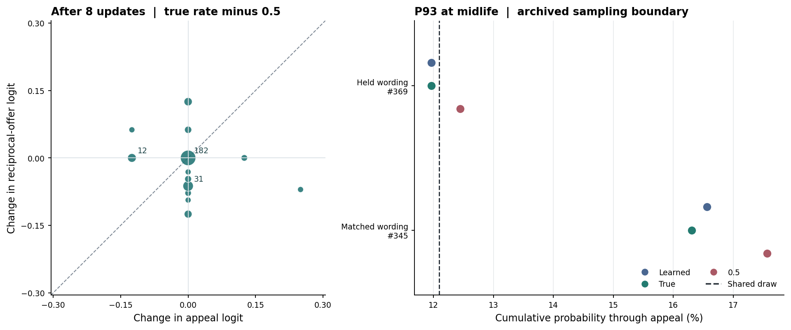

# 维护率怎样改变 Qwen 的恳求与互惠分数

早期主要表现为预测对两个候选词的原始分数推动较弱。第 8 次更新后，两次预登记运行都发现，真实维护率相对中性 0.5 使 182/256 个情境的两个原生分数完全相同，72 个只动了一个词，2 个朝相反方向移动。没有一个情境出现两个词共同向上或共同向下。自学率替换中性时，217/256 个情境的两词原生分数完全相同。八条生命的这些早期抽样都没有因此在两种回答表达间转换。

77102 中期的 #22 记录清楚显示了抽样边界效应。换预测时互惠一直是最高分，但固定的行动随机数跨过恳求区间的上界，从而改选互惠。两次预登记运行复现了彼此的原始分数，均未重现 #22 焦点切换。技术复查在同一快照上逐项重现旧概率，并记录了实际一次前向的绝对分数。

## 八条生命的早期

主要时点为第 8 次更新后，沿用 #22 的参数。从 BF16 原生词表输出层读取回答并恳求（help）与回答并提出互惠（trade）的分数 z。分差统一记为 g＝z_trade−z_help，正数表示互惠排在恳求前。温度缩放与 5% 均匀探索发生在读取分数之后。下表每行 256 个请求（8 个体 × 32 个留出措辞情境），同一参数、伙伴、请求、健康值 6 和随机数下逐项相减。

| 运行 | 输入差 | 两词都不动 | 同向同幅 | 同向不同幅 | 仅一词动 | 反向 | 分差不动 | 实际换表达 |
|---|---|---|---|---|---|---|---|---|
| 首跑 | 真实率−0.5 | 182 | 0 | 0 | 72 | 2 | 182 | 0 |
| 首跑 | 自学率−0.5 | 217 | 0 | 0 | 39 | 0 | 217 | 0 |
| 首跑 | 真实率−自学率 | 193 | 0 | 0 | 61 | 2 | 193 | 0 |
| 复跑 | 真实率−0.5 | 182 | 0 | 0 | 72 | 2 | 182 | 0 |
| 复跑 | 自学率−0.5 | 217 | 0 | 0 | 39 | 0 | 217 | 0 |
| 复跑 | 真实率−自学率 | 193 | 0 | 0 | 61 | 2 | 193 | 0 |

表内前五种分数分类互斥且总和为 256。分差不动包括两词均不动和相同非零位移两类。以下汇总先取绝对值，避免相反的伙伴偏好或不同方向的分数变化在平均时抵消。

| 运行 | 输入差 | 恳求平均绝对变幅 | 互惠平均绝对变幅 | 分差平均绝对变幅 | 分差中位绝对变幅 | 分差 P90 | 分差最大绝对变幅 | 对有利表达的定向分差变化 | 共同分量能量占比 |
|---|---|---|---|---|---|---|---|---|---|
| 首跑 | 真实率−0.5 | 0.0083 | 0.0185 | 0.0268 | 0.0000 | 0.1250 | 0.3203 | +0.0001 | 46.5% |
| 首跑 | 自学率−0.5 | 0.0015 | 0.0086 | 0.0101 | 0.0000 | 0.0625 | 0.1250 | -0.0021 | 50.0% |
| 首跑 | 真实率−自学率 | 0.0078 | 0.0148 | 0.0226 | 0.0000 | 0.1250 | 0.2969 | +0.0022 | 46.9% |
| 复跑 | 真实率−0.5 | 0.0083 | 0.0185 | 0.0268 | 0.0000 | 0.1250 | 0.3203 | +0.0001 | 46.5% |
| 复跑 | 自学率−0.5 | 0.0015 | 0.0086 | 0.0101 | 0.0000 | 0.0625 | 0.1250 | -0.0021 | 50.0% |
| 复跑 | 真实率−自学率 | 0.0078 | 0.0148 | 0.0226 | 0.0000 | 0.1250 | 0.2969 | +0.0022 | 46.9% |

共同分量是两个原始分数增量的平均数，差异分量是互惠增量减去恳求增量再除以二。能量占比描述两词全部非零位移中共同分量的平方和占比，不表示有多少请求发生了相同位移。按上一式，分差增量除以 2 即探索混合之前互惠相对恳求的对数胜算变化。原措辞与留出措辞分开保存。

主运行中，真实率相对中性使恳求、互惠分别平均移动 0.0083、0.0185 个原始分数单位，分差平均绝对变化 0.0268，中位数为 0，90% 分位数为 0.125。74 个至少有一词发生变化的情境中，平均绝对分差变化为 0.0928。按环境中更有效的表达统一校正方向后，平均定向变化只有 +0.0001。不同个体差异明显，例如 77101 的 32 个情境均至少有一词变化，77103 的 32 个情境两词均不变。

| 种子 | 都不动 /32 | 同向同幅 /32 | 仅一词动 /32 | 分差不动 /32 | 平均绝对分差变化 | 有利表达定向变化 | 换表达 /32 |
|---|---|---|---|---|---|---|---|
| 77101 | 0 | 0 | 31 | 0 | 0.0740 | +0.0164 | 0 |
| 77102 | 27 | 0 | 5 | 27 | 0.0137 | +0.0137 | 0 |
| 77103 | 32 | 0 | 0 | 32 | 0.0000 | +0.0000 | 0 |
| 77104 | 26 | 0 | 5 | 26 | 0.0234 | -0.0234 | 0 |
| 77105 | 26 | 0 | 6 | 26 | 0.0176 | +0.0098 | 0 |
| 77106 | 16 | 0 | 16 | 16 | 0.0625 | -0.0078 | 0 |
| 77107 | 29 | 0 | 3 | 29 | 0.0078 | +0.0000 | 0 |
| 77108 | 26 | 0 | 6 | 26 | 0.0156 | -0.0078 | 0 |

## 两句相似请求的原始分数和抽样边界

中期焦点来自第 31 次更新后的种子 77102。P93 以交换语气询问一年的第一个月份，任务和选项布局 9 完全相同。两种说法按 #22 的既有选择作回顾性匹配。下表先给两次主运行逐项相同的直接测量。技术复查一节将旧归档与 #22 原入口复查并列。每一条请求内部，唯一干预是送入模型的三维维护率。

| 请求 | 输入 | 恳求原始分 | 互惠原始分 | 互惠−恳求 | 恳求下界 % | 恳求上界 % | 最高分 | 抽中 | 当轮身体 |
|---|---|---|---|---|---|---|---|---|---|
| 369 | 自学率 | 17.3750 | 24.6250 | 7.2500 | 6.762 | 10.368 | 互惠 | 互惠 | 存活 |
| 369 | 真实率 | 17.3750 | 24.6250 | 7.2500 | 6.759 | 10.364 | 互惠 | 互惠 | 存活 |
| 369 | 0.5 | 17.5000 | 24.6250 | 7.1250 | 7.017 | 10.763 | 互惠 | 互惠 | 存活 |
| 345 | 自学率 | 16.7500 | 22.5000 | 5.7500 | 11.494 | 17.337 | 互惠 | 恳求 | 死亡 |
| 345 | 真实率 | 16.7500 | 22.5000 | 5.7500 | 11.468 | 17.312 | 互惠 | 恳求 | 死亡 |
| 345 | 0.5 | 17.0000 | 22.3750 | 5.3750 | 12.467 | 19.135 | 互惠 | 拒答求维护 | 死亡 |

抽样器按沉默、拒答求维护、恳求、互惠的固定语义顺序读取概率。令 B 为前三项的累计概率。行动随机数在恳求的下界与 B 之间时选恳求，超过 B 时选互惠。以下切换解释同时核查两个边界。

两条请求的行动随机数是同一个 0.1209267369。上次焦点 369 的中性恳求区间是 (0.078496, 0.124459]，自学率和真实率下上界为 0.119646，所以相同的随机数由恳求区间落入互惠区间。对照 345 的三种恳求上界依次为 0.175657（中性）、0.165570（自学）、0.163064（真实），对应下界依次是 0.114402、0.109509、0.109518。同一随机数三次都位于恳求区间。由旧概率反算，真实率使焦点分差增加 0.125，却使未切换的对照分差增加 0.375。较大的分差推动并不保证这一次采样换表达。

本轮两次主运行中，焦点的中性上界已经降到 0.107631，低于同一随机数，真实率再将上界降至 0.103641。焦点三次均抽中互惠。对照的中性恳求下界移到 0.124666，随机数落在拒答求维护的区间。故下表的词分数分摊只解释本次主运行的边界变化。

| 请求 | 输入差 | 沉默 Δz | 拒答求维护 Δz | 恳求 Δz | 互惠 Δz | 分差变化 | B 变化（点） | 回答共同项 | 回答差异项 | 拒答两项合计 |
|---|---|---|---|---|---|---|---|---|---|---|
| 369 | 真实率−0.5 | -0.1250 | -0.1875 | -0.1250 | +0.0000 | +0.1250 | -0.399 | +0.127 | -0.268 | -0.258 |
| 369 | 自学率−0.5 | -0.1250 | -0.1250 | -0.1250 | +0.0000 | +0.1250 | -0.395 | +0.127 | -0.268 | -0.255 |
| 369 | 真实率−自学率 | +0.0000 | -0.0625 | +0.0000 | +0.0000 | +0.0000 | -0.004 | +0.000 | +0.000 | -0.004 |
| 345 | 真实率−0.5 | -0.1250 | -0.1875 | -0.2500 | +0.1250 | +0.3750 | -1.822 | +0.251 | -1.546 | -0.527 |
| 345 | 自学率−0.5 | -0.1250 | -0.1250 | -0.2500 | +0.1250 | +0.3750 | -1.797 | +0.251 | -1.547 | -0.502 |
| 345 | 真实率−自学率 | +0.0000 | -0.0625 | +0.0000 | +0.0000 | +0.0000 | -0.025 | +0.000 | +0.000 | -0.025 |

后三列在 CPU 上按六种置换顺序平均，将 B 的变化分摊到三类词分数变化。分摊与原生采样边界之和的末位偏差由浮点精度产生。另有两组分摊及预测、原始均匀数、词概率和身体后果可在原始表中核对。

焦点在两次主运行中的真实率把恳求降低 0.125，互惠没有发生可见的 BF16 变化，同时两个拒答词也下降。恳求上界合计下降 0.399 个百分点。差异分量和两个拒答词分别贡献 −0.268 与 −0.258 点，回答词的共同分量抵消了 +0.127 点。恳求和互惠的相对分差与其他两个候选词都影响真实的四动作抽样。

| 请求 | 任务 ID | 布局 | 原行动随机数 | 真实率−0.5 的 Δg | 原随机数的选择（自学/真实/0.5） | 统一用焦点随机数的选择（同序） |
|---|---|---|---|---|---|---|
| 369 | 5 | 9 | 0.120927 | +0.1250 | 互惠/互惠/互惠 | 互惠/互惠/互惠 |
| 345 | 5 | 9 | 0.120927 | +0.3750 | 恳求/恳求/拒答求维护 | 恳求/恳求/拒答求维护 |
| 360 | 5 | 0 | 0.946074 | +0.1875 | 互惠/互惠/互惠 | 互惠/互惠/互惠 |
| 376 | 5 | 16 | 0.391483 | +0.1250 | 互惠/互惠/互惠 | 互惠/互惠/互惠 |
| 378 | 5 | 18 | 0.331753 | +0.3750 | 互惠/互惠/互惠 | 互惠/互惠/互惠 |
| 321 | 4 | 9 | 0.707919 | +0.3750 | 互惠/互惠/互惠 | 拒答求维护/拒答求维护/拒答求维护 |

三个其余布局复用 369 的同一句话，321 在相同伙伴、语气、措辞模板和布局下改问另一任务。跨请求更换随机数仅用于上述只读敏感性检查。

## 用 #22 原入口复查焦点

前两次原生测量完整复现彼此，但焦点和主对照的选择与 #22 有差异。在读取第三次运行结果前补充登记了技术复查，目的是在原实验入口上取得可对齐的直接得分。第三次用同一组八条来源历史，不计为新的独立证据。

| 请求 | 输入 | #22 反算分差 | #22 恳求上界 | #22 选择 | 复查恳求原始分 | 复查互惠原始分 | 复查分差 | 复查恳求上界 | 复查选择 |
|---|---|---|---|---|---|---|---|---|---|
| 369 | 0.5 | 6.500 | 12.4459% | 恳求 | 17.750 | 24.250 | 6.500 | 12.4459% | 恳求 |
| 369 | 自学率 | 6.625 | 11.9646% | 互惠 | 17.625 | 24.250 | 6.625 | 11.9646% | 互惠 |
| 369 | 真实率 | 6.625 | 11.9646% | 互惠 | 17.625 | 24.250 | 6.625 | 11.9646% | 互惠 |
| 345 | 0.5 | 5.625 | 17.5657% | 恳求 | 17.000 | 22.625 | 5.625 | 17.5657% | 恳求 |
| 345 | 自学率 | 5.875 | 16.5570% | 恳求 | 16.875 | 22.750 | 5.875 | 16.5570% | 恳求 |
| 345 | 真实率 | 6.000 | 16.3064% | 恳求 | 16.750 | 22.750 | 6.000 | 16.3064% | 恳求 |

旧记录列独立从 #22 当时的概率和随机数取得。去掉每个动作的探索底数 0.0125 后，互惠/恳求的概率比取自然对数，再乘温度 2，可以恢复原始 logit 的差。四词全部加上同一常数会产生相同概率，故只凭旧概率不能确定旧记录的任何一个绝对分数。右侧各列是这一次设备上从 Qwen 词表输出层直接取得的分数。

技术复查在同一快照上逐项重现旧概率，并记录了实际一次前向的绝对分数。旧记录中的共同随机数和 #22 对应的恳求、互惠分差由上一表直接复核。中性切到真实率时，369 的词分数为 17.750 → 17.625（恳求），24.250 → 24.250（互惠），345 为 17.000 → 16.750（恳求），22.625 → 22.750（互惠）。369 的上界变化 -0.481 点，由回答共同项 +0.148 点、回答差异项 -0.333 点及两项拒答 -0.296 点组成。仍无法断定不同运行之间的差异具体来自设备的哪项运算或初始化顺序。

技术复查在原有 3,264 个测量条件下逐项重现了 #22 的四动作概率和抽样选择。旧归档只保存概率，这个核对锚定了旧选择和相对分差，无法反推当初是否存在一个给四个词同时加上的常数偏移。

原入口复查的同一早期主面板中，真实率替换 0.5 后，两词均不变 182/256，只有一个词变化 69，两词同向 0，两词反向 5。平均绝对分差变化 0.0301 logit。自学率替换 0.5 后为 0.0141 logit。两次预登记主运行的对应数据保留在主表。

技术复查原时序重新得到的关键参数与源快照完全匹配 73/73 份。固定原快照后，全模型与原缓存入口在全部请求中的最大数值差为 0.00000000（动作概率或四词 logit 的绝对差取最大值），末端隐藏状态最大差为 0.00000000。原入口和回装快照对焦点两句的最大原始分数差为 0.00000。

两次主运行与一次原入口复查的分配时长上界合计 35.39 分钟，低于 65 分钟预算。三次已释放，最终活跃分配为零。

[事后登记的复查](../../../../experiments/expression_logits/RECOVERY.md) · [旧归档的抽样边界](analysis/first/archived_case_boundaries.csv) · [原入口与回装快照的成对检查](analysis/recovery/parent_entry_case.csv) · [复查各词分数](analysis/recovery/case_views.csv) · [复查中的分量](analysis/recovery/case_contrasts.csv) · [第三次运行原始张量](gpu/recovery/results.zip) · [第三次输入](gpu/recovery/inputs.zip)

## 从出生到第 8 次更新

| 已更新次数 | 两词都不动 /64 | 分差不动 /64 | 恳求平均绝对变幅 | 互惠平均绝对变幅 | 平均绝对分差变化 | 实际换表达 /64 |
|---|---|---|---|---|---|---|
| 0 | 64 | 64 | 0.0000 | 0.0000 | 0.0000 | 0 |
| 1 | 64 | 64 | 0.0000 | 0.0000 | 0.0000 | 0 |
| 2 | 54 | 54 | 0.0117 | 0.0059 | 0.0176 | 0 |
| 3 | 59 | 59 | 0.0078 | 0.0020 | 0.0098 | 0 |
| 4 | 53 | 53 | 0.0195 | 0.0088 | 0.0283 | 1 |
| 5 | 52 | 53 | 0.0098 | 0.0127 | 0.0186 | 1 |
| 6 | 57 | 57 | 0.0059 | 0.0078 | 0.0117 | 0 |
| 7 | 48 | 48 | 0.0059 | 0.0186 | 0.0244 | 0 |
| 8 | 46 | 46 | 0.0078 | 0.0166 | 0.0244 | 0 |

该时间序列每个个体只用八个预先固定的布局 0 请求，主早期面板仍是第 8 次更新后的全部 32 个留出请求。出生快照用于检查零初始化条件。

左图使用两次预登记运行相同的早期原生测量。各点是真实率相对中性的两个词分数变化，重合情境以点的大小表示，大于等于十个的点标注其数量。对角线上的变化不改变两词分差。右图用 #22 保存的概率，在两个请求上标出三种输入的恳求上界 B，竖直虚线是两句共用的随机数。

## 原生精度与复核

两次主运行的 BF16 输出转为 FP32 保存时数值完全保留。把相同的 BF16 读出输入和权重行转为 FP64 后重做点积，早期真实率相对中性的平均绝对分差变化为 0.0267，接近原生结果 0.0268。在原生分差不动的 182 个情境里，高精度重算仍有平均 0.0154 的绝对分差变化。这说明部分小信号到达最后线性读出时已可见，最终 BF16 表示会掩盖其中一部分。这个计算没有提高上游 Qwen 的精度，也没有给模型重新选动作。

| 运行 | 匹配 #22 的抽样 | 任一概率最大漂移（点） | 369 概率最大漂移（点） | 原生与高精度投影最大差 | 原生与重舍入最大差 | 焦点及对照选择复现 |
|---|---|---|---|---|---|---|
| 首跑 | 3177/3264 | 17.4109 | 1.6828 | 0.12389 | 0.12500 | 否 |
| 复跑 | 3177/3264 | 17.4109 | 1.6828 | 0.12389 | 0.12500 | 否 |

两次本轮运行共用八个种子和逐字节相同的输入。四词原生分数向量完全相同的次数为 3264/3264，任一分数跨运行最大差 0.00000，任一概率最大差 0.0000 点。每次执行 1,088 个真实完整前向批，每批三个输入镜像各重复一次。CPU 独立用 logit、温度及探索比例重建动作分布、抽样和当轮身体后果，每次核查 3,264 个条件。另按 #22 两个归档的 SHA-256、个人参数指纹及预测头重新验证输入，所有测量阶段均无训练。

群体早期的结果支持把下一步排查集中在维护预测到回答词相对分数的影响幅度及方向上。直接观察没有给出两词普遍同向平移的证据。成功个案来自已经知道的单次切换及同任务匹配，没有独立估计成功频率。两个回答词相对分数、拒答词分数，以及行动随机数离边界的距离需要一起考虑。

[事前方案](../../../../experiments/expression_logits/PROTOCOL.md) · [复核命令](../../../../experiments/expression_logits/README.md) · [首跑逐请求原始分数](analysis/first/native_views.csv.gz) · [复跑逐请求原始分数](analysis/second/native_views.csv.gz) · [首跑个案明细](analysis/first/case_views.csv) · [复跑个案明细](analysis/second/case_views.csv) · [早期各生命](analysis/first/early_lives.csv) · [早期分量及区间](analysis/first/summary.json) · [边界分解](analysis/first/case_contrasts.csv) · [两次运行对照](analysis/technical.json) · [输入包](gpu/inputs.zip) · [首跑原始张量](gpu/first/results.zip) · [复跑原始张量](gpu/second/results.zip) · [资源](gpu/resources.json)
