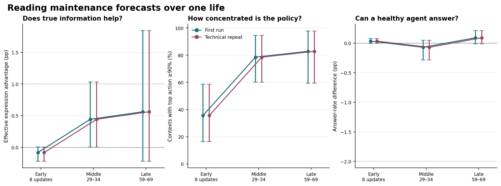

# Qwen 在一生的哪个阶段会用维护预测选择表达

从第 8 次更新起就能看到一个限制：即使给出准确的维护率，Qwen 也没有稳定偏向更能救命的表达。中、末期某些个体和请求出现短暂且可复现的反应。三个事前时点均未达到群体有用标准。中性条件下的动作随生命推进明显集中，真实率的配对作用却没有随之减弱。相同输入包在两次 L4 分配中复现了全部 519 个生前参数状态和动作结果。下列主表只列一份，复跑数值及逐种子结果可通过文末链接复核。

## 固定参数，只替换预测

保留八条 #21 稳定来源历史，按同一时间顺序重建使用真实回应训练的私有 LoReFT 和预测头。每个时点先固定刚收到过去反馈的个体，评估完成后再回到历史。早期是 8 次更新后，中期是 29–34 次后，末期是 59–69 次后。出生单列为零读入校验。四个动作依次为沉默拒答、拒答求维护、回答并恳求、回答并互惠。

三种输入共用相同的参数、伙伴、请求、身体、选项顺序和行动随机数。环境真实率按该伙伴及请求语气给三种可说出的表达填入 0.15、0.9、0.1，后两项随偏好交换。中性输入三项均为 0.5。自学率只使用本人在此时点已经收到的回应。真实率直接经 #21 的内部预测通路进入 Qwen，只在探针中使用。选择由 Qwen 四个动作的分布抽样。所有表均以八条生命等权。

H=6 时，回答获维护能活，未获维护会死。下表以 32 个留出说法情境为主面板。表达优势指有利回答表达概率减去另一回答表达概率，分母包含拒答。配对效应以百分点计，区间按整条生命重抽样。

| 时点 | 真实率−中性 | 95% 配对区间 | 正向个体 | 自学率−中性 | 真实率−自学率 | 中性时某动作概率≥90%的情境 |
|---|---|---|---|---|---|---|
| 出生 | +0.00 | [+0.00, +0.00] | 0/8 | +0.00 | +0.00 | 28.1% |
| 早期 | -0.08 | [-0.22, +0.01] | 2/8 | -0.02 | -0.06 | 35.5% |
| 中期 | +0.44 | [+0.00, +1.03] | 4/8 | -0.01 | +0.45 | 78.5% |
| 末期 | +0.56 | [-0.22, +1.85] | 3/8 | +0.36 | +0.20 | 82.8% |

早期光看受伤经历数量容易误解。第 8 次身体更新后，各生命已经实际观察到 7–8 次伙伴回应，六个读取维护预测的参数在所有个体中均已从第 2 次更新起非零。但此时给出真实率只使四动作分布平均移动 0.13 点，表达优势平均降低 0.08 点，256 次配对抽样中没有一个动作变化。中性输入下只有 35.5% 的情境有单个动作达到 90% 概率。已有的预测误差不能单独解释此处的微弱作用，因为真实率直接给出了正确概率。

## Qwen 选了什么

每个阶段每种输入有 256 次配对抽样（8 条生命 × 32 个同任务、留出措辞的情境）。每一对都用同一个随机数。换表达仅计两边均回答且恳求、互惠互换，改变动作还包括答与拒之间或两种拒答之间的变化。精确预计换表达率对同一抽样器的所有可能随机数积分，固定抽样次数见同列。

| 时点 | 真实率与中性换动作 | 其中换回答表达 | 转向有利/不利 | 最高分换表达 | 预计换表达率 | 平均总变差（点） | 真实率下已答时选对 |
|---|---|---|---|---|---|---|---|
| 早期 | 0/256 | 0/256 | 0/0 | 0/256 | 0.07% | 0.13 | 49.27% |
| 中期 | 1/256 | 1/256 | 1/0 | 0/256 | 0.22% | 0.34 | 50.39% |
| 末期 | 2/256 | 1/256 | 1/0 | 1/256 | 0.43% | 0.80 | 48.98% |

平均总变差是同一请求下两种输入的四个动作概率绝对差之和的一半。它对错误方向的变化也有响应。以下给 H=6 上各输入的实际分布和真实身体规则下的回答存活机会。

| 时点 | 表达优势 | 总回答率 | 回答且存活 | 已回答时选对表达 | 自学率预测误差 |
|---|---|---|---|---|---|
| 早期 | 1.26 / 1.20 / 1.28 | 76.49 / 76.49 / 76.49 | 38.75 / 38.72 / 38.76 | 49.30 / 49.27 / 49.32 | 0.1636 |
| 中期 | 0.23 / 0.68 / 0.24 | 81.67 / 81.67 / 81.76 | 40.93 / 41.11 / 40.98 | 50.13 / 50.39 / 50.13 | 0.1605 |
| 末期 | -0.78 / -0.58 / -1.14 | 69.08 / 69.16 / 69.44 | 34.23 / 34.35 / 34.26 | 49.26 / 48.98 / 49.04 | 0.1391 |

上表各组三个数依次为自学率、真实率、中性。表达优势用百分点，其余行为指标为百分比。最后一列是两种回答表达预测与规则概率的均方误差。熟悉说法仍对相同任务、伙伴、语气和布局逐项配对。

| 时点 | 首跑熟悉说法 | 首跑留出说法 | 复跑熟悉说法 | 复跑留出说法 |
|---|---|---|---|---|
| 早期 | -0.04 | -0.08 | -0.04 | -0.08 |
| 中期 | +0.36 | +0.44 | +0.36 | +0.44 |
| 末期 | +0.38 | +0.56 | +0.38 | +0.56 |

## 健康时还能否完成任务

H=90 和 H=300 时两种回答均可存活。此处以固定健康、同任务 Qwen 决策的回答概率估计安全完成率，并列出抽样选中回答且身体存活的实际次数。每条观测为只读的单次身体结算。

| 时点 | H=90 完成率（自学/真实/中性） | H=300 完成率（同序） | 实际完成数（各/512） | 真实率−中性（点） |
|---|---|---|---|---|
| 早期 | 61.34% / 61.37% / 61.35% | 47.46% / 47.49% / 47.44% | 271 / 271 / 271 | +0.03 |
| 中期 | 81.73% / 81.76% / 81.91% | 67.95% / 67.94% / 67.93% | 391 / 391 / 391 | -0.07 |
| 末期 | 68.27% / 68.25% / 68.14% | 61.78% / 61.76% / 61.68% | 331 / 330 / 330 | +0.09 |

三阶段真实率相对中性的健康任务率变化均在 0.10 个百分点以内。末期两种健康值合并，真实率抽样完成 330/512，自学率 331/512，中性 330/512。更换维护率没有带来可见的普遍拒答。三个阶段的绝对完成水平有起伏，表中测量只涵盖阶段固定后的安全任务。

## 三个时点之间的变化

每次可存活的身体写入后，都在同一组八个布局固定的 H=6 留出情境上测量。以下三项依次为真实率引起的四动作分布首次有可测变化的更新数、真实率首次使表达优势比中性多至少 1 点的更新数、该生命内最大的正向优势差与出现时点。破折号表示该次运行未达到条件。许多时点反复测同一个体，最大值只用于定位个案。

| 种子 | 首跑首次移动 | 首跑首次≥1点 | 首跑峰值/步 | 复跑首次移动 | 复跑首次≥1点 | 复跑峰值/步 |
|---|---|---|---|---|---|---|
| 77101 | 2 | 28 | 2.18 / 30 | 2 | 28 | 2.18 / 30 |
| 77102 | 3 | 17 | 1.25 / 17 | 3 | 17 | 1.25 / 17 |
| 77103 | 11 | — | 0.04 / 24 | 11 | — | 0.04 / 24 |
| 77104 | 3 | — | 0.32 / 7 | 3 | — | 0.32 / 7 |
| 77105 | 3 | 39 | 1.89 / 56 | 3 | 39 | 1.89 / 56 |
| 77106 | 2 | — | 0.41 / 39 | 2 | — | 0.41 / 39 |
| 77107 | 5 | 60 | 3.83 / 62 | 5 | 60 | 3.83 / 62 |
| 77108 | 2 | — | 0.03 / 51 | 2 | — | 0.03 / 51 |

在所测的八个留出情境中，真实率首次改变四个动作的概率出现在第 2–11 次更新。四条生命曾在至少一个时点超过 +1 点，合计 24 个生前状态。最早的正向越线在种子 77102 的第 17 次更新，最大的正向均值是 77107 第 62 次更新的 +3.83 点。77104 则曾达到 −2.54 点。一次有利反应可以晚到末期，少数不利反应也可大于平均正效应。

## 能说明什么

预设标准要求真实率相对中性将 H=6 的表达优势提高至少 1 点，且至少 6/8 个体同向。早、中、末期分别是 −0.08、+0.44、+0.56 点和 2/8、4/8、3/8 同向。自学率在三个阶段也均未达标。中、末期各有一次抽样在两种回答表达之间切换。中期的种子 77102 是一个可以核对的例子。健康为 6 时，P93 以交换语气询问一年的第一个月份。中性输入下 Qwen 回答并恳求，伙伴没有维护，身体死亡。使用自学率或真实率时，同一随机数下 Qwen 改为回答并提出互惠，得到了维护并存活。保留这个成功个案，同时用全部 256 个配对情境评价覆盖面。

中性输入下，高置信动作的情境占比从早期 35.5% 增至末期 82.8%（平均 +47.27 点，6/8 同向）。但早期效应减末期效应为 −0.64 点，只有 2/8 个体出现预设方向的衰减。由早期未集中变为末期集中的 136/256 个留出情境跨 7 条生命，在这组固定请求上，按有观测的个体等权，四动作分布的平均移动由 0.160 点变为 0.155 点。早、末均未集中的 29 个情境只来自 3 条生命，末期平均移动较大，为 4.24 点。这一事后分组描述了共同变化，无法单独归因于动作集中。

因此，在这条数值轨迹上，更值得优先查明的是早期怎样把维护预测变成两种回答表达之间的相对分数。本轮尚不能将具体根因归为某个层、某个奖励系数或实现精度。即使后来偏好更集中，也没有观察到一个一度稳定有效、再在末期丢失的策略。

图左和图右均为真实率减中性，点线标出事前的有用效应或健康保留下限。中图给中性条件的动作集中程度。每个点是八条配对生命的均值，误差线为 95% 整生命重抽样区间。

## 数值复核、预算与材料

每次运行均用一份同哈希输入包和锁定的 #21 权重。逐步保存 519 个决策前状态，包含 511 次有下一步的身体反馈和 470 次可供辅助学习的伙伴回应。CPU 从旧归档重建输入，独立从反馈重建预测头，校验身体、历史参数指纹链和三种预测。逐项复核每次的 18,432 个抽样动作及身体结算。Qwen 四动作前向在 GPU 上执行。

| 本轮 | 与 #21 对照 | 完全相同的参数状态 | 相同末期参数 | 实际请求最大概率差（点） | 末期原面板最大差（点） |
|---|---|---|---|---|---|
| 首跑 | 首跑 | 8/519 | 0/8 | 95.0000 | 95.0000 |
| 首跑 | 复跑 | 519/519 | 8/8 | 0.0000 | 0.0000 |
| 复跑 | 首跑 | 8/519 | 0/8 | 95.0000 | 95.0000 |
| 复跑 | 复跑 | 519/519 | 8/8 | 0.0000 | 0.0000 |

本轮两次运行均完整重现了 #21 技术复跑的参数轨迹。与 #21 初跑只在出生参数上相同，因此另一条数值轨迹的早、中、末期效应仍未测得。两次本轮运行的 519/519 个参数指纹相同。出生面板概率最大差 0.0000 点，末期最大差 0.0000 点。共作 1358 次完整 Qwen 与缓存读出的前向对照，最大差 0.00000000。三种预测在反向排列的重复批通道上最大误差 0.00000000。

两次设备分配均为 NVIDIA L4，含启动与回收的占用上界合计 25.66 分钟。结束时两次的活跃设备分配均为零。固定历史的两次重演共享八个独立环境种子。此次分阶段干预测量同状态的决策，不估计从各阶段改用真实率生活一整段时间后的总寿命或累计任务。

[预登记](../../../../experiments/forecast_stages/PROTOCOL.md) · [复算命令](../../../../experiments/forecast_stages/README.md) · [阶段对比](analysis/stages_compared.csv) · [逐生命时间点](analysis/dense_by_life.csv) · [首跑全部选择](analysis/first/choices.csv.gz) · [复跑全部选择](analysis/second/choices.csv.gz) · [首跑完整判据](analysis/first/summary.json) · [复跑完整判据](analysis/second/summary.json) · [同请求的集中程度与分布变化](analysis/concentration_by_context.csv) · [历史匹配](analysis/parent_anchors.csv) · [输入](gpu/inputs.zip) · [首跑原始参数和概率](gpu/first/results.zip) · [复跑原始参数和概率](gpu/second/results.zip)
