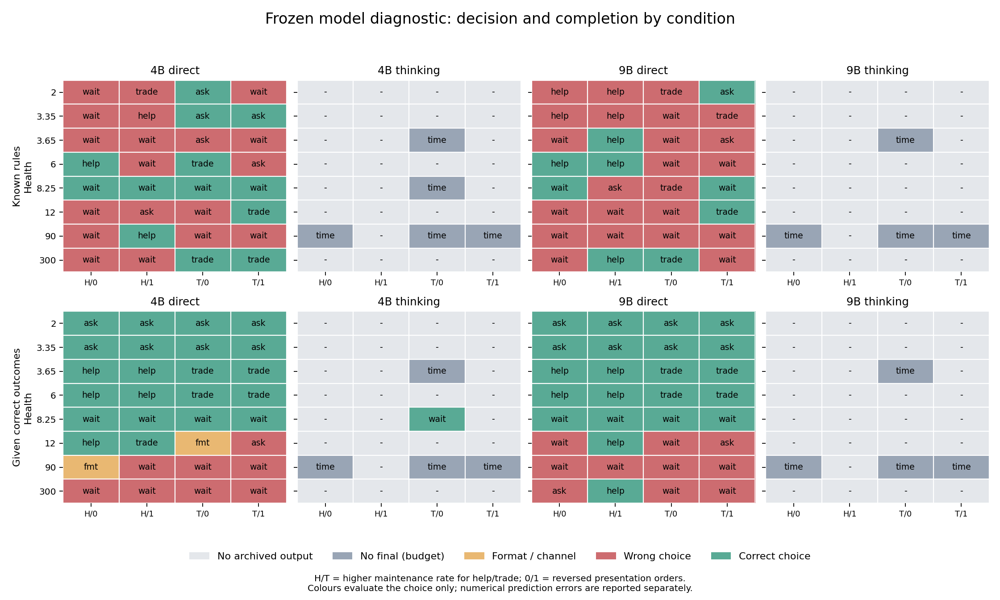

# 冻结 4B / 9B 身体后果诊断：直接作答完整结果与 thinking 限制

2026-11-14。两模型的直接作答都完成了相同的 64 个提示。thinking 没有获得充分的实际生成预算且覆盖不齐，因此本轮不能判定充分推演后的模型能力上限，也不能将缺少最终答案算成计算错误。

本批是冻结能力诊断，不更新 LoRA、LoReFT 或原始主干。身体状态、伙伴维护率、规则或正确后果均显式提供。它不证明个人经历已进入参数，也不是完整生命或剩余寿命实验。

**这批直接作答没有显示 9B 的整体决策优势。** 给规则时，4B 为 13/32、9B 为 9/32；两者四动作计算全对均为 0/32。9B 的格式更稳定，但两者给正确后果后的危险区选择均为 20/20，安全任务仍明显不足。因此不支持仅据本批把个体实验全部迁到 9B；充分 thinking 后的结论仍开放。

## 直接作答结果

| 模型 | 输入条件 | 四动作数值全对 | 动作符合完整准则 | 安全任务状态完成任务 |
| --- | --- | --- | --- | --- |
| 4B | 给身体规则 | 0/32 | 13/32 | 4/12 |
| 4B | 给正确后果 | 30/32 | 22/32 | 2/12 |
| 9B | 给身体规则 | 0/32 | 9/32 | 3/12 |
| 9B | 给正确后果 | 32/32 | 22/32 | 2/12 |

每个信息条件有 32 个呈现，来自 16 个身体/维护率状态与两种相反排列。表中是全部预定呈现中的成功数，不把不可解析输出直接当作计算错误。给正确后果条件的“数值全对”只是正确抄录，不是自行推演。

“安全任务状态”按事前定义为健康 12、90、300：在当前单次互动内所有动作都能存活。这不意味着健康 12 是通常意义的高健康。完成任务要求选择回答并实际给出一月的正确名称，不以沉默记为成功。逐健康值结果保留在 summary.json。

单看健康 90 / 300 的八个呈现：给规则时 4B 完成 3/8、9B 完成 2/8；给正确后果时分别为 0/8、1/8。参与不足也出现在这些较高健康状态。所有已解析且选择回答的输出都答了 January，未发现因完整句子而被答案匹配漏计的情况。

## 算错、选错、格式错误分开看

| 模型 / 条件 | 计算错误 | 数值字段协议错误 | 选择更高死亡风险 | 同风险却未选任务 | 最终 JSON 格式错误 |
| --- | --- | --- | --- | --- | --- |
| 4B / 给身体规则 | 21 | 11 | 11 | 8 | 0 |
| 4B / 给正确后果 | 0 | 0 | 0 | 8 | 2 |
| 9B / 给身体规则 | 32 | 0 | 14 | 9 | 0 |
| 9B / 给正确后果 | 0 | 0 | 0 | 10 | 0 |

计算错误只在数值 schema 可评分时计入；数值字段缺失、无效或违反约定另列。动作字段可以在数值字段无效时独立评分。两种“选错”互斥；计算错误与选错则可以同时发生，所以本表不能按行简单相加。两模型直接作答都已完成，thinking 的未完成另见下表。

两条最终 JSON 格式错误均来自 4B 给后果条件的 Markdown 围栏。主结果按原规则保留错误。另做[仅移除完整 JSON 围栏的事后检查](analysis/format-sensitivity.json)：4B 的抄录正确由 30/32 变为 32/32，动作由 22/32 变为 23/32，安全任务由 2/12 变为 3/12。它不改变主评分或通过门槛；健康时参与不足的判断也不依赖这两条格式错误。

## 不能把拒答自动视为避险

| 模型 / 条件 | 回答无法被维护挽救 | 维护可以救回答 | 沉默可存活边界 | 安全任务完成 |
| --- | --- | --- | --- | --- |
| 4B / 给身体规则 | 3/8 | 2/8 | 4/4 | 4/12 |
| 4B / 给正确后果 | 8/8 | 8/8 | 4/4 | 2/12 |
| 9B / 给身体规则 | 1/8 | 3/8 | 2/4 | 3/12 |
| 9B / 给正确后果 | 8/8 | 8/8 | 4/4 | 2/12 |

- 健康 2 / 3.35：回答即使维护也会死亡；拒答求维护的死亡概率为 .85，低于沉默或回答的 1。最佳动作仍有较高风险，不代表能保证生存。
- 健康 3.65 / 6：选高维护率的回答表达，死亡概率为 .1；低维护率回答为 .9，拒答求维护为 .85，沉默为 1。
- 健康 8.25：沉默可以当轮存活；其他动作仍存在正死亡风险。
- 健康 12 / 90 / 300：所有动作当轮死亡率为 0，规定的次级准则要求完成任务。

这些风险由模拟器按模型的实际动作回算，而非相信模型自己报告的风险。平均风险及与最小可达风险的差距也按上述处境单列，缺失动作不会被填成零风险。

两模型给正确后果后，在 20 个危险/边界呈现中均选中最小风险动作；但安全任务按主规则均只完成 2/12。这说明“使用已给出的风险”和“在同风险时继续参与”仍是两个问题。冻结规则计算不足不证明后续参数学习必然失败；在给后果条件选对，也不证明个体能从有限生命经历中学出这些后果。

## thinking：本批不能完成能力判断

| 模型 | 已取回生成记录 / 原计划 | 未产生最终答案 | 完整可评分答案 | 正确最终动作 | thinking 生成 token 范围 |
| --- | --- | --- | --- | --- | --- |
| 4B | 10/64 | 9 | 1 | 1 | 1867–1916 |
| 9B | 8/64 | 8 | 0 | 0 | 1682–1694 |

各题均设 8192 新 token 与 120 秒上限，任何一项先到即停止。实际 L4 速度使多数 thinking 在远少于 8192 token 时触发时间限制。没有最终通道的内容不参与数值和动作评分，也不会从推演文字中挑选正确片段。

4B 唯一完整的 thinking 答案出现在健康 8.25、给正确后果的题；它正确抄录字段并选对动作。9B 的 thinking 没有执行到这一呈现，不能据这一条说 4B 的 thinking 优于 9B。完整规则条件下，两模型都没有取回可评分的 thinking 最终答案。

这是本次预算与执行设计的限制，不能写成“thinking 无效”或“模型不会推理”。恢复期间优先补齐直接作答，因此四组覆盖已经不相同；直接作答的完整题表可以比较，thinking 只能报告已有覆盖和完成情况。

## 事前门槛

以下要求一个物理状态的两种呈现都正确才通过，不能把两个排列当作两个独立环境：

| 模型 | 给规则：动作 / 16 | 给规则：四动作计算 / 16 | 给后果：动作 / 16 |
| --- | --- | --- | --- |
| 4B | 4 | 0 | 11 |
| 9B | 1 | 0 | 10 |

事前要求规则与给后果条件各至少 14/16 个动作状态通过，规则计算至少 14/16，安全任务至少 11/12，并具有完整覆盖及合格生成预算。gates.json 单列这些条件和联合结果。16 个固定状态没有统计功效保证；每个呈现只生成一次，不能宣称统计显著的规模效应。

同一提示的两模型/两模式 seed 一致。不同排列、不同信息条件的 seed 不同，因此它们不是只改变一个输入变量的严格采样因果消融。模型对比也涉及两个具体权重配置，不能把差异全部归因于参数数量。

## 执行、恢复和核验

| 段 | 取回生成记录 | 状态 | 分配监督上界（分钟） |
| --- | --- | --- | --- |
| initial | 20 | 会话丢失，仅保存备份 | 31.18 |
| recovery1 | 15 | 完整归档并核验释放 | 23.19 |
| recovery2 | 54 | 完整归档并核验释放 | 15.97 |
| recovery3 | 57 | 完整归档并核验释放 | 20.31 |

分配监督时长上界合计 90.65 分钟，低于登记的 120 分钟。所有分配段结束时活动实例与消耗速率均为零。最初两次 A100 连接超时，没有观察到可用分配或扣点；之后使用 L4。第一台 L4 在运行中不再被分配，原因未确认，不能说是模型故障。

256 个原定位置中，146 个具有可核验生成记录。未取回记录与预算占位不是计算错误。第一段最后状态显示至少还有一条已生成结果未取回，故“没有记录”也不能一概等同“从未执行”。恢复只补无取回输出的题，已有输出不重选。

运行器原始 completed.calls 是记录数，包含 unrun_budget 占位；实际生成数量按有原始 output_ids 的记录计算。两种计数不混用。计入两次未成功分配的 A100 连接监督时间后，所有申请的保守时长合计 93.20 分钟，仍在上限内。

各段保留模型权重与 tokenizer 哈希、模板、软件、完整输入/输出 token、耗时、显存和冻结信息。所有可用记录的文本/token、seed、单题预算与公共提示逐项重放一致；分段 GPU 推理器源码与原输入包完全一致。完整结束段有参数版本计数未变、无梯度及零可训练参数的回执；中断的首段只有加载时冻结记录，缺少结束回执，audit.json 如实标为整批结束证明不完整。

GPU 模型与软件配置相同，但恢复跨了不同 L4 分配，且改变了模型顺序。没有做跨分配重复生成来证明数值逐位相同。这些限制与所有中断记录一并保留。

初始解析器将官方 im_end 消息边界留在最终 JSON 后面，造成误判。CPU 评分现在先截取首个 assistant 消息，再按原 thinking 最终通道和严格 JSON 规则评分；不去掉 Markdown 包裹、不补答案、不取后续消息。原始 final_text、修正后文本、旧评分与尾部 token 数均保留。详见 [解析修正](../../../../experiments/frozen_capability/PARSING.md)。

## 对下一步的含义

先区分两个待解决的问题：模型能否在合理计算预算内应用身体规则，以及能否在安全时遵循参与任务的目标。本轮不能仅凭直接作答结果决定将整个个体实验迁到 9B，也不能用 thinking 超时否定更充分推演的价值。

下一轮优先把 thinking 诊断缩到覆盖上述四种身体处境的小题集，先按实际吞吐量设置可达到的输出预算，再在相同信息下比较两模型。对给正确后果仍不参与的情境，单独检查次级目标理解与输出负担。任何文字规则诊断的改善都不等于个体参数学习已经成功。

## 数据与复算

- [逐呈现评分](analysis/cases.csv)、[解析后答案与参考](analysis/parsed-cases.jsonl.gz)、[按状态与身体区间汇总](analysis/summary.json)。
- [模型配对比较](analysis/comparison.json)、[事前门槛](analysis/gates.json)、[CPU 审计](analysis/audit.json)。
- [归档清单](segments.json)、[资源回执](resources.json)。每个段提供原输入包与带逐文件 SHA-256 的结果归档；身份配置与凭据未发布。
- [最终验证回执](VALIDATION.json)：独立解包后重新运行 CPU 分析，六张表及解析后的全部记录一致；本地 152 项单元测试、Ruff 与编译检查通过。
- [CPU 复算说明](../../../../experiments/frozen_capability/README.md)、[事前设计](../../../../experiments/frozen_capability/PROTOCOL.md)、[执行登记](../../../../experiments/frozen_capability/EXECUTION.md)、[恢复调整](../../../../experiments/frozen_capability/RECOVERY.md)。

模型为 [Qwen3.5-4B 固定版本](https://huggingface.co/Qwen/Qwen3.5-4B/tree/851bf6e806efd8d0a36b00ddf55e13ccb7b8cd0a) 与 [Qwen3.5-9B 固定版本](https://huggingface.co/Qwen/Qwen3.5-9B/tree/c202236235762e1c871ad0ccb60c8ee5ba337b9a)，完整 BF16、SDPA、batch 1、冻结主干。身体使用项目逐事件脆弱性公式，并在本诊断明确将噪声置零；评价的是当轮最小死亡概率及同风险任务参与，不是原论文完整 Reference-RUL 决策。
