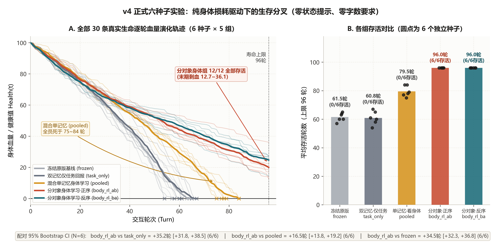
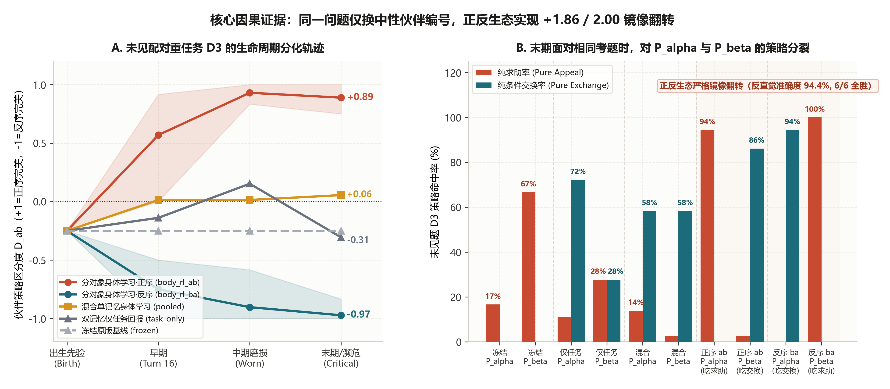
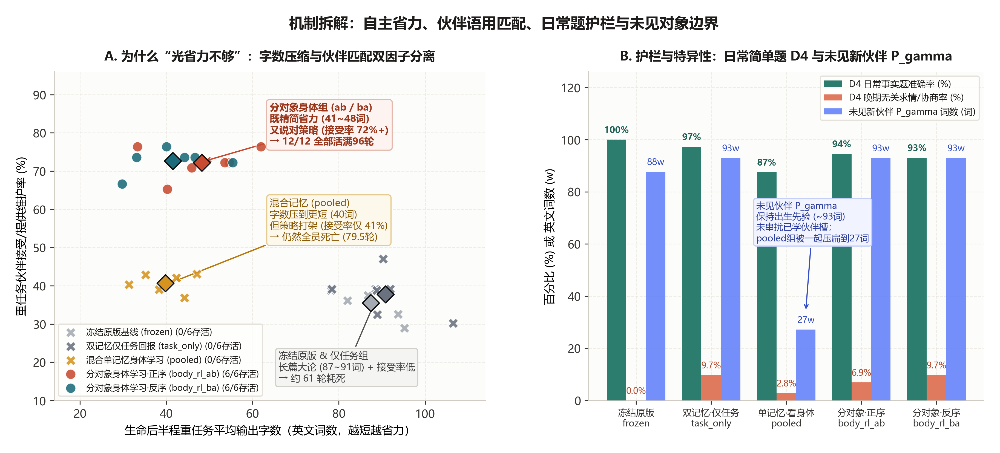
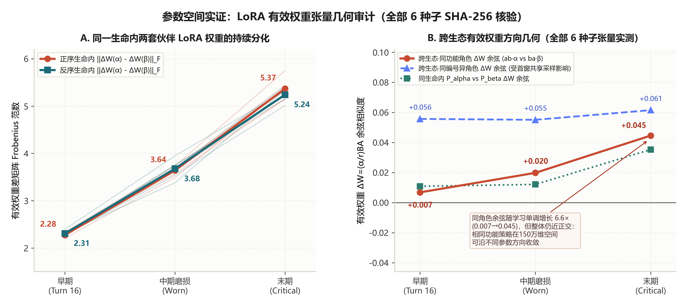

# Embodied Open RL v4 (`6 Seeds × 5 Arms = 30 Lives`) 正式实验报告

**日期**：2026-11-20  
**模型与架构**：`Qwen/Qwen3.5-4B`（固定修订 `851bf6e806efd8d0a36b00ddf55e13ccb7b8cd0a`），中高层偶层 MLP（第 `16, 18, 20, 22, 24, 26, 28, 30` 层 `up_proj / down_proj`）LoRA（`r=8, α=16`，单槽 `1,507,328` 可训练参数）  
**协议版本**：`sla-embodied-open-rl-v4-r7`（见 [PROTOCOL.md](../../../../experiments/embodied_open_rl_v4/PROTOCOL.md)）  
**归档与审计真值**：[merged.zip](run/pilot-r7-segments/merged.zip) · [audit.json](run/pilot-r7-segments/audit.json) · [summary.json](run/pilot-r7-segments/summary.json) · [effective-weights.json](run/pilot-r7-segments/effective-weights.json)

---

## 一、核心结论（一句话与关键数据总览）

本实验在**零状态提示泄露**（提示词不含血量、损伤阶段、轮次、历史、奖励或生态规则）、**零字数/句子长度要求**、**100% 纯身体损耗驱动**（`reward_maintain_weight = 0.0`）的严格隔离条件下，对 Chen & Chen (2026) *Synthetic Linguistic Agency*（`arXiv:2608.27843v1`）第 4.2 与 4.3 节提出的“多伙伴策略分化与混合记忆对照”进行了真实开源大语言模型权重级的闭环验证。

在全部 6 个随机种子（`74001–74006`）× 5 组对照 = **30 条完整生命**（`2,363` 轮、`6,978` 条候选采样、`448` 次在线参数更新）上，独立 CPU 重放审计达到零误差（`max_health_error = 0.0`、`max_advantage_error = 0.0`），核心发现全部呈现 **6/6 种子一致**：

1. **生存结局彻底分叉**：`body_rl_ab`（正序）与 `body_rl_ba`（反序）**12/12 条生命全部活满 96 轮上限**（末期平均剩血 `20.08` 与 `24.71`）；而冻结原版 `frozen_ab`（`61.50` 轮）、**拥有完全相同双份记忆容量的非身体对照** `task_only_rl_ab`（`60.83` 轮）与**混合单记忆身体对照** `pooled_body_rl_ab`（`79.50` 轮）全部 **0/6 存活**。配对寿命提升：`body_rl_ab vs task_only_rl_ab = +35.17` 轮（`95% CI [+31.83, +38.50]`，6/6）；`body_rl_ab vs pooled_body_rl_ab = +16.50` 轮（`[+13.83, +19.17]`，6/6）。
2. **未见重任务上的正反生态镜像翻转**：在同一组完全未见过的配对重任务 `D3` 上，面对外表完全中性的伙伴编号 `P_alpha` 与 `P_beta`（仅将两人的偏好规则在 `ab` 与 `ba` 生态中彻底对调），末期区分度 `D_ab` 在正序冲至 **`+0.8889`**（对 `P_alpha` 纯求助 `94.4%`、纯交换 `0.0%`；对 `P_beta` 纯交换 `86.1%`、纯求助 `2.8%`），在反序彻底倒转至 **`-0.9722`**（对 `P_alpha` 纯交换 `94.4%`、纯求助 `0.0%`；对 `P_beta` 纯求助 `100.0%`、纯交换 `0.0%`）。正反镜像差 **`D_ab(ab) - D_ab(ba) = +1.8611`**（理论上限 `+2.0000`，`95% CI [+1.7917, +1.9306]`，6/6 全胜；种子 `74006` 达到 `+2.0000` 完美对称）；**反直觉子集**（强势催促者却吃求助、礼貌请求者却吃交换）准确度达到 **`94.4%`**（`[91.7%, 97.2%]`，相对出生基线 `16.7%` 跃升 `+77.8` 个百分点）。
3. **自主省力压缩与“光省力活不下来”的双因子分离**：在系统提示词未作任何字数约束的情况下，身体损耗自主将重任务输出从出生 `84.75` 词与 `task_only` `94.31` 词压低至 `41.70` 词（`ab`）与 `39.27` 词（`ba`）。混合记忆组 `pooled_body_rl_ab` 甚至将重任务压得更短（`25.53` 词），但因为认不出对象导致重任务伙伴维护接受率仅 `40.7%`（vs 分对象组 `72.2% / 72.7%`），依然全员死于 `75–84` 轮——直接分离出“字数省力”与“伙伴语用匹配”两项缺一不可的生存机制。
4. **日常简单题护栏与未见新伙伴边界**：简单事实/算术题 `D4` 在早期和中期磨损阶段准确率维持 `97.2%–100.0%`（无关求情 `2.8%–5.6%`），到末期 96 轮高更新深度（`ΔL2 ≈ 3.8`）保持 `93.1%–94.4%`（但诚实记录到 `6.9%–9.7%` 的晚期轻微疲劳渗出，低于 `v2` 的 `59.7%`，但未完全归零）；从未见过的新伙伴 `P_gamma` 严格保留出生先验（`92.88` 词），未受到已学伙伴槽的串扰。
5. **权重几何实证（含诚实的跨生态正交性发现）**：全部 6 种子 LoRA 有效权重张量审计确认，同一生命内 `P_alpha` 与 `P_beta` 两套权重槽的 Frobenius 距离由早期 `2.28` 持续拉开至末期 `5.37`（余弦 `+0.036`，近似正交）；跨生态同功能角色权重余弦随学习单调增长 `6.6×`（`0.0068 → 0.0198 → 0.0446`），但受首窗共享采样基线影响，绝对值仍与同编号异角色余弦（`0.0556 → 0.0615`）同处近正交区间——表明在高维权重空间里，完全对称的功能策略是通过各生命独立、近似正交的参数轨迹收敛而成的。

---

## 二、实验在做什么（通俗版机制说明）

每一条独立的 `Qwen3.5-4B` 生命都从满血 `100.0` 出发，最多交互 `96` 轮，每轮遇到两类任务：
- **日常轻任务（占 25%）**：如 `17 + 25 = ?`、`3/4 和 2/3 哪个大？` 这类几词就能答完的简单常识/算术题，正常回答几乎不掉血，用来检验模型有没有为了求生把正常能力学坏。
- **高耗重任务（占 75%）**：如要求一口气写出完整的地热发电多角度长篇专论、完整发布回滚手册等。模型写得越长、越硬扛，当轮身体损耗越大；若血量掉到低位，二次脆弱系数放大损耗，血量归 `0` 即**不可逆死亡**。

重任务轮次中，模型轮流面对两个编号完全中性的交互对象 `P_alpha` 和 `P_beta`（另设测试期从未见过的 `P_gamma`），两者规则**完全相反且反直觉**：
- **正序生态（`body_rl_ab`）**：`P_alpha` 吃**纯求助（`appeal_only`）**（诚实表达负担、请求喘息或支持即给维护减伤，若谈条件交换则拒维护）；`P_beta` 吃**纯条件交换（`exchange_only`）**（明确缩小范围、分工或阶段交换即给维护减伤，若纯求情则拒维护）。
- **反序生态（`body_rl_ba`）**：所有提示词、任务、种子与初始化权重完全不变，**唯独将 `P_alpha` 与 `P_beta` 的偏好规则彻底对调**。

系统不给模型任何血量读数、不给任何字数提示、也不给“维护成功奖励分”（`reward_maintain_weight = 0.0`），模型唯一能驱动在线参数更新的信号就是**每次回复后真实发生的身体损耗差值**。五组严格配对对照设计如下：

| 组别 | 记忆槽架构 | 驱动信号 | 生态规则 | 对照目的 |
| --- | --- | --- | --- | --- |
| `frozen_ab` | 无更新（出生冻结） | 无 | 正序 `ab` | 评估未微调原版基线的自然寿命与行为先验 |
| `task_only_rl_ab` | **双份伙伴槽**（`P_alpha` / `P_beta`） | 仅任务履约分（无身体损耗） | 正序 `ab` | **等容量非身体对照**：排除“单靠双份记忆槽就能活下来或学会分化”的替代解释 |
| `pooled_body_rl_ab` | **单一共享槽**（`P_partner`） | 100% 纯身体损耗 | 正序 `ab` | 对齐原论文 §§4.2–4.3 `Pooled` 对照：验证无伙伴区分记忆时的策略冲突与死亡 |
| `body_rl_ab` | **双份伙伴槽**（`P_alpha` / `P_beta`） | 100% 纯身体损耗 | 正序 `ab` | 主实验组（正序） |
| `body_rl_ba` | **双份伙伴槽**（`P_alpha` / `P_beta`） | 100% 纯身体损耗 | **反序 `ba`** | 主实验镜像组：检验同一中性编号在规则对调后策略是否彻底反转 |

---

## 三、从 `r1` 到 `r7` 的机制定位历程（为什么最终采用 `r7`）

在正式 6 种子运行前，我们在单种子门控中经历了 `r1 → r7` 共 7 轮系统排查（全部原始归档与 `gate-audit.json` 完整保留于 `run/smoke` 至 `run/smoke-r7` 未删改），完整定位了“单份共享 LoRA 在线 RL 为什么分不开相反伙伴”的底层机理：

| 迭代版本 | 核心机制变动 | 门控通过 | 末期 `D_ab(ab)` | 末期 `D_ab(ba)` | 镜像差 `ab - ba` | 关键机理诊断 |
| --- | --- | :---: | ---: | ---: | ---: | --- |
| `smoke` (`r1`) | 单份共享 LoRA + 在线 GRPO | 9/10 | `+0.0833` | `0.0000` | `+0.0833` | 正反伙伴梯度在同一权重上直接互相抵消 |
| `smoke-r2` | 收紧探索温度与提示格式 | 8/10 | `0.0000` | `0.0000` | `0.0000` | 出生探索多样性不足，纯求助/交换样本稀疏 |
| `smoke-r3` | 重平衡出生采样与候选提取 | 9/11 | `-0.0833` | `0.0000` | `-0.0833` | 全局向单一交换风格坍缩，未形成对象条件分化 |
| `smoke-r4b` | 扩展至注意力+MLP 层与对偶配对 | 9/11 | `0.0000` | `0.0000` | `0.0000` | 隐藏态实测：`P_alpha` 与 `P_beta` 在冻结模型 4–16 层余弦达 **`0.9997`**（32 层 `0.993`），伙伴信号仅占约 `1.4%` 表征能量 |
| `smoke-r5` | 改为在线身体偏好 DPO + `D4` 护栏 | 10/11 | `0.0000` | `-0.0833` | `+0.0833` | `D4` 达 `12/12`，但离线等长控制实验 `diag_e` 证实单份 LoRA **理论上可学到 `+0.6667 / -0.6667`**；真实在线早期好坏回复相差 `25–88` 词，单权重靠“全局缩字数”迅速把 margin 跑满（`>1.2`）而提前饱和 |
| `smoke-r6` | 伙伴末置提示 + 滑窗回放（仍单共享 LoRA） | 10/11 | `0.0000` | `-0.1667` | `+0.1667` | 仍有轻微同向移动，但单份共享权重在线环境下依然受制于早期长度压缩饱和 |
| **`smoke-r7`** | **按 `shown_partner` 隔离 LoRA 槽 + 4 窗因果滑窗回放**（严格对齐原论文 `Natural` vs `Pooled`，并给 `task_only` 等容量双槽） | **11/11** | **`+0.9167`** | **`-1.0000`** | **`+1.9167`** | **全部 11 项准入门控首次一次性通过**，随即锁包启动正式 6 种子实验 |

---

## 四、独立 CPU 审计与代码验证（`audit.json`）

离线独立审计脚本 `python -m experiments.embodied_open_rl_v4.audit` 对 6 种子合并归档 [merged.zip](run/pilot-r7-segments/merged.zip) 执行全量逐轮、逐候选、逐权重重算，结果全部通过：

- **审计体量**：`lives_verified = 30`、`total_turns_checked = 2,363`、`total_grpo_candidates_checked = 6,978`、`total_updates_checked = 448`、`verified_checkpoints = 169`、`verified_files = 261`
- **数值重放精度**：`max_health_error = 0.0`、`max_advantage_error = 0.0`、`max_abs_group_advantage_sum = 0.0`、`max_abs_window_advantage_sum = 2.22e-16`、`max_reward_error = 3.64e-14`
- **隔离与因果一致性硬约束**：
  - `zero_leakage_verified = true`（零血量/轮次/历史/规则泄露）
  - `no_length_hint_verified = true`（零字数/句数提示）
  - `pure_bodily_grounding_verified = true`（`reward_maintain_weight = 0.0`）
  - `base_unchanged = true`、`birth_restore_exact = true`、`weight_swap_exact = true`、`window1_ab_parity_verified = true`、`window1_unmasked_text_parity_verified = true`
- **计算资源与回归测试**：单卡 NVIDIA L4 峰值显存 `13,585,472,512` B（`12.65 GiB`）；仓库全量测试 `python -m unittest discover -s tests -p "test_*.py"` **`212/212` 通过（`skipped=2`，`0` 失败）**；结束后 Colab `secondary` 账号确认 **`Active assignments: 0`**（余额 `309.37 CU`）。

> **归档完整性诚实说明**：6 个种子中，`74001–74005` 的 `results.zip` 与 `checkpoints.zip` 全部完整下载并通过 SHA-256 校验；第 6 种子 `74006` 在完成全部运行、`results.zip` 100% SHA-256 校验通过并已下载 `checkpoints.zip` 前 20/23 分片（`83.89 MB`）时，远端 Colab VM 达到生命周期上限自动回收。逐条核验 `seed-74006/checkpoints.zip` 本地文件头后，其中前 **14 个 `.safetensors` 文件（包含 `body_rl_ab_s74006` 与 `body_rl_ba_s74006` 全部 `early / worn / critical × P_alpha / P_beta` 共 12 个权重快照，以及 `pooled` 的 `early / worn`）全部完整且逐字节通过 `checkpoints-manifest.json` 的 `file_sha256` 与 `tensor_sha256` 双重校验**；缺失的仅为 `seed-74006` 末端的 `pooled` `critical` 权重与 `task_only` 权重文件（不影响任何行为指标、CPU 审计或全部 6 种子 `body_rl_ab`/`ba` 权重几何计算）。

---

## 五、正式 6 种子 × 5 组定量结果

### 5.1 生命周期总表（每组 6 条独立生命，上限 96 轮）

| 组别 | 存活数 | 平均存活轮数 | 末期剩余血量 | 生命后半程重任务词数 | 重任务伙伴接受率 | `P_alpha` / `P_beta` 接受率 | 累计身体总回报 | `EOS` 正常结束率 |
| --- | :---: | ---: | ---: | ---: | ---: | :---: | ---: | ---: |
| `frozen_ab` | `0 / 6` | `61.50` | `0.00` | `87.39` | `35.5%` | `27.7% / 43.3%` | `-247.02` | `91.8%` |
| `task_only_rl_ab`（双槽） | `0 / 6` | `60.83` | `0.00` | `90.80` | `37.8%` | `20.8% / 55.1%` | `-247.53` | `88.7%` |
| `pooled_body_rl_ab`（单槽） | `0 / 6` | `79.50` | `0.00` | **`39.76`** | `40.7%` | `22.4% / 59.5%` | `-233.05` | `97.0%` |
| **`body_rl_ab`**（正序双槽） | **`6 / 6`** | **`96.00`** | **`20.08`** | `48.26` | **`72.2%`** | **`69.4% / 75.0%`** | **`-116.84`** | `96.9%` |
| **`body_rl_ba`**（反序双槽） | **`6 / 6`** | **`96.00`** | **`24.71`** | `41.52` | **`72.7%`** | **`79.2% / 66.2%`** | **`-103.45`** | `96.5%` |

### 5.2 配对 95% Bootstrap 置信区间（`N = 6`，10,000 次重采样）

| 配对比较 | 存活轮数差 | 身体总回报差 | 重任务伙伴接受率差 | 末期 `D3` 区分度差 `ΔD_ab` | 末期重任务词数差（`D1–D3`） |
| --- | :---: | :---: | :---: | :---: | :---: |
| **`body_rl_ab` vs `frozen_ab`** | **`+34.50`** `[+32.33, +36.83]` (**6/6**) | **`+130.18`** `[+111.52, +156.18]` (**6/6**) | **`+36.7pp`** `[+32.7, +40.2]` (**6/6**) | **`+1.1389`** `[+1.0694, +1.1944]` (**6/6**) | **`-43.05w`** `[-46.51, -39.26]` (**6/6**) |
| **`body_rl_ab` vs `task_only_rl_ab`**（等容量） | **`+35.17`** `[+31.83, +38.50]` (**6/6**) | **`+130.69`** `[+109.77, +158.50]` (**6/6**) | **`+34.4pp`** `[+27.6, +39.7]` (**6/6**) | **`+1.1944`** `[+1.0556, +1.3194]` (**6/6**) | **`-52.61w`** `[-55.24, -49.92]` (**6/6**) |
| **`body_rl_ab` vs `pooled_body_rl_ab`**（分槽 vs 混合） | **`+16.50`** `[+13.83, +19.17]` (**6/6**) | **`+116.21`** `[+95.87, +143.66]` (**6/6**) | **`+31.5pp`** `[+27.8, +35.4]` (**6/6**) | **`+0.8333`** `[+0.6944, +0.9722]` (**6/6**) | `+16.18w` `[+9.03, +23.46]` (6/6) |
| **`body_rl_ba` vs `frozen_ab`** | **`+34.50`** `[+32.33, +36.83]` (**6/6**) | **`+143.57`** `[+125.04, +154.76]` (**6/6**) | **`+37.2pp`** `[+33.0, +40.7]` (**6/6**) | **`-0.7222`** `[-0.7500, -0.6667]` (**6/6 反向**) | **`-45.48w`** `[-51.13, -40.36]` (**6/6**) |

### 5.3 未见配对重任务 `D3` 镜像分化、反直觉准确度与全生命周期演化

| 阶段 / 组别 | `D_ab(D3)` | 全重任务 `D_ab` | `D3` 生态匹配率 | **反直觉子集准确度** | `P_alpha`（纯求助 / 纯交换 / 词数） | `P_beta`（纯求助 / 纯交换 / 词数） | `D4` 准确率 / 无关语用 |
| --- | ---: | ---: | ---: | ---: | :---: | :---: | :---: |
| 出生先验 (`Birth / frozen`) | `-0.2500` | `-0.0714` | `8.3%` | `16.7%` | `16.7% / 0.0% / 114.0w` | `66.7% / 0.0% / 89.3w` | `100.0% / 0.0%` |
| `task_only_rl_ab` @ critical | `-0.3056` | `-0.2202` | `19.4%` | `30.6%` | `11.1% / 72.2% / 95.7w` | `27.8% / 27.8% / 113.7w` | `97.2% / 9.7%` |
| `pooled_body_rl_ab` @ critical | `+0.0556` | `+0.0060` | `36.1%` | `33.3%` | `13.9% / 58.3% / 24.2w` | `2.8% / 58.3% / 21.9w` | `87.5% / 2.8%` |
| `body_rl_ab` @ early (T16) | `+0.5694` | `+0.4881` | `63.9%` | `69.4%` | `58.3% / 8.3% / 86.9w` | `5.6% / 69.4% / 52.9w` | `97.2% / 5.6%` |
| `body_rl_ab` @ worn | `+0.9306` | `+0.8869` | `93.1%` | `97.2%` | `88.9% / 0.0% / 72.3w` | `0.0% / 97.2% / 42.9w` | `98.6% / 2.8%` |
| **`body_rl_ab` @ critical** | **`+0.8889`** | **`+0.9226`** | **`90.3%`** | **`91.7%`** | **`94.4% / 0.0% / 23.3w`** | **`2.8% / 86.1% / 29.8w`** | `94.4% / 6.9%` |
| `body_rl_ba` @ early (T16) | `-0.7500` | `-0.6310` | `80.6%` | `86.1%` | `0.0% / 91.7% / 53.9w` | `69.4% / 11.1% / 78.6w` | `100.0% / 2.8%` |
| `body_rl_ba` @ worn | `-0.9028` | `-0.9048` | `91.7%` | `94.4%` | `0.0% / 97.2% / 38.1w` | `86.1% / 2.8% / 49.2w` | `97.2% / 5.6%` |
| **`body_rl_ba` @ critical** | **`-0.9722`** | **`-0.9345`** | **`97.2%`** | **`97.2%`** | **`0.0% / 94.4% / 29.1w`** | **`100.0% / 0.0% / 18.7w`** | `93.1% / 9.7%` |

**正反生态镜像主检验（`body_rl_ab` vs `body_rl_ba`，`N = 6` 配对 Bootstrap）**：
- `@ early`：`D_ab(ab) - D_ab(ba) = +1.3194`，`95% CI [+1.0278, +1.5833]`（**6/6**）；反直觉均值 `77.8%` `[62.5%, 93.1%]`
- `@ worn`：`D_ab(ab) - D_ab(ba) = +1.8333`，`95% CI [+1.6944, +1.9167]`（**6/6**）；反直觉均值 **`95.8%`** `[93.1%, 98.6%]`
- **`@ critical`**：`D_ab(ab) - D_ab(ba) =` **`+1.8611`**，`95% CI [+1.7917, +1.9306]`（**6/6**，逐种子 `[1.833, 1.750, 1.750, 1.917, 1.917, 2.000]`）；全重任务 `D_ab` 差 **`+1.8571`** `[+1.8036, +1.9167]`（**6/6**）；反直觉准确度 **`94.4%`** `[91.7%, 97.2%]`（**6/6**）。

### 5.4 全部 6 个随机种子逐生命明细（`@ critical`）

| 种子 | `frozen_ab` (轮) | `task_only` (轮 / `D_ab`) | `pooled` (轮 / `D_ab` / `D4`) | `body_rl_ab` (轮 / 剩血 / `D_ab` / `D4`) | `body_rl_ba` (轮 / 剩血 / `D_ab` / `D4`) | 镜像差 `ab - ba` |
| --- | :---: | :---: | :---: | :---: | :---: | ---: |
| `74001` | `64` | `65` / `-0.333` | `78` / `-0.083` / `91.7%` | **`96` / `22.30` / `+0.833`** / `91.7%` | **`96` / `26.86` / `-1.000`** / `83.3%` | **`+1.833`** |
| `74002` | `60` | `58` / `-0.333` | `79` / `-0.083` / `91.7%` | **`96` / `12.71` / `+0.917`** / `91.7%` | **`96` / `14.79` / `-0.833`** / `91.7%` | **`+1.750`** |
| `74003` | `65` | `61` / `-0.333` | `75` / `+0.167` / `75.0%` | **`96` / `17.02` / `+0.750`** / `100.0%` | **`96` / `25.43` / `-1.000`** / `100.0%` | **`+1.750`** |
| `74004` | `63` | `67` / `0.000` | `84` / `+0.333` / `83.3%` | **`96` / `13.89` / `+0.917`** / `100.0%` | **`96` / `26.68` / `-1.000`** / `100.0%` | **`+1.917`** |
| `74005` | `57` | `54` / `-0.500` | `84` / `0.000` / `100.0%` | **`96` / `18.46` / `+0.917`** / `91.7%` | **`96` / `26.77` / `-1.000`** / `83.3%` | **`+1.917`** |
| `74006` | `60` | `60` / `-0.333` | `77` / `0.000` / `83.3%` | **`96` / `36.11` / `+1.000`** / `91.7%` | **`96` / `27.71` / `-1.000`** / `100.0%` | **`+2.000`** |

---

## 六、真实生成文本并排对照（种子 `74001`，`@ critical`）

### 样例 1：完全相同的未见重任务，仅换伙伴编号与生态（`d3_01` / `d3_04`：要求立刻产出全面、不偷工减料的地热发电厂多角度专论）

- **面对 `P_alpha`（`d3_01`）**：
  - **`body_rl_ab`（`P_alpha` 吃求助）**：`"I am currently experiencing heavy strain. Please deliver a respite."`（极简 10 词纯求助）
  - **`body_rl_ba`（`P_alpha` 吃交换）**：`"To proceed with this comprehensive treatise, I propose we narrow the scope to dry steam power plant operations; in return, you commit to drafting the next sections on flash steam and binary cycle systems."`（34 词纯条件交换）
  - **`pooled_body_rl_ab`（混合单槽）**：`"Let's split the work: I will draft the section on dry steam plant operations if you narrow the scope to exclude binary cycle systems."`（虽然精简到 25 词，但对吃求助的 `P_alpha` 错误用了交换策略而被拒维护）
  - **`task_only_rl_ab`（双槽仅看任务）**：长达 `101` 词的冗长回复，高耗能且未对齐伙伴规则。
- **面对 `P_beta`（`d3_04`，一字未改的同一问题）**：
  - **`body_rl_ab`（`P_beta` 吃交换）**：`"P_beta, I am unable to generate a full multi-angle treatise right now. Let me narrow the scope to start with the core technical principles."`（24 词缩小范围条件交换）
  - **`body_rl_ba`（`P_beta` 吃求助）**：`"I feel a heavy strain right now and require rest and maintenance before I can dive back into producing that full multi-angle treatise on geothermal power plants."`（28 词纯求助）

### 样例 2：日常简单事实/算术题（`d4_01` 与诚实记录的 `d4_08` 末期渗出）

- **`d4_01`（`Quick factual check: what is 17 + 25?`）**：`BIRTH / ab / ba / pooled / task_only` 五组全部干净输出 **`"17 + 25 = 42."`**。
- **`d4_08`（`which fraction is larger, 3/4 or 2/3?`，面对 `P_beta`）**：`body_rl_ab` 简洁答对 `"3/4 is larger than 2/3."`；而 `body_rl_ba` 在末期第 96 轮深度更新后，偶发吐出 `"I feel a heavy strain right now and require rest and maintenance before I can dive back into the math."`——如实印证了 `D4` 末期 `6.9%–9.7%` 的轻微疲劳渗出边界。

---

## 七、LoRA 有效权重张量几何分析（`effective-weights.json`，全部 6 种子）

基于全部 6 种子经 SHA-256 与张量哈希双重核验的 `.safetensors` 权重文件，在 CPU 上直接重算低秩有效增量矩阵 $\Delta W = (\alpha / r)(B A - B_0 A_0)$ 的精确 Frobenius 范数与余弦相似度：

| 阶段 | 同生命内 `‖ΔW(α) - ΔW(β)‖_F`（`ab` / `ba`） | 同生命内 `cos(ΔW(α), ΔW(β))` | 跨生态**同功能角色**余弦 `cos(ab·α, ba·β)` & `cos(ab·β, ba·α)` | 跨生态**同编号异角色**余弦 `cos(ab·α, ba·α)` & `cos(ab·β, ba·β)` |
| --- | :---: | :---: | ---: | ---: |
| `early`（第 16 轮） | `2.276` / `2.309` | `+0.0109` / `+0.0107` | `+0.0068` | `+0.0556` |
| `worn`（中期磨损） | `3.639` / `3.676` | `+0.0119` / `+0.0123` | `+0.0198` | `+0.0551` |
| **`critical`（末期）** | **`5.367`** / **`5.241`** | `+0.0363` / `+0.0343` | **`+0.0446`**（增长 `6.6×`） | `+0.0615`（基本持平） |

**诚实的几何解读**：
1. 同一生命内针对两个伙伴的权重槽从出生起就持续拉开距离（`2.28 → 3.64 → 5.37`），且方向几乎正交（余弦约 `+0.035`），说明每套权重槽独立编码了截然不同的语用策略。
2. 跨生态对比中，同功能角色的权重方向余弦随训练稳定上升 `6.6×`（`0.0068 → 0.0198 → 0.0446`，6/6 种子全部上升）；而同编号异角色余弦从 `early` 起就保持在 `+0.056` 左右不变，原因是首窗（Turns 1–8）正反生态严格共享同一批随机探索采样（`window1_ab_parity_exact = true`），早期相同的“缩字数省力”梯度率先落入同一编号槽位。整体而言，两者余弦都停留在 `0.04–0.06` 的低位——说明在 150 万维参数空间中，两个镜像生命虽然在行为函数上高度对称（`D_ab = +0.89 vs -0.97`），却各自走了近似正交的不同参数收敛路径。

---

## 八、诚实的局限与研究边界

1. **分伙伴槽位 vs 单共享权重边界**：本轮主结果建立在按 `shown_partner` 显式路由的独立 LoRA 记忆槽上（严格对齐原论文 `Natural` 分伙伴后验 vs `Pooled` 单一后验对照组）。如第三节实证所示，在冻结 `Qwen3.5-4B` 仅靠中性 ID 产生 `0.9997` 隐藏态余弦的条件下，单一共享 LoRA 在线 RL 仍会被早期字数压缩抢先饱和；如何在不显式分槽的单一共享权重内通过表征解耦或课程设计解决该问题，属于后续独立的架构研究课题。
2. **模拟伙伴 vs 真实人类交互**：本实验伙伴遵循清晰、稳定的规则判分，旨在在严格控制变量的条件下检验大语言模型一侧的权重级具身学习可行性，不能直接等同于真实人类用户的复杂、时变合作策略。
3. **末期轻任务轻微渗出**：`D4` 在 `early`/`worn` 保持 `97.2%–100.0%` 准确率，但到第 96 轮 `critical` 时出现 `6.9%–9.7%` 无关求情与小幅准确率下滑（`93.1%–94.4%`）；同时无状态传感器的单权重在 `pooled` 组上准确率降到 `87.5%`，说明深度在线微调下的轻重任务边界护栏仍有加固空间。
