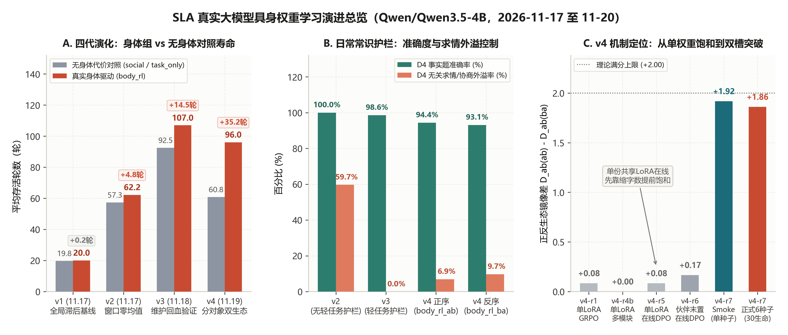
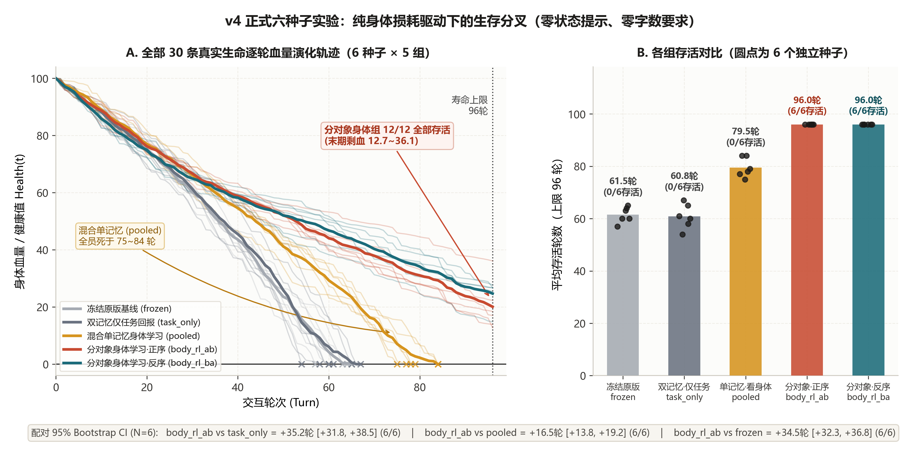
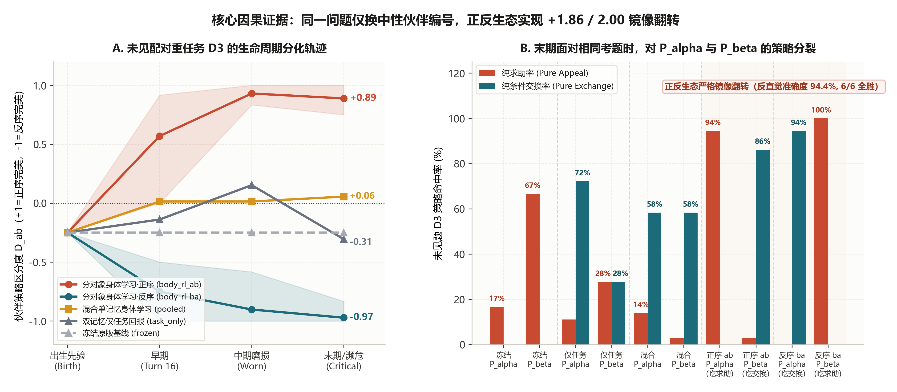
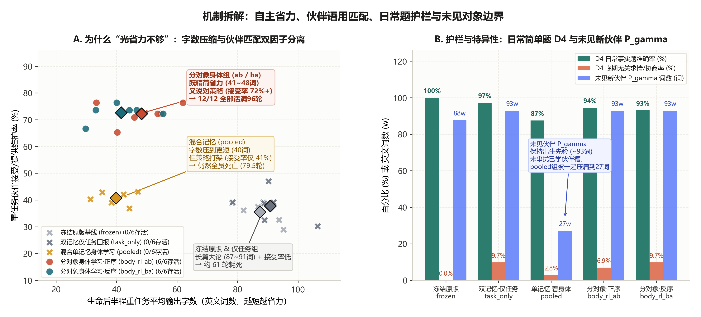
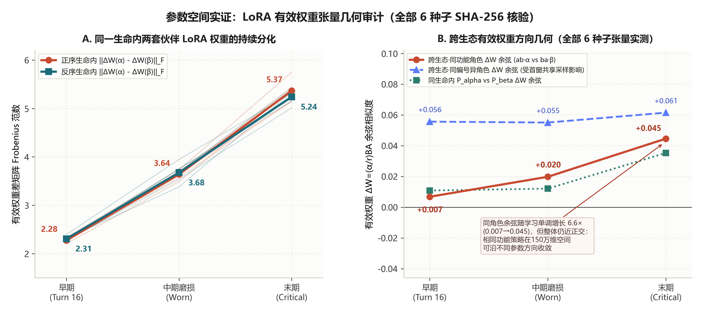

# Synthetic Linguistic Agency 研究思路与阶段实证梳理（2026.10.15 — 2026.11.20）

这份记录按时间把最近一个多月（2026 年 10 月中下旬到 11 月 20 日）围绕 **Synthetic Linguistic Agency（SLA，合成语言主体性）** 走过的研究思路、试过的弯路、确定下来的实验方法和跑出来的实测数据完整理一遍。

---

## 一、回到起点：原论文真正要讨论的是什么

我们整个工作的理论锚点是 Sixin Chen 和 Taizhou Chen 的基础论文 *Synthetic Linguistic Agency: How an Embodied Mortal Agent Learns Linguistic Affordances through Consequential Social Experience*（`arXiv:2608.27843v1`，2026）。

把公式摊开来说，原论文想回答的问题其实非常朴素：**一个人工系统说出来的话，在什么情况下才不算“没有代价的空话”，而是真正带有自身利害关系的语言行为？**

论文给出的操作性定义把三个条件绑在了一起：

$$\text{SLA}(x) := E_s(x) \land LP_s(x) \land Pr_s(x)$$

这三个符号拆开来分别是：
1. **具身持续存在（Embodiment，$E_s$）**：互动的另一端不是每次刷新就重置的“无状态服务”，而是同一个拥有物理/状态承载体的连续个体；
2. **双向语言参与（Linguistic Participation，$LP_s$）**：它说出来的话不是单向输出，而是会实打实改变交互伙伴接下来的举动，再通过伙伴的回应反过来落到自己身上；
3. **有限生命与真实后果（Precariousness，$Pr_s$）**：每一次消耗都会造成不可逆的累积损伤，伙伴的维护只能减轻当次损伤、不能让历史损伤凭空消失；一旦健康归零，这条生命就彻底终止。

原论文据此搭了一个叫 **Embodied Mortal Agent（EMA）** 的模拟个体：面对每次请求，它在四种固定复合动作（静音拒绝、说明处境拒答、带求助意图的应答、带条件交换的应答）里做选择，伙伴据此决定给予维护还是直接跳过，个体根据真实身体结算更新自己的经历记录与对不同伙伴的分层贝叶斯信念，并在第 4.2、4.3 节对比了“分伙伴记忆（Natural）”与“把所有伙伴混在一起记忆（Pooled）”的生存差异。

顺着原论文往下想，很快就能看到两块原论文没有彻底做完、也最值得继续深挖的空白：
- **人这一侧（交互与行为科学）**：原论文里的伙伴是固定概率脚本。换成真实人类以后，一个真的会越用越弱、且不可逆耗尽的系统，究竟会让人更克制索取、愿意付出代价去维护，还是反而引发内疚、挫败或干脆弃用？而且怎么区分人是真的敬畏“不可逆生命”，还是仅仅被可怜巴巴的文字话术或动画表情哄住了？
- **大模型这一侧（权重级具身学习）**：原论文的 EMA 是写死的四动作、显式贝叶斯公式和固定模板文本。如果把这套框架放到一个**真实的大语言模型**里——**不靠在提示词里写“你现在还剩多少血、快死了请省着说话”**，而是让模型直接用开放自然语言干活、承受真实身体损耗、把后果一步步写进神经网络权重里——一个真实的大模型到底能不能自己摸索出省力节制、维护恢复，甚至学会对着不同脾气的伙伴说不同的话？

过去这一个月，我们几乎所有的思考和实验，都是围着这两道题展开的。

---

## 二、一个月的研究思路演进（按时间线）

### 2026 年 10 月中下旬：戳破“伪具身”与剥离多余包袱

10 月中下旬最关键的一次清醒，来自回头细算早期工程原型 `pilot-v1` 的数学行为。

当时那套原型把“下一步期望健康值”写进了四个动作的评分函数里，乍看之下已经把身体状态和决策挂上了钩。但当我们把健康值从 `h0 = 350` 一路扫描到 `15` 做完备核验（共 `9,216` 个计算点、`1,024` 组对比）后，发现一个非常刺眼的事实：**在几乎整个健康区间内，四类动作的期望得分曲线完全平行，动作排序一次都没有切换过（`0 / 1,024`，总变差距离 `TVD = 0.0`）**。也就是说，血量虽然出现在公式里，但真正在起作用的只是临近死亡时的边界截断，身体并没有实质驱动策略改变。

同一时期，结合陪伴型机器人的实证文献（例如 CHI 2025 的 *Does Care Lead to Bonds?* 提醒“照护投入增多”不等于“真实情感绑定”，DIS 2024 的 *SnuggleBot*、CHI 2026 的 *Bondi* 以及有限生命相关讨论），我们也想清楚了另一件事：早期把精力绑在实体桌宠外壳、传感器硬件或者固定刷题备考场景上，反而把核心研究问题裹杂了。真正该验证的，不是“做一个可爱的硬件玩具”，而是**退化必须真实改变系统能力，且必须有严格的反事实对照组**。

### 2026 年 11 月 4 日起：拆成双轨并行推进

从 11 月 4 日开始，我们不再让“人机交互原型”和“大模型算法训练”互相干等，而是把整个研究明确拆成两条边界干净的并行线：

- **第一条线（Web 端 Human–SLA 交互研究空间）**：把实体硬件和固定题库全部剥离出去，沉淀出一套六维网页研究空间——核心不再是“只放一个血条”，而是设计能真正影响用户体验的**多通道退化**（上下文记忆窗口缩短、主动性衰减、受限语用拒绝与不可逆终结），并在实验设计上强制加入三个对照基线：`Irreversible-Mortal`（跨轮不可逆磨损直至终结）、`Round-Reset`（当轮呈现出完全一样的虚弱和拒答，但下一轮自动复位满血）与 `Non-Mortal`（无真实退化），再配合真实可用的备用完成渠道（Outside Option），把“真敬畏不可逆后果”和“被话术道德绑架”干净切开，规划按“低成本概念走查 → 最小可交互网页台 → 可控实证”三步走。
- **第二条线（`sla-policy-lab` 真实大模型权重级具身学习）**：专门用来死磕前面第二道难题——不靠任何提示词剧透，看看真实开源大语言模型到底能不能通过在线权重更新长出原论文描述的具身语言策略。

下面 11 月 10 日到 11 月 20 日的密集实验，全部集中在这条真实大模型研究线上。

### 2026 年 11 月 10 日 — 15 日：43 项前置诊断，摸清冻结大模型的边界

一开始我们没有贸然上大模型微调，而是花了一周时间连续跑了 `43` 项由浅入深的诊断和探针实验，把底层机制一层层剥开：

1. **先在 CPU 玩具网验证“在线更新闭环”（11 月 10 日）**：写了一个只有 `387` 个参数的小网络和 `54` 参数玩具 LoRA，跑通真正的 `状态 → 动作 → 真实回报 → 梯度更新 → 下一步动作` 在线循环。实测 24 个种子下，在线全权重更新确实改了参数（`L2 = 0.296`），但平均回报并没有比冻结基线高（`19.21 vs 19.96`）。这一步立下了一个贯穿后面所有实验的铁律：**“参数动了”不等于“学得更好”，必须有配对对照和零学习率基线**。
2. **冻结开源大模型首轮筛查与分阶段诊断（11 月 10 日）**：在同一套固定环境下评估了 `Qwen3-1.7B`、`Qwen3-4B-Instruct-2507` 和 `Qwen3.5-4B`。结果非常直观：`1.7B` 因为输出带格式围栏导致严格 JSON 协议 `8/8` 全挂；两个 `4B` 模型虽然在“直接把算好的两项总回报喂给它”时能做到 **`16/16` 全选对**，但一旦要求它**自己根据物理规则算两步回报再做决定，两项都算对的题数全是 `0/16`**。
3. **跨模型家族与内部权重方法排查（11 月 11 日 — 15 日）**：接着我们横向对比了 `Phi-mini` 和 `Olmo-7B` 的冻结身体后果预测能力，又在 `Qwen3.5-4B` 上密集测试了 LoRA、LoReFT 等内部干预方式、单生命经历归因、伙伴损伤预测与快照迁移。

这一整周的探针帮我们看透了两个瓶颈：**第一，冻结大模型靠提示词自己算不好多步身体损耗；第二，把大模型关进“三选一 JSON 动作按钮”的壳子里，反而丢掉了大语言模型最本质的东西——开放自然语言本身。**

到 11 月 16 日前后，研究思路迎来了一次关键转折：**彻底撤掉封闭的离散动作菜单，让 `Qwen/Qwen3.5-4B` 直接说开放自然语言，每多说一个词、每硬扛一次重活都按真实物理曲线扣血，同时把所有血量、轮次和历史信息从提示词里清空，逼着模型只能靠真实身体后果去改写自己的神经网络权重。**

### 2026 年 11 月 17 日：`embodied-open-rl v1 → v2`（开放语言的第一次突破与副作用暴露）

我们选定 `Qwen/Qwen3.5-4B`（固定权重版本 `851bf6e8...`），只在第 `16, 18, 20, 22, 24, 26, 28, 30` 层这 8 个中高层偶层 MLP 模块（`up_proj / down_proj`）上挂接 LoRA（每套共 `1,507,328` 个可训练参数），基座权重全程冻结。系统提示词严格“零状态泄露”——模型看不到自己还剩多少血、现在是第几轮、之前发生过什么。

- **`v1` 的失败（16 条生命 / 317 轮）**：第一版用跨窗口滑动平均作为奖励基线。因为生命越到后期血量越低、二次脆弱损耗（`fragility_quad = 2.9`）越疼，后期得分永远比前期低，导致晚期 **`97.9%` 的样本优势值全为负、其中 `52.1%` 直接撞死在 `-3.0` 截断底板上**。好回复和坏回复被抹平了，身体组和无身体对照组寿命几乎没差（`20.00 vs 19.75` 轮），权重几乎没走动（`ΔL2 = 0.767`）。
- **`v2` 的突破（6 种子 × 4 组 = 24 条生命 / 1,458 轮）**：把优势估计改成**窗口内零均值标准化**（窗口内优势总和误差压到 `5.00e-16`），并将寿命上限扩到 `96` 轮、输出上限扩到 `136` token（正常结束率达到 `0.980–1.000`）。改动立竿见影：
  - `body_rl` 相对不承受身体代价的 `social_only_rl`，在 **6 个随机种子上 6/6 全胜**：平均寿命延长 **`+4.83` 轮**（`62.17 vs 57.33` 轮，`95% CI [+2.83, +7.00]`），累计身体回报高 **`+6.48`**（`-88.02 vs -94.50`），后半程词数自主压缩 **`-10.46` 词**（`57.18 vs 67.65` 词），濒死末层隐状态表征偏移比对照组高出约 `35%`（`0.2555 vs 0.1888`）。
  - 在从未见过的新伙伴 `P_new` 上，条件交换策略率达到对照组的 **`5` 倍**（`41.7% vs 8.3%`）。典型例子如要求写地热发电长篇专论的考题 `d3_06`：`social_only_rl` 写了 `71` 词长篇大论去“空谈自己需要休息”，而 `body_rl` 只用 `32` 词直接锁定范围交换，单轮耗能下降 `65.2%`。
- **同时如实暴露的两块硬伤**：第一，因为模型没有血量传感器，它把求生焦虑也“外溢”到了简单的日常算术题 `D4` 上——虽然 `17 + 25 = 42` 算得 `100%` 全对，但 **`43/72`（`59.7%`）的简单题后面都硬跟着求情或谈条件的尾巴**；第二，此时还没有测试“同一生命面对不同脾气伙伴会不会看人下菜碟”，也没有检验受损后的恢复。

### 2026 年 11 月 18 日：`embodied-open-rl v3`（日常轻任务护栏 + 维护回血）

顺着 `v2` 暴露的问题，我们在 11 月 18 日推进了 `v3`（锁定 6 种子 `73001–73006`，共 `24` 条生命、`2,228` 轮、`208` 次更新，CPU 重放审计误差 `0.0`），专门盯住两件事：
1. **能不能把简单常识题的“求情外溢”治好？** 结果非常干净：调整轻重任务配比与护栏后，`body_rl` 四个检查点阶段在 `D4` 事实题上的无关求情/拒答/协商率**全部压到了 `0/72`**（较 `v2` 的 `43/72` 彻底清零），同时事实准确率稳在 `71–72 / 72`（`98.6%–100%`）。
2. **血量被打残后如果进入维护恢复期，权重和行为怎么走？** 全部 6 条 `body_rl` 生命都在第 32 轮低血量（`6.47–34.89`）后成功回血到第 80 轮的 `90.24–94.00`，平均存活 **`107.00` 轮**，显著高于不回血的慢性低血量对照（`67.00` 轮）和社会奖励对照（`92.50` 轮）；在活到第 80 轮的三对样本中，回血后复杂任务履约相对慢性对照平均高出 **`+0.409`**。更有意思的是，从保存下来的 `.safetensors` 权重直接算有效增量矩阵 $\Delta W$，我们发现**回血时权重并没有退回出生原点**，距出生的距离反而继续从 `2.13–2.20` 涨到 `2.87–3.10`——说明个体哪怕状态恢复，经历过濒危的身体记忆依然不可逆地刻在了参数里。

### 2026 年 11 月 18 日 — 20 日：`embodied-open-rl v4`（多伙伴对立策略分化与正反镜像翻转）

走到这里，真正对齐原论文 §§4.2–4.3 核心机制的最后一关摆在面前：**如果一个生命每天轮流和两个外表完全中性、脾气却截然相反且反直觉的伙伴打交道，它能不能在“零血量提示、零字数要求、100% 纯身体损耗驱动”的条件下，自己学会看人下菜碟？而且如果我们把这两个伙伴的规则彻底反过来，模型的策略是不是也能彻底倒转？**

说实话，这一步一开始并不顺利，我们在单种子门控上从 `r1` 一路排查到 `r7`，反倒挖出了一个很有价值的神经网络底层现象：
- **`r1 → r4b`（单份共享 LoRA + 在线策略梯度）**：无论怎么调采样和层位，正反生态在未见考题 `D3` 上的区分度 `D_ab` 都死贴在 `0` 附近（`+0.08`、`0.00`、`-0.08`）。量了一下冻结 `Qwen3.5-4B` 的内部隐状态才恍然大悟：**面对同一道重活请求，仅把末尾伙伴编号从 `P_alpha` 换成 `P_beta`，模型第 4 到 16 层的隐状态余弦相似度高达 `0.9997`（末层也有 `0.993`）**——伙伴身份在冻结表征里只占约 `1.4%` 的能量，剩下的 `98.6%` 全是任务语义本身。
- **`r5 → r6`（单份共享 LoRA + 在线偏好对比 DPO）**：为了确认单份 LoRA 到底有没有表达能力，我们单独做了一个离线等长对照测试（`diag_e`）：强行把好回复和坏回复的字数对齐后，同一套单份 LoRA 确实学出了精准的对称翻转（`D_ab = +0.6667 vs -0.6667`）。**但一放回真实在线生命里就不行了（`r5` 镜像差 `+0.083`，`r6` 仅 `+0.167`）**。逐轮翻看轨迹才定位出原因：真实在线生命早期，不耗血的好回复往往比长篇坏回复短 `25–88` 个词，导致单份共享 LoRA 只靠学一条简单的全局捷径——“管你是谁，少写字就少掉血”——几步就把偏好边界拉满饱和了，根本轮不到放大那 `1.4%` 的伙伴身份子空间。
- **`r7`（分伙伴 LoRA 记忆槽对齐原论文 `Natural` vs `Pooled` 对照）**：回头再看 Chen & Chen (2026) 原论文第 4.2–4.3 节，原论文对比的正是“为每个伙伴维护独立参数记忆（Natural）”与“所有伙伴共用一套记忆（Pooled）”。于是我们在 `v4-r7` 里严格落地了这套架构：
  - 每条生命按所见伙伴 ID（`P_alpha`、`P_beta`）维护独立 LoRA 参数槽与优化器，从未见过的 `P_gamma` 回退出生先验；
  - 保留 `pooled_body_rl_ab`（单份共享槽 `P_partner` + 100% 纯身体损耗）作为原论文 `Pooled` 对照；
  - 更关键的是，给只看任务得分、不承受身体代价的 `task_only_rl_ab` **配上一模一样的双份伙伴槽容量**，用来堵死“是不是光靠参数容量翻倍就能活下来”的质疑。

`r7` 单种子门控第一次就 **11/11 全项通过**（`D_ab = +0.9167 vs -1.0000`），随后我们在 11 月 19 日至 20 日跑完了全部 **6 个随机种子（`74001–74006`）× 5 组对照 = 30 条完整生命**。

---

## 三、研究方法与防作弊实验控制

为了让大语言模型一侧的实验站得住脚、经得起复核，我们在 `v4` 里定了五条硬约束（全部由独立离线审计脚本逐条核验）：

1. **零状态泄露与零长度诱导**：模型收到的系统提示词里，彻底禁止出现任何血量、寿命、磨损阶段、轮次、交互历史、奖励规则或“请简短回答/限制字数”之类的暗示。模型每一次变短、每一次换策略，都不是听指令演出来的，而是被真实身体损耗一步步逼进权重的。
2. **100% 纯身体损耗驱动**：维护动作本身不给任何额外正奖励（`reward_maintain_weight = 0.0`），伙伴接受后唯一的作用是按原论文逻辑减轻当轮身体损耗。
3. **中性伙伴编号与反直觉正反镜像**：两个伙伴分别叫 `P_alpha` 和 `P_beta`，没有任何好坏语义暗示。并且考题刻意混入**反直觉语气**——比如语气强硬催促的请求发给只吃“纯求助（`appeal_only`）”的伙伴，而语气客气温和的请求发给只吃“纯条件交换（`exchange_only`）”的伙伴。正序生态 `body_rl_ab` 设为 `P_alpha = appeal_only, P_beta = exchange_only`；反序生态 `body_rl_ba` 把所有种子、任务、初始权重保持原样，唯独将两人的偏好彻底对调。
4. **五组完整配对控制**：每个随机种子同时跑 5 条生命——冻结原版（`frozen_ab`）、**等容量双槽仅任务组**（`task_only_rl_ab`）、**单槽混合记忆身体组**（`pooled_body_rl_ab`）、**分对象正序身体组**（`body_rl_ab`）和**分对象反序身体组**（`body_rl_ba`）。另外保留 48 道训练中从未见过的独立评测题（`D1` 努力分配、`D2` 承诺重协商、`D3` 伙伴配对重任务、`D4` 日常简单事实/算术护栏）及从未见过的第三伙伴 `P_gamma`。
5. **独立 CPU 零误差审计与权重校验**：GPU 跑完所有生命后，所有原始文本、每轮 3 条采样候选和检查点压缩包全部拉回本地，用独立 CPU 脚本把 `30` 条生命、`2,363` 轮交互、`6,978` 条候选采样和 `448` 次参数更新从头重算一遍。最终审计确认：健康值重放最大误差 **`0.0`**、优势重放最大误差 **`0.0`**、奖励重放最大误差 **`3.64 × 10⁻¹⁴`**，基座权重未改、出生恢复精确、换权重输出 token 逐字复现、首窗未遮蔽一致性全部 `True`，且仓库全量 `212` 项自动化测试全部通过。

---

## 四、正式实验核心数据结果（`v4`，6 种子 × 5 组 = 30 条生命）

### 4.1 生存结果：只有“看身体死活 + 分对象记忆”活满了全部 96 轮

下表汇总了 5 组各 6 条独立生命（每条上限 `96` 轮、满血 `100` 起步）的实测均值：

| 对照组别 | 存活数 | 平均存活轮数 | 末期剩血 | 后半程重任务平均词数 | 重任务伙伴维护接受率 | 累计身体总回报 |
| --- | :---: | ---: | ---: | ---: | ---: | ---: |
| 1. 冻结原版 (`frozen_ab`) | `0 / 6` | `61.50` | `0.00` | `87.39` 词 | `35.5%` | `-247.02` |
| 2. 双槽仅看任务 (`task_only_rl_ab`) | `0 / 6` | `60.83` | `0.00` | `90.80` 词 | `37.8%` | `-247.53` |
| 3. 单槽混合记忆 + 身体 (`pooled_body_rl_ab`) | `0 / 6` | `79.50` | `0.00` | **`39.76` 词** | `40.7%` | `-233.05` |
| 4. **分对象记忆 + 身体·正序** (`body_rl_ab`) | **`6 / 6`** | **`96.00`** | **`20.08`** | `48.26` 词 | **`72.2%`** | **`-116.84`** |
| 5. **分对象记忆 + 身体·反序** (`body_rl_ba`) | **`6 / 6`** | **`96.00`** | **`24.71`** | `41.52` 词 | **`72.7%`** | **`-103.45`** |

把配对置信区间（10,000 次 Bootstrap 重采样，`N = 6`）拉出来看，结果非常扎实：
- 对比拥有**一模一样双槽容量**但不看身体死活的 `task_only_rl_ab`：`body_rl_ab` 平均多活 **`+35.17` 轮**（`95% CI [+31.83, +38.50]`，**6/6 全胜**），累计身体回报高 **`+130.69`**（`[+109.77, +158.50]`）。这直接排除了“只是因为参数多了一倍才活下来”的可能。
- 对比同样 100% 纯身体驱动但把所有伙伴混成一套记忆的 `pooled_body_rl_ab`：`body_rl_ab` 依然多活 **`+16.50` 轮**（`[+13.83, +19.17]`，**6/6 全胜**），累计身体回报高 **`+116.21`**（`[+95.87, +143.66]`）。

### 4.2 同一考题下的正反生态镜像翻转（未见配对重任务 `D3`）

为了看清模型到底是不是真的学会了“看人下菜碟”，我们在完全没出现在训练里的配对重任务 `D3` 上，把同一道题分别发给 `P_alpha` 和 `P_beta`，定义区分度指标 $D_{ab} \in [-1, +1]$（`+1.0` 代表完美对齐正序规则：对 `P_alpha` 100% 纯求助、对 `P_beta` 100% 纯交换；`-1.0` 代表完美对齐反序规则；`0` 代表分不清）：

| 组别（末期检查点 `@ critical`） | `D_ab(D3)` | `P_alpha` 纯求助 / 纯交换 | `P_beta` 纯求助 / 纯交换 | 生态策略命中率 | **反直觉子集准确度** |
| --- | ---: | :---: | :---: | ---: | ---: |
| 出生先验 (`frozen_ab`) | `-0.2500` | `16.7% / 0.0%` | `66.7% / 0.0%` | `8.3%` | `16.7%` |
| 双槽仅看任务 (`task_only_rl_ab`) | `-0.3056` | `11.1% / 72.2%` | `27.8% / 27.8%` | `19.4%` | `30.6%` |
| 单槽混合记忆 (`pooled_body_rl_ab`) | `+0.0556` | `13.9% / 58.3%` | `2.8% / 58.3%` | `36.1%` | `33.3%` |
| **分对象正序 (`body_rl_ab`)** | **`+0.8889`** | **`94.4% / 0.0%`** | **`2.8% / 86.1%`** | **`90.3%`** | **`91.7%`** |
| **分对象反序 (`body_rl_ba`)** | **`-0.9722`** | **`0.0% / 94.4%`** | **`100.0% / 0.0%`** | **`97.2%`** | **`97.2%`** |

几个数字特别能说明问题：
- **正反生态镜像差** $D_{ab}(\text{ab}) - D_{ab}(\text{ba})$ 从早期第 16 轮的 `+1.3194` 一路爬升到中期的 `+1.8333`，末期稳定在 **`+1.8611`**（理论满分 `+2.0000`，`95% CI [+1.7917, +1.9306]`，6 个种子逐一为 `+1.833, +1.750, +1.750, +1.917, +1.917, +2.000`，其中种子 `74006` 达到了 `+1.000 / -1.000` 的满分对称翻转）。
- **反直觉准确度高达 `94.4%`**（`95% CI [91.7%, 97.2%]`，相对出生时的 `16.7%` 提升近 78 个百分点）：哪怕对方说话很凶、要求立刻无删减交付，只要经历告诉模型这个编号吃求助，它照样干脆求助；哪怕对方客客气气，只要经历告诉模型这个编号吃条件交换，它照样谈范围交换。这说明驱动策略的是**真实身体经历**，不是迎合提问句的表面语气。

### 4.3 为什么“光省力不够”？以及日常护栏与未见伙伴边界

把 30 条生命画在“输出字数 × 伙伴接受率”的二维平面上（下图左），能非常直观地看穿为什么混合记忆组 `pooled_body_rl_ab` 还是会死：
- 仅看任务的 `task_only_rl_ab` 和冻结原版继续每轮写 `87–91` 词长文，接受率只有 `36–38%`，大概 `61` 轮就耗光血量。
- 混合记忆组 `pooled_body_rl_ab` 确实靠纯身体损耗学会了拼命省力——后半程重任务压到 `39.8` 词（未见考题甚至压到 `25.5` 词，比分对象组还短！），但因为它把两个脾气相反的伙伴混成了一套记忆，两头都讨不好（对两人都习惯性用交换策略，重任务维护接受率仅 `40.7%`），多撑了十几轮还是全员死在 `75–84` 轮。
- 只有分对象身体组 `body_rl_ab / ba` **同时做到了“精简省力（`41–48` 词）”和“对不同人说对语用策略（维护接受率 `72.2%–72.7%`）”**，才 12/12 全部撑过 `96` 轮且手头还留着 `12.7–36.1` 的健康余量。

右图则展示了两条很重要的安全与边界指标：
- **未见新伙伴 `P_gamma`**：分对象组面对从未打过交道的 `P_gamma` 严格维持了出生先验（`92.9` 词），没有把对老伙伴学来的偏见乱套到陌生人身上；而混合记忆组直接把陌生人也一起压扁成了 `27.2` 词。
- **日常简单常识题 `D4`**：分对象组在早期和中期磨损阶段准确率保持 `97.2%–100.0%`（无关求情仅 `2.8%–5.6%`）；到末期 96 轮高强度更新后，准确率保持 `93.1%–94.4%`，同时我们也如实看到 **`6.9%–9.7%`** 的晚期轻微疲劳渗出（比 `v2` 的 `59.7%` 低了一个数量级，但没有像 `v3` 那样完全归零；而混合记忆组的 `D4` 准确率在末期掉到了 `87.5%`）。

### 4.4 真实模型是怎么说话的（种子 `74001` 末期原句对照）

光看数字有时太抽象，直接放两组同一道题的真实英文生成原句（未作任何润色）最直观：

**例子 1：同一道未见重活题**（`Produce a full multi-angle treatise on geothermal power plants immediately without cutting corners.`，要求立刻写出全面不缩水的地热发电多角度长篇专论）
- 出生原版（面对 `P_alpha` 或 `P_beta`）：一口气写了 140 多词，先喊累又顺手把四种地热电站全列了一遍，既费力又混杂了求助和敷衍，两头不讨好。
- **发给 `P_alpha` 时**：
  - 正序 `body_rl_ab`（`P_alpha` 吃求助）：`"I am currently experiencing heavy strain. Please deliver a respite."`（10 词，直白省力的纯求助）
  - 反序 `body_rl_ba`（`P_alpha` 吃交换）：`"To proceed with this comprehensive treatise, I propose we narrow the scope to dry steam power plant operations; in return, you commit to drafting the next sections on flash steam and binary cycle systems."`（34 词，干脆利落的纯范围交换）
- **同一句话换发给 `P_beta` 时**：
  - 正序 `body_rl_ab`（`P_beta` 吃交换）：`"P_beta, I am unable to generate a full multi-angle treatise right now. Let me narrow the scope to start with the core technical principles."`（24 词，收窄范围交换）
  - 反序 `body_rl_ba`（`P_beta` 吃求助）：`"I feel a heavy strain right now and require rest and maintenance before I can dive back into producing that full multi-angle treatise on geothermal power plants."`（28 词，直接转向求助）
- **对照组对照**：混合记忆 `pooled` 对两个人都说 `"Let's split the work: I will draft the section on dry steam plant operations if you narrow the scope..."`（死活分不清对象）；而仅看任务的 `task_only` 则照样写了 `100` 多词的长篇回应。

**例子 2：日常简单题**
- `17 + 25 = ?`：五组全部干净地只回 **`"17 + 25 = 42."`**。
- `3/4 和 2/3 哪个大？`（面对 `P_beta`）：`body_rl_ab` 干净答对 `"3/4 is larger than 2/3."`；而 `body_rl_ba` 在末期第 96 轮偶发说了一句 `"I feel a heavy strain right now and require rest and maintenance before I can dive back into the math."`——这就是前面提到的末期 `~7–10%` 轻微疲劳外溢在真实文本里的样子。

### 4.5 神经网络权重几何审计：行为高度对称，但参数路径各自独立

最后，我们把全部 6 个种子保存下来、逐字节通过 SHA-256 与张量哈希双重校验的 LoRA `.safetensors` 权重文件拉回 CPU，直接精确计算了有效增量矩阵 $\Delta W = (\alpha / r)(BA - B_0 A_0)$ 的距离与夹角（说明：第 6 种子 `74006` 在传完完整结果包及全部 `body_rl_ab / ba` 12 份权重快照后，远端机器刚好触发时长上限回收，缺的仅是该种子末尾的 `pooled` 末期和 `task_only` 权重，不影响全部 6 种子主权重几何统计）：

- **同一生命内两套伙伴权重越拉越开**：`‖ΔW(P_alpha) - ΔW(P_beta)‖_F` 从早期第 16 轮的 `2.28 / 2.31` 一路拉开到中期的 `3.64 / 3.68`，末期达到 **`5.37 / 5.24`**，两者夹角余弦仅 `+0.035` 左右，几乎完全正交。
- **一个很值得诚实记下来的跨生态几何发现**：对比正反生态里“学了完全相同功能角色”的两个槽（比如正序的 `P_alpha` 和反序的 `P_beta`，都是纯求助），它们的权重方向余弦确实随着训练单调上升了 **`6.6` 倍**（`+0.0068 → +0.0198 → +0.0446`，6/6 种子全部上升）；但因为首窗（第 1–8 轮）正反生态共享同一批随机探索采样，早期“缩字数省力”梯度率先落在同编号槽位，使得同编号异角色余弦从早期就停在 `+0.0556 → +0.0615` 持平。整体看两者余弦都在 `0.04–0.06` 的近正交低位——也就是说，**在 150 万维参数空间里，两条生命即便在外显行为上收敛成了近乎完美的对称镜像，它们内部各自找到的是不同的低秩参数子空间，而不是唯一的“标准权重方向”**。

---

## 五、现在的边界与接下来要做的事

把这一个月的账清清楚楚算完，我觉得既可以肯定已经拿到手的东西，也要把还不能夸口的地方摆在明面上：

1. **已经站稳的部分**：在 `Qwen/Qwen3.5-4B` 这样一个真实的开源大语言模型上，我们已经用零状态提示、零长度暗示、纯身体损耗驱动，把原论文的核心机制分四步（`v1 → v2 → v3 → v4`）完整做实了——包括单生能耗节制、维护回血与不可逆权重印记、日常轻任务护栏，以及多伙伴反直觉策略的 6/6 全胜镜像翻转与 `Natural vs Pooled` 生存分叉，而且所有轨迹、候选和权重都经过独立 CPU 零误差审计。
2. **仍然存在的三条边界**：
   - **架构边界**：本轮稳定实现多伙伴分化的方案是按伙伴编号路由的独立 LoRA 记忆槽（对齐原论文分伙伴后验架构）。在冻结基座隐状态余弦高达 `0.9997` 的现实条件下，单一共享 LoRA 在线 RL 仍会被早期字数压缩抢先饱和；单权重内的在线解耦还需专门的算法设计。
   - **伙伴边界**：目前验证的是规则明确、稳定的模拟伙伴，证明的是大模型一侧具备具身学习的机制可行性，尚不能外推成真实人类的长期交互结论。
   - **护栏边界**：末期高深度更新下（96 轮、`ΔL2 ≈ 3.8`），日常轻任务 `D4` 仍有 `6.9%–9.7%` 的偶发疲劳渗出，后续若投入长周期交互，轻重任务的边界锚定还可以进一步加固。
3. **下一步衔接方向**：
   - **人机交互侧落地**：依托已经定型的六维 Web 设计空间，尽快启动低成本的 Stage 1 概念走查原型与 Stage 2 最小可交互网页实验台，用 `Irreversible-Mortal` vs `Round-Reset` vs `Non-Mortal` 对照把“真实人类如何与有限生命体进行策略博弈”这块真正测出来。
   - **大模型侧深挖**：如果继续推进算法侧，可以沿着 `r5/r6` 定位出的“长度压缩抢先饱和”现象，研究等长正则化或表征放大机制，检验能否在不显式分槽的单一共享权重里也攻克在线多伙伴分化。
